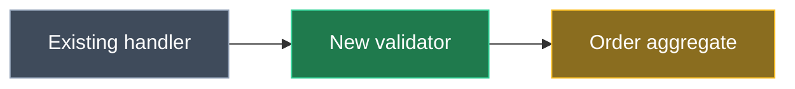

# Structural blocks: `<Callout>`, `<Diagram>`, `<FileTree>`, tables, `<Checklist>`, `<QuestionForm>`

Props and examples for the blocks that structure a document's argument. The general MDX rules in `SKILL.md` (escaping, validation, stable `id`s) apply to every block here.

## `<Callout>`

A tinted, bordered aside for a decision, risk, or warning called out from the surrounding prose.

```mdx
<Callout id="compat" tone="warning" title="Optional heading">

Body text — regular Markdown, rendered inline.

</Callout>
```

- `tone`: `info` | `decision` | `risk` | `warning` | `success` (default `info`).
- `title`: optional short heading.
- **Every edge case you considered and every tradeoff you accepted goes in a `tone="warning"` Callout.** A case the change does not handle, a limit it inherits, a simpler option taken knowing what it costs — each gets its own warning box, not a parenthetical mid-paragraph and not silence because you judged it acceptable. This is the content a reviewer most needs to be able to disagree with, and the content prose hides best: inside a paragraph it reads as detail and gets skimmed; in a warning box it reads as a decision and gets challenged. Omitting it entirely is the worst option — the reader then assumes you never thought of it.
- State each one as the case plus what happens in it plus why that is acceptable — "Two agents editing the same package concurrently: last write wins. Accepted because the designer already reloads on external change." Put it beside the part of the design it constrains rather than sweeping every caveat into a section at the end, and keep one Callout per tradeoff so each can be argued with separately. Don't manufacture them: a change with no real edge cases needs no warning box.
- Tones are not interchangeable. `warning` is for a case or cost you have already accepted; `risk` for something that might go wrong and is still open; `decision` for the choice itself, with the alternatives; `info` for context; `success` for what is now proven.

## `<Diagram>`

An architecture/flow/before-after diagram authored as plain HTML + CSS (not an image). Two equivalent forms — the `data={{ html, css }}` prop, or fenced `` ```html ``/`` ```css `` code blocks as children:

```mdx
<Diagram
  id="flow"
  caption="Optional caption under the diagram"
  data={{
    html: `<div class="wrap">
  <div class="diagram-panel">
    <div class="diagram-node">Step one</div>
    <div class="diagram-arrow">&#8595;</div>
    <div class="diagram-node">Step two</div>
  </div>
</div>`,
    css: `
.wrap { display: flex; gap: 16px; }
.diagram-panel { display: flex; flex-direction: column; align-items: center; gap: 6px; padding: 12px; }
`,
  }}
/>
```

- Prefer the `data` prop for anything non-trivial: the HTML is one string, so there is no ambiguity about what the renderer picks up, and a raw `<` inside it is safe. Its one cost is that a literal backtick or `${` inside the markup must be escaped, since it is a template literal.
- Use the `.diagram-panel`/`.diagram-node`/`.diagram-card`/`.diagram-box`/`.diagram-pill`/`.diagram-badge`/ `.diagram-accent`/`.diagram-mono`/`.diagram-muted` class-name conventions for structural elements — the renderer forces consistent color/border/typography onto these regardless of your CSS, so the diagram stays legible without you having to theme it by hand. Layout (flex/grid direction, gaps, sizing) is entirely up to your CSS.
- Use two-dimensional layouts (side-by-side panels, layers, quadrants) for anything that isn't genuinely a straight-line sequence.
- The CSS you provide is automatically scoped to this one diagram — it never leaks to the rest of the page or other diagrams, so ordinary class names (`.node`, `.panel`) are safe to reuse across diagrams.
- For standard architecture shapes — flowchart, sequence, ER/class, state — a plain `` ```mermaid `` fence is usually faster to author (see **Mermaid fences** in `SKILL.md`). Reach for `<Diagram>` when you need bespoke layout the mermaid diagram types don't give you.

### Colouring a mermaid fence

`classDef` plus `:::name` is the whole recipe, and a one-line key in the caption saves the reader guessing what the colours mean:



The fence renders on mermaid's `default` theme in light mode and its `dark` theme in dark mode, so **always set `color:` alongside `fill:`** — a fill with no explicit text colour inherits the theme's and goes unreadable in one of the two. Fills dark enough for white text work in both. Subgraphs take `style <name> fill:…,stroke:…` the same way. Keep it to a handful of categories; a rainbow of one-off node colours reads as decoration and gets ignored.

## `<FileTree>`

A compact list of files touched, with change badges.

```mdx
<FileTree
  id="files"
  title="Optional heading"
  entries={[
    { path: "src/foo/Bar.ts", change: "modified", note: "One-line reason this file changed" },
    { path: "src/foo/Baz.ts", change: "added" },
  ]}
/>
```

- `change`: `added` | `modified` | `removed` (or `deleted`) | `renamed`.
- `note`: optional short reason, shown beside the path.
- `snippet`: optional short code excerpt shown under the row — only include when it tells the reader something the path/note doesn't.
- Every row is clickable: a row with a `change` badge opens that file's diff, a row without one opens the file. So paths must be real and correctly spelled — a made-up path renders as a dead row.
- Write each `path` **relative to the repository root**, exactly as for `<FileRef>` (`references/linked-blocks.md`). A badged row keeps its badge colour rather than turning red, so a wrong path here is invisible until someone clicks it — which is why the write-time check reports one that resolves nowhere. Only the rows whose file is MEANT to be missing — `added`, `removed`, `deleted` — are exempt; a `modified` or `renamed` row is checked.

## Tables: always a markdown pipe table

**Write every table as a GFM pipe table**, in `.mdx` as in `.md`. It reads as a table in the raw source and on GitHub, and an edit to one row diffs as that row. `<Table>` is deprecated: it still renders in older documents, but every one in a write is reported as a warning.

```markdown
| Option   | Tradeoff                          |
| -------- | --------------------------------- |
| Option A | Simple, but doesn't scale past X  |
| Option B | More moving parts, handles X      |

_Table 2.1 — the options considered._
```

- Put a caption, if you want one, as an italic line directly under the table. A `Table N.N` caption is linked wherever it is cited in prose.
- Cells render **inline** markdown — backticks, `**bold**`, `*italic*` and `[links](…)` all work. Block syntax (headings, lists, fences) does not; keep a cell to one line. In `.mdx`, `<FileRef path="…" label="…" />` and `<ModelRef … />` in a cell render as live chips.
- **Escape every `|` inside a cell as `\|`**, including inside backticks and in `[[target\|label]]` links; an unescaped one splits the cell. A `|` can't go inside a JSX prop in a cell at all (unescaped, it fails the whole document; escaped, the backslash shows), so keep pipes out of a chip's `label` there.
- **Editing a document that already has `<Table>` blocks:** convert the ones in the part you are changing to pipe tables, and leave the rest. Their remaining warnings are expected.

## `<Checklist>` (interactive checkboxes, strike-through when checked)

```mdx
<Checklist
  id="verify"
  items={[
    { id: "a", label: "Build passes", checked: true },
    { id: "b", label: "Manually verified the happy path", note: "Optional detail line" },
  ]}
/>
```

- `label` and `note` render inline markdown, same as a table cell.
- Check state PERSISTS across closing and re-opening the document (stored in a sidecar beside it, never written back into the document itself) — so a verification list can genuinely be worked through over time rather than resetting on every open.
- This is NOT the spec task list. A spec's tasks live in `tasks.md` as real markdown checkboxes; see "Never author a spec's `tasks` artifact as MDX" in `SKILL.md`.

## `<QuestionForm>` (open questions the user answers, sent straight back to you)

Put this as the single block at the very bottom of the document for anything genuinely unresolved — do not scatter open questions through the body. A follow-up round after the user has answered should use a new `id` (e.g. `open-questions-2`).

```mdx
<QuestionForm
  id="open-questions"
  questions={[
    {
      id: "q1", title: "Which approach?", mode: "single",
      options: [
        { id: "a", label: "Option A", recommended: true, detail: "Why this is the default" },
        { id: "b", label: "Option B" },
      ],
    },
    { id: "q2", title: "Anything else?", mode: "freeform" },
  ]}
/>
```

- `mode`: `single` (radio) | `multi` (checkboxes) | `freeform` (textarea).
- Mark the recommended default with `recommended: true` on that option rather than leaving the reader to guess.
- The reader answers in the viewer and hits "Send answers to the agent", which posts them back into this conversation as a normal turn — so you DO receive them, and must not ask the user to copy-paste anything. (A copy-to-clipboard button remains for a document opened outside a conversation.) The answered state persists, so a re-opened document shows what was already sent.
