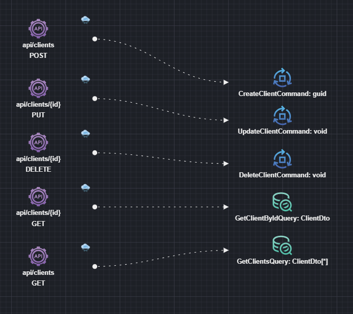

# Intent.ApiGateway.Ocelot

This module implements the Ocelot API Gateway in a ASP.NET Core application.

# What is Ocelot?

Ocelot is aimed at people using .NET running a microservices / service-oriented architecture that need a unified point of entry into their system. -[Website](https://ocelot.readthedocs.io/en/latest/introduction/bigpicture.html#big-picture)

# Modeling API Gateway Routes



The following steps are performed inside the Services designer:

- First you need to add a reference to a Services package containing all the downstream service endpoints.
  - Right-click on the Service package and select `Add Package Reference`.
  - Locate the Service package from another Intent Architect application that will act as the downstream service.
  - Click on DONE.
- Add downstream endpoints:
  - Right-click on the diagram background and select `Add to diagram`.
  - Select the downstream endpoints you would like to connect to. They would be in the form of `Command`/`Query`/`Service` endpoints.
  - Click on DONE.
- Add Api Gateway routes:
  - Right-click on the diagram background and add a new `Api Gateway Route` element.
  - Right-click on it and select `New Route Association`.
  - Select a downstream endpoint to connect to and click to snap it into place.

# Inspect the `ocelot.json` file

The routes will be generated inside the `ocelot.json` file:

```json
{
  "Routes": [
  {
      "Key": "CreateClientCommandGatewayRoute",
      "UpstreamPathTemplate": "/api/clients",
      "UpstreamHttpMethod": [
          "Post"
      ],
      "DownstreamPathTemplate": "/api/clients",
      "DownstreamHttpMethod": "POST",
      "DownstreamHostAndPorts": [
        {
           "Host": "{Clients.Host.Name}"
        }
      ]
  },
  // ...
```

Each route's `Key` is the name of its API Gateway Route, so you can refer to it from an Ocelot aggregate's `RouteKeys`. Route names must be unique.

# Security

Gateway routes are **secured by default**. The gateway is usually the only way into the downstream services, so every route needs a bearer token unless the model says otherwise. This applies whatever the application's Default API Security setting is.

When any route is secured, `ocelot.json` gets one global authentication setting:

```json
"GlobalConfiguration": {
  "AuthenticationOptions": {
    "AuthenticationProviderKeys": [ "Bearer" ]
  }
}
```

The gateway application must register an authentication scheme named `Bearer`, for example with `Intent.Security.JWT` or your own authentication setup. Without one, Ocelot refuses to start and reports `AuthenticationProviderKeys:['Bearer'] is unsupported authentication provider`.

To open a single route, apply the `Unsecured` stereotype (from `Intent.Metadata.Security`) to its API Gateway Route. That route gets:

```json
"AuthenticationOptions": {
  "AllowAnonymous": true
}
```

and every other route stays secured. A rate-limited anonymous route still needs the `Oc-Client` header.

To open every route of a gateway, apply `Unsecured` to the gateway's Services package instead. No authentication settings are then written, and the gateway starts without a `Bearer` scheme. `Secured` on a route, or on the package, restores the default below it.

The nearest stereotype wins: the route first, then the elements it sits in, then the package. If one element carries both `Secured` and `Unsecured`, it is secured.

A service that calls another service through the gateway needs a token too. A generated HTTP client (`Intent.Integration.HttpClients`) sends one only when the endpoint it calls is secured in its own service, so its call to an open endpoint through a secured route gets `401`. Either apply `Unsecured` to that route, or secure the endpoint in the downstream service so the client sends a token the gateway's `Bearer` scheme accepts.

Security comes from the model: a change to the generated authentication settings in `ocelot.json` is reverted on the next Software Factory run, unless you mark it `// IntentIgnore` (see [Editing `ocelot.json` by hand](#editing-ocelotjson-by-hand)).

# Rate limiting

Apply the `Rate Limit` stereotype to an API Gateway Route to rate limit it. The stereotype has no properties: it only marks the route. A route without it is not limited.

All marked routes share one rule, `GlobalConfiguration.RateLimitOptions` in `ocelot.json`:

```json
"GlobalConfiguration": {
  "RateLimitOptions": {
    "EnableRateLimiting": true,
    "RouteKeys": [
      "GetCustomersQueryGatewayRoute"
    ],
    "Limit": 100,
    "Period": "1m",
    "ClientIdHeader": "Oc-Client",
    "ClientWhitelist": []
  }
}
```

`EnableRateLimiting` and `RouteKeys` come from the model: the template lists the marked routes, by their `Key`, and keeps the list in step with the model. The other values are written only when they are missing, so the starting values above appear once and from then on are yours to set:

| Setting           | Meaning                                                                                      |
| ----------------- | -------------------------------------------------------------------------------------------- |
| `Limit`           | Requests each client may make per period.                                                    |
| `Period`          | The counting window: a number followed by `ms`, `s`, `m`, `h` or `d`, such as `10s` or `1m`. |
| `ClientIdHeader`  | The request header that identifies the client.                                               |
| `ClientWhitelist` | Client ids that are never limited.                                                           |

You can add any other Ocelot rate limit setting there, such as `"Wait": "5s"` (how long a client is blocked once it reaches the limit; by default the rest of the period).

The rule is written only while at least one route is marked: without `RouteKeys`, Ocelot would apply it to every route. **Removing the stereotype from the last marked route removes the whole rule, your values included.** Marking a route again writes the starting values, so note your values first if you will want them back.

Ocelot identifies the client by the `ClientIdHeader` request header, and each client has its own counter. **Callers of a rate-limited route must send that header** (`Oc-Client` unless you changed it): without it Ocelot answers `503` ("Rate limiting client could not be identified"). A client over its limit gets `429` ("API calls quota exceeded!").

A route that needs a different limit can have its own `RateLimitOptions`, written by hand on the route in `ocelot.json` with at least `EnableRateLimiting`, `Limit` and `Period`. It overrides the shared rule for that route and is kept on regeneration.

# Route priority

A route whose path ends in a placeholder, such as `/api/customers/{id}`, also matches the bare path `/api/customers`. So that the bare path is served by its own route, with its own rate limit, the template writes `"Priority": 2` on a route when another route with the same verb has the same path plus a trailing placeholder.

## Editing `ocelot.json` by hand

The Software Factory merges the routes into the `ocelot.json` on disk rather than overwriting it, so you can edit it by hand.

You can add any Ocelot setting to a generated route, for example `LoadBalancerOptions`, `QoSOptions` or `AuthenticationOptions.AllowedScopes`, and it is kept when the Software Factory runs again, along with your `//` and `/* */` comments. Routes are matched on their `UpstreamPathTemplate` and `DownstreamHttpMethod`, so your additions stay with their route when other routes are added, removed or reordered; the routes are written in the model's order. If you change either of those two values in the designer, the route counts as new and your additions to it are lost.

Some settings need more than the JSON. Ocelot refuses to start with `QoSOptions` on a route unless a quality-of-service provider is registered, for example `AddPolly()` from the `Ocelot.Provider.Polly` package.

Values the template writes come from the model: a route's `Key`, paths, verbs, hosts and `Priority`, `AuthenticationOptions.AllowAnonymous`, the global `AuthenticationProviderKeys`, and the rate limit's `EnableRateLimiting` and `RouteKeys`. A hand change to one of them is reverted, and removing it in the model (for example the `Unsecured` stereotype) removes it from `ocelot.json`. Other keys in the same object, such as `AllowedScopes` next to `AllowAnonymous`, are kept.

To keep a hand change to a generated value, put `// IntentIgnore` on the line above it. The Software Factory then keeps that value, and everything inside it, as you wrote it. Only its layout changes, because the whole file is re-indented (see below):

```json
"Routes": [
  {
    "Key": "GetCustomersQueryGatewayRoute",
    // IntentIgnore
    "Priority": 3
  }
]
```

An ignored value no longer follows the model: changing the model has no effect on it until you remove the comment.

Removing a route from the designer removes it from `ocelot.json`. So does any route you add by hand, unless you put `// IntentIgnore` above it; an ignored route stays where you put it. Keys you add by hand to `GlobalConfiguration`, such as `BaseUrl`, and other top-level sections you add, such as `Aggregates`, are left alone.

The file is re-indented with 2 spaces and one value per line on every run, and trailing commas are dropped. If `ocelot.json` is not valid JSON, the Software Factory stops with an error giving the line it stopped at, and leaves the file untouched. That can be the line after the mistake, because a missing comma is reported where the next value starts. Fix the file, or delete it to have it generated again.

## Hosts

You will see that each route entry has a Host value corresponding to the package name being imported. This is a substitution of the actual host name and port number.

Configure those services inside the `appsettings.json` file:

```json
{
  //...
  "Ocelot": {
    "Hosts": {
      "Clients.Host.Name": "https://localhost:44300"
    }
  }
}
```