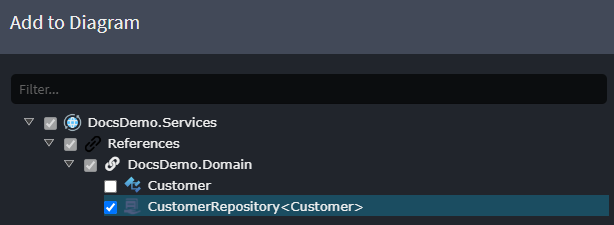
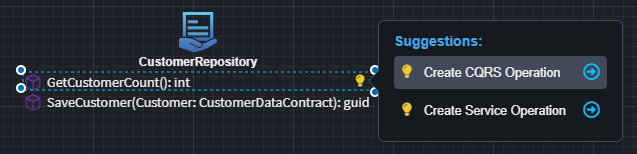
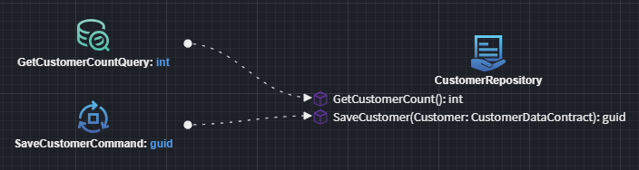
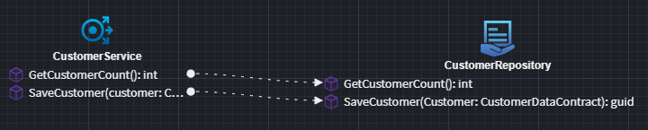

# Intent.Application.DomainInteractions

## What This Module Does
Provides generation strategies for domain interaction implementations (e.g., find, create/update, projection patterns) defined using the Domain Interactions modelling specialization. It standardizes how application layer code orchestrates domain entity access and mutation beyond basic CRUD.

## Generated Behaviour (Conceptual)
- Interaction registration extension (via factory extension) wiring interaction strategies into the software factory pipeline.
- Implementations for modeled interaction types (e.g., ProjectTo, FindById, CreateOrUpdate) guided by domain model metadata.

## Interoperability
Detects related modelling modules: Domain, Services, Domain Interactions, Event Interactions, CRUD MediatR – ensuring presence of necessary metadata and base abstractions.

## Typical Workflow
1. Model a Domain Interaction (e.g., a projection aggregating several entities).
2. Run generation; module produces interaction implementation code and registers it.
3. Application services or request handlers invoke the interaction class/method instead of constructing repository queries manually.
4. Adjust/extend generated code via merge mode for specialized logic (validation, caching, authorization checks).

## CRUD Accelerators

This module adds the accelerators that generate service-to-domain interactions from a domain element:

- `Create CRUD CQRS Operations` and `Create CRUD Traditional Service`, on the Services package, its folders and its diagrams.
- Suggestions on a Domain designer `Class` to create the same CQRS requests or traditional services in the Services designer.

They follow the `Default Mapping Mode` setting of `Intent.Modelers.Services.DomainInteractions`.

## Modeling a Repository Operation Call

To model the invocation of a `Repository Operation`, two accelerators are available, supporting either **CQRS** or **Traditional** service styles.

Alternatively, you can create the services, invocations, and mappings **manually** without using the provided accelerators, offering full control over the structure and implementation.

### Reference the Repository

1. In the **Service Designer**, within a diagram, right-click and select **`Add to Diagram`**.
2. Choose the previously created `Repository` and click **Done**.

### Create the Service

Once the repository is added to the diagram, a *suggestion* will appear to either:

- **Create a CQRS Operation**
- **Create a Service Operation**

These options allow you to quickly scaffold a service that invokes the repository operation.

### CQRS Operation

Use the **`Create CQRS Operation`** option to generate either a `Command` or a `Query` that calls the repository:

### Traditional Service Operation

Use the **`Create Service Operation`** option to generate a traditional service method for calling the repository:

## Customization Points
- Extend generated interaction partial classes with business rules.
- Introduce caching wrappers around expensive projections.
- Inject additional domain services (e.g., calculators, policy evaluators).

## Related Modules
- `Intent.Application.MediatR.CRUD`
- `Intent.Application.ServiceImplementations.Conventions.CRUD`
- `Intent.Entities.Repositories.Api`
- `Intent.Eventing.Contracts` (for interactions emitting events)
