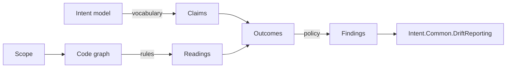

# Claims and findings

The contract at the engine's centre. Vocabulary (block 1) turns the model into claims. Rules (blocks 3 and 4) take readings from the code graph (block 2). Policy (block 5) turns each claim and its reading into an outcome, and the outcomes into findings.

## The claim

A claim is one checkable statement the model makes about the code.

| Field            | Meaning                                                                                                                                | Example                                    |
| ---------------- | -------------------------------------------------------------------------------------------------------------------------------------- | ------------------------------------------ |
| `kind`           | The claim kind, from the vocabulary                                                                                                    | `table.name`                               |
| `designer`       | The designer whose model states it                                                                                                     | `Domain`                                   |
| `element`        | The innermost model element that states it                                                                                             | the `Order` class                          |
| `path`           | The elements from the outermost owner to `element`                                                                                     | `Order` → `OrderDate`                      |
| `discriminator`  | What tells two claims of one kind on one element apart, when they can be several: an association, a marker's name, a registration kind | the `Order` → `OrderItem` association      |
| `expected`       | The value the model states (see [Values](#values))                                                                                     | `Orders`                                   |
| `stated`         | `always` (the code states it even by saying nothing) or `whenSet` (the model states it only when the code does), from the kind         | `whenSet`                                  |
| `bindings`       | The placeholders the claim's rules use, and their values                                                                               | `{ "Entity": "Order", "Table": "Orders" }` |
| `own`            | Which placeholders name the claim's own element, for the wrong-element check                                                           | `["Entity"]`                               |
| `parameterNames` | An operation's parameter names, in order, telling overloads apart                                                                      | `["orderId", "reason"]`                    |
| `source`         | The model feature that states the value, for fix messages                                                                              | the `Table` stereotype's `Name`            |
| `dependsOn`      | The claim this one is blocked by when that isn't verified, usually its owner's existence; or the claim it waits on that the code contradicts | `type.exists` on `Order`                   |
| `origin`         | The pack and vocabulary entry that produced it                                                                                         | `intent.domain@1.0.0`, entry `table.name`  |

A claim's identity is its designer, element, kind and discriminator. It is the same on every run, so a finding can be traced across runs and exceptions can never drift onto another claim.

**A claim exists only for what the model states.** An empty stereotype property is not a claim (decision 10). An unnamed index is a claim (decision 9). An element type, stereotype or association that no vocabulary covers is a `noVocabulary` finding, never silently skipped ([R6](requirements.md)).

## Values

A value has a type, and canonical text used for messages and for the `exact` comparer.

| Type       | Canonical text                                                             | Example                    |
| ---------- | -------------------------------------------------------------------------- | -------------------------- |
| `text`     | As stated, trimmed                                                         | `Orders`                   |
| `bool`     | `true` or `false`                                                          | `true`                     |
| `number`   | Invariant culture, no trailing zeros                                       | `200`                      |
| `list`     | Items joined by `, ` in order; a parameter is `name: type`                 | `CustomerId, OrderDate`, `id: guid, reason: string` |
| `set`      | Items sorted ordinally, joined by `, `                                     | `Admin, Manager`           |
| `type`     | Model type name, with `[]` for a collection and `?` for nullable           | `OrderItem[]`, `datetime?` |
| `route`    | Segments joined by `/`, parameters as `{name}`, no leading or trailing `/` | `api/orders/{id}`          |
| `presence` | `present` or `absent`                                                      | `present`                  |

A `type` value carries the model's type element, collection and nullability separately, so the `type` comparer can map each through the language profile ([rules.md](rules.md#language-profiles)). Model type names are Intent's (`guid`, `datetime`); a code type is shown as written (`Guid`, `DateTime`).

The run result and the suite's `expect` show both sides as canonical text, so `true`, `200` and `guid?` are strings there, and `null` is a side with no value.

## The reading

A rule's result for one claim.

| Field        | Meaning                                                                                                                                                                                                                         |
| ------------ | ------------------------------------------------------------------------------------------------------------------------------------------------------------------------------------------------------------------------------- |
| `value`      | The value read, typed as the claim's value. Missing when the rule found none.                                                                                                                                                   |
| `from`       | `code` (read from code the find located), `inherited` (from an enclosing node), `default` (the recipe's `default`) or `absent` (the recipe's `absent`, because the find found nothing). `default` and `absent` are **silence**. |
| `at`         | File, start and end line and column of the code read, or of the owner when the reading is silence. A node starts at its first attribute or annotation, if it has any. When a rule combines several nodes, `at` is the one it names as deciding: a recipe's node its matching read case read, a query's `at`, a plug-in's choice |
| `node`       | The code graph node the value came from                                                                                                                                                                                         |
| `rule`       | Pack, rule and, for a recipe, the find path and read case that produced it                                                                                                                                                      |
| `text`       | The matched text, for recipe validation's probe                                                                                                                                                                                 |
| `failure`    | Why there is no value: `notFound`, `ambiguous`, `unreadable`, `unresolved`, `readerFailed` or `ruleFailed`, with detail                                                                                                         |
| `searched`   | For `notFound`: the files and types the rule looked in                                                                                                                                                                          |
| `candidates` | For `ambiguous`: every match, with its location                                                                                                                                                                                 |

An `outOfScope` reading also names the excluded file the find's steps matched (`shadowFile`) and the row that excludes it (`scopeRow`, as `<host element>#<row number>`). A `blocked` claim's `dependsOn` gives the identity of the claim it waits on.

## Outcomes

Every claim ends as exactly one outcome ([R1](requirements.md)). The engine decides it in this order; the first step that applies wins.

| #  | Condition                                                                                                                      | Outcome                                                            |
| -- | ------------------------------------------------------------------------------------------------------------------------------ | ------------------------------------------------------------------ |
| 1  | No active rule reads the claim's kind for this element                                                                         | can't verify, `noRule`                                             |
| 2  | The claim it `dependsOn` isn't verified, or a claim it `waitsOn` is contradicted                                               | can't verify, `blocked`                                            |
| 3  | The rule threw, or returned something malformed                                                                                | can't verify, `ruleFailed`                                         |
| 4  | A file the rule needed couldn't be read by its reader                                                                          | can't verify, `readerFailed`                                       |
| 5  | The rule needs a reader capability the reader lacks (name resolution, for example)                                             | can't verify, `unresolved`                                         |
| 6  | Nothing found in scope, but the find's named steps match the path of an out-of-scope file ([scope.md](scope.md#shadow-lookup)) | can't verify, `outOfScope`, naming the file and the scope row      |
| 7  | Several nodes match where one is expected                                                                                      | can't verify, `ambiguous`                                          |
| 8  | A read case marked `unreadable` matched                                                                                        | can't verify, `unreadable`                                         |
| 9  | Nothing found, and the kind is an existence kind (`presence` comparer)                                                         | compare `absent`: contradicted when the model says present, as the code lacks it ([R8](requirements.md)); verified when the model says absent |
| 10 | The kind is `whenSet`, its owner was found, and the rule found nothing or no read case matched                                 | contradicted: the code doesn't state it ([R4](requirements.md))    |
| 11 | The kind is `always`, and the recipe's `absent` (nothing found) or `default` (found, but no read case matched) applies         | compare that value, marked as from silence ([R3](requirements.md)) |
| 12 | Nothing found, or found but no read case matched, otherwise                                                                    | can't verify, `notFound`, saying which                             |
| 13 | A value was read                                                                                                               | compare: verified or contradicted                                  |

Two consequences worth stating:

- **A `whenSet` kind never takes a value from silence.** A modelled table name with no `ToTable` is contradicted, even if EF Core's convention gives the same name (decision 4). A recipe for a `whenSet` kind with `default` or `absent` is a configuration error.
- **A missing type is one finding.** `type.exists` on `Order` is contradicted; every claim on `Order` and its members is `blocked`, and the one finding says how many ([R5](requirements.md)).
- **So is a table nothing maps.** `entity.persisted` on `Order` is contradicted; its table name, key, indexes, columns and relationships wait on it (`waitsOn`), so they are `blocked` and counted in its one finding. A claim it waits on that can't be verified (no DbContext in scope) blocks nothing: that is no evidence the class isn't mapped, so its claims are checked on their own.

### Stated always, or only when set

Each claim kind declares which, in its vocabulary.

- **`always`**: the code states the value even by saying nothing. A class with no `abstract` modifier says it isn't abstract, so `type.abstract` with model `false` is verified from silence. Kinds: structure (types, members, nullability, modifiers), multiplicity, keys, and markers both ways.
- **`whenSet`**: the model states the value only where the code states it explicitly, so the claim exists only when the model property has a value, and the code saying nothing contradicts it. Kinds: stereotype-set values such as table name, schema, column name, column type, max length, route and verb overrides.

## Comparers

Each claim kind names its comparer ([R10](requirements.md)). Both sides are trimmed first.

| Comparer      | Verified when                                                                                                     | Example                                                      |
| ------------- | ----------------------------------------------------------------------------------------------------------------- | ------------------------------------------------------------ |
| `exact`       | The texts are equal, ordinally. The default.                                                                      | `Orders` = `Orders`, but not `orders`                        |
| `ignoreCase`  | The texts are equal ignoring case                                                                                 | SQL Server type `nvarchar` = `NVARCHAR`                      |
| `number`      | Both parse as the same number                                                                                     | `200` = `200.0`                                              |
| `list`        | The same items in the same order                                                                                  | index columns `CustomerId, OrderDate`                        |
| `subsequence` | The model's items appear in the code in the model's order; the code may have more                                 | enum literals: model `Draft, Paid`, code `Draft, Sent, Paid` |
| `set`         | The same items in any order                                                                                       | roles `Admin, Manager` = `Manager, Admin`                    |
| `subset`      | Every model item is in the code; the code may have more                                                           | a component uses at least the modelled services              |
| `within`      | Every code item is in the model; the model may allow more. A contradiction names each offending item and its line | a layer imports only from layers it may depend on            |
| `contains`    | The code's text contains the model's                                                                              | a page title within a heading                                |
| `type`        | The model type, mapped through the language profile, equals the code's type reference                             | model `Guid?` = C# `Guid?`, Java `UUID` with `@Nullable`     |
| `route`       | The routes have the same segments in order, ignoring a leading or trailing `/` and case in literal segments. A parameter matches a parameter in the same position with the same name, ignoring case and constraints; an optional `?` and a catch-all `*` must agree | `api/Orders/{id:guid}` = `/api/orders/{Id}`, not `api/orders/{id?}` |
| `version`     | The versions are equal ignoring a leading `v` and trailing `.0` parts                                             | `v1` = `1.0`                                                 |

The collection comparers (`list`, `subsequence`, `set`, `subset`, `within`) compare items exactly unless the kind names an `itemComparer`: `version` makes `1` and `v1.0` one item, `route` compares items as routes, and `type` compares a parameter's `name: type` by its name exactly and its type with the `type` comparer.
| `presence`    | Found in code exactly when the model says present                                                                 | a `[Serializable]` marker modelled and present               |

A pack's plug-in may add comparers ([rules.md](rules.md#plug-ins)).

## Findings

A finding is one row of the drift report. Claim outcomes produce most of them; scope, configuration, readers and opt-in rules produce the rest.

| Field      | Meaning                                                                                                   |
| ---------- | --------------------------------------------------------------------------------------------------------- |
| `rule`     | A stable id: `claim/<kind>`, `scope/<case>`, `optin/<rule>`, `engine/<case>` or `config/<case>`           |
| `area`     | The report Area                                                                                           |
| `severity` | From [Policy](#policy)                                                                                    |
| `message`  | One or two sentences: what disagrees, and which model property and code state it ([R14](requirements.md)) |
| `subject`  | What the finding is about: a model element, a file and line, or text                                      |
| `against`  | What it was compared with: a file and line, or the files searched                                         |
| `claims`   | The claims the finding reports: one, or a blocked owner's and its dependants'                             |

### Onto Intent.Common.DriftReporting

The engine reports through the hub exactly as Common.Drift does, in its own Areas so both engines can run on one application ([R12](requirements.md)).

| Finding                                                    | Area                        | Category                    | Subject                              | Against                                                    |
| ---------------------------------------------------------- | --------------------------- | --------------------------- | ------------------------------------ | ---------------------------------------------------------- |
| A contradicted or can't-verify claim                       | `<Designer> (DriftEngine)`  | `ModelCode`                 | `Element`, the innermost element     | `File` (path and line), or `Text` naming what was searched |
| A model feature with no vocabulary (`engine/noVocabulary`) | `<Designer> (DriftEngine)`  | `ModelCode`                 | `Element`                            | none                                                       |
| A designer with content and no vocabulary                  | `<Designer> (DriftEngine)`  | `ModelCode`                 | `Text`, the designer                 | none                                                       |
| An opt-in rule's finding (`optin/*`)                       | the designer the rule names | `ModelCode`                 | `File` (path and line)               | `Element`, the nearest modelled owner, if any              |
| A reader failure for a file (`engine/readerFailed`)        | `DriftEngine`               | `Code`                      | `File`                               | none                                                       |
| Scope and configuration (`scope/*`, `config/*`)            | `DriftEngine`               | `Code`                      | `Element` (the scope host) or `Text` | none                                                       |

`Rule` on the hub's finding is the finding's `rule`. Claims `blocked` by another aren't separate rows; the blocking claim's message counts them.

The report holds only drift (decision 30). Info findings, the scope coverage listing (`scope/coverage`) and the `engine/notStated` note, go to the Software Factory log and never to the report. An Area is created by its first finding and declares no categories, so the report never shows an Area or category as clean.

### Messages

Messages name the element and the claim's label, never an id. Code goes in backticks, which the hub renders as code.

| Outcome                  | Example message                                                                                                                                                           |
| ------------------------ | ------------------------------------------------------------------------------------------------------------------------------------------------------------------------- |
| Contradicted, value      | Table name of `Order`: model `Orders`, code `Order`. Change the Table stereotype's Name, or the code's `ToTable`.                                                         |
| Contradicted, not stated | Table name of `Order`: model `Orders`, but the code doesn't state one. Add `ToTable` to the code, or clear the Table stereotype's Name if the convention's name is right. |
| Contradicted, missing    | Class `Order` isn't in the code. Searched 41 files under `src/Domain`. 14 claims on it can't be verified.                                                                 |
| `ambiguous`              | Class `Order`: 2 types match, `src/Domain/Order.cs:5` and `src/Legacy/Order.cs:3`.                                                                                        |
| `outOfScope`             | Class `Order` isn't in scope. `src/Legacy/Order.cs`, which the Root Folder's scope row `src/Legacy/**` excludes ("being replaced by `src/Domain`"), may hold it.          |
| `unreadable`             | Max length of `Order.Name`: the code states it at `OrderConfiguration.cs:12` in a form the rule can't read.                                                               |
| `noRule`                 | Table schema of `Order`: no rule in the active packs reads it.                                                                                                            |
| `unresolved`             | Nullable of `Order.Notes`: the code's nullability is unknown, because `Order.cs` is outside a nullable context.                                                           |
| `readerFailed`           | Class `Order`: `src/Domain/Order.cs` couldn't be read by the C# reader.                                                                                                   |
| `ruleFailed`             | Table name of `Order`: rule `house/table.name` failed: the query's `ownerOf` names no Layer property.                                                                     |
| `noVocabulary`           | `Order`'s `Audited` stereotype: no pack says what it states in code. Add vocabulary for it, or declare it non-checkable with a reason.                                    |

## Policy

### Default severities

| Finding                                                                          | Severity               |
| -------------------------------------------------------------------------------- | ---------------------- |
| Contradicted claim                                                               | Error                  |
| Can't-verify claim, every reason except the next row                             | Error                  |
| `engine/notStated`: nullability claims whose code is outside a nullable context, listed once; no finding per claim | Info |
| `engine/noVocabulary`, and a designer with no vocabulary                         | Error                  |
| `engine/readerFailed` (the file)                                                 | Error                  |
| `scope/missing` (no Drift Scope anywhere)                                        | Error                  |
| `scope/reason` (an Out row with no reason)                                       | Error                  |
| `scope/stale` (a row that decides nothing)                                       | Warning                |
| `optin/*` finding                                                                | Error                  |
| `optin/staleException` (an exception that matches nothing)                       | Warning                |
| `config/*` (an unknown pack or version, conflicting vocabulary, an invalid rule) | Error                  |
| `scope/coverage` (the listing)                                                   | Info                   |

Info is logged, never reported. Every can't-verify is an error because the model makes a claim the run couldn't check (principle 2). Open question 2 asks to confirm this.

The exception is a fact the code can't state at all. Outside a nullable context a C# reference type says nothing about nullability, so neither the model nor the code can be wrong about it, and it isn't drift. Each such claim is still can't verify, `unresolved`, in the run result, but it has no finding of its own: one `engine/notStated` note gives the count per designer and the files per top folder, and says that turning nullable reference types on makes them checkable. basislink5's first Software Factory run showed why: a codebase the recipe check reports clean came back with 753 errors, every one a `string` in a project with nullable off.

### Overrides

The model can change a severity, with a reason, on the `Drift Check` stereotype ([scope.md](scope.md#the-drift-check-stereotype)): a row of `Rule` (a rule id, `*` allowed, such as `claim/column.*`), `Severity` and `Reason`. A row without a reason is a `config/overrideReason` error. An override changes severity only: the finding is still reported.

### Exceptions

Exceptions apply to opt-in rules only. They describe code the model deliberately doesn't describe ([rules.md](rules.md#opt-in-must-be-modelled-rules)). A claim can't be excepted: the model states it, so the model, the code or the rule must change.

## The run result

What a run produces, and what the acceptance suite asserts on. Its schema is [`schemas/run-result.schema.json`](schemas/run-result.schema.json).

- **claims**: every claim with its reading and outcome.
- **findings**: every finding, as reported to the hub.
- **coverage**: per scope row, the files and types it decides, plus the files the built-in exclusions skipped.
- **packs**: the packs used, with their versions.
- **files**: every file read, with its reader. The suite checks no out-of-scope file is in it ([R22](requirements.md)).
