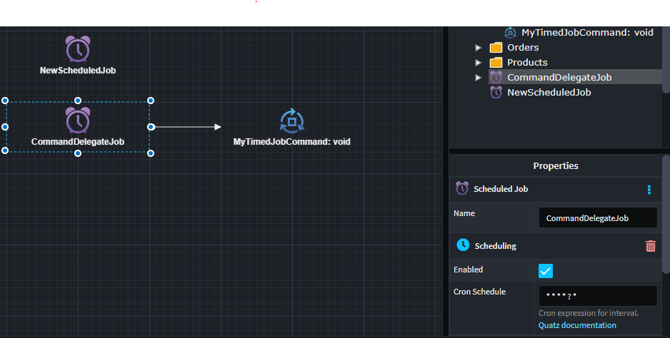

# Intent.QuartzScheduler

This module provides patterns for time based jobs, using Quartz.NET Scheduler.

## What is Quartz.NET Scheduler?

Quartz.Net Scheduler is an open-source job scheduling library for the .NET framework, offering a powerful and flexible way to schedule and manage tasks in applications. Developed as a port of the Quartz Scheduler for Java, Quartz.Net provides a feature-rich scheduling mechanism, allowing developers to define jobs and trigger them based on various criteria such as time intervals, cron expressions, or even in response to external events. The scheduler is designed to be highly configurable, supporting features like job persistence, clustering for distributed execution, and the ability to handle complex scheduling scenarios. It is commonly used in applications where periodic or recurring tasks need to be executed automatically, such as in the context of enterprise systems, batch processing, or background job execution in web applications.

For more information on Quartz.NET Scheduler, check out their [official docs](https://www.quartz-scheduler.net/).

## What's in this module?

This module creates the required infrastructure for a Windows Service:-

- Quartz.Net host registration
- Job generation
- Mediator delegation to Commands (if modeled as such)

## Quartz.NET version by target framework

Quartz.NET 4 supports `.NET 10` only, so the version this module uses depends on the project's target framework.

| Target framework                       | NuGet package                                                             | Generated job signature                                                                          |
| -------------------------------------- | ------------------------------------------------------------------------- | ------------------------------------------------------------------------------------------------ |
| `.NET 10` and later only               | `Quartz.AspNetCore` 4.x (web projects) or `Quartz` 4.x (other projects)   | `ValueTask Execute(IJobExecutionContext context, CancellationToken cancellationToken = default)` |
| `.NET 8`, `.NET 9`, or multi-targeting | `Quartz.AspNetCore` 3.x (web projects) or `Quartz.Extensions.Hosting` 3.x | `Task Execute(IJobExecutionContext context)`                                                     |

A project uses Quartz 4 only when every framework it targets is `.NET 10` or later. A project that multi-targets, for example `net9.0;net10.0`, stays on Quartz 3 for all of them.

On Quartz 4, any `Quartz.Extensions.Hosting` or `Quartz.Extensions.DependencyInjection` reference is removed, because Quartz 4 folds them into `Quartz` and a 3.x reference left beside Quartz 4 does not compile. `Quartz.AspNetCore` is still a real package on Quartz 4 (the HTTP API and health checks), so web projects keep it, raised to 4.x, and a reference you added yourself is kept.

When moving an application to `.NET 10`, check the [Quartz 4 migration guide](https://www.quartz-scheduler.net/documentation/quartz-4.x/migration-guide.html) for changes this module does not generate:

- Hand-written job, trigger or scheduler listeners must return `ValueTask`. Quartz rejects the 3.x signatures at startup.
- A persistent ADO.NET job store needs the 3.x to 4.0 database schema migration.
- The cron parser is stricter, so audit cron expressions in the model and in the `Quartz:Jobs:*:CronSchedule` configuration.

## Service Designer

You can model scheduled jobs in the services designer, using the CRON syntax to specify the scheduling. `Scheduled Jobs` can be modeled to publish commands if you are using MediatR or Mediator.

