# Intent.VisualStudio.Projects

This module adds Visual Studio capabilities to the [](xref:application-development.modelling.codebase-structure-designer) to allow applications to generate related files such as `.sln` and `.csproj` types.

## Codebase Structure Designer Extensions

This module allows modelling of the following within the [](xref:application-development.modelling.codebase-structure-designer):

- `Visual Studio Solution`s and its configuration.
- The various C# projects that make up your solution and their configuration.

Below is an example of a Visual Studio Solution in the Codebase Structure Designer configured for a typical Clean Architecture application. We can see the following:

- The Visual Studio Solution will be named **OnlineOrdering**.
- The solution will have four C# projects:
  - **OnlineOrdering.Api** – Responsible for application hosting and service distribution.
  - **OnlineOrdering.Application** – Responsible for application-specific business rules and use cases.
  - **OnlineOrdering.Domain** – Responsible for business rules and domain logic.
  - **OnlineOrdering.Infrastructure** – Responsible for infrastructure, persistence, and integration.

We can also see `Template Output`s, such as `Intent.Entities.Entity`, which indicate where the generated code files will be placed. In this case, domain `Entity` code files will be generated into the **OnlineOrdering.Domain** C# project, inside the `Entities` folder. When you install new modules, they will automatically add their `Template Output`s to this designer. Modules use [Output Anchors](xref:application-development.modelling.codebase-structure-designer#output-anchors) to determine where to place their `Template Output`s.

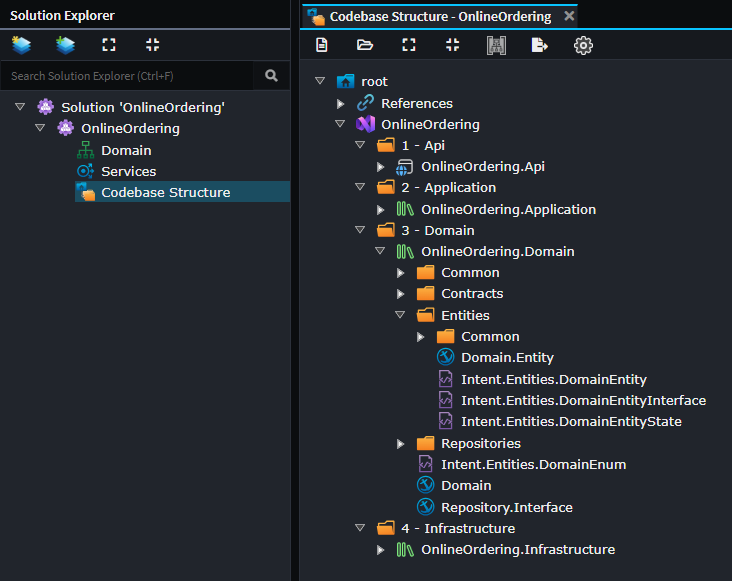

> [!TIP]
>
> `Application Template`s typically fully configure this layout for you. However, you can reconfigure or adjust this designer if you want to customize the structure of your application's code generation.

### Adding a New Project

1. Right-click on the `Visual Studio Solution` element or a `Folder` under it and select `C# Project (.NET)`.
2. Enter the name of your C# project.
3. _(Optional)_ Configure any project options in the Property Pane, such as `Target Framework`.
4. _(Optional)_ Customize your project by configuring `Output Anchor`s, `Folder`s, `Template Output`s, etc.

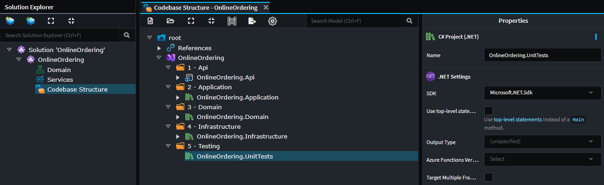

### Customizing your Visual Studio Codebase Structure

If you want to change where Intent Architect generates code within Visual Studio solution and projects, you can do so by making changes in this designer. Here are some examples of how this can be achieved.

#### Moving a File to a Different Location

Given the following setup:

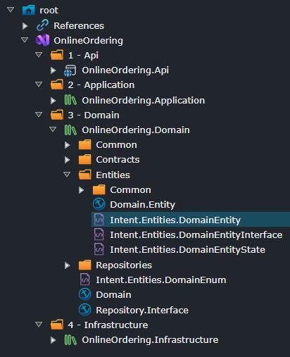

Modeled domain entities are generated into the `Entities` folder. These entities may be things like `Customer` or `Order`, depending on what `Entity`s you have modeled in the **Domain Designer**.

If you drag the **Intent.Entities.Entity** `Template Output` to the root folder of the C# project, the entities will now be generated directly into the project's root folder.

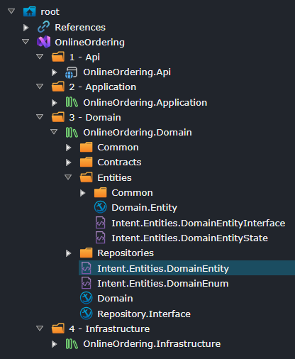

Alternatively, you could create a new folder, say `My Folder`, and move `Intent.Entities.Entity` into that folder. Now, the entities will be generated into a folder named `My Folder`.

#### Restructuring Projects

You can reorganize your Visual Studio solution structure by consolidating projects, splitting them apart, or creating entirely new projects. This section demonstrates common restructuring scenarios.

##### Consolidating Projects

In this example, let's assume you do not want four projects and prefer to consolidate the `Application` and `Domain` projects.

To consolidate the `Domain` project into the `Application` project:

1. Move all `Template Output`s from the `Domain` project into the `Application` project, placing them where you want the code to go.
2. Delete the `Domain` project.

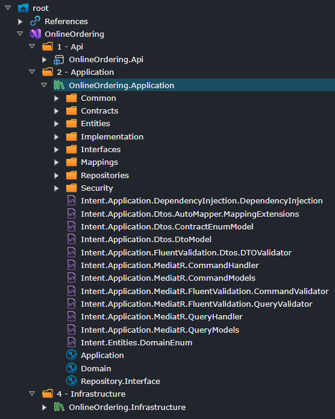

_Visual Studio solution with Domain project consolidated into Application project._

Now, your Visual Studio solution will have three projects instead of four.

##### Adding Projects

In this example, we have a Standalone Blazor application, and we don't want HTTP Client information in our Client application but would prefer to split it out into its own project.

The existing structure of the solution. In this example, we want to move the `Intent.Blazor.HttpClients.ServiceContract` template to a separate project.

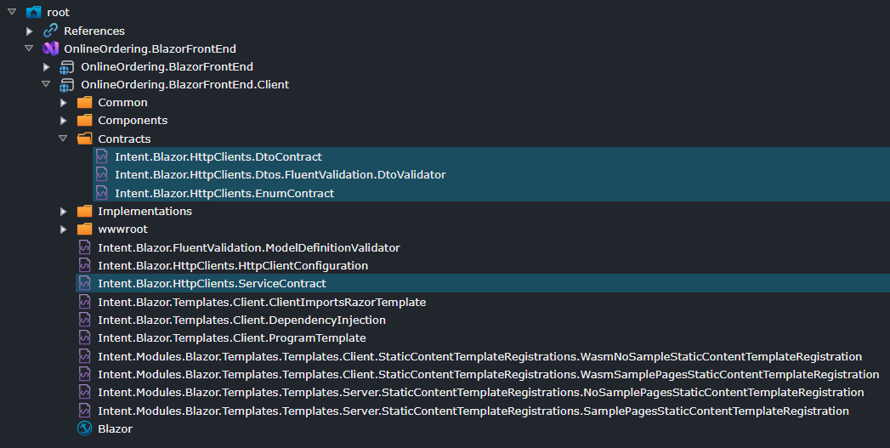

_Original Blazor project structure with the ServiceContract template in the main Client project._

To split out templates into a separate project:

1. Create a new project, as per the steps described in the [Add a New Project](#adding-a-new-project) section.
2. Move the `Intent.Blazor.HttpClients.ServiceContract` template from the existing project to the new project, placing it where you want the code to go.

> [!WARNING]
> Templates that `Intent.Blazor.HttpClients.ServiceContract` depends on also need to be moved to avoid circular dependencies. The Software Factory will throw errors if projects have circular references.

3. Move dependent templates to the new project. In this example, the entire `Contracts` folder also needs to be moved to the new project to prevent the Client project from depending on the New project while the New project depends on the Client project.

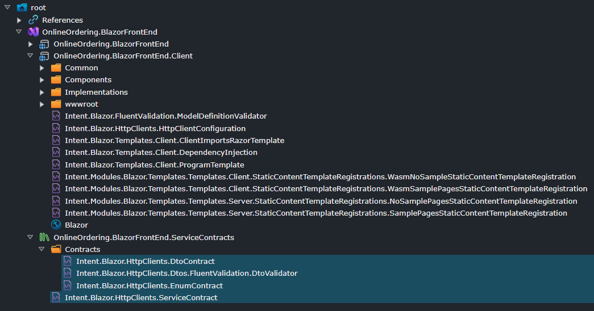

_Refactored structure with HttpClients in a separate project._

## Folder Options

### Namespace Provider

The `Namespace Provider` option controls whether a folder's name contributes to generated code namespaces.

- **Enabled**: The folder name is included in the namespace.
- **Disabled**: Files are still generated into the folder, but the folder name is excluded from the namespace.

This is useful when you want to organize files on disk without forcing that structure into your code namespaces.

For example, if `Orders` is marked as a namespace provider and `Internal` is not, a class in `Orders/Internal` would use a namespace like `MyApp.Orders` (not `MyApp.Orders.Internal`).

This option is available on folders in **all designers**. Configure it in the designer where the folder is modeled to control which parts of the folder hierarchy participate in namespaces.

## NuGet Package Management

This module is what installs NuGet packages into `.csproj` files. Other modules do not write package references themselves, instead their templates declare the packages the generated code depends on along with the minimum version required for it to compile and behave correctly. On each Software Factory execution, this module collects those declarations for each project and applies them.

### How the installed version is determined

For each package a module has requested for a project:

- **Not referenced in the project** - the package is added at the requested version.
- **Referenced at an older version** - the version is upgraded to the requested version.
- **Referenced at the requested version or a newer one** - the reference is left as it is, packages are never downgraded.

Where several modules request the same package for a project, the highest of the requested versions is the one which gets installed.

Package references which no module requests are left alone, so packages which you added to the `.csproj` yourself are not modified. A package is only removed when a module explicitly requests its removal.

> [!NOTE]
> When a requested package is already a transitive dependency of another requested package at an equal or higher version, it is not added as an explicit `PackageReference`, unless the project already references it.

### Preventing a package from being changed

Adding an `IntentIgnore="true"` attribute to a `PackageReference` will cause this module to skip that package for that project, so its version will not be upgraded and the reference will not be removed:

```xml
<ItemGroup>
    <PackageReference IntentIgnore="true" Include="Microsoft.EntityFrameworkCore" Version="8.0.21" />
</ItemGroup>
```

> [!WARNING]
> Because the minimum version is no longer applied to an ignored reference, pinning a version lower than an installed module requires may result in generated code which does not compile.

### Ordering and comments

`PackageReference`s in an `ItemGroup` that holds nothing else are kept in alphabetical order, and so are the `Using` items this module adds for the project's custom implicit usings. A group that is already in order is left exactly as it is.

Comments you write in these groups stay with the item they describe when it moves: a comment on the line(s) above an item, and a comment at the end of the item's own line. A comment after the last item stays at the end of the group. When a package is no longer requested and its `PackageReference` is removed, a comment above it is kept, and so is the `ItemGroup` holding it.

```xml
<ItemGroup>
    <PackageReference Include="Azure.Identity" Version="1.13.0" />
    <!-- Pinned: 9.x breaks our custom converters, see #412 -->
    <PackageReference Include="Newtonsoft.Json" Version="13.0.3" />
    <PackageReference Include="Serilog" Version="4.0.0" /> <!-- keep in step with Serilog.Sinks.* -->
</ItemGroup>
```

> [!NOTE]
> For SDK-style projects, all of the above holds. For `.NET Framework` projects using `PackageReference`, and for `Using` items, the file is re-indented whenever Intent changes it, so a comment at the end of an item's line moves to its own line just below that item.

### Module settings

| Setting                                   | Default | Description                                                                                                                                                                         |
| ----------------------------------------- | ------- | ----------------------------------------------------------------------------------------------------------------------------------------------------------------------------------- |
| Consolidate Package Versions              | `false` | When enabled, versions of a NuGet package are consolidated across the solution to be the same as the highest currently installed version.                                           |
| Warn On Multiple Versions of Same Package | `true`  | When enabled, warnings are shown if multiple versions of the same NuGet package are installed within the solution. Only applicable when _Consolidate Package Versions_ is disabled. |

> [!NOTE]
> In applications which have the `Intent.ModuleBuilder` module installed, its _Dependency version overwrite behavior_ setting also applies to NuGet packages, allowing the default upgrade behaviour described above (_If newer_) to be changed to _Always_ or _Never_.

## Launch Settings

For projects with _Generate LaunchSettings File_ enabled on the _.NET Settings_ stereotype, this module generates `Properties/launchSettings.json`, including launch profiles and environment variables which other modules register (e.g. a `Docker` profile). _Generate LaunchSettings File_ is on by default for Web, Worker and Blazor WebAssembly projects (see [Generate AppSettings File and Generate LaunchSettings File](#generate-appsettings-file-and-generate-launchsettings-file)).

Once the file exists, it is only ever added to:

- A registered profile is appended when no profile with that name exists. A profile which already exists is never changed.
- A registered environment variable is added to a profile which does not have it. Existing values are never changed.
- When an HTTP endpoint is required (e.g. _Enable HTTPS Redirect_ is disabled), `http://localhost:{port}` is added to an `applicationUrl` which only has `https://` entries.
- On `*.Api` profiles, a `launchUrl` pointing at `swagger` or `scalar/v1` is updated when you switch between Swashbuckle and Scalar. Any other `launchUrl` is left as you set it.

Everything else in the file is preserved as written, including `$schema`, property order, unrecognized properties and `commandName` values, indentation, line endings, and the trailing newline. When nothing needs adding, the file is left untouched.

## App Settings

For projects with _Generate AppSettings File_ enabled on the _.NET Settings_ stereotype, this module generates `appsettings.json` (and `appsettings.{Environment}.json` for each modelled runtime environment), adding the settings and connection strings which other modules register.

An existing file is only ever added to: a setting that is already present keeps its value. When nothing needs adding, the file is left byte-for-byte as it is. When something is added, the file keeps its own indentation, line endings and comments, and date- and number-like values are kept exactly as written.

A new file is indented according to the `.editorconfig` that applies to it, honouring only the `[*]` section and sections whose glob matches the file (e.g. `[*.json]`), so a `[*.cs]` `indent_size` does not reach JSON files. Without one, it is indented with 2 spaces.

## Stereotype details

### The _.NET Settings_ stereotype

#### The `SDK` property

Sets the `Sdk` attribute of the `.csproj` file. Besides the `Microsoft.NET.Sdk.*` SDKs, `Aspire.AppHost.Sdk` (written with its _Aspire SDK Version_) and `MSTest.Sdk` are available.

For `MSTest.Sdk`, the optional _MSTest SDK Version_ property is written as `Sdk="MSTest.Sdk/{version}"`. Leave it empty to resolve the version from `global.json` (`"msbuild-sdks": { "MSTest.Sdk": "4.0.2" }`). An empty value also keeps any version already in the `.csproj`.

When the existing `.csproj` uses an SDK that isn't one of these options (e.g. `Microsoft.Build.NoTargets/3.7.0` or `Uno.Sdk`), its `Sdk` attribute is never changed, whatever the model says. An SDK which is one of the options is always made to match the model. For example, an `MSTest.Sdk` project modelled as `Microsoft.NET.Sdk` is rewritten to `Microsoft.NET.Sdk`.

#### Target frameworks

The _Target Framework_ / _Target Frameworks_ properties set the `.csproj` file's `<TargetFramework>` / `<TargetFrameworks>`. An existing value is only rewritten when it is a single, unconditional element holding plain monikers (e.g. `net8.0`) whose set differs from the model. It is left untouched when:

- there is more than one `TargetFramework`/`TargetFrameworks` element, or a `Condition` on the element or its `PropertyGroup`, or the value uses an MSBuild property (`$(...)`);
- it holds the same frameworks as the model, in any order;
- it holds platform-specific frameworks (e.g. `net10.0-android;net10.0-ios`) which reduce to the modelled framework.

The model can't represent platform-specific frameworks. When those of a multi-platform project (e.g. .NET MAUI) no longer match the model, the `.csproj` is left untouched and the Software Factory logs a warning naming the project, so the change has to be made by hand.

#### Generate AppSettings File and Generate LaunchSettings File

These control whether this module manages the project's `appsettings.json` (see [App Settings](#app-settings)) and `Properties/launchSettings.json` (see [Launch Settings](#launch-settings)). They are available for `Microsoft.NET.Sdk`, Web, Worker and Blazor WebAssembly projects:

- **Web, Worker and Blazor WebAssembly projects:** turning a flag off makes Intent hands-off for that file: an existing file and its `.csproj` items (e.g. `<Content Include="appsettings.json">`) are left exactly as they are (never rewritten, added or deleted), none is created, and settings, launch profiles or ports which other modules request for the project are not written. The Software Factory log lists what was not written.
- **`Microsoft.NET.Sdk` projects** default to off. With _Generate AppSettings File_ off, settings registered for the project are handled by the host projects that reference it.

When this module is installed, or upgraded from an earlier version, both flags are turned on for the application's existing Web, Worker and Blazor WebAssembly projects, which always had both files generated. From then on, the flags are whatever you set them to.

#### The `Suppress Warnings` property

Adds a [`<NoWarn />`](https://learn.microsoft.com/dotnet/csharp/language-reference/compiler-options/errors-warnings#nowarn) element to the `.csproj` file with the specified value of semi-colon separated codes of warnings to suppress.

By default, this is populated with the value `$(NoWarn)` which will apply the [default suppressed warnings](https://github.com/dotnet/sdk/blob/2eb6c546931b5bcb92cd3128b93932a980553ea1/src/Tasks/Microsoft.NET.Build.Tasks/targets/Microsoft.NET.Sdk.CSharp.props#L16). While this value is set to `$(NoWarn)`, no `<NoWarn />` element will be added to the `.csproj` file.

`;1561` is automatically appended by some Intent Architect application templates to suppress the [Missing XML comment for publicly visible type or member 'Type_or_Member'](https://learn.microsoft.com/dotnet/csharp/language-reference/compiler-messages/cs1591) warning.

#### Use top-level statements

When enabled the `Program.cs` will no longer generate a class and instead use [top-level statements](https://learn.microsoft.com/dotnet/csharp/fundamentals/program-structure/top-level-statements).

> [!NOTE]
> Requires at least version `6.0.0` of the `Intent.Modules.AspNetCore` to be installed in order for changes to take effect.

#### Worker projects' `Program.cs`

For `Microsoft.NET.Sdk.Worker` projects, this module generates `Program.cs` with `[assembly: DefaultIntentManaged(Mode.Merge)]`, so statements you add are kept. _Use top-level statements_ decides between top-level statements and a `Main` method: set it to match an existing `Program.cs`, since switching an existing file between the two styles isn't supported.

When `Program.cs` already exists, the template adapts to it rather than adding statements that duplicate yours:

- Its builder declaration is kept as written: `var builder = WebApplication.CreateBuilder(args);` or `Host.CreateApplicationBuilder(args)` (generated as `HostApplicationBuilder builder = Host.CreateApplicationBuilder(args);` for a new file).
- Its run call is kept: `app.Run();`, or `await app.RunAsync();`, in which case a generated `Main` method is `async Task`.

With top-level statements, `using {project namespace};` is only added when Intent generates types in that namespace (or a namespace nested under it), so a project whose code lives under a different root namespace still compiles.

An existing `Program.cs` in any other shape is left untouched, and the Software Factory logs a warning. This includes `Host.CreateDefaultBuilder(args).ConfigureServices(...)`, different variable names than `builder` and `app`, or more than one run call. Startup code that other modules add to `Program.cs` (e.g. Serilog or Windows Service hosting) is then not applied.

The logging settings a `Main`-method Worker adds (`Logging:EventLog:*`) are written to that project's own `appsettings.json` only.

#### Use minimal hosting model

When enabled `Startup.cs` will no longer be generated, and all start-up will be performed in `Program.cs` by of the [new minimal hosting model](https://learn.microsoft.com/aspnet/core/migration/50-to-60#use-startup-with-the-new-minimal-hosting-model) introduced with .NET 6.

> [!NOTE]
> Requires at least version `6.0.0` of the `Intent.Modules.AspNetCore` to be installed in order for changes to take effect.

#### The `Output Type` property

Sets the `<OutputType />` element in the `.csproj` file (`Class Library`, `Console Application`, or `Windows Application`, mapped to `Library`, `Exe`, and `WinExe` respectively). Leave it unset to fall back to the SDK's own default.

This property is settable regardless of the selected `SDK`, including `Aspire.AppHost.Sdk`. An Aspire AppHost project must build as an executable to run as the orchestrator, so leave it unset (the Aspire SDK defaults it to `Exe`) or set it to `Console Application` explicitly — `Class Library` and `Windows Application` will produce a non-runnable AppHost.

### The _Visual Studio Solution Options_ stereotype

This stereotype is applied to **Visual Studio Solution** elements.

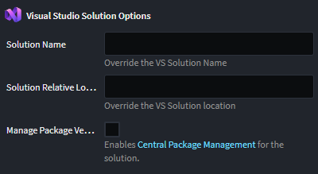

#### Solution Name

By default, your **Visual Studio Solution** name will be the same as your `Visual Studio Package` name. These properties allow you to explicitly specify the name without changing the package name. This is useful for scenarios where you have a shared VS Solution across Applications.

#### Solution Relative Location

By Default, your **Visual Studio Solution** will be placed in Application's `Relative Output Location`, this setting allows you to adjust the location of the solution relative to it's default location. Project references inside the generated `.sln`/`.slnx` are automatically kept correct relative to wherever this setting places the file.

#### Solution File Format

Controls which solution file format is generated for this **Visual Studio Solution**. Two options are available:

- **Classic (.sln)** (default): Generates the traditional `.sln` format that all Visual Studio versions support.
- **XML Solution (.slnx)**: Generates the modern XML-based `.slnx` format introduced in Visual Studio 2022 and .NET 10. It is simpler to read and diff — no GUIDs. Intent itself does not generate solution configurations/platforms or per-project build type mappings into this file, but if you or Visual Studio add them directly to the `.slnx` — along with any other manual customisation such as `BuildDependency`, `Properties`, or comments — the Software Factory preserves them on every subsequent run; they are only ever changed when the project or folder they belong to is itself renamed, moved, or removed.

To switch formats, apply the `Visual Studio Solution Options` stereotype to the solution element and change the `Solution File Format` property. When you run the Software Factory after switching, it will generate the new format and present the removal of the old file in the staged changes view.

> [!NOTE]
> The `.slnx` format requires Visual Studio 2022 17.10 or later, or the .NET 10 SDK.

### The _Root Folder Options_ stereotype

This stereotype is applied to the **Root Folder** element (shown as `root` at the top of the Codebase Structure Designer) and is owned by the `Intent.Modelers.CodebaseStructure` module. Its `Relative Location` property lets you shift the application's absolute output root (`OutputRootDirectory`) so that the `.sln`/`.slnx` file, `.gitignore`, and a centrally-managed `Directory.Packages.props` can be generated one or more levels up from the application's own output location, in a folder shared with sibling applications.

See the [_Root Folder Options_ stereotype](https://docs.intentarchitect.com/articles/modules-dotnet/intent-modelers-codebasestructure/intent-modelers-codebasestructure.html) section of the `Intent.Modelers.CodebaseStructure` module's documentation for the full property details, an example, and known caveats (including an `Intent.Modules.SharedKernel.Consumer` interaction).

### The _Folder Options_ stereotype

This stereotype is applied to **Solution Folder** elements.

### Materialize Folder

When checked, this option will materialize your logical **Visual Studio Solution** folders as actual folders on disk.

Projects under a materialized folder are written to an `.slnx` file the way `dotnet sln add` writes them (e.g. `src/Basket.API/Basket.API.csproj`). Paths are compared after normalisation, so an existing entry written as `src/...` or `./src/...` is matched and kept exactly as written.

## Adopting an existing (brownfield) repository

When modelling projects that already exist on disk, model them to match the repository so that the Software Factory leaves existing files alone:

- Turn on _Materialize Folder_ for solution folders that are folders on disk (e.g. `src`, `tests`).
- Set _SDK_ to what each `.csproj` uses, including `MSTest.Sdk` for MSTest projects. Leave _MSTest SDK Version_ empty when `global.json` supplies it.
- Set _Target Framework_ to each project's base framework (e.g. `net10.0` for a .NET MAUI app targeting `net10.0-android;net10.0-ios`).
- Set _Use top-level statements_ to match each Worker project's existing `Program.cs`.
- Untick _Generate AppSettings File_ and _Generate LaunchSettings File_ on Web, Worker and Blazor WebAssembly projects whose `appsettings.json` and `launchSettings.json` should stay hands-off.

### Central Package Management

In .NET, [Central Package Management (CPM)](https://learn.microsoft.com/nuget/consume-packages/central-package-management) allows management of NuGet package versions for multiple `.csproj` from a central `Directory.Packages.props` file and an MSBuild property.

To have Intent Architect automatically create and manage a `Directory.Packages.props` file for a solution, on the _Visual Studio Solution Options_ stereotype, check the _Manage Package Versions Centrally_ property.

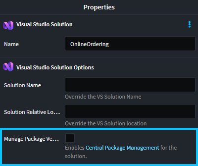

Once enabled, `PackageReference` items `.csproj` files will by default no longer add a `Version` attributes added to them and any existing ones will be removed.

Once `Manage Package Versions Centrally` is enabled, several options become available to control _where_ the `Directory.Packages.props` file is output.

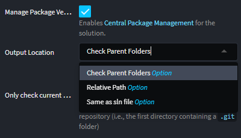

#### Available Output Location Options

- **Same as .sln file** (default):\
  The `Directory.Packages.props` file will be placed in the same directory as the solution (`.sln`) file.

- **Relative Path**:\
  The `Directory.Packages.props` file will be placed at the specified _relative path_ field value, which is resolved against the solution (.sln) file location.
  - **Relative Path** field:\
    This field is only available when the **Output Location** is set to _Relative Path_. For example, setting the value to `../` will result in the output folder being one folder higher than the solution file location.

- **Check Parent Folders**:\
  The system will check parent directories (starting from the solution file's location) for an existing `Directory.Packages.props` file. If found, that file will be used; otherwise, a new one will be created in the solution (.sln) file's directory.
  - **Only Check Current Git Repository** (checkbox):\
    This option is available when **Check Parent Folders** is selected. If enabled, the search will stop at the root of the current Git repository (i.e., the first directory containing a `.git` folder).

#### Managing Project Package Versions

It is also possible to control the behaviour of a single project by setting the _Manage Package Versions_ property on its stereotype:

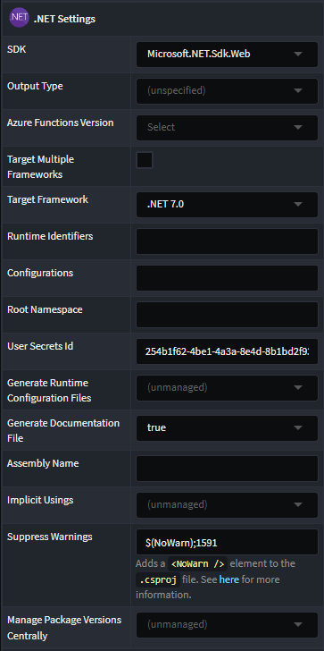

The following options are available:

- **(unmanaged)** - Intent will not add, change or remove the `ManagePackageVersionsCentrally` property in the `.csproj` file.

- **(unspecified)** - Intent will ensure there is no `ManagePackageVersionsCentrally` property in the `.csproj` file removing it if necessary. `Version` attributes will be added to `PackageReference` items depending on whether the Solution has the CPM option set.

- **false** - Intent will ensure the `ManagePackageVersionsCentrally` property is present with a value of `false` and regardless of the the Solution's CPM setting, `Version` attributes will always be added to `PackageReference` items.

- **true** - Intent will ensure the `ManagePackageVersionsCentrally` property is present with a value of `true` and regardless of the the Solution's CPM setting, `Version` attributes will be removed from `PackageReference` items.

> [!NOTE]
> Regardless of the project level's _Manage Package Versions_ setting, unless the solution has _Manage Package Versions Centrally_ set, Intent will not update or manage `PackageVersion` items for a `Directory.Packages.props` file.

#### Floating Package Versions

By default, NuGet's Central Package Management rejects a floating version (e.g. `Version="8.0.*"`) on a `PackageVersion` entry - `dotnet restore` fails with `NU1011: Centrally defined floating package versions are not allowed`.

To allow floating versions, on the _Visual Studio Solution Options_ stereotype, check the _Central Package Floating Versions Enabled_ property (available once _Manage Package Versions Centrally_ is checked). On the next Software Factory run, `Directory.Packages.props` gains a `CentralPackageFloatingVersionsEnabled` property set to `true` in the same `PropertyGroup` as `ManagePackageVersionsCentrally`:

```xml
<Project>

  <PropertyGroup>
    <ManagePackageVersionsCentrally>true</ManagePackageVersionsCentrally>
    <CentralPackageFloatingVersionsEnabled>true</CentralPackageFloatingVersionsEnabled>
  </PropertyGroup>

</Project>
```

Unchecking the property does not remove it once written - this avoids reverting a value you may have since changed by hand.

> [!WARNING]
> This property only makes a floating version legal to NuGet - it does not change how this module itself writes versions. A `PackageVersion` entry that no installed module requests (one you added by hand) keeps its float untouched. A `PackageVersion` entry that an installed module _does_ request will still have its float rewritten to that module's pinned version, since the float's minimum version is what gets compared against the requested version. Setting the project's _Dependency Version Overwrite Behavior_ module setting to `Never` (see [Module settings](#module-settings) above, requires `Intent.ModuleBuilder`) avoids this for module-requested packages too, since it only writes a version when the entry is absent.
