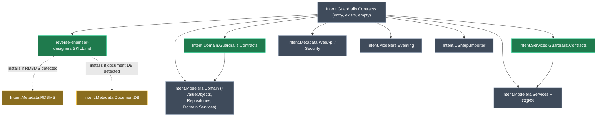

# Guardrails Contracts: entry module, reverse-engineering skill, and Domain/Services contract modules

## Context

A developer on a **brownfield** .NET codebase wants Intent Architect to visualise what the code already has. They want domain entities in the Domain designer and services, commands, queries and DTOs in the Services designer. They also want Intent to **guard** that model, so every modelled class and member keeps existing in the code. Intent should never implement anything or rewrite the developer's logic.

**Worked example (product terms):**

1. The developer installs **`Intent.Guardrails.Contracts`** into an application that points at their existing repo. That one install brings in the Domain, Services, CQRS and Web API metadata designers, plus the two contract modules.
2. Their AI agent runs the shipped **`reverse-engineer-designers`** skill. The skill sees `Microsoft.EntityFrameworkCore.SqlServer` in a csproj, so it installs `Intent.Metadata.RDBMS`. It finds no MongoDB, Cosmos or DynamoDB package, so it does not install `Intent.Metadata.DocumentDB`. It then imports `Order`, `OrderLine` and `Customer` into the Domain designer. It imports `OrderService`, `CreateOrderCommand`, `GetOrderByIdQuery` and `OrderDto` into the Services designer. Designer folders mirror the source folders.
3. The Software Factory runs. For `Order.cs`, Intent merges into the **existing** file. Every modelled property is already present, so there is no diff. Later someone models a new operation `Cancel(reason: string)` on `Order`. The next run adds `public void Cancel(string reason) { throw new NotImplementedException(); }` to `Order.cs` and leaves every existing body untouched.

The `Intent.Guardrails.Contracts` package exists in the Module Builder designer, but it is **empty**: no templates, no dependencies modelled beyond what the scaffold put in the `.imodspec`. The two contract modules don't exist yet.

## Approach

There are three modules. They split along the dependency boundary: the entry module carries **no code-generation dependency**, and each contract module carries only the designer API it reads.

*Green = new. Grey = existing module. Amber = installed at run time by the skill, never by a static dependency.*

<Callout id="conditional-db" tone="decision" title="RDBMS and DocumentDB metadata are installed by the skill, not by the module">

A module can't inspect the consumer's codebase at install time: `.imodspec` `interoperability` only detects *other modules*. So the decision to install `Intent.Metadata.RDBMS` 3.7.19 or `Intent.Metadata.DocumentDB` 1.3.8 belongs in the skill. The skill scans the csproj `PackageReference`s and `DbContext` / `IMongoCollection` usages, then installs the right module with `install_or_update_modules`, one module per call.

</Callout>

**Contract templates.** These are plain C# File Builder templates, one file per model. They emit the class and its modelled members only, in Merge mode, with method bodies set to Ignore. Each one reuses the shape of an existing reference template but leaves out everything that implements behaviour:

| New template | Model | Reuse reference (shape only) |
|---|---|---|
| Domain `EntityContract` | Domain `ClassModel` | `Intent.Modules.Entities/Templates/DomainEntity/DomainEntityTemplatePartial.cs` (attributes, navigable associations, operations, constructors, `ParentClass`) |
| Domain `EnumContract` | Domain `EnumModel` | literals only |
| Domain `ValueObjectContract` | `ValueObjectModel` (`Intent.Modelers.Domain.ValueObjects`) | class with `Attributes` as properties; no equality or `GetEqualityComponents` implementation |
| Domain `RepositoryContract` | `RepositoryModel` (`Intent.Modelers.Domain.Repositories`) | **interface** with modelled `Operations` only, so there are no bodies at all |
| Domain `DomainContract` | `DataContractModel` (Domain designer "Data Contract", `GetDataContractModels()`) | class with `Attributes` plus base contract from `Generalizations()` |
| Domain `DomainServiceContract` | `DomainServiceModel` (`Intent.Modelers.Domain.Services`) | class with stubbed `Operations`, same as `ServiceContract` |
| Services `ServiceContract` | `ServiceModel` | `Intent.Modules.Application.Contracts/Templates/ServiceContract/ServiceContractTemplatePartial.cs`, but emitted as a class with stubbed operations |
| Services `CommandContract` / `QueryContract` | CQRS `CommandModel` / `QueryModel` | `Intent.Modules.Application.MediatR/Templates/CommandModels/CommandModelsTemplatePartial.cs`, properties only, no `IRequest` |
| Services `DtoContract` | `DTOModel` | `Intent.Modules.Application.Dtos/Templates/DtoModel/DtoModelTemplatePartial.cs`, fields plus `ParentDto` |
| Services `EnumContract` | Services `EnumModel` | literals only |

The generated shape for an entity looks like this:

<AnnotatedCode
  id="contract-shape"
  filename="Domain/Orders/Order.cs (consumer app, illustrative)"
  language="csharp"
  code={`[assembly: DefaultIntentManaged(Mode.Merge, Body = Mode.Ignore)]

namespace Acme.Domain.Orders
{
    public class Order : AggregateBase
    {
        public Order(Guid customerId)
        {
            throw new NotImplementedException();
        }

        public Guid Id { get; set; }
        public Guid CustomerId { get; set; }
        public ICollection<OrderLine> OrderLines { get; set; }

        public void Cancel(string reason)
        {
            throw new NotImplementedException();
        }
    }
}`}
  annotations={[
    { lines: "1", label: "File default", note: "Merge (add, never delete); bodies are always the developer's" },
    { lines: "5", label: "Generalization", note: "From ParentClass when modelled" },
    { lines: "7-10", label: "Constructor stub", note: "Only emitted if missing; existing ctor body untouched" },
    { lines: "14", label: "Navigation", note: "From navigable association ends" },
    { lines: "16-19", label: "Operation stub", note: "Added only when the method does not exist" },
  ]}
/>

<Callout id="names-verbatim" tone="warning" title="Element names are used verbatim, and the C# kind is fixed per element type">

Brownfield names are already set, so templates never add prefixes or suffixes. For example, they never turn `OrderRepository` into `IOrderRepository`. The class or interface name is exactly the element name, which the importer took from the code.

Each element type has a fixed C# kind:
- Repositories are always emitted as `interface`.
- Value Objects, Domain Contracts and Domain Services are always emitted as `class`.

If a codebase has a domain service declared as an interface, or a repository as a class, the merge won't match the existing type. The skill must then skip modelling that type and report it, rather than create a mismatched contract. This is accepted because it keeps the templates simple. A per-element override stereotype can come later if real codebases need it.

</Callout>

**Type resolution across modules** uses **role strings**, not template-id references. For example, `AddTypeSource("Guardrails.Contracts.Domain.Enum")` lets a DTO in the Services module resolve a domain enum without an assembly reference from the Services module to the Domain module. Within the Domain module, every template registers the other Domain contract templates as type sources. That way an entity attribute typed as a Value Object, a repository operation returning an entity, and a domain service taking a Domain Contract all resolve with correct `using`s.

**File placement** follows your answer: designer folders mirror the source folders. Output Anchors in the consumer's Codebase Structure carry the new roles and point at each project's root, so `GetFolderPath()` plus the anchor reproduces the existing file path exactly.

<Callout id="placement-risk" tone="warning" title="A path mismatch creates a duplicate class instead of merging">

If a designer folder or an anchor is off by one segment, the Software Factory writes a *new* file beside the existing one. The developer then gets two `Order` classes and a compile error. The skill must check this before any apply. It runs the Software Factory and reads `get_file_diffs`; any **new** contract file for a type that already exists on disk means placement is wrong, and the skill fixes the folders or anchor instead of applying. This is accepted because it is the standard Intent placement model, and the importer already recreates disk folders by default.

</Callout>

<Callout id="signature-risk" tone="risk" title="Open: will Merge normalise existing member signatures?">

With `Mode.Merge`, RoslynWeaver may rewrite the signature of a **matched** existing member to the generated one. For example, `public Guid Id { get; private set; }` could become `{ get; set; }`, or a `List<T>` could become an `ICollection<T>`. That would be more than "ensuring it exists". Phase 1 verification checks this on purpose. If it happens, we tighten the file default to `Signature = Mode.Ignore` for properties and methods. Existence would still be enforced, but types would no longer be policed.

</Callout>

<Callout id="attrs-cost" tone="warning" title="Brownfield files gain RoslynWeaver attributes">

Merge mode only works if each file carries `[assembly: DefaultIntentManaged(...)]` and `using Intent.RoslynWeaver.Attributes;`. The consumer projects also need the `Intent.RoslynWeaver.Attributes` NuGet package. That is a visible footprint in otherwise hand-written code. You accepted it with the "Stub + Body=Ignore" choice.

</Callout>

## Model changes

<ModelChanges id="mb-changes" caption="Module Builder changes across the three module applications" changes={[
  { element: "Intent.Guardrails.Contracts (package)", designer: "Module Builder", change: "modified", note: "Entry point. Templates and dependencies only.",
    fields: [
      { label: "File Template", after: "ReverseEngineerDesignersSkill — Single File (no model), Markdown File Builder, role `AI.Context.Skills`" },
      { label: "Dependencies", after: "Modelers.Domain, Modelers.Domain.ValueObjects, Modelers.Domain.Repositories, Modelers.Domain.Services, Modelers.Services, Modelers.Services.CQRS, Metadata.WebApi, Metadata.Security, Modelers.Eventing, CSharp.Importer, Domain.Guardrails.Contracts, Services.Guardrails.Contracts" },
      { label: "Version", before: "1.0.0-pre.0", after: "1.0.0-pre.0 (unpublished, so the version gate leaves it)" },
    ] },
  { element: "Intent.Domain.Guardrails.Contracts (package)", designer: "Module Builder", change: "added", note: "New Module Builder application",
    fields: [
      { label: "C# Template", after: "EntityContract — File Per Model on Domain Class, C# File Builder, role `Guardrails.Contracts.Domain.Entity`" },
      { label: "C# Template", after: "EnumContract — File Per Model on Domain Enum, role `Guardrails.Contracts.Domain.Enum`" },
      { label: "C# Template", after: "ValueObjectContract — on Value Object, role `Guardrails.Contracts.Domain.ValueObject`" },
      { label: "C# Template", after: "RepositoryContract — on Repository, role `Guardrails.Contracts.Domain.Repository`" },
      { label: "C# Template", after: "DomainContract — on Data Contract, role `Guardrails.Contracts.Domain.DataContract`" },
      { label: "C# Template", after: "DomainServiceContract — on Domain Service, role `Guardrails.Contracts.Domain.DomainService`" },
      { label: "Package references", after: "Intent.Modelers.Domain, Intent.Modelers.Domain.ValueObjects, Intent.Modelers.Domain.Repositories, Intent.Modelers.Domain.Services" },
      { label: "Version", after: "1.0.0-pre.0" },
    ] },
  { element: "Intent.Services.Guardrails.Contracts (package)", designer: "Module Builder", change: "added", note: "New Module Builder application",
    fields: [
      { label: "C# Template", after: "ServiceContract — File Per Model on Service, role `Guardrails.Contracts.Services.Service`" },
      { label: "C# Template", after: "CommandContract — on Command (CQRS), role `Guardrails.Contracts.Services.Command`" },
      { label: "C# Template", after: "QueryContract — on Query (CQRS), role `Guardrails.Contracts.Services.Query`" },
      { label: "C# Template", after: "DtoContract — on DTO, role `Guardrails.Contracts.Services.Dto`" },
      { label: "C# Template", after: "EnumContract — on Services Enum, role `Guardrails.Contracts.Services.Enum`" },
      { label: "Version", after: "1.0.0-pre.0" },
    ] },
]} />

- **Package references.** Each new Module Builder package references the designer package it reads: `Intent.Modelers.Domain` for the Domain module, and `Intent.Modelers.Services` plus `Intent.Modelers.Services.CQRS` for the Services module. This makes the Domain/Services element types available as the templates' model types.
- **Codebase Structure.** Each new module application gets the same Codebase Structure scaffold as the existing Guardrails app: folders such as `Templates` and `Api`, and Output Anchors. The entry app's existing `skills` folder already has the `AI.Context.Skills` anchor, so the skill template needs nothing new there.

## Code changes

These are hand-written bodies inside the scaffolded `*TemplatePartial.cs` files. The designer owns the `[IntentManaged(Mode.Fully)]` parts.

<FileTree
  id="files"
  title="Representative files"
  entries={[
    { path: "Modules/Intent.Modules.Guardrails.Contracts/Templates/ReverseEngineerDesignersSkill/ReverseEngineerDesignersSkillTemplatePartial.cs", change: "added", note: "SKILL.md content as a raw string (DomainEntitySkill pattern)" },
    { path: "Modules/Intent.Modules.Domain.Guardrails.Contracts/Templates/EntityContract/EntityContractTemplatePartial.cs", change: "added", note: "Class contract builder" },
    { path: "Modules/Intent.Modules.Services.Guardrails.Contracts/Templates/ServiceContract/ServiceContractTemplatePartial.cs", change: "added", note: "Service class with stubbed operations" },
    { path: "Modules/Intent.Modules.Services.Guardrails.Contracts/Templates/DtoContract/DtoContractTemplatePartial.cs", change: "added", note: "Same pattern for Command / Query / Enum" },
    { path: "Modules/Intent.Modules.NET.sln", change: "modified", note: "Add the two new csproj files" },
  ]}
/>

**Rules shared by all contract templates.** The method names are confirmed in `Intent.Modules.Common.CSharp`.

- `CSharpFile(...).IntentManagedMerge()` plus `AddAssemblyAttribute("[assembly: DefaultIntentManaged(Mode.Merge, Body = Mode.Ignore)]")`.
- Methods and constructors get one statement: `throw new NotImplementedException();`. They have no other statements and no initial-gen markers.
- Properties are `{ get; set; }` with no initializers. Collections use `CSharpCollectionFormatter.CreateICollection()` for Domain and `CreateList()` for Services.
- Async operations (`IsAsync()`) emit `Task`/`Task<T>` and a `CancellationToken` parameter, matching the reference templates.
- `@class.RepresentsModel(Model)`, and each member `RepresentsModel(member)`, so traceability works.
- NuGet dependencies, if any, go in the constructor and never in `OnBuild`. This follows the known-build-gotchas rule.

**SKILL.md content outline** (`reverse-engineer-designers`):

1. **Discover the codebase.** Find the projects and layers (Domain, Application, Api) from the `.sln`/csproj. Never blanket-glob.
2. **Detect persistence.**
   - RDBMS signals: `Microsoft.EntityFrameworkCore.*` relational providers, `Dapper`, `Npgsql`, `Microsoft.Data.SqlClient`. These install `Intent.Metadata.RDBMS`.
   - Document DB signals: `MongoDB.Driver`, `Microsoft.Azure.Cosmos`, EF Cosmos provider, `AWSSDK.DynamoDBv2`, `Azure.Data.Tables`, `Redis.OM`. These install `Intent.Metadata.DocumentDB`.
   - Install with `install_or_update_modules`, one module per call. If both are detected, install both.
3. **Ensure placement.** Make sure a Codebase Structure or Visual Studio designer exists. Add Output Anchors with the six `Guardrails.Contracts.*` roles at each project's root.
4. **Model the Domain.** Run `getDesignerSchema()` first, then run **one `import_code` call per role**, each with explicit `includeGlobs`:
    - Entities: class to `Class` (Attribute, Operation, Constructor, Generalization).
    - Enums: enum to `Enum`.
    - Value Objects: `record`, struct, or a class deriving from a `ValueObject` base, to `Value Object`.
    - Repositories: interfaces whose names end in `Repository`, to `Repository`.
    - Domain Contracts: plain data classes used by the domain but not persisted, to `Data Contract`.
    - Domain Services: classes in `**/Services/**` of the Domain project, to `Domain Service`.

    Keep the default `folderStructure` so folders mirror disk. Reconcile `Unresolved Imports` placeholders, then fix validation errors. A type whose C# kind doesn't match its element's fixed kind is skipped and reported.
5. **Model Services.** Import application services, Commands/Queries and DTOs per role in separate `import_code` calls. Add Web API metadata (HTTP verbs/routes) from controllers where present.
6. **Verify the contract.** Run the Software Factory, then read `get_file_diffs`. Expect **no new files** for existing types and only additive changes. Any new file or destructive change means stop and fix the model.
7. Report what was modelled and what was skipped.

## Steps

1. **Version gate and housekeeping.** Run `module-version-increment` for all three modules. The entry module stays at `1.0.0-pre.0` because it is unpublished; the new ones start at `1.0.0-pre.0`. Read `CONTEXT.md` (none exist yet for these). Delete the stray duplicate `Intent.Modules.Guardrails.Contracts.csproj`/`.imodspec` copies, after one confirmation with you:
   - in `Modules/Intent.Modules.Guardrails.Contracts/Intent.Modules.Guardrails.Contracts/`
   - in `Modules/intent/Intent.Modules.Guardrails.Contracts/`

   They are leftover output from earlier Software Factory runs, use the wrong id, and are not managed files.
2. **Create the two module applications** in `Intent.Modules.NET.Contract.Guardrails.isln` with the same Module Builder architecture as `Guardrails.Contracts`. Metadata goes in `Modules/intent/Intent.Modules.{Domain,Services}.Guardrails.Contracts`, output in `Modules/Intent.Modules.{Domain,Services}.Guardrails.Contracts`. Add the designer package references.
3. **Model the Domain contract templates** (EntityContract, EnumContract, ValueObjectContract, RepositoryContract, DomainContract, DomainServiceContract). First add package references to the ValueObjects, Repositories and Domain.Services designer modules so their element types can be chosen as template models. Then run the Software Factory and apply the scaffolds.
4. **Implement the Domain template bodies** with the shared rules above. Use `DomainEntityTemplatePartial.cs` as the shape reference. Extract a shared helper in the module for "add properties from `AttributeModel`s" and "add stubbed methods from `OperationModel`s", because Entity, Value Object, Data Contract, Domain Service and Repository reuse them. The Repository variant emits interface methods without stubs.
5. **Model the Services contract templates** (Service, Command, Query, DTO, Enum), then run the Software Factory and apply.
6. **Implement the Services template bodies.**
7. **Entry module.** Model the `ReverseEngineerDesignersSkill` File Template and add the module dependencies listed above, including the two new modules. Write the SKILL.md content.
8. **Build** each module with `dotnet build --no-incremental`. Check the `.imod` output path is reachable by the test solution's `intent.repositories.config`.
9. **Verification apps** (see below).
10. **Close-out, per module.** In order:
    - Confirm versions.
    - Run `module-dependency-audit`:
        - The Services module needs an `Intent.Modelers.Services.CQRS` dependency.
        - The Domain module needs `Intent.Modelers.Domain.ValueObjects` 3.6.3, `Intent.Modelers.Domain.Repositories` 3.6.3 and `Intent.Modelers.Domain.Services` 1.3.1, plus the matching `Intent.Modules.Modelers.Domain.*` NuGet references.
        - All three need `Intent.Common.CSharp` and `Intent.OutputManager.RoslynWeaver`.
    - Run `module-docs-chore` (README and release notes).
    - Run `module-context-capture`. The `CONTEXT.md` covers the merge and body-ignore decision, role-string type sources, verbatim names with a fixed C# kind per element type, and why the DB metadata modules are installed by the skill.

## Critical files / elements

- Designer `Module Builder` (Guardrails.Contracts), package `Intent.Guardrails.Contracts`: the entry module, currently empty.
- `Modules/Intent.Modules.Guardrails.Contracts/Intent.Guardrails.Contracts.imodspec`: the canonical spec. Its dependencies are regenerated from the model.
- `Modules/Intent.Modules.Entities/Templates/DomainEntitySkill/`: the SKILL.md template pattern to copy.
- `Modules/Intent.Modules.Entities/Templates/DomainEntityStateTemplateBase.cs`: helpers for operation return types and collections, to mirror rather than reference.
- `Modules/Intent.Modules.Constants/TemplateRoles.cs`: `AI.Context.Skills` role constant. The new modules use their own role strings, not this project.

## Verification

1. **Build.** Each module project builds with `dotnet build --no-incremental` and exits 0. A green build isn't proof the output is correct; steps 2 and 3 check that.
2. **Phase 1, brownfield reproduction.** Add `Tests/Guardrails.Contracts.Brownfield`, a small hand-written solution containing:
   - entities with an aggregate, composition, inheritance, enum, nullable and collection members, a ctor with parameters, and an operation
   - a value object (`Money` as a record), a repository interface (`IOrderRepository`), a domain contract and a domain service
   - an EF Core `DbContext`
   - an application service, one command, one query and a DTO

   Install `Intent.Guardrails.Contracts`, then run the skill end to end. Expected results:
   - `Intent.Metadata.RDBMS` is installed and `Intent.Metadata.DocumentDB` is not.
   - Designers are populated with folders mirroring disk.
   - The Software Factory diff touches **only** existing files, adding just the RoslynWeaver attribute/using lines.
   - No new class files and no bodies changed.
   - The signature-normalisation risk above is explicitly checked.
3. **Phase 1, guard behaviour.** Add a new attribute and a new operation in the designer, then rerun the Software Factory. Only those two members should be added, the operation with a `NotImplementedException` body. Delete a member from code and rerun: the member should come back.
4. **Phase 2, from scratch.** Use a new app with no code and model one entity and one service. Contract files should generate into the anchored folders and compile, once the `Intent.RoslynWeaver.Attributes` package is present.
5. **DocumentDB branch.** Temporarily swap the test app's EF Core reference for `MongoDB.Driver`, then rerun skill step 2 only. Only `Intent.Metadata.DocumentDB` should be selected.

## Open questions resolved

- **Q:** Module ids? **A:** `Intent.Domain.Guardrails.Contracts` and `Intent.Services.Guardrails.Contracts`.
- **Q:** How do outputs line up with existing files? **A:** Designer folders mirror source folders, with Codebase Structure Output Anchors per role.
- **Q:** What goes in method bodies? **A:** A `NotImplementedException` stub, with file default `Mode.Merge, Body = Mode.Ignore`.
- **Q:** Services scope? **A:** Everything the Services designer can model: Services, Commands, Queries and DTOs. Plan inference: enums are included in both modules so modelled types resolve.
- **Q:** Domain scope? **A (you specified):** Value Objects, Repositories and Domain Contracts, in addition to entities. **Plan inference:** Domain Services are included too, following your "everything that can be modelled" answer for Services. Say if they should be dropped.
- **Plan inference, not a user decision:** "Metadata.web" is read as `Intent.Metadata.WebApi`. `Intent.CSharp.Importer` and `Intent.Modelers.Eventing` are included as entry-module dependencies. Say if either should be dropped.
