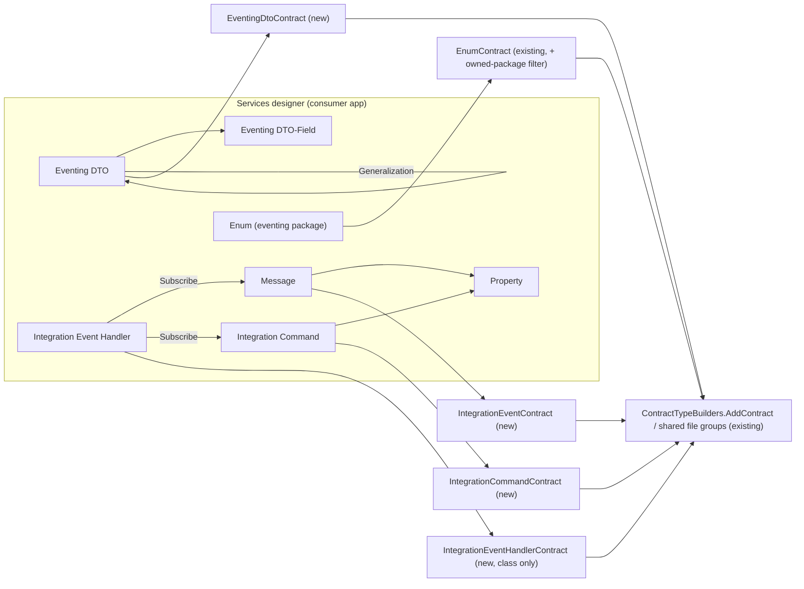

# Integration eventing contracts in Intent.Services.Guardrails.Contracts

## Context

Integration eventing is modelled with **Intent.Modelers.Eventing** and **Intent.Modelers.Services.EventInteractions**. You want the Services guardrails module to guard those elements in existing code, the same way it guards services, commands, queries and DTOs: merge each modelled type and its members into the existing file, with no behaviour.

**Where these elements live.** Since Eventing 6.0 there is no separate Eventing designer. Everything lives in the **Services designer**:

| Element (from) | Children / links | Guarded today? |
|---|---|---|
| Message, shown as "Integration Event" (Eventing) | Properties (type, nullable, collection; **no Value**) | No |
| Integration Command (Eventing) | Properties, as for Message | No |
| Eventing DTO (Eventing) | Fields (with Value), Is Abstract, generic types, Generalization to a parent DTO | No |
| Enum (Common Types; the same Enum the Services designer uses) | Literals | **Yes.** EnumContract already lists every Enum in the Services designer, including enums in eventing packages. |
| Integration Event Handler (EventInteractions) | Subscribe Integration Event / Subscribe Integration Command associations | No |

**Worked example.** Here is existing code, with a MassTransit consumer:

```csharp
namespace Acme.Contracts.Orders;
public sealed record OrderPlaced
{
    public Guid OrderId { get; set; }
    public IEnumerable<OrderLineDto> Lines { get; set; }
}
public class OrderLineDto { public Guid ProductId { get; set; } public int Quantity { get; set; } }
internal sealed class OrderPlacedHandler : IConsumer<OrderPlaced> { public Task Consume(ConsumeContext<OrderPlaced> ctx) { … } }
```

It is modelled as follows:
- An Eventing package, with folder `Orders`.
- **Message `OrderPlaced`**: Type Configuration `record` / `public sealed`. Properties `OrderId` (guid) and `Lines` (OrderLineDto, collection, Collection Type `IEnumerable`).
- **Eventing DTO `OrderLineDto`.**
- **Integration Event Handler `OrderPlacedHandler`**, subscribed to `OrderPlaced`.

The Software Factory (SF) emits:
- `public sealed record OrderPlaced` with the two properties;
- `public class OrderLineDto`;
- `internal sealed class OrderPlacedHandler` with no members.

Merged into the existing files, this changes only the headers. `IConsumer<>` and `Consume` stay as they are.

## Approach

**1. No dependency on the eventing modelers. This repeats the recorded Domain Events decision.** Domain Event Handlers avoided a dependency on Intent.Modelers.Domain.Events (a user decision, in CONTEXT.md). The reason given was that the reverse-engineering skill installs that modeler only when the code needs it. The same is true here. The skill installs Intent.Modelers.Eventing and EventInteractions only when it finds messaging in the code. EventInteractions would also pull Intent.Modelers.Domain into Services-only applications.

So I'll copy the existing `DomainEventHandlerContract` pattern:
- the model type is the raw `IElement`;
- `GetModels` is `Services(app).GetElementsOfType(type id)`, which is empty when the modeler isn't installed;
- stereotypes are targeted by a filter function and read by definition id and property name.

That brings the same caveat as Domain Events: renaming a stereotype property in the designer makes it silently read as empty.

**2. Handlers are class-only.** This is also the precedent from Domain Event Handlers. Handle methods depend on the broker: MassTransit `Consume(ConsumeContext<T>)`, NServiceBus `Handle(T, IMessageHandlerContext)`, Intent's `HandleAsync(T, CancellationToken)`. Merge leaves them, and the handler interfaces, as they are. The Subscribe associations are modelled for documentation only; the template doesn't read them.

**3. Only this application's own packages.** Eventing packages are routinely referenced across applications: a subscriber references the publisher's package. Without a filter, the subscriber application would generate every message in the publisher's package.
- The new registrations keep only elements whose `Package.ApplicationId` is this application.
- EnumContract gets the same filter, because enums arrive through those same package references.
- The other existing registrations are unchanged.

**4. Everything else matches the existing contracts.** Names are used verbatim: no forced `Event` suffix and no casing changes. The default kind is `class`, with Type Configuration for `record`. Modifiers come from the Default Type Modifiers setting or Type Configuration, and the File Config and Collection Type stereotypes work as they do today. Bodies are empty, and the merge directives are unchanged.



## Model changes

All of these are in the **Module Builder designer** of the `Intent.Services.Guardrails.Contracts` module application.

- **Four new C# File Builder templates.** Copy `DomainEventHandlerContract`'s settings, including the custom model type `Intent.Metadata.Models.IElement`. Their TemplateIds come from these names.

  | Template | Role |
  |---|---|
  | `IntegrationEventContract` | `Guardrails.Contracts.Services.IntegrationEvent` |
  | `IntegrationCommandContract` | `Guardrails.Contracts.Services.IntegrationCommand` |
  | `EventingDtoContract` | `Guardrails.Contracts.Services.EventingDto` |
  | `IntegrationEventHandlerContract` | `Guardrails.Contracts.Services.IntegrationEventHandler` |

- **Widen the existing filter-targeted stereotypes** in the "Domain Events" folder, and rename the folder to "Optional Modeler Elements" (the definition ids don't change):
  - **File Config**: widen its filter to also match Message, Integration Command, Eventing DTO and Integration Event Handler.
  - **Handler Type Configuration** (Modifiers only): widen its filter to also match Integration Event Handler.
- **Two new filter-targeted stereotypes** in that folder. Their options are identical to the typed ones.
  - **Type Configuration** (`Type`: class/record, plus `Modifiers`), on Message, Integration Command and Eventing DTO.
  - **Collection Type** (`Type`, `Custom Format`), on the Message/Integration Command `Property` and on `Eventing DTO-Field`.

## Code changes

These are hand-written files in `Modules/Intent.Modules.Services.Guardrails.Contracts/Templates/`. Generation only scaffolds the templates.

- **`DomainEventsMetadata.cs` → `OptionalModelerMetadata.cs`** (rename and generalise).
  - Holds the type ids for Message, Integration Command, Eventing DTO, Property, Eventing DTO-Field, Integration Event Handler and the Eventing Generalization association.
  - Readers by id: the shared File Config, handler Modifiers, the new Type Configuration (Type, Modifiers) and Collection Type (kind, format). Collection Type is parsed into the existing `ContractCollectionKind`.
  - An `IsOwnedBy(application)` helper for the package filter.
- **`ContractTypeBuilders.cs`**
  - New `AddContract` branches. The dispatcher otherwise throws, which would break shared files.
  - New `AddIntegrationEvent` and `AddIntegrationCommand`, built like `AddCommand`.
  - New `AddEventingDto`, built like `AddDto`: abstract, generics, base type from the Generalization target, kind check against the parent.
  - New `AddIntegrationEventHandler`, which reuses `AddDomainEventHandler`'s body.
- **`ContractBuilderExtensions.cs`**: an `AddContractProperties` overload over child `IElement`s.
  - It uses the existing general resolver `GetContractTypeName(template, typeReference, element, kind, customFormat)` in `ContractCollectionTypes.cs`.
  - It calls `WithContractInitialValue` for an Eventing DTO-Field's Value.
- **`ContractTypeKind.cs`**: a `GetContractTypeKind(IElement)` overload. For an Eventing DTO it also checks the parent's kind, raising an `ElementException` on a mismatch, as for DTOs.
- **`ContractTypeModifiers.cs`**: `IsInheritedByAnyEventingDto`, so the setting's `sealed` is left off base DTOs.
- **`GuardrailsContractsServicesRoles.cs`**: four role constants. IntegrationEvent, IntegrationCommand and EventingDto are added to `TypeSources`, so properties typed as Eventing DTOs resolve.
- **Each new template:**
  - a constructor body copied from `DomainEventHandlerContractTemplatePartial.cs`;
  - a hand-written `*.FileGroup.cs` partial (`IServicesContractTemplate`, `CanRunTemplate`, `Namespace`, `NormalizeNamespace`, `RunTemplate`);
  - `GetModels` = `GetElementsOfType(id)` filtered by `IsOwnedBy(app)`.
- **`EnumContractTemplateRegistration.cs`**: add the owned-package filter.

## Skill, docs and context

The skill text in `ReverseEngineerServicesSkillTemplatePartial.cs` must be edited with a **plain-text editor only**, because `patch_file` flattens the raw string.
- **§0:** widen the messaging evidence row: `IConsumer<T>`, `IHandleMessages<T>`, `IIntegrationEventHandler<T>`, `IEventBus` / `IMessageBus` publish and send calls.
- **§1:** extraction bullets for messages and integration commands. Report:
  - kind, including positional records;
  - modifiers;
  - properties as spelled, including accessors;
  - for Eventing DTOs, the same plus the base type;
  - for handlers, the class, its modifiers and the messages it handles.
- **§2:** add the four Template Outputs. Messages often live in a separate Contracts project, which needs its own output.
- **§3:** a new "Integration eventing" item after Domain event handlers, covering:
  - the Eventing package, and event vs integration command (published vs sent);
  - Eventing DTOs for nested types;
  - enums;
  - handlers with Subscribe associations;
  - which stereotypes apply;
  - the limitations below.

The other documentation changes:
- **`docs/README.md`:** template table rows, stereotype sections that list the eventing elements, and a short "Integration eventing" section (when the templates generate, the owned-package rule, and the limitations).
- **`CONTEXT.md`:** record decisions 1-3 and the stereotype-sharing choice.

## Deliberately deferred (documented as limitations)

- **Positional records** (`record OrderPlaced(Guid OrderId)`) are common for messages. Merging property-style output into one would duplicate members.
  - The builder has `AddPrimaryConstructor`, so a later `Type = positional record` option is feasible.
  - For now the skill leaves them unmodelled and reports them. That counts as a shape the model can't express, not a dropped member.
- **Property accessors** (`init`, get-only). The module has no accessor control today, and this already applies to DTOs. Verification checks what Merge does to `init`, and the skill documents the result.
- **Message property initializers.** The Eventing designer doesn't allow a Value on Message properties.
- **A subscriber's own copy of a message** that is modelled in another application's package.
- **Handle methods** on handlers.

## Steps

1. **Prerequisite:** the Intent Architect connection. The designer and SF tools are currently disconnected, and the Module Builder changes and SF runs need them.
2. **Module Builder:** add the 4 templates and roles, widen 2 stereotypes, add 2 stereotypes, and rename the folder. Validate and save.
3. **SF on the module application:** inspect the diffs (the 4 scaffolds, `TemplateExtensions.cs`, the imodspec, with no new dependencies), then apply.
4. **Hand-written code** as listed above.
5. **Build:** `dotnet build --no-incremental`, expecting 0 errors and 0 warnings. Rerun the SF until nothing is staged.
6. **Verify in a consumer test application** (see below).
7. **Skill, README and CONTEXT.md.**
8. **Close-out:**
  - The version stays `1.0.0-pre.0`; it is unpublished, as the standing rule requires.
  - Dependency audit: confirm the imodspec has no Eventing or EventInteractions dependency.
  - Report the `.imod` path, ready to copy to `D:\Dev\.intent-modules`.

## Critical files and elements

- Module Builder designer, `Intent.Services.Guardrails.Contracts`: the templates and the "Optional Modeler Elements" stereotype folder.
- `Templates/DomainEventsMetadata.cs` (renamed), `ContractTypeBuilders.cs`, `ContractBuilderExtensions.cs`, `ContractTypeKind.cs`, `ContractTypeModifiers.cs`, `GuardrailsContractsServicesRoles.cs`, `ContractCollectionTypes.cs` (reused), `ContractFileGroups.cs` (reused).
- `Templates/EnumContract/EnumContractTemplateRegistration.cs`.
- The four new template folders: `IntegrationEventContract`, `IntegrationCommandContract`, `EventingDtoContract`, `IntegrationEventHandlerContract`.
- `Templates/ReverseEngineerServicesSkill/ReverseEngineerServicesSkillTemplatePartial.cs`, `docs/README.md`, `CONTEXT.md`.

## Verification

- **Module:** the build is clean, and an SF run on the module application stages nothing after the apply.
- **Consumer without the eventing modelers:** no new files and no errors.
- **Consumer with Eventing and EventInteractions:**
  1. Model the worked example, plus:
     - a class message;
     - an integration command;
     - an abstract Eventing DTO with a child (the parent loses `sealed`, and a kind mismatch raises an error);
     - an enum in the eventing package;
     - a handler with two subscriptions;
     - File Config Namespace, No Namespace, and a shared file;
     - Collection Type `IEnumerable` and `Array`;
     - `internal sealed` modifiers.
  2. Inspect the fresh output.
  3. Put the matching hand-written code in place, including a handler with `IConsumer<T>` and `Consume`, and a message with `init` accessors.
  4. Rerun the SF. Expect header-only diffs, and record what happens to `init`.
- **Cross-application reference:** a second application that references the first application's eventing package generates no eventing or enum files from it.

## Decisions taken

- **No modeler dependency, filter-targeted stereotypes.** Applied from the recorded Domain Events user decision, for the same reason.
- **Class-only handlers.** Applied from the Domain Event Handler user decision.
- **Owned packages only** for the new templates and EnumContract. My recommendation; the alternative generates every message in every referenced package.
- **Positional records, accessors and handle methods are deferred.** They are listed above, so you can pull any of them into this cut.
