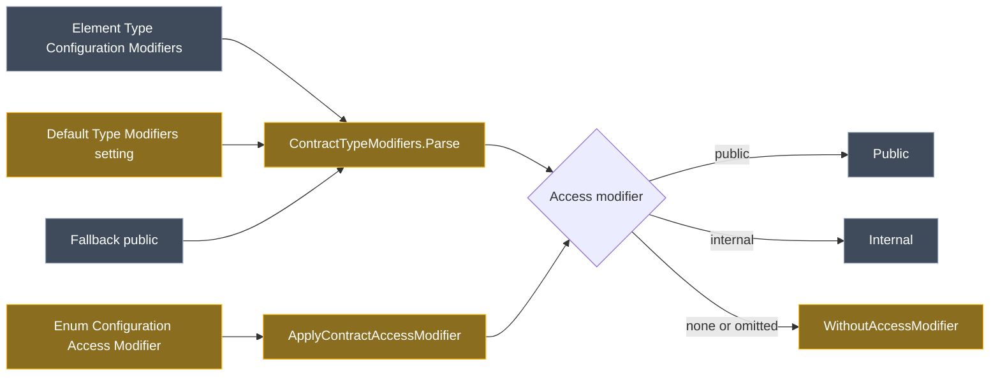

# Types declared without an access modifier in the Guardrails Contracts modules

## Context

`Intent.Modules.Common.CSharp` 3.10.12-pre.0 adds `WithoutAccessModifier()` to the C# class builder (records included), the interface builder and the enum builder. Until now the builder always wrote an access modifier.

Both **Intent.Domain.Guardrails.Contracts** and **Intent.Services.Guardrails.Contracts** were built around that limit. Their `ContractTypeModifiers.Parse` requires exactly one of `public` / `internal`, and both CONTEXT.md files record that "implicitly internal code is modelled as `internal`". Under plain Merge the generated modifiers replace the existing ones, so every type written without an access modifier gets one added on each run.

**Worked example.** Existing code:

```csharp
sealed class PriceCalculator { }
record OrderPlaced { public Guid OrderId { get; set; } }
enum OrderStatus { Open, Closed }
```

| Element | Today | After this change |
| --- | --- | --- |
| `PriceCalculator` | Modifiers must be `internal sealed`, so Merge rewrites it to `internal sealed class PriceCalculator` | Modifiers `sealed` generates `sealed class PriceCalculator`: no diff |
| `OrderPlaced` | Modifiers must be `internal`, giving `internal record OrderPlaced` | Modifiers `none` generates `record OrderPlaced` |
| `OrderStatus` | Enum Configuration `internal`, giving `internal enum OrderStatus` | Enum Configuration Access Modifier `none` generates `enum OrderStatus` |

If most of a codebase declares types this way, set **Default Type Modifiers** to `none` (or `sealed`, and so on) once, instead of configuring each element.

Neither module generates interfaces, so the interface part of the new API isn't used.

## Approach

Every contract kind gets its modifiers through one parser and one apply method, `ContractTypeModifiers.Parse` and `Apply`. The two modules hold identical copies of that file. Making the access modifier optional there covers all of these at once, with no change to any builder:

- classes, records and positional records;
- Domain Events;
- integration events, integration commands and Eventing DTOs;
- handlers.



_Amber: changed. Grey: existing. The precedence is unchanged: the element's value wins, then the setting, then `public`._

**Rules:**

- **An access modifier becomes optional.** Keywords without one write none: `sealed` gives `sealed class`, and `static partial` gives `static partial class`.
- **`none` is a new keyword meaning no modifiers at all.** It must stand alone. It is needed because an empty Modifiers already means "use the setting".
- **Default Type Modifiers** gains four options: `none`, `sealed`, `partial` and `sealed partial`. An empty setting still falls back to `public`, so default output is unchanged.
- **Enums:**
  - Enum Configuration → Access Modifier gains `none`.
  - An enum with no Enum Configuration follows the setting's access modifier. A setting without one (`none`, `sealed`, …) therefore gives `enum OrderStatus`.

<Callout id="sentinel" tone="decision" title="The keyword none for no modifiers">

An empty Modifiers can't mean "no modifiers", because every element that sets Type and leaves Modifiers empty relies on the setting. So a keyword is needed for "none at all". I chose `none` because it reads plainly in the text box, in the setting's dropdown and in the generated option accessors. Rejected alternatives:

- **A separate Omit Access Modifier checkbox:** two properties that can contradict each other, and the setting would still need new options.
- **Reusing `internal` to mean "omit it":** this would rewrite code that does say `internal`.

</Callout>

<Callout id="existing-models" tone="warning" title="Models that already say internal keep generating internal">

Elements modelled as `internal` under the old rule still generate `internal`. That compiles and means the same thing, but Merge keeps adding the keyword to code that doesn't have it. To get a clean diff, change those elements to `sealed`, `none` and so on. Old values stay valid, so this isn't a breaking change, and the skills will say to model the declaration exactly as written.

</Callout>

## Model changes

All of these are in the **Module Builder designer** of each module's application.

<ModelChanges id="model-changes" caption="Proposed Module Builder changes (both modules unless noted)" changes={[
  { element: "Default Type Modifiers (module setting)", designer: "Module Builder", change: "modified", note: "Select options; in each module's settings group",
    fields: [{ label: "Options", before: "public / internal, each with nothing, sealed, partial or sealed partial", after: "the same, plus none, sealed, partial, sealed partial" }] },
  { element: "Enum Configuration → Access Modifier", designer: "Module Builder", change: "modified",
    fields: [{ label: "Options", before: "public, internal", after: "public, internal, none" }] },
  { element: "Type Configuration → Modifiers (every variant)", designer: "Module Builder", change: "modified", note: "Domain: typed and Domain Events. Services: typed, eventing and handler. Hint text only, where a hint exists",
    fields: [{ label: "Hint", after: "Optional public or internal, plus sealed, abstract, static, partial; or none" }] },
]} />

The Software Factory then regenerates `Settings/ModuleSettingsExtensions.cs` and `Api/EnumModelStereotypeExtensions.cs` in each module, with the new option accessors.

## Code changes

<FileTree id="files" entries={[
  { path: "Modules/Intent.Modules.Domain.Guardrails.Contracts/Templates/ContractTypeModifiers.cs", change: "modified", note: "Parse, Apply, enum path and doc comments" },
  { path: "Modules/Intent.Modules.Services.Guardrails.Contracts/Templates/ContractTypeModifiers.cs", change: "modified", note: "The same change; keep the two identical" },
  { path: "Modules/Intent.Modules.Domain.Guardrails.Contracts/Intent.Modules.Domain.Guardrails.Contracts.csproj", change: "modified", note: "Common.CSharp 3.10.5 to 3.10.12-pre.0" },
  { path: "Modules/Intent.Modules.Services.Guardrails.Contracts/Intent.Modules.Services.Guardrails.Contracts.csproj", change: "modified", note: "Common.CSharp 3.10.5 to 3.10.12-pre.0" },
  { path: "Modules/Intent.Modules.Domain.Guardrails.Contracts/Intent.Domain.Guardrails.Contracts.imodspec", change: "modified", note: "Intent.Common.CSharp dependency 3.10.12-pre.0" },
  { path: "Modules/Intent.Modules.Services.Guardrails.Contracts/Intent.Services.Guardrails.Contracts.imodspec", change: "modified", note: "Intent.Common.CSharp dependency 3.10.12-pre.0" },
  { path: "Modules/Intent.Modules.Domain.Guardrails.Contracts/Templates/ReverseEngineerDomainSkill/ReverseEngineerDomainSkillTemplatePartial.cs", change: "modified", note: "Section 3 Type modifiers" },
  { path: "Modules/Intent.Modules.Services.Guardrails.Contracts/Templates/ReverseEngineerServicesSkill/ReverseEngineerServicesSkillTemplatePartial.cs", change: "modified", note: "Section 3 Type modifiers" },
  { path: "Modules/Intent.Modules.Domain.Guardrails.Contracts/docs/README.md", change: "modified" },
  { path: "Modules/Intent.Modules.Services.Guardrails.Contracts/docs/README.md", change: "modified" },
  { path: "Modules/Intent.Modules.Domain.Guardrails.Contracts/CONTEXT.md", change: "modified" },
  { path: "Modules/Intent.Modules.Services.Guardrails.Contracts/CONTEXT.md", change: "modified" },
]} />

- **`ContractTypeModifiers.cs` (both modules):**
  - **`Parse`:**
    - Drop the "it has no access modifier" error, and accept the `none` token.
    - Raise an error if `none` is combined with any other keyword.
    - `SupportedModifiersText` becomes "Use at most one of public or internal, plus any of sealed, abstract, static or partial, or none for no modifiers."
  - **`Apply`:** switch on the access modifier: `public` calls `Public()`, `internal` calls `Internal()`, and none calls `WithoutAccessModifier()`.
  - **`ApplyContractAccessModifier`:**
    - accepts `none` from Enum Configuration;
    - calls `WithoutAccessModifier()` on the enum when the setting supplies no access modifier;
    - leaves the error for an unexpected stored value as it is.
  - Validation (`sealed`/`static` on abstract or inherited types, `static` on records) is unchanged.
- **Dependency:**
  - Change the csproj package reference and the imodspec `Intent.Common.CSharp` dependency to `3.10.12-pre.0` by hand. The Module Builder only ever raises these, as with the earlier RoslynWeaver bump.
  - The NuGet package exists only in `D:\Dev\.nuget-packages`. The registered `intent-packages` source points at `C:\Dev\.nuget-packages`, which doesn't have it, so restore with explicit sources (nuget.org plus `D:\Dev\.nuget-packages`).
  - Its new transitive `Intent.Modules.Common.Types` 4.1.4-pre.0 is in the same folder. Its other minimums (Common 3.11.0, SDK 3.14.0-pre.0) are already met.
- **Skills:**
  - In §3 "Type modifiers", list the new setting options and add "omit the access modifier when the code has none, or use `none` when it has no modifiers at all", with the enum `none` option.
  - §1 already reports "`public`, `internal` or none".
  - Edit with the plain-text editor only, because `patch_file` flattens the raw string.
- **READMEs:** update the "Type modifiers" bullets: the setting options, an optional access modifier, `none`, and the enum `none` option. Remove the sentence "A type declared without an access modifier is `internal`, so model it as `internal`".
- **CONTEXT.md:**
  - Replace the Domain bullet "An access modifier is required because `CSharpClass` (Common.CSharp 3.10.5) always writes one" with the new rule, and record the `none` decision and the alternatives it rejected.
  - Services points at the Domain record, so it only needs a line saying that `ContractTypeModifiers` changed in step.

Both modules stay at `1.0.0-pre.0`, which is unpublished and still in flight.

## Steps

1. **Prerequisite:** reconnect Intent Architect. The designer and Software Factory tools are currently disconnected.
2. **Dependency upgrade:** in both modules, set Common.CSharp to `3.10.12-pre.0` in the csproj and imodspec, restore with explicit sources, and build. This confirms the upgrade compiles on its own before any behaviour changes.
3. **Module Builder:** in each module application, add the setting options and the Enum Configuration option, and update the Modifiers hints. Validate.
4. **Software Factory on each module application:**
   - Expect regenerated settings and enum accessors.
   - Check that the csproj and imodspec aren't downgraded.
   - Leave the Services csproj's Modelers.Services reference at `4.0.17-pre.2`; that package now exists.
   - Apply.
5. **Code:** change `ContractTypeModifiers.cs` in both modules.
6. **Documentation:** the skills, READMEs and CONTEXT.md.
7. **Close-out:**
   - Run `dotnet build --no-incremental` on both modules.
   - Rerun the Software Factory and confirm it stages nothing.
   - Copy both `.imod` files to `D:\Dev\.intent-modules`.

## Verification

- **Modules:** both build with 0 errors and 0 warnings, and a rerun of the module Software Factory stages nothing.
- **Consumer verification: skipped, because you will test it (your decision).** The rebuilt modules go to `D:\Dev\.intent-modules`. Installing them pulls in Intent.Common.CSharp 3.10.12-pre.0. These are the outcomes to expect:

| Model | Expected declaration |
| --- | --- |
| Modifiers `sealed` | `sealed class X` |
| Modifiers `none` on a record | `record X` |
| Modifiers `static partial` | `static partial class X` |
| Modifiers `none sealed` | Error on the element |
| Setting `none`, no Type Configuration or Enum Configuration | `class X`, `enum S` |
| Setting `internal sealed`, Enum Configuration `none` | `enum S` |
| No setting and no stereotype | `public class X`, unchanged from today |

Merged into existing hand-written `sealed class X` and `enum S`, neither declaration should change.

## Open questions resolved

- **Q:** Which keyword means a type has no modifiers at all? **A:** `none`.
- **Q:** Should consumer verification run in TestReverse? **A:** No. You will test it, as with positional records. CONTEXT.md records it as not verified in a consumer.
