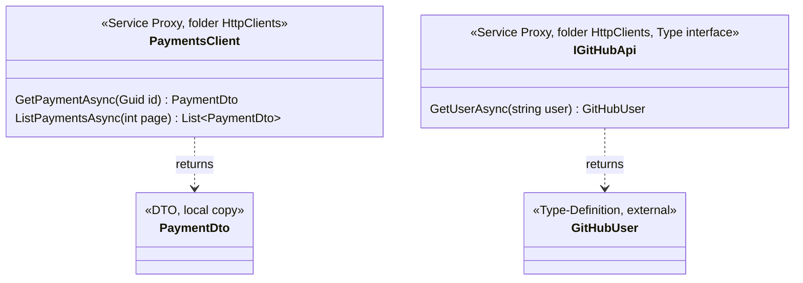
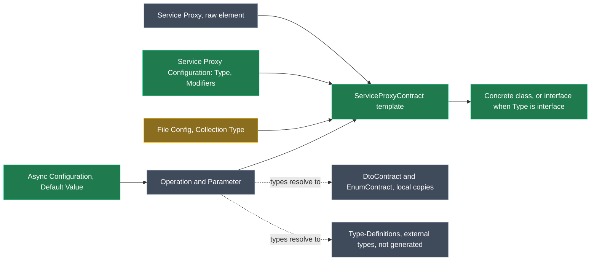

# Model the code's API clients as Service Proxies in Services Guardrails Contracts

## Context

Today the `reverse-engineer-services` skill models a call to another API as a `Service Proxy` only when that API is an Intent application whose Services package can be referenced. Every other client (typed `HttpClient` wrappers, Refit, NSwag or Kiota clients) is reported and left out of the model. Nothing guards the client files themselves.

The user wants every API client in the code modelled as **one** Service Proxy in the Services designer, **purely as a picture of the code, with no mappings** to remote endpoints. The Services Guardrails Contracts module then keeps that client's file in step with the model, the same way it guards services today:

- **The proxy is the concrete client class.** The interface it implements isn't modelled.
- **The interface only when there's no concrete class.** That's code where the implementation is generated at runtime, such as a Refit interface.

A proxy Operation is also a valid `Perform Invocation` target, so the intent of commands, queries and service operations (§5 of the skill) can show which client calls they make.

What a Service Proxy is (Intent.Modelers.Types.ServiceProxies 5.5.6, published):

- **`Service Proxy`** is its own element type. It holds its own **`Operation`** elements, which are not the Services designer's Operation. An Operation has an optional return type (DTO, Enum or Type-Definition, nullable or collection), no generic parameters, and the `[Invokable]` trait.
- **`Parameter`** is also a separate type. It is required to have a type (Command, DTO, Enum, Query or Type-Definition) and can't hold a Value. Its "Add Parameter" menu item is hidden, but a script can still create one.
- **Mappings are optional.** The metadata doesn't require a mapping, and since 5.5.6 a script can create a proxy without the mapping dialog opening.

## Worked example

**A concrete client.** The code has an interface, its implementation and a local copy of the API's DTO:

```csharp
// Acme.Application/Payments/IPaymentsClient.cs   (not modelled, stays hand-written)
public interface IPaymentsClient { ... }

// Acme.Infrastructure/HttpClients/PaymentsClient.cs
internal sealed class PaymentsClient : IPaymentsClient
{
    private readonly HttpClient _http;
    public PaymentsClient(HttpClient http) => _http = http;

    public async Task<PaymentDto> GetPaymentAsync(Guid id, CancellationToken cancellationToken = default)
        => await _http.GetFromJsonAsync<PaymentDto>($"payments/{id}", cancellationToken);

    public async Task<List<PaymentDto>> ListPaymentsAsync(int page = 1, CancellationToken cancellationToken = default) { ... }
}
```

**An interface-only client.** Refit generates the implementation at runtime:

```csharp
// Acme.Infrastructure/HttpClients/IGitHubApi.cs
public interface IGitHubApi
{
    [Get("/users/{user}")]
    Task<GitHubUser> GetUserAsync(string user);
}
```

The skill models one proxy per client, with no mapping anywhere:



- **`PaymentsClient`:** a concrete class, the default Type. Its Service Proxy Configuration sets Modifiers to `internal sealed`.
- **`page`:** the new `Default Value` stereotype is applied, with Value `1`.
- **`IGitHubApi`:** its Service Proxy Configuration sets Type to `interface`. Its operation's Async Configuration has Include Cancellation Token unticked, because the code declares no token.
- **`PaymentDto`:** a local copy, so it's an ordinary DTO in this application's package, guarded by `DtoContract` as today.
- **`GitHubUser`:** comes from outside the code, so it's a Type-Definition and nothing generates it.

The Software Factory merges each proxy into its one file:

- **The class:** `PaymentsClient` gets `public async` methods with the modelled signatures and empty bodies. Under Merge the existing bodies, constructor, fields and the code's `: IPaymentsClient` base list are kept.
- **The interface:** `IGitHubApi` gets the signatures, and `Attributes = Mode.Merge` keeps Refit's `[Get(...)]` attributes.
- **The result:** adopting the files changes nothing but headers and formatting.

## Approach

One new C# template, `ServiceProxyContract`, reads Service Proxies as raw elements, as the eventing and domain event handler templates already do. It writes one file per proxy from the proxy's own Operations and Parameters, and never reads a mapping.



_Green: new. Amber: an existing filter-targeted stereotype that is widened. Grey: unchanged._

<Callout id="no-mapping" tone="decision" title="No mappings (user decision)">

Proxies represent the code only. The template reads the proxy's own Operations, Parameters and return types and ignores a mapping if one exists. Rejected: mapping proxies to a referenced Intent application, or to a modelling-only External API application, which is Intent's own pattern but means modelling every remote API before a client can be guarded.

</Callout>

<Callout id="one-proxy" tone="decision" title="One proxy, one file: the concrete class unless there is none (user decision)">

- **The default:** each client is one Service Proxy, and the template guards its concrete class.
- **Interface-only code:** `Service Proxy Configuration` → Type = `interface` guards the interface instead. That's code whose implementation is generated at runtime, such as Refit.
- **The name:** the element name is the type name, verbatim.
- **Rejected:** a proxy for the interface plus a second template, or stereotype, for its implementation. That would model one client twice.

</Callout>

<Callout id="interface-unguarded" tone="warning" title="Accepted: a concrete client's interface isn't guarded">

When the proxy is the class, the interface it implements, such as `IPaymentsClient`, stays hand-written. Merge keeps the class's `: IPaymentsClient` base list. A modelled signature change therefore also needs a hand edit to the interface. Accepted because the user wants one proxy per client, linked to the implementation.

</Callout>

<Callout id="no-dependency" tone="decision" title="Raw elements, no dependency on Intent.Modelers.Types.ServiceProxies">

This follows the recorded Domain Event Handler and eventing decision. The skill installs the modeler only when the code has API clients, so the module takes no dependency on it:

- **Reading the elements:** the template queries `GetElementsOfType` with the type ids, filtered to this application's packages (`IsOwnedBy`).
- **Stereotypes:** the new definitions are filter-targeted in the "Optional Modeler Elements" folder, and `OptionalModelerMetadata` reads them by definition id and property name.
- **Minimum modeler version:** the `.imodspec` gains a hand-maintained interoperability minimum of **Intent.Modelers.Types.ServiceProxies 5.5.6**, beside the existing VS Projects one. Earlier versions open a mapping dialog when a proxy is created, which stalls an agent.

</Callout>

<Callout id="contract-types" tone="decision" title="Contract types (user decision)">

A type the client code declares itself (a local copy of the API's contract) is modelled as a DTO, Command, Query or Enum in this application's package, and the existing templates guard it. A type that comes from outside the code (e.g. a NuGet contracts package) is modelled as a Type-Definition and isn't generated.

</Callout>

### What the file gets

| | Type `class` (default) | Type `interface` |
|---|---|---|
| Declaration | `class` with the proxy's name | `interface` with the proxy's name |
| Modifiers | Own Modifiers (same rules as Type Configuration Modifiers), or the Default Type Modifiers setting | Own Modifiers: an access modifier and `partial` only. The Default Type Modifiers setting contributes only its access modifier, as for enums |
| Methods | One per Operation, name verbatim, `public`, plus `async` when the Async Mode is `async`. Bodies are empty, so existing ones are kept | One per Operation, name verbatim, no access modifier, never `async` |
| Return type | Operation type, with Collection Type, then Task or ValueTask wrapping from the async rules (name convention, or Async Configuration) | Same |
| Parameters | Parameter name and type verbatim, Collection Type, Default Value, then the CancellationToken parameter from the async rules | Same |
| Base list, attributes | None generated; Merge keeps the code's own | Same; Refit-style method attributes are kept by `Attributes = Mode.Merge` |
| Location | Template Output + designer folders; File Config Filename, Namespace and No Namespace | Same |
| Multi-type files | Joins File Config groups through `ContractTypeBuilders.AddContract` | Same |

When clients sit in more than one project (e.g. Refit interfaces in Application, concrete clients in Infrastructure), the skill uses the existing multi-location mechanism: duplicated Template Outputs with mutually exclusive Registration Filters. The model is a raw `IElement`, so filters use `np(ParentElement.Name)`.

<Callout id="default-value" tone="warning" title="Accepted: a new Default Value stereotype for proxy parameters">

Method signatures are fully managed (`Signature = Mode.Fully`), and a proxy Parameter can't hold a Value. Without this stereotype, a default such as `int page = 1` would be stripped from the code. The value is formatted by the existing `ContractDefaultValues`, the same as service operation parameters. CancellationToken defaults stay with Async Configuration.

</Callout>

<Callout id="macro-risk" tone="risk" title="Open: the designer's parameter-sync macros assume a mapping">

Intent.Modelers.Types.ServiceProxies runs a parameter-sync macro when the Services package loads and when a Service Proxy changes. It calls `operation.getMapping().getElement()` without a null check, so it throws on an unmapped Operation. It throws before it touches any parameter, so nothing is deleted.

Not verified in a consumer:

- whether this shows the user an error;
- whether a mapped proxy later in the same package stops syncing.

This solution has no Services designer to test it in. The fix belongs in Intent.Modelers.Types.ServiceProxies: skip operations without a mapping in the two macros and their TypeScript source. That is a separate module in the Intent.Modules repo and isn't part of this plan; it's the recommended follow-up if consumer testing shows errors.

</Callout>

<Callout id="client-modules" tone="warning" title="Accepted: incompatible with Intent's own client generators">

Intent.Application.Contracts.Clients and Intent.Integration.HttpClients throw a NullReferenceException on unmapped proxies, and skip their operations otherwise. A brownfield application using this module doesn't install them. The README and the skill say not to.

</Callout>

<Callout id="deferred" tone="warning" title="Deferred, documented as limitations">

- **Modifiers on class methods** (`virtual`, `override`, `sealed`, `new`): they need a filter-targeted Operation Configuration for proxy Operations. Methods are written `public`, so the skill reports a client that differs.
- **Explicit interface implementations** (`Task<PaymentDto> IPaymentsClient.GetPaymentAsync(...)`) in a concrete client.
- **Generic methods:** the designer doesn't allow generic parameters on a proxy Operation.
- **Parameter modifiers** (`ref`, `out`, `params`).

</Callout>

## Model changes

All in the **Module Builder** designer of the Intent.Modules.Services.Guardrails.Contracts application. Every new stereotype is filter-targeted on `element.specializationId` in the "Optional Modeler Elements" folder, like the eventing ones.

<ModelChanges id="mb-changes" caption="Proposed Module Builder changes" changes={[
  { element: "ServiceProxyContract", designer: "Module Builder", change: "added", note: "C# File Template, File per Model, model type `Intent.Metadata.Models.IElement`",
    fields: [{ label: "Role", after: "`Guardrails.Contracts.Services.ServiceProxy`" }] },
  { element: "Service Proxy Configuration", designer: "Module Builder", change: "added", note: "Stereotype, filter: Service Proxy",
    fields: [{ label: "Type", after: "select: `class` (default), `interface`" }, { label: "Modifiers", after: "text, same rules as Type Configuration Modifiers" }] },
  { element: "Async Configuration (proxy Operation)", designer: "Module Builder", change: "added", note: "Stereotype, filter: proxy Operation. Same properties, options and defaults as the typed Async Configuration",
    fields: [{ label: "Async Mode", after: "async, no async keyword, sync" }, { label: "Task Type", after: "Task, ValueTask" }, { label: "Include Cancellation Token", after: "checkbox" }, { label: "Cancellation Token Name", after: "text" }, { label: "Cancellation Token Default", after: "checkbox" }] },
  { element: "Default Value", designer: "Module Builder", change: "added", note: "Stereotype, filter: proxy Parameter",
    fields: [{ label: "Value", after: "text, the C# default as written" }] },
  { element: "File Config (Optional Modeler Elements)", designer: "Module Builder", change: "modified", note: "Definition id unchanged, so existing applied values keep working",
    fields: [{ label: "Filter", before: "handlers, messages, Eventing DTOs", after: "+ Service Proxy" }] },
  { element: "Collection Type (Optional Modeler Elements)", designer: "Module Builder", change: "modified", note: "Definition id unchanged",
    fields: [{ label: "Filter", before: "eventing Property, Eventing DTO-Field", after: "+ proxy Operation (return type), proxy Parameter" }] },
]} />

## Code changes

<FileTree id="files" title="Files touched" entries={[
  { path: "Modules/Intent.Modules.Services.Guardrails.Contracts/Templates/ServiceProxyContract/ServiceProxyContractTemplatePartial.cs", change: "added", note: "Scaffolded by the Software Factory; constructor body written like IntegrationCommandContract's" },
  { path: "Modules/Intent.Modules.Services.Guardrails.Contracts/Templates/ServiceProxyContract/ServiceProxyContractTemplateRegistration.cs", change: "added", note: "GetModels: Service Proxies by type id, owned by this application" },
  { path: "Modules/Intent.Modules.Services.Guardrails.Contracts/Templates/ServiceProxyContract/ServiceProxyContractTemplate.FileGroup.cs", change: "added", note: "Hand-written: file groups, No Namespace, NormalizeNamespace, as the other templates" },
  { path: "Modules/Intent.Modules.Services.Guardrails.Contracts/Templates/OptionalModelerMetadata.cs", change: "modified", note: "Type ids for Service Proxy, proxy Operation and Parameter; readers for the new stereotypes" },
  { path: "Modules/Intent.Modules.Services.Guardrails.Contracts/Templates/ContractTypeBuilders.cs", change: "modified", note: "AddServiceProxy; dispatcher handles Service Proxy" },
  { path: "Modules/Intent.Modules.Services.Guardrails.Contracts/Templates/ContractBuilderExtensions.cs", change: "modified", note: "Stubbed proxy operations for a class and for an interface" },
  { path: "Modules/Intent.Modules.Services.Guardrails.Contracts/Templates/ContractAsync.cs", change: "modified", note: "Core reads plain values, so raw stereotypes feed it; interface-method overloads" },
  { path: "Modules/Intent.Modules.Services.Guardrails.Contracts/Templates/ContractTypeModifiers.cs", change: "modified", note: "Interface overload: access modifier and partial only" },
  { path: "Modules/Intent.Modules.Domain.Guardrails.Contracts/Templates/ContractAsync.cs", change: "modified", note: "Same refactor, kept identical; no output change" },
  { path: "Modules/Intent.Modules.Domain.Guardrails.Contracts/Templates/ContractTypeModifiers.cs", change: "modified", note: "Same interface overload, kept identical; unused in Domain" },
  { path: "Modules/Intent.Modules.Services.Guardrails.Contracts/Templates/ReverseEngineerServicesSkill/ReverseEngineerServicesSkillTemplatePartial.cs", change: "modified", note: "Service proxy extraction and modelling guidance; edited as plain text" },
  { path: "Modules/Intent.Modules.Services.Guardrails.Contracts/Intent.Services.Guardrails.Contracts.imodspec", change: "modified", note: "Template from the Software Factory; Types.ServiceProxies 5.5.6 minimum by hand" },
  { path: "Modules/Intent.Modules.Services.Guardrails.Contracts/docs/README.md", change: "modified" },
  { path: "Modules/Intent.Modules.Services.Guardrails.Contracts/CONTEXT.md", change: "modified" },
  { path: "Modules/Intent.Modules.Domain.Guardrails.Contracts/CONTEXT.md", change: "modified", note: "Records the shared helper change" },
]} />

Reused rather than rewritten:

- **Type names:** `ContractCollectionTypes.GetContractTypeName(typeReference, element, kind, customFormat)`, the raw overload the eventing Properties use.
- **Defaults:** `ContractDefaultValues.WithContractDefaultValue`.
- **Async:** `ContractAsync` (`GetReturnType`, the CancellationToken name check, the keyword).
- **Modifiers:** `ContractTypeModifiers.ApplyContractModifiers` for the class.
- **Files and namespaces:** `ContractFileGroups` (`WithContractFileName`, `GetContractNamespace(IElement …)`, `GetElementFolderPath`, file groups) and `GlobalNamespaceOutput`.

## Steps

1. **Restore the earlier plan file.** Planning overwrote `intent/.plans/2026-10-14-guardrails-types-without-access-modifier.mdx`. Restore it from the last commit with `git checkout --` on that file.
2. **Version gate.** Both modules are still at the unpublished `1.0.0-pre.0`, so neither is bumped.
3. **Module Builder model.** In one designer script, add the three stereotype definitions, widen the two filter functions, and add the File Template. Then run the Software Factory for the Services module application, review the diffs (the new template scaffold, `TemplateExtensions.cs` and the `.imodspec` template), and apply them.
4. **Metadata and builders.** Add the ids and readers to `OptionalModelerMetadata`, `AddServiceProxy` to `ContractTypeBuilders`, and the stubbed proxy operations for a class and an interface. Make the `ContractAsync` and `ContractTypeModifiers` changes in both modules, keeping each pair identical.
5. **Template.** Write the constructor, the registration and the hand-written partial. Validation raises an `ElementException` for:
   - an unknown Type;
   - interface Modifiers other than an access modifier and `partial`;
   - a CancellationToken name that clashes with a parameter;
   - a Default Value that can't be formatted for its type.
6. **`.imodspec` interoperability.** Add `detect Intent.Modelers.Types.ServiceProxies` with install `5.5.6` to the existing Minimum Compatible Versions block.
7. **Skill.** Edit `reverse-engineer-services` as plain text, not with Intent's file tools:
   - **§0:** clients always mean installing Intent.Modelers.Types.ServiceProxies (5.5.6 or later); never install Contracts.Clients or HttpClients.
   - **§1:** extract each client: the concrete class, or the interface when there's none. Report its path, namespace and modifiers; each method as spelled, including defaults, the token and the `async` keyword; and where its contract types come from.
   - **§2:** place the `ServiceProxyContract` Template Output(s), with Registration Filters when clients span projects.
   - **§3, new "Service proxies" step:**
     - Create one proxy per client, with its Operations and Parameters, by script. Never set a mapping.
     - Set Type `interface` only for interface-only clients.
     - Model local contract copies as DTOs and external types as Type-Definitions.
     - Report anything in the deferred list.
   - **§5:** keep `Perform Invocation` to proxy Operations, and drop "only if that application is modelled".
   - **Gotchas:** add the deferred list, the unguarded interface, and the macro risk.
8. **Build and regenerate.** Run `dotnet build --no-incremental` on both modules, rerun both Software Factories, and expect nothing new to be staged.
9. **Probe.** Run reflection probes against the built assembly, as in earlier changes.
10. **Close out.** Update the README (a new "Service proxies" section, the templates table and the stereotypes), record the decisions above and the unverified macro behaviour in CONTEXT.md, check the `.imodspec` dependencies, and copy both `.imod` files to `D:\Dev\.intent-modules`.

## Verification

<Checklist id="verify" items={[
  { id: "build", label: "Both modules build with 0 errors and 0 warnings after `--no-incremental`" },
  { id: "sf", label: "Both Software Factory reruns stage nothing after the apply" },
  { id: "probe-class", label: "Probe: a default proxy renders a class with `public` (and `async` per Async Mode) methods, the modelled return types, Collection Type, Default Value and CancellationToken, and the setting's or own modifiers" },
  { id: "probe-interface", label: "Probe: Type `interface` renders an interface with the same signatures, no access modifiers on methods and no `async`" },
  { id: "probe-group", label: "Probe: a proxy sharing a file with a DTO through File Config Filename is written by the file's owner" },
  { id: "probe-errors", label: "Probe: each invalid combination in step 5 throws from the validation, not from the builder" },
  { id: "imod", label: "Packaged .imod contains the template, the three stereotypes and the 5.5.6 interoperability entry" },
  { id: "consumer", label: "User, in a consumer: unmapped proxies cause no blocking designer errors, and adopting real client files changes only headers and formatting", note: "Not possible in this solution: it has no Services designer" },
]} />

## Open questions resolved

- **Q:** Where does the API a proxy maps to come from? **A:** Nowhere. No mappings; proxies just represent what's in the code.
- **Q:** What C# does a Service Proxy guard? **A:** One proxy per client, linked to the concrete class. It's linked to the interface only when the code has no concrete class, e.g. an implementation generated at runtime.
- **Q:** How are the client's contract types handled? **A:** Local copies in the code are modelled as DTOs. Types defined externally are modelled as Type-Definitions.
