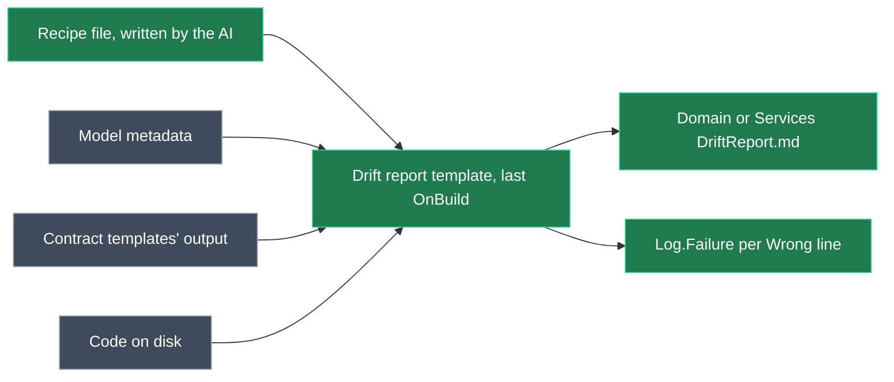

# Drift check: compare the model with the code on every Software Factory run

## Context

The Guardrails drift check has to catch code changes that weren't modelled. Today it can't:
- **The AI recorded only where facts are.** The check hashed that code and reported only what had changed since the last save, never whether the code and the model agree.
- **The save accepts anything.**
- **It runs only when an AI chooses to run it.**

The Basislink audit compared 1,588 facts and found 6 real mismatches. All 6 passed as "No drift", because the adoption's first save accepted them. The same audit identified the false alarms and wrong labels (F-4, F-8, O-1 and O-3) and the blind spots (F-2, F-3).

The fix keeps the design's generic idea: **the AI understands the technology once, and the check is deterministic.** The AI now records, per kind of fact, **where it is and how to read its value**: a recipe. On every Software Factory run, a generic engine runs the recipes, reads each value, and compares it with the model. There's no baseline and no save.

**Example (one of the 6):** in the model, `sapPlants.differential` is `VARCHAR(1)`. In the code, its `Entity<sapPlants>` block says `.HasColumnType("char(1)")`. The text-type recipe (below) reads `CHAR`, so the Domain drift report writes, under *Wrong: facts the code contradicts*:

`` `sapPlants.differential` text type: model `VARCHAR`, code `CHAR`. Location: `Basislink.Data/Model/BasislinkContext.cs:1204` ``

The run reports a Software Factory error, so CI fails too, until the model or the code changes.

## Approach


*Green: new. Grey: existing.*

- **One template per module.** Shaped like the Front End modules' `FrontEndDriftReportTemplate`: `BuildAndCheck`, check-only on CI, and `Log.Failure`. It replaces the module task, the drift-report skill and the context menu.
  - **When it runs:** it registers `MarkdownFile.OnBuild(…, int.MaxValue)`, so it runs after every contract template has built.
- **Where facts come from:**
  - **Model values** are read from metadata. The model side is fixed: it is Intent's own stereotypes.
  - **Code values for generated types** (structure) come from asking each contract template instance where it writes and what it would generate, then comparing that with the file on disk. No recipe is needed for these.
  - **Code values for hand-written code** (HTTP, security, database) come from the recipes.
- **Rule:** *the model must never be wrong.* Every line in a **Wrong:** section is reported with `Log.Failure`.

| Report section | When a line appears |
| --- | --- |
| Wrong: facts the code contradicts | The model value and the code value differ |
| Wrong: facts that can't be verified | A recipe finds no code, or its pattern matches nothing and it has no default (your decision: this fails the run) |
| Wrong: code the model doesn't describe | Code that a recipe's ownership list finds, or a member of a generated type, that isn't modelled and has no exception |
| Wrong: modelled but not in the code | A modelled type or member is missing on disk |
| Exceptions | The exceptions in effect (informational) |

Lines are sorted and carry no timestamps.

## Recipes

There's one file per designer: `guardrails/<designer>.drift.json`, beside the `.application.config`. It replaces `*.sync.json` and is committed with the code. The AI writes it during adoption, and updates it whenever the codebase uses a new way of declaring a fact.

A recipe has three parts:
- **find:** the code that holds an element's facts, built with the existing `CodeLocator` / `FindAnchored`. It can be a class, a method, a statement containing an anchor, or a file, with placeholders such as `{Service}`, `{Operation}`, `{Entity}` and `{Attribute}`.
- **read:** cases. The first regular expression that matches the found code wins. Matching ignores whitespace and comments. Each case gives a value or a capture, and the recipe can have a default for when no case matches.
- **own:** what code of that kind exists, so code that isn't modelled gets reported.

Recipes are per kind of fact, not per element. A whole application needs a few dozen lines, not 1,588 entries.

```json
{
  "facts": {
    "service.route": { "find": "class:{Service}", "read": [{ "match": "\\[Route\\(\"([^\"]*)\"", "value": "$1" }] },
    "operation.verb": {
      "find": "class:{Service} > method:{Operation}",
      "read": [{ "match": "\\[Http(Get|Post|Put|Delete|Patch)\\b", "value": "$1", "case": "upper" }]
    },
    "security": {
      "find": "class:{Service} > method:{Operation}",
      "read": [
        { "match": "\\[AllowAnonymous\\]", "value": "Unsecured" },
        { "match": "\\[(Authorize|Authorization)\\b", "value": "Secured" }
      ],
      "inherit": "class"
    }
  },
  "own": [{ "kind": "endpoint", "find": "method with \\[Http(Get|Post|Put|Delete|Patch)\\b", "name": "{Class}.{Method}" }],
  "exceptions": ["Basislink.API/Controllers/HealthController.cs"]
}
```
*An excerpt of a Basislink Services recipe, as the AI would write it after reading Basislink's controllers.*

```json
{
  "facts": {
    "column.textType": {
      "find": "statement:Entity<{Entity}> > chain:Property(e => e.{Attribute})",
      "read": [
        { "match": "HasColumnType\\(\"(n?(var)?char)", "value": "$1", "case": "upper" },
        { "match": "IsUnicode\\(false\\)", "value": "VARCHAR" }
      ],
      "default": "DEFAULT"
    },
    "table.schema": { "find": "statement:Entity<{Entity}>", "read": [{ "match": "ToTable\\(\"[^\"]*\", \"([^\"]+)\"", "value": "$1" }], "default": "dbo" }
  }
}
```
*An excerpt of a Basislink Domain recipe (EF Core, database-first).*

The module knows no technology:
- **Model vocabulary only:** its only knowledge is the model's fact list and vocabulary (`GET`, `Secured`, `VARCHAR`, `dbo`).
- **Recipes carry the rest:** every recipe reads code and produces values in that vocabulary. Equivalences such as "no schema means `dbo`" or "no text type means `DEFAULT`" are a recipe's `default` for that codebase, not rules in the module.
- **Other technologies:** the same engine reads them, the AI simply writes different recipes:
  - a minimal API finds `statement:Map(Get|Post|Put|Delete)(...)` and reads the route argument;
  - FastEndpoints finds `class:{Operation}Endpoint > method:Configure` and reads `Get\("([^"]+)"`;
  - a Mongo class map finds the `RegisterClassMap<{Entity}>` statement;
  - a Cosmos indexing policy is a JSON file read with a pattern.

The model side, which the module defines once:
- **HTTP:** service route; operation verb and route; parameter source.
- **Security:** Secured / Unsecured, plus Roles and Policy when modelled.
- **Database:** table and view name and schema, key, column name and type, text type, max length, required, precision and scale, default, and relationships (multiplicity and foreign key).

**Exceptions** live in the same file, one pattern per line (a file glob, `Type` or `Type.Member`). The AI adds clear helpers itself, and asks the developer about anything else. Exceptions never cover contradicted or unverifiable facts.

<Callout id="model-first" tone="warning" title="A model-first change fails the run that introduces it">

The check compares against the code currently on disk, as you asked. So a member, a parameter or a type modelled first is reported in the run that generates it, and passes once that output is applied. This is accepted because it also catches signatures changed in code (F-3) and deleted members the Software Factory would re-add as stubs (F-2). The rule tells the AI to expect it.

</Callout>

<Callout id="ci" tone="decision" title="CI: check without emitting the report">

`FileBuilderHelper.PerformConfiguration` filters on `CanRunTemplate()` before any build step runs (`FileBuilderHelper.cs:28`). So `CanRunTemplate()` returns true until `BuildAndCheck` has run, and false afterwards when `TF_BUILD` is set. The late check therefore runs on CI too, and no report file is written there.

</Callout>

<Callout id="regex" tone="warning" title="Recipes read text, not meaning">

A recipe matches syntax inside the code that Roslyn found, so it can be fooled by unusual code, such as a value built in a helper method. When a pattern matches nothing and has no default, the fact is reported as unverifiable, never passed. The AI then rewrites the recipe, or the code, until the fact can be read.

</Callout>

## Model changes (Module Builder, both modules)

<ModelChanges id="mb-changes" caption="Intent.Modules.Domain.Guardrails.Contracts and Intent.Modules.Services.Guardrails.Contracts" changes={[
  { element: "DriftReport", designer: "Module Builder", change: "added", note: "File Template, Markdown File Builder, Single File, no model. Outputs DomainDriftReport.md / ServicesDriftReport.md at the output root" },
  { element: "ConfigureDriftCheckSkill", designer: "Module Builder", change: "added", note: "File Template, role AI.Context.Skills, writes skills/configure-drift-check/SKILL.md. Shared like sync-model: the Domain module writes it when installed, otherwise Services" },
  { element: "ModelSyncTask", designer: "Module Builder", change: "removed" },
  { element: "DriftReportSkill", designer: "Module Builder", change: "removed" },
  { element: "Domain / Services Guardrails Extensions", designer: "Module Builder", change: "removed", note: "The Check drift with code context menu, which only called the module task" },
]} />

`ModelSyncRule`, `SyncModelSkill` and the reverse-engineer skills stay; their text is rewritten (see Steps).

## Code changes

<FileTree id="files" title="Representative files (Domain shown; Services mirrors it)" entries={[
  { path: "Modules/Intent.Modules.Domain.Guardrails.Contracts/Templates/DriftReport/DriftReportTemplatePartial.cs", change: "added", note: "BuildAndCheck in OnBuild(int.MaxValue); CanRunTemplate for CI; Log.Failure" },
  { path: "Modules/Intent.Modules.Domain.Guardrails.Contracts/Drift/RecipeEngine.cs", change: "added", note: "find, read and own over Roslyn-located code; no technology knowledge; shared, identical in both modules" },
  { path: "Modules/Intent.Modules.Domain.Guardrails.Contracts/Drift/DriftModel.cs", change: "added", note: "Model facts from metadata (the Domain database facts; Services has the HTTP and security ones)" },
  { path: "Modules/Intent.Modules.Domain.Guardrails.Contracts/Drift/StructureComparer.cs", change: "added", note: "Each contract template's output vs its file on disk" },
  { path: "Modules/Intent.Modules.Domain.Guardrails.Contracts/Drift/DriftReport.cs", change: "added", note: "Findings, sections, report text" },
  { path: "Modules/Intent.Modules.Domain.Guardrails.Contracts/Tasks/ModelSync/CodeIndex.cs", change: "renamed", note: "Moves to Drift/; CodeFiles, CodeLocator, Members and FindAnchored kept; fingerprints dropped" },
  { path: "Modules/Intent.Modules.Domain.Guardrails.Contracts/Tasks/ModelSync/ModelSyncEngine.cs", change: "removed", note: "Fingerprint check, BuildSync, the expected-folders scan" },
  { path: "Modules/Intent.Modules.Domain.Guardrails.Contracts/Tasks/ModelSync/ModelSyncRunner.cs", change: "removed" },
  { path: "Modules/Intent.Modules.Domain.Guardrails.Contracts/Tasks/ModelSync/SyncDocument.cs", change: "removed" },
  { path: "Modules/Intent.Modules.Domain.Guardrails.Contracts/Tasks/ModelSync/PersistenceAccess.cs", change: "removed" },
  { path: "Modules/Intent.Modules.Guardrails.Contracts.Tests/Intent.Modules.Guardrails.Contracts.Tests.csproj", change: "added", note: "xunit and Shouldly, as Intent.Modules.VisualStudio.Projects.Tests uses" },
]} />

## Steps

1. **Remove the old path.** In both Module Builders, delete the Module Task, the drift-report File Template and the context-menu extension. Delete the runner, sync document, persistence access, fingerprints, `BuildSync` and the expected-folders scan. Keep `CodeFiles`, `CodeLocator` (with `Members` and `AccessOf`) and `FindAnchored`.
2. **Model the template.** Add the DriftReport File Template to both Module Builders, then run the Software Factory on both module apps.
3. **Recipe engine.** Load the recipe file. Implement:
    - **find:** locate the code, by class, method, statement, chain or file, with placeholders;
    - **read:** first matching case, capture, case-folding, default;
    - **own:** enumerate code of a kind.

    It contains no technology knowledge. An invalid recipe file, or a model fact with no recipe, is itself a Wrong line.
4. **The `configure-drift-check` skill.** This is the one place that explains how to set up the drift config.
    - **Format and vocabulary:** the recipe file format, plus every fact the model can state (for each installed Guardrails designer) and its vocabulary.
    - **Steps:**
      1. List the fact kinds the model uses.
      2. For each kind, find in the code how this codebase declares it, in whatever technology.
      3. Write the recipe, plus an `own` list for each kind of code the model must describe.
      4. Run the Software Factory.
      5. Fix the recipes until no fact is reported as unverifiable.
      6. Resolve the contradictions: fix the model or the code, never the recipe, to make them pass.
    - **Examples** for several technologies (controllers, minimal APIs, FastEndpoints, EF Core, Mongo).
    - **Exit condition:** both drift reports have no Wrong lines.
5. **Model facts.** Read the fixed fact list from metadata: Domain database facts in the Domain module, HTTP and security facts in the Services module.
6. **Structure.** Ask each contract template instance for its output path, compare its built declarations with that file on disk (normalising type spelling), and report unmodelled members at the access levels in play.
7. **Template.** `BuildAndCheck` builds the report, raises one `Log.Failure` listing every Wrong line, and handles CI as in the decision callout above.
8. **Guidance.** Rewrite the files AI agents read: the always-on rule, the sync-model skill and the reverse-engineer skills.
   - **Rule:** model every code change; the Software Factory fails on drift; read the report; a model-first change fails one run.
   - **sync-model:** resolve each Wrong line. Model it, fix the code, fix the recipe when a fact is unreadable, or add an exception (asking the developer unless it's clearly a helper).
   - **Reverse-engineer skills:** their last step changes from "Save the first sync" to a required step: load **configure-drift-check** and carry it out. Adoption isn't finished until both reports have no Wrong lines. The skill also adds `*DriftReport.md` to `.gitignore`. While modelling, the AI notes how the code declares each fact, which feeds the recipes.
   - **sync-model:** when a fact is unreadable (for example, new code uses a technology no recipe covers yet), load **configure-drift-check** and extend the recipes.
9. **Tests** (see below).
10. **Close out.**
    - Version stays at 1.0.0-pre.0 (your decision).
    - Update the README and `CONTEXT.md` for both modules, and supersede the fingerprint and sync entries.
    - Run the Software Factory on both module apps; it should be clean.
    - Publish both modules to `D:\Dev\.intent-modules`.

<Callout id="dup" tone="warning" title="The engine stays duplicated">

The two modules keep identical copies of the engine, as they do today, with a "keep in step" note. A shared package was rejected because it would mean a third module and a new dependency for consumers.

</Callout>

## Tests: independent ground truth

- **Each kind of fact, true and false.** Recipes are test data: a controllers and EF Core recipe written the way the AI would for Basislink.
  - HTTP: class route, action route with tokens, verb, explicit and inferred binding.
  - Security: `Authorize`, an `[Authorization]` override, an `AllowAnonymous` override, roles and policy.
  - Database: table, schema, key (explicit and by convention), text type, max length, required (with and without nullable reference types), precision, column type and name, relationships, defaults.
  - Structure: property type, method signature, modifiers, a missing member, and an unmodelled member at each access level.
- **The 6 Basislink mismatches as regression cases,** using code copied from Basislink with Basislink's recipe file.
- **Mismatches that exist without any change:** a disagreement present at the very first check is reported.
- **Other technologies, with the same engine:** recipes for a minimal API route, a FastEndpoints route and a Mongo class map are read and compared correctly. This proves the engine isn't tied to any technology.
- **Can't be verified:** code not found; a pattern that matches nothing and has no default; an invalid recipe file.
- **Ownership:** an unmodelled action and an unmodelled `Entity<T>` are reported, an exception suppresses each one, and a stale exception is listed.

## Verification

- Both modules build, all tests pass, and the module Software Factory runs are clean.
- The rendered rule and skills read correctly.
- **End to end, in your Basislink instance:**
  1. Re-install both modules.
  2. Run `/configure-drift-check` there. This also proves that a fresh AI can write the recipes from the skill alone.
  3. Delete the obsolete `guardrails/*.sync.json` files.
  4. Run the Software Factory.

  Expect it to fail with exactly the 6 audit mismatches, plus any deliberate test edits still in the code, and nothing else. After fixing them, the run is clean.
- On CI (`TF_BUILD` set): the same failures, and no report file staged.

## Open questions resolved

- **Q:** How are facts read without hard-coding technologies? **A:** The AI writes every recipe (where a fact is and how to read it) for whatever technology the codebase uses, and a generic engine runs them. The modules contain no technology knowledge and ship no presets. (You: it's a brownfield reverse-engineering tool, not a controllers and EF Core tool.)
- **Q:** Code Location stereotype? **A:** Dropped. Generated files are located through their template instance, and hand-written code through recipes.
- **Q:** Should setting up the drift config be part of the reverse-engineer skills, or a separate skill? **A:** A separate shared skill, `configure-drift-check`, which both reverse-engineer skills require as their last step and which `sync-model` reuses (my call; you left it to me).
- **Q:** Signature differences? **A:** Compare the code on disk with the model. Unmodelled code changes are failures.
- **Q:** Deliberately unmodelled code? **A:** The report flags it, and the AI marks it as an exception or asks the developer.
- **Q:** Facts the check can't verify? **A:** They fail the run.
- **Q:** The WebApi route script? **A:** Out of scope; you've already sorted it elsewhere.
