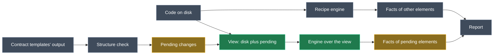

# Check a newly modelled element's facts on the first run

## Context

The drift report exists to show **gaps in the implementation**: code the developer still has to write, which the Software Factory (SF) will never produce. A pending SF change isn't one of those gaps; the developer just hasn't accepted it yet (you).

Today the check reads only the files on disk. A member or type the model has just added isn't on disk until its SF change is applied. So since this afternoon the check **holds back every fact about it**, and you have to run the SF twice to see the gap.

**Worked example.** You model a non-nullable `another: string` on `basisCalcLog`, and an action `MillsController.Ping` with Http Settings `GET Ping`. Neither EF Core configuration nor a `[Route]` is ever written by a template.

| | First run | Apply, second run |
| --- | --- | --- |
| **Today** | Nothing. The log says "left 2 differences to this run's changes … nor N facts about what it added" | `basisCalcLog.another` required: model `true`, code `false` (no `IsRequired()` …) and `MillsController.Ping` route: model `Ping`, code (none) (no route template on the action) |
| **After this change** | The same two rows | The same two rows, until the code is fixed |

On the first run, the property and the action themselves are still not rows: they're the SF's pending changes, already shown in the Changes pane.

## Approach

The check reads the facts about pending elements against the code **as it will be once the pending changes are accepted**. That view is built in memory, never on disk, from two sources:

- the files on disk;
- this run's pending changes, taken from the contract templates' output that the check already renders: new members, new types and changed method signatures.

Every other fact is read from disk exactly as today.

*Green: new. Gold: changed. Grey: as today.*

<Callout id="decision-accepted" tone="decision" title="Pending changes count as accepted (you)">

The check judges the implementation as if the developer had accepted every pending SF change. A pending change is never a row. A gap that remains in that view (a missing `IsRequired()`, `[Route]` or `HasMaxLength`) is a row, and it fails the run like any other drift.

The hold-back added this afternoon is removed. It was answering the wrong question: it waited for the code to catch up with something the SF already produces.

</Callout>

<Callout id="warning-untick" tone="warning" title="A failing first run leaves its staged changes unticked">

Because the gap fails the run, Intent unticks all of that run's staged changes, including the SF's addition of the new member. That's existing platform behaviour for any drift: the developer, or the AI, applies the changes they expect alongside the fix. It's accepted because the gap is real, and hiding it is what forced two runs.

</Callout>

<Callout id="warning-approximation" tone="warning" title="The view is built from the template output, not the weaver's merge">

- **New member:** its generated declaration is inserted before the closing brace of its type's first declaration in the code file.
- **New type in an existing file:** inserted before the closing brace of the namespace, or at the end of a file-scoped one.
- **New file:** the generated file as a whole.
- **Changed method or constructor signature:** only the parameter list is replaced. That's what the weaver's fully managed signature does, and it keeps the code's attributes.

It isn't RoslynWeaver's exact output, which the check can't see: the merged files only exist after the check has run. It's accepted because templates never write what facts read (routes, verbs, EF configuration). So a fact read from an inserted member reads what the next run would read once the change is applied.

</Callout>

<Callout id="warning-scope" tone="warning" title="Only facts about pending elements use the view">

The view is used only for facts whose element chain includes an element the model added, or a method or constructor whose signature change is pending. All other facts, the structure comparison and ownership still read the disk. This keeps every other row's line number true to the file, and means a pending removal never affects anything.

A pending-element fact located in a file the view changed keeps its line only when it falls before that file's first change. Otherwise its row points at the file without a line: the code it read isn't on disk yet.

</Callout>

## Model changes

None. This is a change to the drift engine shared by both Guardrails modules, with no Module Builder change. Both modules stay at 1.0.0-pre.0, which is unpublished.

## Code changes

All engine edits go into the Domain module's `Drift` folder and are copied to Services, as `SharedCodeTests` requires.

- **`CodeIndex.cs`:** today's one-file `CodeFiles.WithText` becomes `WithFiles`, which changes several files and adds new ones to the file list.
- **`RecipeEngine.cs`:** `RecipeEngine.WithFiles`, built on the same overlay. It also hands back the hits it located in unchanged files, which are the same syntax nodes as on disk, so ownership still counts that code as described.
- **`StructureComparer.cs`:** keeps each generated type's and member's declaration, and each generated file's text, by aspect. These are already parsed for the comparison.
- **`DriftReport.cs`:**
  - `PendingChanges` records the pending additions (aspect, file and element id) and pending parameter-list changes (aspect, code node and element ids).
  - `DriftCheck.Run` builds the view, and reads facts whose element chain includes one of those elements through the view engine.
  - The deferral (`DeferredFacts`) and the "nor N facts about what it added" part of `PendingMessage` are removed.
  - Row locations are mapped as described above.
- **`RecipeCheck.cs`:** the probe skips readings matched inside code the view inserted, because that code isn't on disk. Those readings are still counted in the Recipe check table.

## Steps

1. **Overlay.** Generalise `CodeFiles.WithText` to `WithFiles` (changed and new files), and add `RecipeEngine.WithFiles`, which shares the caches as `WithText` does today.
2. **Generated declarations.** Have `StructureComparer.Compare` return each aspect's generated declaration and each generated file's text.
3. **The view.** In `DriftCheck`, collect pending additions and parameter-list changes from `ApplyBaseline`, then build the in-memory file texts (insert, append, new file, or replace a parameter list).
4. **Read the facts.** Facts of pending elements go through the view engine; everything else goes through the disk engine. Copy located hits in unchanged files back to the disk engine before the ownership check. Map row locations. Remove the deferral and its message.
5. **Probe.** Skip readings matched in inserted code.
6. **Tests.**
   - Rewrite `FactRowTests`' deferral test: the first run reports `Order.Test` required.
   - New action on an existing controller: route row on the first run, no structure row, and the controller's other actions aren't reported by the endpoint convention.
   - New controller (new file): `service.route` read from the view.
   - Renamed parameter (pending signature change): its binding is read with no can't-be-verified row.
   - A fact of an unaffected element keeps its disk line.
   - A pending element's fact located after an insertion points at the file without a line.
7. **Guidance and docs.**
   - The always-on rule's "a fact about a type or member you have just added … is checked on the next run" becomes: checked on the same run, against the code as it will be once the pending changes are applied.
   - The same correction in both READMEs.
   - `CONTEXT.md`: supersede the "Facts about an added element wait" entry and record why. Add the view's approximation and scope, and the accepted untick.
   - Update the drift-report memory: pending changes count as accepted.
8. **Close out.**
   - Rebuild both modules with 0 warnings.
   - Run all tests, with the copies kept identical.
   - Run both module applications' SF, which should stage nothing.
   - Publish to `D:\Dev\.intent-modules` and record the DLL md5s.

## Critical files

- <FileRef path="Modules/Intent.Modules.Domain.Guardrails.Contracts/Drift/DriftReport.cs" />: `ApplyBaseline`, `PendingChanges`, the fact loop in `DriftCheck.Run`, `PendingMessage`.
- <FileRef path="Modules/Intent.Modules.Domain.Guardrails.Contracts/Drift/CodeIndex.cs" />: the overlay (`CodeFiles.WithText` today).
- <FileRef path="Modules/Intent.Modules.Domain.Guardrails.Contracts/Drift/RecipeEngine.cs" />: `WithText`, `_located`, `IsDescribed`.
- <FileRef path="Modules/Intent.Modules.Domain.Guardrails.Contracts/Drift/StructureComparer.cs" />: `Compare`, `Members`.
- <FileRef path="Modules/Intent.Modules.Domain.Guardrails.Contracts/Drift/RecipeCheck.cs" />: `RecipeProbe`.
- <FileRef path="Modules/Intent.Modules.Domain.Guardrails.Contracts/Templates/ModelSyncGuidance.cs" />, both `docs/README.md` files, and the Domain <FileRef path="Modules/Intent.Modules.Domain.Guardrails.Contracts/CONTEXT.md" />.
- <FileRef path="Modules/Intent.Modules.Guardrails.Contracts.Tests/FactRowTests.cs" /> and <FileRef path="Modules/Intent.Modules.Guardrails.Contracts.Tests/ModelBaselineTests.cs" />.

## Verification

**Here:**
- Both modules build with 0 warnings.
- All tests pass, including the new ones and `SharedCodeTests`.
- The module applications regenerate with nothing staged.

**In Basislink** (reinstall both modules one at a time, checking the md5):

| Case | Expected on the first run |
| --- | --- |
| Model a non-nullable string attribute (e.g. `basisCalcLog.another`) | `basisCalcLog.another` required: model `true`, code `false` (…), pointing at the `Entity<basisCalcLog>` configuration. No row for the property itself |
| Model a nullable string attribute with no constraints | No row: EF Core maps it by convention |
| Model an action with Http Settings on an existing controller | Route row for the new action, pointing at the controller file. No "not modelled" row for the controller's other actions |
| Model a new controller | `service.route` and route rows for its actions, pointing at its new file |
| Rename an operation's parameter in the model | No "can't be verified" row for its binding |
| Apply the pending changes and run again | The same gap rows, with real line numbers, until the code is fixed |

## Open questions resolved

- **Q:** Does the check read the files on disk or Intent's virtual file system with unapplied changes? **A:** The files on disk. This run's merged output only exists after the check has run, and an earlier run's unapplied staging is discarded when a new run starts. That's why this plan builds the "accepted" view in memory.
- **Q:** Should a gap about a newly modelled element fail the run? **A:** The report shows gaps in the implementation. Pending changes aren't gaps; the user just hasn't accepted them (you). So the check judges the code with the pending changes accepted, and a gap it finds there is drift like any other.
