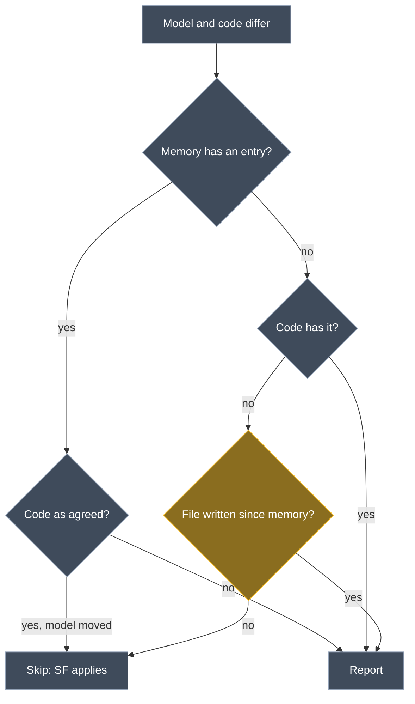

# Fix the Guardrails adversarial re-test findings

## Context

The re-test (`BasisLinkSolution/intent/.plans/2026-10-21-guardrails-adversarial-retest.md`) reported four drift-check failures. Three of them hold up:

- **MEM9b, MEM5b:** hand edits the check doesn't report.
- **C8b V7/V8:** new endpoints hidden by an exception.
- **MEM1d (`private set`):** turns out to be by design (see the review).

It also found three recipe defects (M22, M13, RC2b), small report-text issues, and several platform or agent behaviours. The handover's rule is that a hand edit that isn't reported is a failure. That's the bar used here, along with the brownfield principle: report, never overwrite.

Three of the failures came from the recipe file an AI wrote, so this plan also adds a way to check that the recipes really read the code (your request). Without it, a recipe that misreads either:
- shows a false row, which is loud; or
- agrees with the model by accident, which is silent. During setup, a loud misreading can become a silent one: the AI "fixes" a correct model to match it.

**Worked example (MEM9b).** A teammate adds `PsMembersDTO.email` to the model and the code. I pull, and before my next Software Factory (SF) run I delete `email` by hand.

- **Today:** my memory has never seen `email`, so the check takes it for a model-first addition and skips it. The SF then quietly re-adds it.
- **After the fix:** `PsMembersDTO.cs` was written after my memory was saved, so the check can't prove the change was model-only. It reports "`PsMembersDTO.email` (property) is modelled, but not in the code", and the failing run leaves the re-add unticked.

## Review of each finding

| Finding | Legitimate? | Fix belongs in | Severity |
| --- | --- | --- | --- |
| MEM9b: a deletion the memory never saw is reverted | **Yes.** It's realistic after a pull or branch switch with no SF run in between. The tester simulated it by removing a memory entry | Drift engine | High |
| C8b: a member exception hides the code inside the member | **Yes.** `Covers()` matches a convention item found *inside* a method against `Type.Member`, so `MillsEndpoints.MapMillsEndpoints` exempts every `Map…` call in it | Drift engine + guidance | High |
| MEM5b: a hand-added member of a model-deleted type is lost | **Yes.** `ApplyBaselineToRemovedTypes` compares only the members the memory knows, so the destructive delete goes through unreported | Drift engine | High |
| MEM1d: `private set` isn't compared | **No, by design.** RoslynWeaver's Merge mode keeps a code accessor change: run A staged nothing for `MillAlertDTO.cs`. The model can't express accessors, so reporting one would be drift nobody could fix in the model, as with F4 (a second route) | — | — |
| M22 as configured: false contradiction for a route from a constant | Yes, but it's a recipe defect. Basislink's `operation.route` lacks the `unreadable` case the skill prescribes, and the false row invites a wrong model fix | Basislink recipe | Medium |
| M13: false "required" row on a key column | Yes, but it's a recipe defect. Basislink's `column.required` ignores `HasKey`, though the skill's example handles it | Basislink recipe | Low |
| RC2b: a static helper in the DTO project is reported as a DTO | Yes, but it's a recipe defect. The convention I wrote matches every class in `Basislink.DTO` | Basislink recipe + guidance | Low |
| MEM7: both-sides parameter change has no "(both changed…)" note | Yes, cosmetic. The row is reported; only the note is missing, because memory keys carry the signature | Drift engine | Low |
| Recipe-problem row has no file; can't-be-verified rows repeat their location | Yes, cosmetic | Drift engine | Low |
| `sync-model` contradicts itself about errors listing rows | Yes. One sentence still says the errors list every row | Guidance | Low |
| M1: model route shows `Get/{millCode}/{code}` | **Probably not a bug.** The check reads the `Route` property as stored. Intent's Web API designer appends a route-bound parameter the template doesn't contain (`code`) | Verify only | — |

<Callout id="mem1d-by-design" tone="decision" title="MEM1d: accessors belong to the code">

The model has no way to say `private set` or `init`: Property Configuration only carries Required and AccessModifier, and the templates write `get; set;`.

The weaver never touches a property's accessors in the contract files. Those files set `DefaultIntentManaged(Mode.Merge)`, and only constructors and methods get `Signature = Mode.Fully`. A Merge signature goes through `MergeSignature` (`Intent.Code.Weaving`, `TreeMerger.PropertyDeclarationSyntax.cs`): it merges the property's modifiers and replaces its type, but leaves the accessor list alone. Only `FullyManageSignature` rewrites accessors. A Merge body just visits the property's children, and there's no accessor override. So `private set`, `init` and a removed setter all survive, and run A staged nothing for `MillAlertDTO.cs`.

Accessors are therefore code-owned, and comparing them would only produce drift that can't be fixed in the model. A class modifier such as `sealed` is still compared, and still reported, because Type Configuration can model it.

</Callout>

## Not fixed here

- **Staged changes not marked destructive (M5, M6).**
  - By design: the model changed, and the code was exactly as agreed.
  - The hand-edit cases (MEM1b, MEM1c) are reported, and their run fails.
- **Platform: `run_software_factory` auto-apply.**
  - Check whether it auto-applies a run that logged errors. If it does, agents lose reported hand edits.
  - Raise it with Intent Architect. It isn't module code.
- **Other platform behaviour:**
  - a report-only run rewrites `application.deviations.log.xml` and `managed-files.xml`;
  - a same-version reinstall doesn't refresh `.cache/modules`.
- **File Classification entries removed on reinstall.**
  - Neither module has migrations. Each installs metadata only into its own Domain or Services designer, and its only link to Codebase Structure is a minimum-version `detect` for `Intent.Modelers.CodebaseStructure`.
  - It needs a separate reproduction (did the reinstall trigger a Codebase Structure reinstall?). This is a data-loss risk to raise on its own.
- **Agent behaviour:**
  - a second memory directory;
  - `git stash` / `git checkout --`;
  - `#warning` re-indent noise;
  - an optional closing question.
- **Not testable yet:** `TF_BUILD`. It needs a 5.4 client.

## Approach

All engine changes are in the shared `Drift` code. They are made once in the Domain module and synced to Services, and `SharedCodeTests` keeps the two identical. Basislink's recipe fixes go into the worktree root copies of `domain.drift.json` and `services.drift.json`, as before, for you to copy across. Both modules are still at 1.0.0-pre.0 and unpublished, so no version bump.

The memory rule gains one guard (MEM9b) and one extra comparison (MEM5b):

*Gold: the new guard. Grey: today's rule.*

### Engine fixes

1. **MEM9b: guard additions the memory never saw.**
   - The template passes the memory file's last-write time into `DriftCheckInput`, and each `CodeFile` carries its own last-write time.
   - In `ApplyBaseline`'s "no entry, not in the code" branch, skip only when the item's file hasn't been written since the memory was saved, or doesn't exist.
2. **MEM5b: compare the whole type before letting the model delete it.**
   - A type's memory entry gains an optional `members` fingerprint covering every code member, at any access level.
   - `ApplyBaselineToRemovedTypes` skips the delete only if the declaration and `members` both match what was agreed. Otherwise it reports, with the both-changed note.
3. **C8b: what an exception covers.**
   - A `Type` or `Type.Member` exception covers those declarations, and a type exception also covers its members.
   - It no longer covers convention items found inside a member's body, such as a route mapping or a configuration call. Those are exempt only by their own name or by a file pattern.
   - All of Basislink's current exceptions name member declarations, so none of them changes behaviour.
4. **MEM7: the both-changed note across signature changes.** When neither the code's key nor the model's key is in memory, use a stale memory entry for the same member name (one neither side still has) as the base.
5. **Report text:**
   - The recipe-problem row links the recipe file, by absolute path, which `FileRef` accepts.
   - A can't-be-verified row's text stops repeating the location its Code file column already shows. The plain error line keeps it.

<Callout id="mem9b-tradeoff" tone="warning" title="MEM9b guard: what it costs, and what it still misses">

- **Cost.** If an item's file is touched after the last run (a branch switch, or an unrelated edit to the same file), a pending model-first addition in that file is reported once. The next run writes fresh memory and skips it again. This is accepted, because it errs towards reporting.
- **Still missed.** A whole new *type* pulled in both model and code, whose file is then deleted by hand before any SF run, has no file to date-check. The SF recreates it. This is accepted as narrow and recorded in `CONTEXT.md`.
- **Rejected.** Reading git `HEAD`: it ties the check to git, and it would report every pending addition after any commit. Hashing the file: a pull then delete can leave the file byte-identical to what the memory saw.

</Callout>

<Callout id="c8b-scope" tone="warning" title="C8b: a type exception no longer hides code mapped inside its methods">

After the change, exempting a whole type such as `MillsEndpoints` exempts the type and its members, but not `Map…` calls inside its methods. To exempt one of those, name it or use a file pattern. That's intended: those calls are endpoints, the model's own concept.

</Callout>

### Recipe verification (your request)

A run whose recipe file differs from the last run's (its hash is kept in `.cache/guardrails/<application>/<Designer>.recipe.json`) does two extra things.

6. **Probe the recipes.**
   - For each recipe, the probe takes one fact per `find` path and per read case that read a value from the code. It changes the matched text in memory and reads the fact again. A captured value gets a different value; a case that maps a match to a fixed value loses its match.
   - The read value must change. If it doesn't, the recipe isn't really reading the code there, and the run warns: "`operation.route`: changing `[Route("Count")]` at `MillsController.cs:48` doesn't change what the recipe reads".
   - No file is touched. The probe's warnings are kept in the same `.recipe.json` and shown on every run until the recipe file changes again.
7. **Show how each kind was read.** On that run the drift report gains a third table, **Recipe check**, so the report is written even with no drift:
   - one row per fact kind, with how many facts were read from the code, from the `default`, from the `absent` value, and how many can't be verified, plus one sample location each;
   - read cases that matched nothing;
   - for each `own` convention, how many types it found and how many of those aren't modelled;
   - for each exception, how many items it covers.

   It's for a person reviewing the recipe change. A recipe that takes everything from its default, a convention that matches far too much (RC2b), or an exception that covers a lot (C8b) stands out at a glance.
8. **Setup guard (configure-drift-check skill).**
   - Before changing the model to clear a contradiction, open the code at the row's location and confirm the recipe read it correctly.
   - Several contradictions of the same kind with the same code value (all "code (none)", for example) mean the recipe is wrong: fix the recipe, not the model.
   - At the end, list every model change the setup made for the developer to approve in one question, and point them at the Recipe check table.
   - The exit condition gains: no probe warnings.

<Callout id="probe-limit" tone="warning" title="What the probe can't prove">

The probe proves a recipe reads *some* code. It can't prove it reads the *right* code. A recipe that reads `HasMaxLength` from the wrong property's chain still changes when that chain changes. Only an independent check catches that: a person reading the Recipe check samples, or an adversarial run like this one. A fact read from a `default` or `absent` value has no matched text to change, so the table counts it rather than probing it.

</Callout>

### Recipe fixes (Basislink, root copies)

9. **M22.** Add the skill's `unreadable` case to `operation.route` and `service.route`, keeping Basislink's `[\[,]` attribute-list prefix.
10. **M13.** `column.required` gets a second `find` path for `HasKey` containing the attribute, plus a read case that gives `true`, as in the skill's EF example.
11. **RC2b.** The DTO convention matches only non-static classes, for example `class with \bpublic\s+(?!static)(?:sealed\s+|partial\s+)*class \w+`. Check it against every class in `Basislink.DTO` first.

### Guidance fixes (`ModelSyncGuidance.cs`, synced)

12. **Exceptions.** A type or member exception exempts that declaration, not the code inside a member. Name the convention item, or use a file pattern, to exempt it.
13. **Conventions.** Exclude static helper classes, or the helpers folder, when a project mixes helpers with the element type.
14. **Contradiction.** The sentence that says the errors list every drift row is reworded to match the others: the error names the report.
15. **Recipe checks.** The rule and sync-model explain the Recipe check table and probe warnings, and that a contradiction which looks like a misreading means checking the recipe first.

### Verify, don't change

16. **M1.** Read `GetMillByCode`'s Http Settings in the Basislink model. If the stored route is `Get/{millCode}/{code}`, there's nothing to fix. If it's `Get/{millCode}`, find what appends `/{code}`.

## Steps

1. **Engine:** fixes 1–5 in the Domain `Drift` folder, then sync to Services.
2. **Recipe verification:** the probe and the Recipe check table (6–7). The engine reports, for each reading, which `find` path and read case produced it, and the matched span, so the probe can change it in an in-memory overlay of the code.
3. **Templates:** both `DriftReportTemplatePartial.cs`:
   - pass the memory's last-write time and the recipe's absolute path;
   - read and write `.recipe.json` (the recipe hash and the probe warnings);
   - write the report when the Recipe check table is present.
4. **Tests:**
   - `ModelBaselineTests`: MEM9b with timestamps, MEM5b with an added member, MEM7's note;
   - exception scope (a member exception doesn't cover a `Map…` call inside it);
   - the probe:
     - a correct recipe passes;
     - a recipe whose case can't see a change is warned about;
     - default-only facts are counted, not probed;
   - the Recipe check table only on a recipe change, and the warnings persisting until the next change;
   - the recipe-row file;
   - unverifiable row text.
5. **Recipes:** fixes 9–11 in the worktree root copies, checked by parsing both files with the engine and running the probe against Basislink's code.
6. **Guidance:** fixes 8 and 12–15. Update the READMEs and `CONTEXT.md`, recording:
   - the MEM9b limits;
   - why accessors aren't compared;
   - what the probe can and can't prove.
7. **Close out:** rebuild both modules, run all tests and the module SF runs, publish to `D:\Dev\.intent-modules`, then verify M1.

## Critical files

- <FileRef path="Intent.Modules.Domain.Guardrails.Contracts/Drift/DriftReport.cs" />: `ApplyBaseline`, `ApplyBaselineToRemovedTypes`, `Covers`, `BaselineEntry`, row building, the Recipe check table.
- <FileRef path="Intent.Modules.Domain.Guardrails.Contracts/Drift/RecipeEngine.cs" />: which path and case produced a reading, the matched span, the probe, and problem text without the location.
- <FileRef path="Intent.Modules.Domain.Guardrails.Contracts/Drift/StructureComparer.cs" />: `CodeFingerprints`, the type's `members` fingerprint.
- <FileRef path="Intent.Modules.Domain.Guardrails.Contracts/Drift/CodeIndex.cs" />: `CodeFile` last-write time, and an in-memory overlay for the probe.
- <FileRef path="Intent.Modules.Domain.Guardrails.Contracts/Templates/DriftReport/DriftReportTemplatePartial.cs" /> and the Services copy.
- <FileRef path="Intent.Modules.Domain.Guardrails.Contracts/Templates/ModelSyncGuidance.cs" />.
- The worktree root's `domain.drift.json` and `services.drift.json`.

## Verification

- **Here:** both modules build with 0 warnings, all tests pass including the new ones, and the module applications regenerate with nothing staged.
- **In Basislink:** reinstall both modules (check the md5) and copy the recipes, then re-run the failed cases, plus three recipe-verification checks:

| Case | Expected after the fix |
| --- | --- |
| MEM9b | "`PsMembersDTO.email` (property) is modelled, but not in the code"; run fails, re-add unticked |
| MEM5b | `OpenBidCountDTO` row with "(the model and the code have both changed…)"; delete unticked |
| MEM1d | Unchanged: `sealed` reported, `private set` not, and nothing staged for `MillAlertDTO.cs` (by design) |
| C8b V7/V8 | Both new `Map…` endpoints reported as not modelled, with the agent's exception still in place |
| M22 | "can't be verified: stated in a form the recipe can't read: `[Route(BasisRoutes.SiloMillDistances)]`" |
| M13 | Only the primary key row; no required row for `millCode` |
| RC2b | `DtoText` not reported; a new non-static DTO still is |
| MEM7 | Parameter row ends with the both-changed note |
| Model-first addition (`basisCalcLog.test`), file untouched | Still skipped, run passes |
| First run after copying the recipes | The report has a Recipe check table; no probe warnings |
| A recipe broken on purpose (e.g. `operation.route`'s capture removed) | A probe warning naming the recipe and a location, shown on every run until the recipe is fixed |
| A second run with the recipe unchanged | No Recipe check table |

## Open questions resolved

- **Q:** How do we know the AI configured the recipes properly? **A:** Add all three: the probe, the Recipe check table, and the setup guard, in this plan (you).
- **Q:** MEM1d: report a private setter? **A:** No, by design. The weaver keeps the code's accessors in Merge mode, and the model can't express them (you, confirmed in the weaver source).
