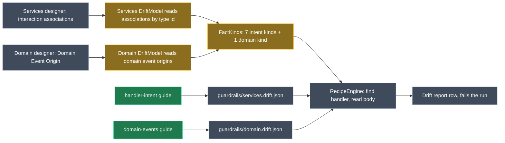

# Drift detection on modelled intent

## Context

The Services designer can say what a handler **does**, not only what it looks like. It does this through interaction associations:
- Create, Update, Delete and Query Entity Action;
- Perform Invocation, which invokes a service operation, Command, Query, domain service, repository operation, stored procedure or API client;
- Publish Integration Event and Send Integration Command.

The Domain designer has the same for domain events: an entity constructor or operation can be linked to the Domain Event it raises.

The reverse-engineer-services skill already models these associations during adoption (§5 "Intent"). The drift check has never read them, though. The Services `CONTEXT.md` records "Associations (intent: entity actions, invocations, published events) aren't checked", and the README says "aren't checked yet". So the diagrams can claim a handler publishes an event, and nothing ever checks that against the code.

**What this change adds:** each modelled interaction becomes a drift fact. The drift check verifies that the code performs it, and a row is reported when it doesn't.

### A worked example (eShop, illustrative)

Suppose the eShop Services diagram has `CreateOrderCommand` → **Create Entity** → `Order`, and `CreateOrderCommand` → **Publish Integration Event** → `OrderStartedIntegrationEvent`. A developer later removes the `AddAndSaveEventAsync(new OrderStartedIntegrationEvent(...))` line from `CreateOrderCommandHandler`. The next Software Factory run then fails with one row:

| Model element | Drift |
| --- | --- |
| `CreateOrderCommand` | `CreateOrderCommand` publishes: model `OrderStartedIntegrationEvent`, code (none) (no `new OrderStartedIntegrationEvent` in the handler) |

Domain events work the same way. If `Order`'s constructor is linked to `OrderStartedDomainEvent` and stops raising it, the row is "`Order.Order` raises: model `OrderStartedDomainEvent`, code (none)".

## Approach

The drift engine compares model facts with values that recipes read from the code. Interactions fit that engine as it stands, so **no recipe-engine change is needed**:
1. Read each interaction association from the designer, by association type id, just as the Domain module already reads relationships from `designer.Associations`. The modeler packages stay optional dependencies.
2. Emit one fact per association. Its placeholders name both ends:
   - the source: `{Service}`, `{Operation}`, `{Folder}`;
   - the target: `{Entity}`, `{Member}`, `{Invoked}`, `{InvokedOwner}`, `{Message}`, `{DomainEvent}`.

   A recipe can then find the handler and match the target in its body with model names and filters, e.g. `_{InvokedOwner|camel}\.({Invoked})(?:Async)?\(`.
3. Ship a tested technology guide per module, so the AI starts from proven recipes instead of inventing them.

*Green: new. Amber: changed. Grey: existing, reused as is.*

<Callout id="decision-shape" tone="decision" title="One fact per association, value = the target's name">

**The decision.** The fact's value is the target element's name: the entity, the invoked element, the message or the domain event. The recipe reads that name from the code by capture, or falls back to `default: ""`. A missing interaction therefore reads as "model `Order`, code (none)", with the recipe's `unstated` text in brackets.

**The rejected alternative.** One list-valued fact per handler and kind ("creates: `Order,OrderItem`"). It can't give a recipe placeholders for each target, so the AI would have to turn code spellings into model names, such as `_orderService` into `OrderService`. That needs case transforms the engine doesn't have.

</Callout>

### The new fact kinds

All are in the shared `FactKinds.cs`. Source placeholders for the Services kinds are `Service`, `Operation` and `Folder`, as for endpoints.

| Key | Label | Association | Value | Target placeholders |
| --- | --- | --- | --- | --- |
| `intent.creates` | creates | Create Entity Action | entity class name | `Entity`, `Member` (targeted constructor or factory operation, else empty) |
| `intent.updates` | updates | Update Entity Action | entity class name | `Entity`, `Member` (targeted operation, else empty) |
| `intent.deletes` | deletes | Delete Entity Action | entity class name | `Entity` |
| `intent.queries` | queries | Query Entity Action | entity class name | `Entity` |
| `intent.invokes` | invokes | Perform Invocation (and its legacy name Call Service Operation, same type id) | invoked element's name | `Invoked`, `InvokedOwner` (Service, Domain Service, Repository or Service Proxy; empty for a Command, Query or stored procedure) |
| `intent.publishes` | publishes | Publish Integration Event | message name | `Message` |
| `intent.sends` | sends | Send Integration Command | integration command name | `Message` |
| `intent.raises` (Domain) | raises | Domain Event Origin | domain event name | `Entity`, `Member` (the raising operation, or the class name for a constructor), `DomainEvent` |

**Sources (your decision: all of them):**
- Commands, Queries and Services' Operations: `Service` is empty for a Command or Query, as with endpoints, and parameter names select overloads.
- Integration event and command subscriptions, and domain event handlers. The source here is an association end: `Service` is the handler's name and `Operation` is the message or event it handles. The row element is `Handler(Message)`.

Each fact's element ids are the source's, so the report and "Try fix with AI" open the handler's element. `OwnPlaceholders` returns the target placeholders for these kinds. Without that, the wrong-element check would treat two creates on one command as the same element.

<Callout id="tradeoff-direction" tone="warning" title="Diagram to code only (your decision)">

An interaction in the code that the diagram doesn't show is not reported. A hand-added `_eventBus.Publish(...)` goes unnoticed until someone models it. Adoption still models every intent through the reverse-engineer skills, so the gap only opens for hand edits after adoption.

</Callout>

<Callout id="tradeoff-presence" tone="warning" title="Presence in the handler, not behaviour">

A recipe reads that the handler (or the class, if the recipe scopes it that way) does `new Order`, calls `.Remove(`, sends `new GetOrderQuery` or publishes `new X`. It does not prove the entity is saved or the message delivered.

An interaction done in another class the handler calls reads as missing until the recipe widens its find. The guide says how to do that and what it can't read, as the existing guides do.

</Callout>

<Callout id="tradeoff-scope" tone="warning" title="Not checked in this cut">

- Mappings.
- A Query Entity Action's multiplicity (`1` or `0..*`).
- The order of interactions.

Each could become a later fact on the same association without changing this design.

</Callout>

<Callout id="tradeoff-modelfirst" tone="warning" title="A newly modelled interaction fails the run until it's coded">

The Guardrails templates never write handler bodies, so the Software Factory will never fill this gap. That makes it a gap, not a pending change, and it is reported on the same run. This is consistent with the existing rule for facts (a new attribute with no `IsRequired()` is reported the same way).

Existing recipe files get a "No recipe: `intent.creates` … isn't checked" **warning** until they are configured. A warning doesn't fail the run.

</Callout>

## Model changes

The only designer changes are in each module's own **Module Builder** designer: one new File Template beside the existing guides. Examples of the existing guides are <ModelRef application="Intent.Modules.Services.Guardrails.Contracts" name="AspNetCoreControllersRecipeGuide" designer="Module Builder" type="File Template" /> and <ModelRef application="Intent.Modules.Domain.Guardrails.Contracts" name="EfCoreRecipeGuide" designer="Module Builder" type="File Template" />.

<ModelChanges id="mb-changes" caption="Module Builder designer changes" changes={[
  { element: "HandlerIntentRecipeGuide", designer: "Module Builder (Intent.Modules.Services.Guardrails.Contracts)", change: "added",
    note: "Writes configure-drift-check/references/handler-intent.md. Settings copied from AspNetCoreControllersRecipeGuide.",
    fields: [{ label: "Type", after: "File Template: Single File" }, { label: "File Settings", after: "Text, Markdown File Builder, no file extension" }, { label: "Template Settings", after: "Lookup Type, Role AI.Context.Skills" }] },
  { element: "DomainEventsRecipeGuide", designer: "Module Builder (Intent.Modules.Domain.Guardrails.Contracts)", change: "added",
    note: "Writes configure-drift-check/references/domain-events.md. Settings copied from EfCoreRecipeGuide.",
    fields: [{ label: "Type", after: "File Template: Single File" }, { label: "File Settings", after: "Text, Markdown File Builder, no file extension" }, { label: "Template Settings", after: "Lookup Type, Role AI.Context.Skills" }] }
]} />

No consumer designer changes, and no new module dependencies. Associations are read by type id, as `OptionalModelerMetadata` already does for the optional modelers' elements.

## Code changes

<FileTree id="files" title="Files" entries={[
  { path: "Modules/Intent.Modules.Services.Guardrails.Contracts/Drift/FactKinds.cs", change: "modified", note: "8 kinds, new placeholder sets, Describe entries, explicit own placeholders. The Domain copy must stay identical" },
  { path: "Modules/Intent.Modules.Domain.Guardrails.Contracts/Drift/FactKinds.cs", change: "modified", note: "Identical copy (SharedCodeTests)" },
  { path: "Modules/Intent.Modules.Services.Guardrails.Contracts/Drift/DriftModel.cs", change: "modified", note: "Read the 7 interaction association types, with element and association-end sources" },
  { path: "Modules/Intent.Modules.Services.Guardrails.Contracts/Templates/OptionalModelerMetadata.cs", change: "modified", note: "Association type ids for Entity Actions, Perform Invocation, Publish and Send" },
  { path: "Modules/Intent.Modules.Domain.Guardrails.Contracts/Drift/DriftModel.cs", change: "modified", note: "Read Domain Event Origin associations; pass parameter names for overloads" },
  { path: "Modules/Intent.Modules.Services.Guardrails.Contracts/Templates/DriftRecipeGuides.cs", change: "modified", note: "New HandlerIntent guide" },
  { path: "Modules/Intent.Modules.Domain.Guardrails.Contracts/Templates/DriftRecipeGuides.cs", change: "modified", note: "New DomainEvents guide" },
  { path: "Modules/Intent.Modules.Services.Guardrails.Contracts/Templates/ModelSyncGuidance.cs", change: "modified", note: "Guide index rows and FactsText for both designers. The Domain copy must stay identical" },
  { path: "Modules/Intent.Modules.Domain.Guardrails.Contracts/Templates/ModelSyncGuidance.cs", change: "modified", note: "Identical copy" },
  { path: "Modules/Intent.Modules.Services.Guardrails.Contracts/Templates/ReverseEngineerServicesSkill/ReverseEngineerServicesSkillTemplatePartial.cs", change: "modified", note: "Section 5 covers event handler subscriptions too; stays within the 48 KB budget" },
  { path: "Modules/Intent.Modules.Domain.Guardrails.Contracts/Templates/ReverseEngineerDomainSkill/ReverseEngineerDomainSkillTemplatePartial.cs", change: "modified", note: "Domain Event Origin becomes required modelling, because the drift check verifies it" },
  { path: "Modules/Intent.Modules.Guardrails.Contracts.Tests/Fakes.cs", change: "modified", note: "Association fake takes a specialization type id; association-end sources" },
  { path: "Modules/Intent.Modules.Guardrails.Contracts.Tests/ModelFactTests.cs", change: "modified", note: "Facts read from each association type and source kind" },
  { path: "Modules/Intent.Modules.Guardrails.Contracts.Tests/HandlerIntentGuideTests.cs", change: "added", note: "Fixture tests for the handler-intent guide" },
  { path: "Modules/Intent.Modules.Guardrails.Contracts.Tests/DomainEventsGuideTests.cs", change: "added", note: "Fixture tests for the domain-events guide" }
]} />

The Software Factory scaffolds each new guide template's `TemplatePartial`/`TemplateRegistration` pair and its `.imodspec` entry. Only the constructor body is hand-written, as for the six existing guides, e.g. `new MarkdownFile("handler-intent", relativeLocation: "configure-drift-check/references").FromMarkdown(DriftRecipeGuides.HandlerIntent)`.

## Steps

1. **Version gate.** Both modules are at `1.0.0-pre.2`. Confirm it is still unpublished and leave it.
2. **Fact kinds (shared).**
   - Add the 8 kinds to `FactKinds.cs` in both modules, kept identical.
   - Placeholder sets: `Member`, `Invoked`, `InvokedOwner`, `Message`, `DomainEvent`.
   - Describe the new placeholders, and widen `Service` and `Operation` to cover event handlers.
   - Give each kind its own placeholders explicitly: the target placeholders for these kinds, the existing rule for the rest.
3. **Services model side.**
   - In `DriftModel.Read`, walk `designer.Associations` whose type id is one of the 7, and whose source belongs to this application's packages.
   - Resolve each source: a Command, Query or Service Operation (with parameter names), or a subscription or domain-event-handler association end (the handler and its message).
   - Resolve each target and its owner.
   - Emit one fact per association, with the source's element ids.
4. **Domain model side.** In the Domain `DriftModel`, read Domain Event Origin associations, from a Domain Operation or Class Constructor to a Domain Event, in this application. Emit `intent.raises` with the entity's and member's ids and the member's parameter names.
5. **Technology guides.**
   - Write two guides in the existing sections (Recognise it, Decide before copying, the recipe file, How each form is modelled with Values come from, Adapting to house style, What it can't read).
   - **Services, `handler-intent`.** Handler styles:
     - MediatR `IRequestHandler<,>` handlers;
     - service classes implementing `I{Service}`;
     - integration event consumers: Intent `IIntegrationEventHandler<T>`, MassTransit `IConsumer<T>`, NServiceBus `IHandleMessages<T>`;
     - domain event handlers.

     Interaction forms:
     - Intent repositories (`Add`, `Remove`, `FindByIdAsync`, `FindAllAsync`) or an EF Core `DbContext`;
     - `ISender`/`IMediator.Send(new …)`, injected services and API clients;
     - `IEventBus`/`IMessageBus` `Publish`/`Send`, MassTransit `IPublishEndpoint`/`ISendEndpointProvider`, and an outbox service such as `AddAndSaveEventAsync(new …)`;
     - a child created through its aggregate (`order.AddOrderItem(…)`), as §5 models it.
   - **Domain, `domain-events`.**
     - `DomainEvents.Add`, `AddDomainEvent`, `RaiseDomainEvent` and `_domainEvents.Add`, in constructors and operations;
     - a private helper named after the event (eShop's `AddOrderStartedDomainEvent`).
   - Model the two File Templates in Module Builder and run the Software Factory. Fill each constructor body.
   - Add a row to `DesignerGuidance.Services.Guides` and to `DesignerGuidance.Domain.Guides`.
   - Extend each designer's `FactsText`. The fact tables in configure-drift-check are generated from `FactKinds`, so they update themselves.
6. **Reverse-engineer skills.**
   - Services §5: model the intent of each command, query, service operation **and event handler subscription**.
   - Domain: link each constructor or operation to the domain events it raises (Domain Event Origin), because the drift check verifies them.
   - Trim the same number of bytes elsewhere in each skill, so both stay under the 48 KB budget. Measure after the edits.
7. **Tests.**
   - `ModelFactTests`: one test per association type and per source kind. Other applications' packages are ignored, and the legacy Call Service Operation name still maps to `intent.invokes`.
   - `GuidanceTests` picks up the new kinds and guide files.
   - Guide fixture tests in the `ServicesGuideTests` style:
     - every form reads clean;
     - validation passes, with no probe or wrong-element warnings, and values come from where the guide says;
     - each planted removal (a publish line, a `Remove(`, an invoked method renamed, a domain event no longer raised) gives exactly one row.
8. **Docs and context.**
   - Both READMEs, the release notes' drift line in each module (kept feature-level), and both `CONTEXT.md` files.
   - Supersede Services "Associations aren't checked". Record your three decisions, the fact design and the rejected list-valued design.
   - Update the memory notes.
9. **Close out.**
   - Build both modules with `--no-incremental`, which also packages them.
   - Run the Software Factory on both module applications and inspect the output.
   - Run the full test suite on Windows and in the Linux container with `TF_BUILD` set.

## Verification

<Checklist id="verify" items={[
  { id: "tests", label: "Full Guardrails test suite passes on Windows and in the Linux container with TF_BUILD set", note: "Includes SharedCodeTests: FactKinds and ModelSyncGuidance identical across modules" },
  { id: "guides", label: "Both guides' recipe files validate with no problems, probe or wrong-element warnings, and catch every planted change as exactly one row" },
  { id: "sf", label: "Software Factory on both module applications stages only the two new guide templates' scaffolding and imodspec entries, then nothing on a second run" },
  { id: "build", label: "Both modules build with 0 errors and package as 1.0.0-pre.2" },
  { id: "budget", label: "Rendered reverse-engineer-services and reverse-engineer-domain skills are each under 48 KB" },
  { id: "eshop", label: "Unverified until you run it: in eShop8, configure-drift-check adds the intent recipes from the guides, and removing a modelled publish from a handler produces its row", note: "eShop8 isn't open in this session" }
]} />

## Open questions resolved

- **Q:** Diagram to code only, or both directions? **A:** Diagram to code only.
- **Q:** Include domain events raised by entity constructors and operations? **A:** Yes, now.
- **Q:** Which handler sources? **A:** All: commands, queries, service operations, and integration and domain event handler subscriptions.
