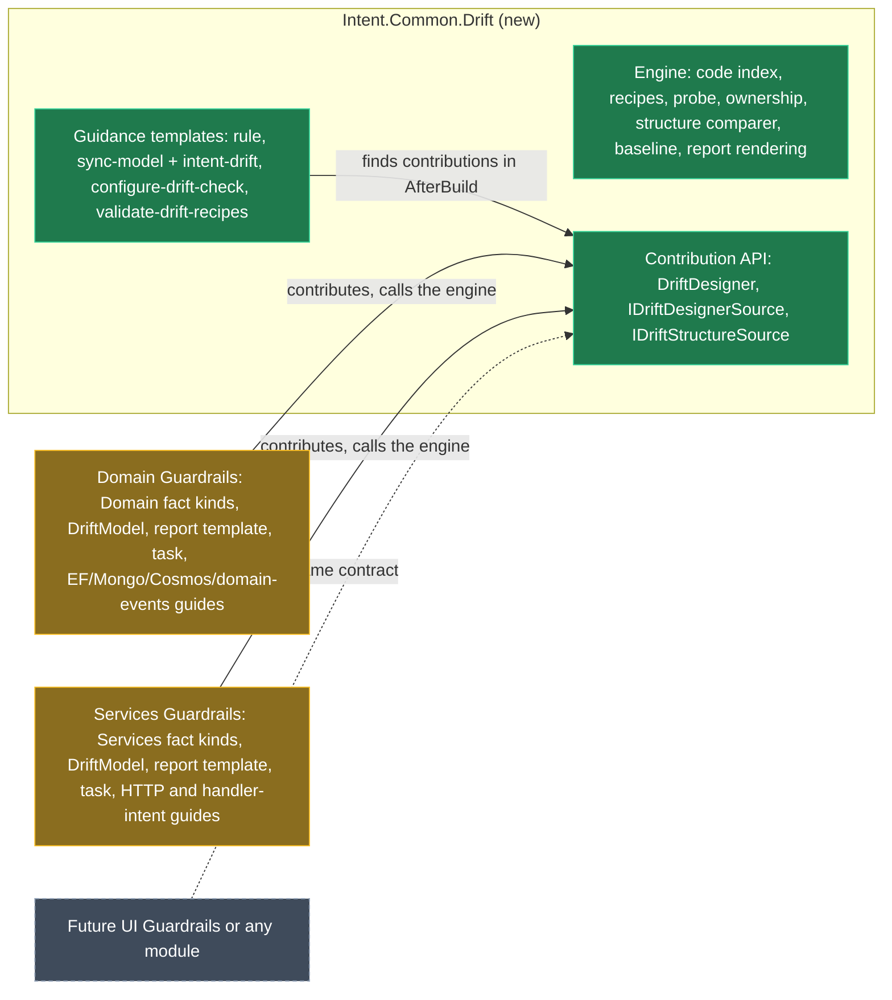

# Move the drift check out of the Guardrails modules into its own module

## Context

The Domain and Services Guardrails modules each carry a full copy of the drift check. `SharedCodeTests` keeps the copies identical apart from the namespace. That is about 5,300 lines:

- six engine files in `Drift/`: `CodeIndex`, `RecipeEngine`, `RecipeCheck`, `StructureComparer`, `DriftReport` and `FactKinds`;
- `Templates/ModelSyncGuidance.cs`;
- the report template and the `ValidateDriftRecipes` module task, which differ by four lines each;
- five guidance templates that both modules declare. An `IsWriter` check stops both from writing them.

Every change is made twice. A third module, such as a UI Guardrails module, or any other module that wants a drift check, would mean a third copy.

<Callout id="supersedes" tone="decision" title="This reverses a recorded decision">

The Domain module's `CONTEXT.md` records "the engine is copied, not shared (user decision)". It rejected a shared package because that meant a third module and a new dependency for consumers. This plan accepts both costs. At close-out, that entry is marked superseded, with today's date and your request as the reason.

</Callout>

**One example of the result.** A developer installs (or upgrades to) Domain Guardrails. Intent installs the new drift module with it as a dependency. On the next Software Factory run:

- the drift module writes `guardrails-model-sync.md` and the `sync-model`, `configure-drift-check` and `validate-drift-recipes` skills, listing every designer that has a drift check;
- Domain Guardrails writes `DomainDriftReport.mdx` using the drift module's engine, and keeps its own EF Core, MongoDB, Cosmos DB and domain-events guides.

The files on disk are byte-for-byte what the copies write today. Only the module that owns each file changes.

## Approach

Split at the line the code already draws. **Common:** everything that is the same for any designer. **Module-specific:** what each designer states and how its model is read. One new library-style module holds the common part. It knows no designer. Each Guardrails module supplies a small *drift designer* contribution: its fact kinds, its model reader and its guidance text.



*Green is new, amber is changed, dashed is future.*

### What goes where

| Piece | Today | After |
| --- | --- | --- |
| Code index, recipe engine and recipe file format, probe and wrong-element checks, ownership and exceptions, structure comparer and `Modellable`, baseline memory, report rendering, `DriftCheck.Run` | Identical copies in each `Drift/` | **Core** |
| `FactKind`, `ModelFact` and the placeholder machinery | Identical `FactKinds.cs` | **Core**, as types only |
| The fact catalog (Domain's 17 kinds, Services' 14), placeholder descriptions, `Own` lists | Both catalogs inside the shared `FactKinds.cs` | **Each designer module** |
| `DriftModel`: model to facts, element ids | Per module | Stays per module |
| Report template logic | 297-line near-copies | **Core** helper. Each module's `DriftReport` template delegates to it, and its template id is unchanged |
| `ValidateDriftRecipes` task | 108-line near-copies | **Core** helper. Each module's task delegates to it, and its task id is unchanged |
| Rule, sync-model, intent-drift, configure-drift-check, validate-drift-recipes | Declared by both modules, gated by `IsWriter` | **Core** templates, with one writer and no `IsWriter` |
| Per-designer guidance text (`FactsText`, `RuleRows`, guide rows, `IntentLinks`, `NewIntent`, the task id) | `DesignerGuidance.Domain` and `.Services` inside the shared file | **Each designer module's contribution** |
| Technology recipe guides, reverse-engineer skills, the `*Metadata` id helpers | Per module | Stay per module. The skills get the report path from core |
| Contract template marker (`IDomainContractTemplate`, `IServicesContractTemplate`) | Per module | Stays, and also implements core's `IDriftStructureSource` |

### The contribution contract

```csharp
// Core: what a module supplies for one designer's drift check.
public sealed record DriftDesigner(
    string Name,                     // "Domain": the recipe file guardrails/domain.drift.json, the report DomainDriftReport.mdx
    string DesignerId,
    int Order,                       // guidance lists designers in this order (Domain 10, Services 20) so output stays identical
    IReadOnlyList<FactKind> Kinds,   // keys, placeholders with descriptions, explicit Own list
    Func<IDesigner, string, DriftModelReading> ReadModel,  // facts + elements by id; wraps the module's DriftModel
    string ValidateTaskId,           // "Intent.Domain.Guardrails.Contracts.ValidateDriftRecipes"
    DriftGuidance Guidance);         // FactsText, RuleRows, GuideRows, IntentLinks, NewIntent, optional extra sentences

public interface IDriftDesignerSource { DriftDesigner Designer { get; } }   // the module's DriftReport template implements it
public interface IDriftStructureSource { string Designer { get; } CSharpFile CSharpFile { get; } }  // contract templates
```

Core's guidance templates find contributions in `AfterBuild`. They take every template instance that implements `IDriftDesignerSource`, ordered by `Order`. This is the proven find-the-template pattern (Wolverine's `FindTemplateInstance`), so there is no static registry to reset between runs. The report and task helpers take the `DriftDesigner` they are given.

<Callout id="one-dll" tone="warning" title="Exactly one copy of the core DLL may load">

The designer modules compile against core without bundling it. They use a `ProjectReference` that isn't copied to output, the same way Roslyn is referenced today. At run time, the installed drift module supplies the DLL. If a designer module's `.imod` carried its own copy, the loader would bind whichever copy loaded first, and `OfType<IDriftDesignerSource>` would silently find nothing. The guidance would then list no designers. `Intent.Modules.Application.Wolverine.csproj` records the same trap. Close-out checks each `.imod`'s `lib` contents.

</Callout>

<Callout id="pure-move" tone="decision" title="A pure move: generated output doesn't change">

Every consumer-visible name stays:
- `guardrails/<designer>.drift.json`;
- `.cache/guardrails/<app>/`, which holds `<Designer>DriftReport.mdx` (written only when there is something to act on) and `<Designer>.model.json` (the baseline: what the model and code looked like when they last agreed);
- the skill names;
- both task ids;
- the report template ids.

The `Guardrails.Modellable` metadata key isn't on this list. It lives only in memory during one Software Factory run, passing from the contract templates to the report template, and nothing writes it to disk. It moves to core with `Modellable`, and both sides use the constant, so it can be renamed freely, for example to `Drift.Modellable`.

The guidance text stays byte-identical, including "Guardrails application". Wording for non-Guardrails reuse is a later, separate change. That keeps the proof simple: golden renders taken before the move must match after it.

</Callout>

<Callout id="one-per-designer" tone="warning" title="One contribution per designer, for now">

A designer has one recipe file and one catalog, so two modules contributing kinds to the same designer isn't supported yet. Fact keys are already namespaced (`column.*`, `intent.*`), so merging contributions later is an additive change.

</Callout>

<Callout id="language-seam" tone="warning" title="C# only, for now">

The code index is Roslyn and C#. A UI module that targets Blazor `.razor` files, or TypeScript, will need a second index behind the same `find` grammar. That seam is deferred until we know the UI module's language: building it now would guess at its shape. Regex `read` cases already work on any text file.

</Callout>

## Model changes

<ModelChanges id="mb-changes" caption="Module Builder designer changes" changes={[
  { element: "Intent.Common.Drift (module application)", designer: "Module Builder", change: "added", note: "New module application in the Guardrails solution. Version 1.0.0-pre.0, no designers or stereotypes" },
  { element: "ModelSyncRule, SyncModelSkill, IntentDriftReference, ConfigureDriftCheckSkill, ValidateDriftRecipesSkill", designer: "Module Builder (Intent.Common.Drift)", change: "added", note: "Same names, File Settings and roles (AI.Context.Instructions and AI.Context.Skills) as today's elements" },
  { element: "The same five File Templates", designer: "Module Builder (Domain Guardrails)", change: "removed", note: "The Software Factory deletes their partials and registrations" },
  { element: "The same five File Templates", designer: "Module Builder (Services Guardrails)", change: "removed", note: "Their IsWriter overrides go with them" },
]} />

DriftReport, the recipe guide templates, the reverse-engineer skills and the `ValidateDriftRecipes` Module Task stay in each designer module.

## Code changes

<FileTree id="files" title="Representative paths (the same pattern applies across each folder)" entries={[
  { path: "Modules/Intent.Modules.Common.Drift/Engine/RecipeEngine.cs", change: "added", note: "The six engine files move here once. Namespace Intent.Modules.Common.Drift; only the contribution API and what designer modules call is public" },
  { path: "Modules/Intent.Modules.Common.Drift/DriftDesigner.cs", change: "added", note: "The contribution record and the two source interfaces" },
  { path: "Modules/Intent.Modules.Common.Drift/Templates/ModelSyncGuidance.cs", change: "added", note: "Takes contributions instead of InstalledModules and DesignerGuidance statics" },
  { path: "Modules/Intent.Modules.Common.Drift/DriftReportRunner.cs", change: "added", note: "The report template's logic. A module's template calls it from its constructor and CanRunTemplate" },
  { path: "Modules/Intent.Modules.Common.Drift/RecipeValidationTask.cs", change: "added", note: "The module task's logic" },
  { path: "Modules/Intent.Modules.Domain.Guardrails.Contracts/Drift/RecipeEngine.cs", change: "removed", note: "And the other five engine copies, in both modules" },
  { path: "Modules/Intent.Modules.Domain.Guardrails.Contracts/Drift/DomainDrift.cs", change: "added", note: "Domain's DriftDesigner: its kinds (moved out of FactKinds), DriftModel, guidance rows and task id" },
  { path: "Modules/Intent.Modules.Domain.Guardrails.Contracts/Templates/DriftReport/DriftReportTemplatePartial.cs", change: "modified", note: "Implements IDriftDesignerSource and delegates to DriftReportRunner. Composition, not inheritance: the class signature is Module Builder-managed" },
  { path: "Modules/Intent.Modules.Domain.Guardrails.Contracts/Tasks/ValidateDriftRecipes.cs", change: "modified", note: "Delegates to RecipeValidationTask" },
  { path: "Modules/Intent.Modules.Services.Guardrails.Contracts/Drift/ServicesDrift.cs", change: "added", note: "Services' DriftDesigner" },
  { path: "Modules/Intent.Modules.Guardrails.Contracts.Tests/SharedCodeTests.cs", change: "removed", note: "Nothing left to keep identical" },
]} />

## Steps

1. **Capture golden output first, on today's code.** Add tests that render every guidance file for three installs: both designers, Domain only and Services only. Also render each report template's output and each task's JSON on the existing fixtures, and write the renders to `Fixtures/Golden/`. They must pass before anything moves.
2. **Create the module application.** Use the `local-module-application-setup` skill:
   - application `Intent.Modules.Common.Drift`, module id `Intent.Common.Drift`, in `Modules/intent/Intent.Modules.NET.Contract.Guardrails.isln`;
   - add the project to `Modules/Intent.Modules.NET.sln`;
   - package versions as the designer modules have them (SDK 3.14.0-pre.1, Common.CSharp 3.10.12-pre.2, compile-only Roslyn 4.14.0);
   - model the five guidance File Templates, then run its Software Factory.
3. **Move the engine.** Move the six files into `Engine/`. Make public only the contribution API, `FactKind`, `ModelFact`, `Modellable`, `GeneratedFile` and the runner and task entry points; everything else stays internal, with `InternalsVisibleTo` for the tests.
4. **Split the catalog.** `FactKinds` keeps the types and placeholder handling. Each kind now names its own placeholder descriptions and `Own` list, replacing the central `Describe` switch and the `OwnPlaceholders` name heuristics. Move Domain's and Services' kinds into `DomainDrift` and `ServicesDrift`, with their `Own` lists set to what the heuristics produce today; a test pins that.
5. **Move the guidance.** Move `ModelSyncGuidance` into core and drive it from the discovered `DriftDesigner`s. `DesignerGuidance.Domain` and `.Services` become the contributions' `Guidance`. The Services-only Perform Invocation sentence becomes an extra sentence in the Services contribution. The five core templates build their text in `AfterBuild`.
6. **Report and task helpers.** Move `DriftReportTemplate`'s body into `DriftReportRunner`, and `ValidateDriftRecipes` into `RecipeValidationTask`. Each module's template and task keep their ids and become thin delegates. The contract templates also implement `IDriftStructureSource`.
7. **Switch the designer modules over.**
   - Reference core without copying it to output.
   - Delete the engine copies and `ModelSyncGuidance`.
   - Delete the five guidance File Template elements in both Module Builder designers, and run each module's Software Factory.
   - Add `<dependency id="Intent.Common.Drift" version="1.0.0-pre.0" />` to both `.imodspec`s.
   - The reverse-engineer skills call core's `ReportPath`.
8. **Tests.** Point the Guardrails tests at the new namespaces and delete `SharedCodeTests`. Add a test for a third, fake designer that contributes one kind, to prove core knows no designer by name. The golden renders from step 1 must match exactly.
9. **Build and package.** Run `dotnet build --no-incremental` on all three modules. Then open each `.imod`: the core DLL is in core's and in neither designer module's.
10. **Check in a consumer.** Use `eShop9 - Copy` with the solution open in Intent Architect. Install `Intent.Common.Drift` 1.0.0-pre.0 and update both Guardrails modules. The Software Factory must:
    - show no content change to any guidance file;
    - move file ownership without a destructive delete;
    - run the drift check clean;
    - return the same JSON from both `ValidateDriftRecipes` tasks.
11. **Close out.**
    - Versions: Domain and Services stay 1.0.0-pre.3 (unpublished, still in progress), and core starts at 1.0.0-pre.0.
    - Run the dependency audit.
    - Docs: core gets its own README and release notes, and the designer READMEs say the drift module writes the guidance.
    - Context: core's `CONTEXT.md` takes over the engine decisions now in the Domain `CONTEXT.md`, and the Domain and Services entries point to it and mark the earlier "copied, not shared" decision superseded.

## Critical files and elements

- `Modules/Intent.Modules.Domain.Guardrails.Contracts/Drift/` and its Services twin: the engine copies, and each module's `DriftModel.cs`.
- `Modules/Intent.Modules.Domain.Guardrails.Contracts/Templates/ModelSyncGuidance.cs`: the guidance, `DesignerGuidance` and `IsWriter`.
- `Templates/DriftReport/DriftReportTemplatePartial.cs` and `Tasks/ValidateDriftRecipes.cs` in each module.
- `Templates/ContractTypeBuilders.cs`, where `Modellable` is recorded, and `Templates/ContractFileGroups.cs`, which holds the marker interfaces, in each module.
- `Modules/Intent.Modules.Guardrails.Contracts.Tests/`: all 265 tests, `SharedCodeTests` and `GuidanceTests`.
- `Modules/intent/Intent.Modules.NET.Contract.Guardrails.isln`: the new module application goes here.

## Verification

- **Golden renders** (step 1) match after the move for all three installs: guidance, report output and task JSON. This is the proof that nothing a consumer sees changed.
- **All existing tests pass.** The only test deleted is `SharedCodeTests`.
- **The fake-designer test** proves core is designer-agnostic.
- **`.imod` contents:** exactly one copy of the core DLL, in core's module.
- **Consumer run** (step 10). This needs the consumer solution open in Intent Architect, which you can do in your other window, as for the trial.

## Open questions resolved

These are user decisions from 2026-10-29. Record them in core's `CONTEXT.md`.

- **Q:** What is the drift module's id? **A:** `Intent.Common.Drift`, in the folder `Modules/Intent.Modules.Common.Drift`.
- **Q:** Should the consumer paths and names change? **A:** No. Keep `guardrails/*.drift.json` and `.cache/guardrails`, because 1.0.0-pre.2 is published with them.
- **Q:** Should the other duplicated Guardrails code (`ContractAsync`, `ContractMemberModifiers`, `ContractTypeModifiers`, `ContractDefaultValues`, `IntentManagedContractMerge`) move too? **A:** Not now. This change moves the drift check only, and those go in a separate follow-up.
- **Q:** What will the UI Guardrails module's code be? **A:** Not decided yet, so the code-index language seam stays deferred.
