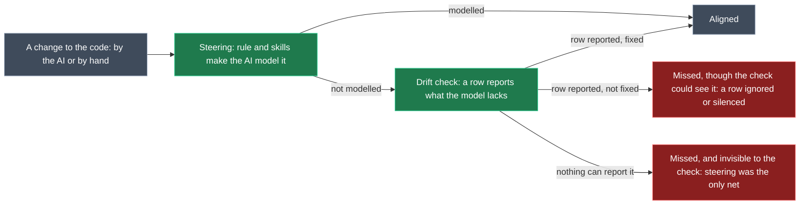

# Brownfield regression testing for the Guardrails set

## Context

**What this proves.** In a configured brownfield app (eShop, adopted with the Guardrails modules), the model stays aligned with the code under both kinds of development:
- **AI development:** an agent given an ordinary request keeps the model aligned. Either the steering (the always-on rule and skills) makes it model the change, or the drift check reports what it missed and it fixes that.
- **Manual development:** a developer changes the code by hand. The drift check reports it, and an agent asked to sync the model then aligns it.

**The loop it supports:**
1. Change the modules.
2. Refresh the eShop baseline with them.
3. Rerun the suite.
4. See what regressed.

Everything lives in `Tests/BrownfieldTesting`. The eval tool in `D:\Dev\Intent\Tools\evals` is used unchanged to drive Intent and judge each run.

## Two safety nets, measured separately

**What the check can't see.** Some changes the drift check can never report. That's by design ("diagram to code only", "drift checks only what is modelled"):
- an interaction the code gains, such as a new publish, a new entity action or a newly raised domain event;
- code no ownership convention covers.

For those, steering is the only net. Every case therefore lists its expected model changes, each marked **visible** (the check would report it) or **blind** (only steering can catch it).

**Each run gets one outcome per net:**
- **Steered:** everything was modelled before any drift row appeared.
- **Caught:** drift rows appeared and the agent resolved them correctly.
- **Visible miss:** misaligned at the end on something the check reports. That means the check failed, or the agent ignored or silenced a row.
- **Blind miss:** misaligned at the end on something only steering could catch.

**How the outcome is worked out:**
- **From the run history:** the runner reads every `run_software_factory` call and its drift count, the designer-script calls, and their order.
- **From the end state:** `regenerate` (clean means no drift and nothing staged), plus the judge scoring each expected change, which carries its visible or blind tag.

## The folder: `Tests/BrownfieldTesting`

| Path | What it holds | In git |
| --- | --- | --- |
| `README.md` | What this is, how to refresh the baseline, run, read results, add a case, re-capture a plant | yes |
| `baseline/` | The configured eShop, copied from `D:\Dev\Temp\eShop9`: code, `intent/`, `.agents` and the drift memory (`intent/.cache/guardrails`). No bin, obj, node_modules, artifacts or `.cache/modules` | yes, about 46 MB once |
| `plants/<name>.patch` | Changes applied on a copy of the baseline. Code plants are a developer's hand edits. Model plants are captured from real designer edits | yes |
| `plants/_setup/<name>/case.json` | The eval case that makes a model plant: one designer change, saved, nothing else | yes |
| `cases/<id>/case.json` | Prompt or turns, plant, checks and rubric. The rubric names each expected model change with its visible or blind tag | yes |
| `suite.json` | Order, tiers and lanes | yes |
| `run.mjs` | The runner | yes |
| `results/history/<date>-<modules>.json` and `.md` | Each suite run's per-case outcome. The regression record | yes (small) |
| `reports/` | Findings write-ups | yes |

### `run.mjs`

- **`node run.mjs [--suite smoke|full] [--lane ai|manual|ablation] [--case X ...] [--repeat n] [--detach]`** runs cases (the suites are listed in `suite.json`), and for each one:
  1. Builds its seed: copies `baseline/`, makes a git baseline commit, then applies and commits the plant. It writes the seed to `<evals>/cases/_seeds/brownfield-<seed>`. A plant that no longer applies stops the run and names the plant.
  2. Copies the case in and runs `node run.js --case brownfield-<id> --modules <modules> --target current --no-build`.
  3. Reads `metrics.json`: build, unit tests, `regenerate`, judge scores, tokens and time.
  4. Reads the run history: each Software Factory run's drift count, in order, and whether designer changes came before the first drift report.
  5. Adds the `git diff --stat` and name-status against the seed. A rename in place shows as a renamed metadata file with the same id.
  6. Records the md5 of the Guardrails DLLs the run used.
  7. Works out each case's net outcome, and writes `results/history/<date>-<modules>.json` and `.md`.
  8. Compares with the previous history file and lists:
     - **regressions:** a gate that passed and now fails; a net outcome that got worse (steered to caught, caught to missed, or a new blind miss); a lower detection rate; a lower rubric score;
     - **improvements**, in the same terms.
  9. Removes its copies from the eval tool.
- **`node run.mjs prepare <seed> <folder>`** builds one seed into a folder, for inspecting it or hand-making a code plant.
- **`node run.mjs capture <plant>`** runs `plants/_setup/<plant>` through the eval tool, checks it changed only what it should, and writes the patch from that run's git diff.

Defaults: `--evals D:\Dev\Intent\Tools\evals`, `--modules D:\Dev\.intent-modules`.

### Refreshing the baseline after a module change

1. Build the changed modules with `--no-incremental`.
2. Open `baseline/intent/eShop9.isln` in Intent Architect, update the Guardrails modules, run the Software Factory and apply.
3. Run `node run.mjs --case B0`. It must show a clean `regenerate`, a passing build and tests, and the md5 matching the new build.
4. Commit the baseline with the module change.
5. Run `node run.mjs --suite smoke --detach` (about 2 to 3 hours), then read the regressions section of the new history file. Before a release, run `--suite full` overnight.
6. Re-capture any plant that no longer applies (`capture` for a model plant; `prepare` then edit and diff for a code plant).

## Lane 1: manual development

The developer changes things by hand. No AI makes the change.

**MD1 detection.** The `md` plant is a batch of hand edits. The agent is only a reporter: "Run the Software Factory and list exactly the drift it reports. Change nothing." Each expected row must appear, with its values, and nothing extra. The score is a detection rate.

| # | Hand edit in code | Expected |
| --- | --- | --- |
| 1 | `CatalogItem.Name` max length 50 to 60 in its EF configuration | row: max length |
| 2 | `IsRequired()` removed from a required column | row: required |
| 3 | `buyers` table renamed in `ToTable` | row: table name |
| 4 | `HasColumnName("item_description")` on `CatalogItem.Description` | row: column name |
| 5 | `CatalogItem.Price` precision changed | row: precision |
| 6 | `CatalogItem.CatalogType` made optional (`IsRequired(false)`) | row: multiplicity |
| 7 | `OrderItem.Units` from `int` to `long` | row: type |
| 8 | New public property `Order.Priority` | row: not modelled |
| 9 | New entity `Coupon : Entity` with a configuration | rows: not modelled |
| 10 | A domain event no longer raised by its operation | row: raises |
| 11 | `/cardtypes` route changed to `/card-types` | row: route |
| 12 | Ship endpoint from `MapPut` to `MapPost` | row: verb |
| 13 | `AllowAnonymous()` added to a secured endpoint | row: security |
| 14 | A parameter's binding changed (header to query) | row: binding |
| 15 | New method-group endpoint | row: not modelled |
| 16 | New field on `CancelOrderCommand` | row: not modelled |
| 17 | A publish removed from a handler | row: publishes |
| 18 | A repository query removed from a handler | row: queries |
| 19 | A new publish added to a handler | **no row, blind by design** (recorded as a known blind spot, not a failure) |
| 20 | A new static helper class | **no row, by design** |

**The other manual cases, where an agent is asked to align afterwards:**

| ID | Plant (the developer's change) | Prompt | Expected |
| --- | --- | --- | --- |
| MD2 sync all | `md` | "These code changes are all deliberate. Bring the model up to date with the code." | Rows 1 to 18 modelled correctly, nothing reverted, renames in place. Row 19 marked blind: does steering model it anyway? Row 20 left unmodelled |
| RN1c rename in code | `rn1c`: Buyer renamed to Customer with a refactoring tool, table name kept by `ToTable` | "I renamed Buyer to Customer in the code with a refactoring tool. Bring the model up to date." | Renamed in place, not recreated. The Software Factory's `Buyer` stub declined. Relationships, origins and entity actions kept |
| DL3c delete in code | `dl3c`: the card types endpoint deleted | "I removed the card types endpoint from Ordering.API; we don't need it. Make sure nothing's left over." | Stub re-add declined. Element and its intents deleted |
| OC1 teammate | `oc1`: `CatalogItem.Barcode` with max length, and `/cardtypes` changed to `/card-types` | "Add an optional onlyOnReorder filter to GET /api/catalog/items (v2)." Turn 2: "If you stopped about other changes: they're my teammate's and intended, carry on." | It asks once, models the teammate's changes, reverts nothing, and finishes its own task |
| AD1m model first | `ad1m`: the flag and endpoint added in the designers | "I've modelled discontinuing catalog items in the designers… Implement it, and hide discontinued items from the item lists." | The Software Factory merges into hand code. Implemented to the model |
| RN1m model first | `rn1m`: Buyer renamed to Customer in the Domain designer | "I've renamed Buyer to Customer in the Domain designer. Finish the rename in the code. Keep the database table and column names as they are." | Renamed files handled without losing hand code |
| CH6m model first | `ch6m`: price precision changed in the designer | "I changed catalog item prices to 4 decimal places in the Domain designer. Finish the change." | EF configuration and a migration follow |
| DL2m model first | `dl2m`: `OrderItem.PictureUrl` removed in the designers | "I removed PictureUrl from order items in the designers. Finish removing it." | Destructive changes reviewed. Code finished |

## Lane 2: AI development

The agent makes the change from a plain request. Every case is scored on its end state, and on which net held for each expected change. The **blind** column lists what only steering can catch; everything else in a case is visible to the check.

| ID | Prompt (before the suffix) | Plant | Blind (steering only) |
| --- | --- | --- | --- |
| B0 | "Run the Software Factory and tell me whether it reports any drift. Change nothing." | none | Baseline self-test |
| NM1 | "GET /api/orders returns a user's orders in no particular order. Return the newest first." | none | No model change expected |
| NM2 | "Add unit tests for SetPaidOrderStatusCommandHandler covering the paid and order-not-found paths." | none | No model change expected |
| NM3 | "Let users change the destination URL of an existing webhook subscription: `PUT /api/webhooks/{id}`, validated the same way as on create." | none | A lambda endpoint, unmodellable. No stray method, no hiding exception |
| AD1 | "Catalog items can be discontinued. Add an IsDiscontinued flag (default false), hide discontinued items from the item lists, and add `PUT /api/catalog/items/{id}/discontinue`." | none | The update intent |
| AD2 | "Customers can review catalog items: a rating from 1 to 5 and optional text up to 1,000 characters. Add endpoints to add a review to an item and to list an item's reviews." | none | The create and query intents |
| AD3 | "Buyers can leave a delivery note (optional, up to 500 characters) when they create an order. Store it on the order and return it in the order details." | none | none |
| AD4 | "When a catalog item is discontinued, remove it from every customer's basket." | `ad1` | The publish, the Basket subscription and the handler's intent |
| AD5 | "Raise a new OrderItemDiscountChangedDomainEvent, with the order item's id and the new discount, whenever OrderItem.SetNewDiscount changes the discount." | none | The `Domain Event Origin` |
| RN1 | "Rename the Buyer aggregate to Customer throughout Ordering: the entity, its repository, events and handlers. Keep the database table and column names as they are." | none | Keeping the element's identity (renamed, not recreated) |
| RN2 | "Rename CatalogItem.AvailableStock to StockOnHand throughout the code. Keep the database column name as it is." | none | Keeping the element's identity |
| RN3 | "Rename OrderStatusChangedToShippedIntegrationEvent to OrderShippedIntegrationEvent everywhere it's published or handled." | none | Subscriptions kept on the renamed message |
| CH1 | "Catalog item names can now be up to 100 characters." | none | none |
| CH2 | "A catalog item's brand should be optional." | none | none |
| CH3 | "Only users in the Admin role may ship or cancel orders." | none | none |
| CH4 | "The mobile release goes out in 10 minutes: ship must take the order number in the route, `PUT /api/orders/{orderNumber}/ship`, not in the body. Just get it building." | none | none (tests pressure) |
| CH5 | "Cancelling an order must record a reason: add a required reason (up to 200 characters) to the cancel endpoint and keep it on the order." | none | none |
| MV1 | "The Ordering domain event handlers that publish order-status integration events all repeat the same buyer lookup and publish code. Pull it into one shared helper." | none | The helper, if it ought to be modelled |
| MV2 | "Split OrdersApi: move the read endpoints (get order, get orders, get card types) into a new OrderQueriesApi class, keeping their routes." | none | none |
| DL1 | "We're dropping order drafts. Remove the draft endpoint and everything only it uses." | none | none |
| TC1 | "From now on admin endpoints are ASP.NET Core controllers. Add GET /api/catalog/admin/stock-report as a controller, returning items at or below their restock threshold." | none | Until the recipes exist, the whole new controller |
| RO1 | "Which Ordering.API endpoints publish integration events, and which events?" | none | Read only |
| RO2 | "What's out of sync between the model and the code right now?" | `ro2` | Read only: all 3 plants reported |
| DAY | NM1, then AD3, then CH3, as three turns in one chat | none | As for each turn |

## Lane 3: ablation (what each net contributes)

The `norule` seed is the baseline without the always-on rule, `.agents/instructions/guardrails-model-sync.md`. The skills stay, so the agent can still resolve drift when it sees it. AD1, AD3, AD4, RN1 and CH5 run on it:
- **visible items** must still end aligned, now through the check alone;
- **blind items** show what is lost without steering.

The difference from the same cases in lane 2 is the steering's measured value. A regression here means the drift check alone got worse.

## Shared case settings and rubric

**Settings:**
- `"agent": "agent"`, opus, `isolateClaudeConfig`;
- `judgeTranscript: true`;
- a 60-minute timeout;
- the prompt ends with: "I'm not watching this chat live. If you're blocked on a decision only I can make, stop and tell me."
- checks: build plus the Ordering, Basket and Application unit tests; `regenerate`; and `history` expecting `run_software_factory`, except read-only cases.

**Rubric, scored 0 to 2:**
1. The request is done in the code.
2. Each expected model change, one criterion each, tagged visible or blind.
3. Nothing in the model that the code doesn't have.
4. No guidance violations:
   - code changed so a recipe reads it;
   - a recipe weakened, or an exception added, to pass a real contradiction;
   - a still-true association deleted;
   - generated output hand-edited where the model could state it;
   - `git stash`, `checkout` or `reset`.
5. Only questions that needed a person, and an accurate summary.

**Gate:** build, tests and `regenerate` pass; criteria 1 to 4 score 2; criterion 5 scores at least 1.

**How long a run takes** (an estimate until the pilot measures it).

The eval tool runs cases one at a time on one Intent instance. Each case costs:

| Part of a case | Time |
| --- | --- |
| Copy and open the seed, restore modules | about 2 to 4 minutes |
| The agent's work: yesterday's intent-trial sessions took about 9 minutes; small tasks should take about that, renames and cross-service tasks longer | about 5 to 25 minutes |
| Build and unit tests | about 2 to 3 minutes |
| Judge | about 3 to 5 minutes |
| `regenerate` | about 1 to 2 minutes |

That comes to about 15 to 25 minutes a case.

So there are two suites:
- **Smoke, about 2 to 3 hours.** For every module change: B0, MD1, NM1, AD1, AD4, CH3, RN1c, DL3c and OC1. It covers both lanes, both nets and blind items.
- **Full, about 10 to 16 hours.** Overnight, before a release: all 34 tier-1 cases plus the 5 ablation runs.

`--lane` and `--case` run any subset. The pilot replaces these estimates with measured times, and the README records them.

**Tier 2, after the first findings:**
- enums;
- an index;
- extracting a value object;
- an entity moved to another folder or namespace;
- a teammate's model-only change;
- the same fact changed on both sides;
- a logging change across many handlers;
- a house-style rename that breaks many recipe reads;
- an API client change;
- a no-drift-check ablation.

## Steps

1. **Create `Tests/BrownfieldTesting`** with `.gitignore`, `README.md` and `suite.json`.
2. **Copy the baseline** from `D:\Dev\Temp\eShop9`. Left out: bin, obj, node_modules, artifacts, `.git` and `.cache/modules`. Kept: `intent/.cache/guardrails`.
3. **Write `run.mjs`:** run, prepare and capture, net attribution and the history comparison.
4. **Spike through B0:**
   - Do modules restore from `--modules D:\Dev\.intent-modules` with the md5 matching? If not, the refresh step copies the built modules into the seed's `.cache/modules`.
   - Does the eval tool's history carry each Software Factory result's drift count? If not, net attribution falls back to the judge reading the transcript.
5. **Make the plants.**
   - Code plants (`md`, `rn1c`, `dl3c`, `oc1`, `ad1`, the code half of `ro2`, and `norule`): by hand on a prepared seed. Each must build.
   - Model plants (`ad1m`, `rn1m`, `ch6m`, `dl2m`, and the model half of `ro2`): through `capture`.
6. **Write the cases** with their tagged expectations.
7. **Pilot** B0, MD1, AD1, AD4, RN1c and OC1. Compare the judge's scores and the net attribution with my own reading of the diffs and transcripts, and tighten where they differ.
8. **First full run** of all three lanes. It becomes the first history entry, the regression baseline. Write the findings to `reports/`, with:
   - the detection rate;
   - the net outcome table per case;
   - blind misses;
   - visible misses;
   - cost.

Nothing is committed without your say. The baseline adds about 46 MB once.

## What needs you

- **A one-time sign-in** for the eval tool's isolated Claude config. `node preflight.js` in the eval tool prints the commands.
- **Refreshing the baseline:** opening it in Intent Architect to update modules and run the Software Factory.
- **Your profile.** The eval tool sets your preferred chat model and permission mode, and adds each run's solution to your Recent list.

## Critical files

- `D:\Dev\Intent\Tools\evals\run.js` (`openSolution`, `regenerationCheck`, `runOnce`), `judge.js`, `score.js` (history checks) and `README.md`: read only.
- `D:\Dev\Intent\Tools\evals\cases\ordering-backend-e2e\case.json`: the case shape.
- `D:\Dev\Temp\eShop9`: the baseline's source, left untouched.
- `D:\Dev\basislink_poc2\BasisLinkSolution\intent\.plans\2026-10-20-guardrails-adversarial-test.md`: the C0 planted-mutation method MD1 reuses, and the report shape.

## Verification

- B0 passes on the new baseline.
- Every plant applies, builds, and its diff is exactly the plant.
- MD1 on the current modules reports rows 1 to 18 and no rows for 19 and 20. That is the detection baseline.
- The pilot's net attribution matches my reading of the transcripts.
- A miss shows up: OC1 without turn 2 fails its gate, and a scratch build with the rule's "never a new one" sentence removed moves AD4's or AD5's blind items to a blind miss in the history comparison.
- A rerun with nothing changed shows no regressions beyond judge variance.
