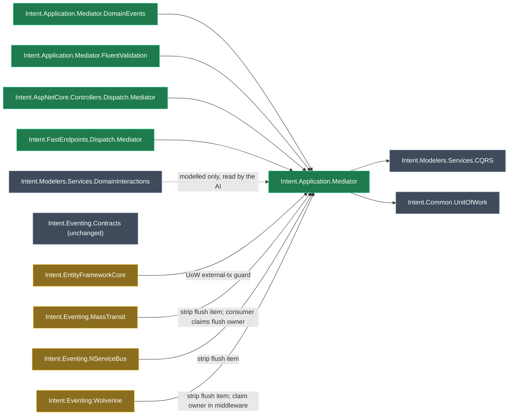

# Intent.Application.Mediator — module family for the source-generated Mediator library

## Context

The spike in `Spike/MediatorSpike` (decisions D1–D26) proved a Clean Architecture CQRS stack on `Mediator.Abstractions` / `Mediator.SourceGenerator` 3.0.2 that replaces MediatR (licensing exit) and Wolverine. This plan turns that golden sample into Intent modules.

**Where the decisions come from:**
- G1–G15: the grilling session of 2026-10-13.
- G16–G21: added after the adversarial review of the same day (see the last section).
- The spike's D-decisions carry forward unless a G-decision amends them.

The defining difference from MediatR and Wolverine: **the AI writes every Mediator handler body.** Developers still model commands, queries and their interactions (Create/Update/Delete/Query Entity, Invoke, Publish, Send) with `Intent.Modelers.Services.DomainInteractions`, but `Intent.Application.DomainInteractions` and `Intent.Application.CQRS.CRUD` are never used, and no field mappings are modelled.

### Worked example

1. A developer models `CreateOrderCommand` in the Services designer: Http Settings `POST orders`, a **Create Entity Action** to `Order` carrying only the mapped end the designer insists on (no field-to-attribute mappings), and a **Publish Integration Event** to `OrderCreatedEvent`.
2. The Software Factory generates:
   - `CreateOrderCommand : ICommand` of `Guid` (Mediator's own `ICommand`, constructor-initialised).
   - `CreateOrderCommandHandler : ICommandHandler` of `CreateOrderCommand, Guid`, whose `ValueTask` of `Guid` `Handle` is a stub: `// TODO` plus `throw new NotImplementedException(...)`, Merge mode.
   - An `OrdersController` action calling `await _sender.Send(command, cancellationToken)`.
   - `MediatorConfiguration.AddMediatorConfiguration` with the literal pipeline array.
3. The run raises an **"Implement Command Handler"** AI task listing the command's modelled interactions in order (G16).
4. The agent loads the `mediator-command-handler` skill, reads the command's associations from the Services designer (the modeler's own AI rules, the `rules` segments in the designer settings, explain what each one means), and writes the body: construct `Order`, add it through the repository, publish `OrderCreatedEvent`, return the id.
5. The next Software Factory run keeps the signature in sync and leaves the body alone.
6. Later, a developer or agent adds a Publish to the command. The designer's AI rules on Command, contributed by the Mediator module, tell the agent that this handler is AI-written and must be revisited, so it updates the body in the same piece of work (G22).

## Decisions

### From the grilling session (2026-10-13)

| # | Decision |
|---|---|
| G1 | **Packaging follows Wolverine's shape:** a fat core module plus DomainEvents, FluentValidation and one dispatch module per host. |
| G2 | **v1 hosts:** ASP.NET Core Controllers and FastEndpoints only. |
| G3 | **Coexistence with MediatR, Wolverine and incompatible modules is documented only.** No `FriendlyException`. Re-confirmed after the review: the README groups incompatible modules by consequence (G21). |
| G4 | **Handler stub uses the established Merge convention.** Class `Merge, Signature = Fully`; constructor `Merge`; `Handle` `Merge, Signature = Fully`, with an `IntentInitialGen` TODO and `throw new NotImplementedException`. |
| G5 | **Module ids:** `Intent.Application.Mediator`, `Intent.Application.Mediator.DomainEvents`, `Intent.Application.Mediator.FluentValidation`, `Intent.AspNetCore.Controllers.Dispatch.Mediator`, `Intent.FastEndpoints.Dispatch.Mediator`. |
| G6 | **Associations are modelled, field mappings are not.** Only the minimal mapped end that designer validation demands is wired, as the DomainInteractions modeler's own rules already advise. Mediator templates never read mappings. |
| G7 | **`SKILL.md` carries how to implement; the model carries what.** No per-file AI context. **Amended by G16 and G22:** an AITaskProvider raises Implement and Finish tasks, and designer rules carry drift awareness. |
| G8 | **Mediator handlers (command, query, domain-event notification) are AI-written.** They never call `RegisterAsProcessingHandlerForModel`, and **no Send interaction strategy is registered**. |
| G9 | **Integration event handlers keep normal code generation by `Eventing.Contracts`,** which is unchanged. The AI wires a modelled Invoke Command, and finishes any unmapped Publish/Send, guided by the `mediator-integration-event-handler` skill (G17). |
| G10 | **v1 seams:** EF Core unit of work and external transaction; eventing flush/outbox (MassTransit, NServiceBus, Eventing.Wolverine) plus D18 flush ownership; FluentValidation; UnitTesting (proven, changed only if broken — G20). Everything else is documented as unsupported. |
| G11 | **Each consuming module owns its Mediator integration seam,** as for Wolverine. |
| G12 | **`MessageBusFlushOwner` lives in the Mediator core,** beside `MessageBusPublishBehaviour`. The core registers it as scoped. This amends D24's wording, which assigned it to eventing modules. |
| G13 | **Test apps:** `TestMediator.Publisher`, `TestMediator.Subscriber`, `TestMediator.Outbox`, extended by G19. The `Test` prefix also avoids the A1 namespace trap. |
| G14 | **New modules start at `1.0.0-pre.0`.** |
| G15 | **Plan only.** No SDD spec. |

### Added after the adversarial review (2026-10-13)

| # | Decision |
|---|---|
| G16 | *Superseded by G23.* **AITaskProviders raise "Implement Command/Query/Domain Event Handler"** while a handler still throws `NotImplementedException`. The task context lists the interactions in model order (Wolverine's `AITasksFactoryExtension` precedent, interaction-type aware). The core raises command and query tasks; Mediator.DomainEvents has its own provider (MediatR.DomainEvents precedent). **There is no "Update" task:** the task API only sees changed output files, and an association change produces none. The user chose AI awareness (G22) over a file fingerprint that would make one. |
| G17 | *Superseded by G23.* **Integration handlers with an Invoke, or with an unmapped Publish/Send, are finished by the AI.** Eventing.Contracts generates `new X` with an empty initialiser for an unmapped message, silently skips an Invoke (it has no strategy for one), and sets `Body = Fully` as soon as it generates anything. The core's provider therefore also raises **"Finish Integration Event Handler"** for any file in the `Application.Eventing.EventHandler` role whose subscription has an Invoke, or a Publish/Send with no mappings — the same check the publish strategy makes. **It scans every output file on every run, not only changed files** (adding an Invoke changes no output, because interactions without a strategy are filtered out before generation), keeps raising the task until the existing file's `HandleAsync` carries `Body = Mode.Ignore`, and overrides `IsApplicableToChanges` so the task applies even when the file did not change. The `mediator-integration-event-handler` skill tells the AI to take the body over (`Body = Mode.Ignore`) and complete it. Eventing.Contracts stays unchanged, as the user chose. |
| G18 | **Default domain-event handlers sit behind a setting, "Create implicit domain event handlers", off by default** (MediatR precedent). When off, an event without a modelled handler simply has no handler; Mediator treats that publish as a no-op (probe P11). |
| G19 | **Seams that only show up at runtime get a test app each,** with configurations chosen so each seam actually runs. `TestMediator.Outbox` (MassTransit EF outbox) gains a subscribed integration handler that Invokes a command, so EF's existing-transaction branch runs. Two small variants are added: `TestMediator.NServiceBus` (SQL outbox, plus a run without the outbox) and `TestMediator.WolverineEventing`. The Wolverine app has three configurations: durable outbox; Outbox None publishing, where an integration handler Invokes a publishing command, so the middleware's ownership claim runs; and Outbox None subscribe-only, so the no-bus strip runs. The middleware is not generated under Durable, so neither of the last two can be tested on a Durable app. |
| G20 | **UnitTesting is proven, not pre-emptively changed.** It is installed in `TestMediator.Publisher`. It goes through the version gate only if that app proves a change is needed. |
| G21 | **Incompatible modules are documented by consequence** (see "Unsupported in v1"). |
| G22 | **Model drift is handled by making the AI aware, not by a task.** The Mediator modules ship designer **element extensions carrying AI `rules`** — the mechanism `Intent.Metadata.RDBMS` uses on `Attribute`. The core extends Command and Query, Mediator.DomainEvents extends Domain Event Handler, and the core extends Integration Event Handler when Eventing.Contracts is present. The rule says: this element's handler is AI-written (Mediator); adding, removing or changing its associations means revisiting and updating the handler body in the same piece of work, using the matching `mediator-*` skill. The handler skills carry the same rule from the other side (re-read the associations whenever implementing or revisiting). The rules reach an agent exactly when it edits the model, and live in Mediator's own modules, so the modeler repo is untouched. |

### Changed during implementation (2026-10-14)

| # | Decision |
|---|---|
| G23 | **No AI task providers (developer decision).** `AITasksFactoryExtension` / `TemplateAITask` are deprecated, so G16's Implement tasks and G17's Finish task are dropped from the core and from Mediator.DomainEvents. What they carried moves to the two remaining mechanisms: the G22 designer `AI Settings` rules (Command, Query, Integration Event Handler in the core; Domain Event Handler in DomainEvents) now also cover a newly generated stub, and each generated handler skill gains a "finding the work" section (search for `// IntentInitialGen` + `NotImplementedException` stubs after a run; for integration handlers, a `HandleAsync` without `Body = Mode.Ignore` whose subscription has an Invoke or an unmapped Publish/Send). The core's Integration Event Handler rule, removed earlier, is restored because it is now the only model-side carrier of the takeover check. Accepted: nothing proactively flags an unwritten handler. |

### Spike decisions carried forward unchanged

| Decision | What it fixes |
|---|---|
| D5 | Mediator-native `ICommand` / `IQuery`. Intent's marker templates are dropped. UoW constrains on `IBaseCommand`. |
| D6 | Handlers return `ValueTask`; void commands return `Unit`. |
| D7 | Domain-event notifications use an abstract generic base, a sealed wrapper per event, and a factory switch. |
| D9 | The functional core is always on. Authorization is never silently off (see "Behaviour without Application.Identity"). Logging, Performance and UnhandledException are opt-in. |
| D10 / D20 | `PipelineBehaviors` is a literal `CSharpCollectionExpression` with one tagged item per behaviour, in a fixed order. |
| D17 | The generator and `AddMediator` live in Infrastructure, with `options.Assemblies` set to the Application assembly. |
| D21 | Validators run one at a time. |
| D22 | `SequentialNotificationPublisher`. |
| D23 | `ServiceLifetime.Transient`. |

D25 (Modular Monolith) is deferred.

### Decisions taken during planning (open to challenge)

<Callout id="no-common" tone="decision" title="No Intent.Mediator.Common module">

Wolverine needs `Wolverine.Common` because Application and Eventing both contribute to `WolverineConfiguration` and to host registration. For Mediator, the core owns the whole pipeline list (see "The pipeline seam"), and eventing modules only *remove* the tagged flush item. The `MediatorConfiguration` template therefore lives in the core module.

</Callout>

<Callout id="roles" tone="decision" title="Which shared roles the core fills">

**Filled:**
- `Application.Command` and `Application.Query`, used as type sources by the dispatchers and UnitTesting.
- `Application.Command.Handler` and `Application.Query.Handler`, used by UnitTesting.
- `Application.DomainEventHandler.Explicit` (by Mediator.DomainEvents), used by UnitTesting's `DomainEventHandlerTest`.

**Not filled:**
- `Application.Contract.Command` / `Application.Contract.Query`. Hangfire and Quartz emit `using MediatR` and `ISender` whenever a job sends a command, so filling the role would not make them work. Leaving it unfilled means they fail at generation time instead of producing MediatR code. That generation-time failure is expected but not verified.
- The marker roles `Application.Command.Interface` / `Application.Query.Interface` (D5).

</Callout>

<Callout id="identity" tone="decision" title="Behaviour without Application.Identity">

The spike's Logging, Performance and Authorization behaviours all take `ICurrentUserService`. There is no hard dependency on `Intent.Application.Identity` ("no baggage"):
- **Logging and Performance** degrade, logging without the user when the `ICurrentUserService` role does not resolve (Wolverine's `LoggingMiddleware` precedent).
- **Authorization** is generated only when Identity is present. A command or query with a Secured stereotype in an app without Identity raises an `ElementException` on that element telling the developer to install `Intent.Application.Identity`.

The `ElementException` is an element-configuration error, not a module-combination guard, so it does not conflict with G3. It is what keeps D9's "never silently off" true.

</Callout>

<Callout id="migration" tone="decision" title="Moving an existing MediatR app to Mediator">

MediatR.CRUD marks every body it fills as fully generated (`Body = Fully`). When MediatR is uninstalled and Mediator installed, the Mediator handler template would overwrite those bodies with stubs. Hand-written void handlers also need `return Unit.Value;`.

**Supported path, documented in the core README:**
1. **Before uninstalling MediatR,** protect every handler:
    - **Command and query handlers:** mark the `Handle` body `Body = Mode.Ignore`. The method still matches the Mediator one (same name, same parameter), so the Software Factory rewrites the signature to `ValueTask` and keeps the body.
    - **Domain-event handlers:** mark the whole method `[IntentManaged(Mode.Ignore)]`. Their parameter type changes under D7 (`DomainEventNotification` of `X` becomes `XDomainEventNotification`), so a body-only Ignore no longer matches and the method would be replaced by a stub. With the whole method ignored, the old method survives beside the new stub; the developer moves the body across and deletes the old method.
    - **Fields and constructors of every handler:** mark them `[IntentManaged(Mode.Ignore)]` too. MediatR.CRUD injected them (`_orderRepository`, `_messageBus` …), the Mediator stub's constructor takes nothing, and on a Merge class the weaver removes members it previously generated, so the bodies would survive but no longer compile.
2. Swap the modules and run the Software Factory. It rewrites the signatures itself, because they are `Signature = Fully`.
3. **Fix the bodies:** void command handlers need `return Unit.Value;`, and leftover `using MediatR` lines must go.

**Proving it:** step 8 runs this against a **throwaway copy** of the spike's MediatR baseline (commit `bcfc0d8aa6`). The spike's own solution must never be regenerated (DECISIONS.md).
- `.intent/` is gitignored, so a fresh copy has no previous output and the weaver would remove nothing, which would hide the field/constructor problem. The check therefore first runs the Software Factory **with the MediatR modules** and applies it, seeding previous output, and only then swaps modules.
- It asserts that the solution **builds**, not only that the command handler and domain-event handler bodies survive.

A version migration that rewrites the files automatically is deferred: it would have to edit files a different module's template used to own, which is unproven.

</Callout>

## Approach

*Green: new modules. Amber: existing modules that gain a Mediator branch. Grey: unchanged. UnitTesting is proven by G20 and drawn only if a change turns out to be needed.*

**How to build it:**
- Every template is ported from the spike's hand-owned code, which is the target output.
- The Wolverine modules are the structural template for the module projects: `.imodspec` interop, `NugetPackages`, template registrations, skill templates, the AITaskProvider and the dispatch extensions.
- The MediatR skill templates are the source for skill wording, rewritten for Mediator semantics.

### Template ids other modules depend on

Template ids derive from the File Template's name and folder in the Module Builder, so each one below must sit at the package root.

**How other modules reference them (Wolverine convention):**
- **Seam modules** (EF Core, MassTransit, NServiceBus, Eventing.Wolverine) use string constants and take no `ProjectReference` on the core.
- **Satellites** (DomainEvents, FluentValidation) reference the core project with `PrivateAssets=All`, as `Intent.Modules.Application.Wolverine.FluentValidation.csproj` does.

| Template id | Used by |
|---|---|
| `Intent.Application.Mediator.MediatorConfiguration` | MassTransit, NServiceBus, Eventing.Wolverine (flush strip) |
| `Intent.Application.Mediator.UnitOfWorkBehaviour` | EF Core (external-transaction guard), Eventing.Wolverine (Lightweight EF transactions) |
| `Intent.Application.Mediator.MessageBusFlushOwner` | MassTransit consumer, Eventing.Wolverine middleware (claim ownership) |
| `Intent.Application.Mediator.UnhandledExceptionBehaviour` | FluentValidation (`ValidationException` rethrow) |
| `Intent.Application.Mediator.CommandModels` / `QueryModels` | FluentValidation validators |

## Module inventory

### `Intent.Application.Mediator` (core)

| Template | Role | Output |
|---|---|---|
| `CommandModels` / `QueryModels` | `Application.Command` / `Application.Query` | `ICommand`, `ICommand` of `T`, `IQuery` of `T`; constructor-initialised; `[Authorize]` from Security stereotypes |
| `CommandHandler` / `QueryHandler` | `Application.Command.Handler` / `Application.Query.Handler` | `ICommandHandler` / `IQueryHandler` with a `ValueTask` `Handle` stub (G4). Void commands return `ValueTask` of `Unit` |
| `MediatorConfiguration` | `Infrastructure.Configuration` | `Infrastructure/Configuration/MediatorConfiguration.cs`. `AddMediatorConfiguration` is called from `AddInfrastructure`. The `AddMediator` lambda is tagged `mediator-config`. The pipeline contract is under "The pipeline seam" |
| `SequentialNotificationPublisher` | `Infrastructure.Configuration` | D22 publisher |
| `LoggingBehaviour` | `Application.Common` | `MessagePreProcessor`, listed first. Opt-in setting; degrades without Identity |
| `UnhandledExceptionBehaviour`, `PerformanceBehaviour` | `Application.Common` | Opt-in settings; Performance degrades without Identity |
| `AuthorizationBehaviour` | `Application.Common` | Generated when Identity is present and any request is secured (see the Identity callout) |
| `MessageBusPublishBehaviour` + `MessageBusFlushOwner` | `Application.Common` | Generated when the `MessageBusInterface` / `EventBusInterface` role resolves (D18, G12). `MessageBusFlushOwner` is registered scoped by the core |
| `UnitOfWorkBehaviour` | `Application.Common` | `where TRequest : IBaseCommand`. The body comes from `Intent.Common.UnitOfWork`'s `ApplyUnitOfWorkImplementations`, called with `fieldSuffix: "dataSource"` so EF Core's guard finds the `_dataSource` field. Gated on `SystemUsesPersistenceUnitOfWork()` |
| `CommandHandlerSkill` / `QueryHandlerSkill` | `AI.Context.Skills.Handler` | `mediator-command-handler` / `mediator-query-handler` `SKILL.md`, each with an "Output expectations" section so the EF Core, Repositories, AutoMapper and Mapperly guidance gets injected |
| `IntegrationEventHandlerSkill` | `AI.Context.Skills` | `mediator-integration-event-handler/SKILL.md`, generated only when Eventing.Contracts is installed (G9, G17) |

The core module also provides:
- **`AITasksFactoryExtension`:** Implement tasks for command and query handlers (G16), and Finish tasks for integration event handlers (G17).
- **Designer metadata:** element extensions with AI `rules` on Command, Query and (when Eventing.Contracts is present) Integration Event Handler (G22).
- **Settings group "Mediator Settings":** toggles for the Logging, Performance and UnhandledException behaviours (D9).
- **NuGet:**
  - `Mediator.Abstractions` 3.0.2 in Application.
  - `Mediator.SourceGenerator` 3.0.2 with `PrivateAssets=all` in Infrastructure, declared in the template constructor, never in `OnBuild`.
- **imodspec interoperability** (as in `Intent.Application.Wolverine.imodspec`):
  - Controllers → `Intent.AspNetCore.Controllers.Dispatch.Mediator`
  - FastEndpoints → `Intent.FastEndpoints.Dispatch.Mediator`
  - `Intent.Application.FluentValidation` → `Intent.Application.Mediator.FluentValidation`
  - `Intent.DomainEvents` → `Intent.Application.Mediator.DomainEvents`
  - Minimum versions for every module that gains a seam in this change.
  - Minimum versions for EF Core Repositories, AutoMapper and Mapperly, as Wolverine's `.imodspec` pins them. Their guidance is what gets injected into the handler skills' "Output expectations" section.

### The pipeline seam

**The core owns the whole ordered list.** The order (outermost first, D20) is Logging, UnhandledException, Performance, Authorization, MessageBusPublish, Validation, UnitOfWork. The core adds each item only when it applies:
- Validation when the `Application.Common.ValidationBehaviour` role resolves (MediatR's FluentValidation precedent).
- MessageBusPublish when a bus role resolves.
- UnitOfWork when persistence uses a unit of work.

No other module inserts items, because `CSharpCollectionExpression` has no ordering support.

**Removal contract:**
- Every item is tagged with its behaviour name; the flush item also carries `eventbus-flush`.
- `AddItem` does not set `Parent`, so `CSharpStatement.Remove()` throws, and a recursive statement search never reaches inside the `PipelineBehaviors` assignment.
- The core therefore exposes the collection itself so a seam can reach it directly (for example as a lookup on the `mediator-config` lambda). A seam removes an item with `collection.Statements.Remove(item)`.
- The exact accessor is settled in step 3 and proven by `TestMediator.Outbox`.

<Callout id="risk-empty-pipeline" tone="risk" title="A pipeline can legitimately be empty">

Two ways to end up with an empty `PipelineBehaviors` array:
- An app with the opt-ins off, no Identity, no FluentValidation, no bus and no persistence.
- An Eventing.Wolverine subscribe-only app whose only item, the flush, is stripped.

`TestMediator.Subscriber` does not reach either: it runs with the opt-ins at their defaults but still has MassTransit and EF. The Outbox None subscribe-only configuration of `TestMediator.WolverineEventing` (no persistence, no Identity) is the one that does.

**Step 3 settles it with a probe** (a throwaway project, like the spike's `probes/`): does the source generator accept `PipelineBehaviors = []`?
- **If it does,** the empty array stays, and the probe result is recorded in the core's CONTEXT.md.
- **If it does not,** the core removes the assignment in an `AfterBuild` at priority 2000, after the seams strip their items at 1000, whenever no items remain.

</Callout>

### `Intent.Application.Mediator.DomainEvents`

**Templates:**
- `DomainEventNotification` of `T`: an abstract base.
- A sealed per-event `XDomainEventNotification`.
- `DomainEventNotificationFactory`: a switch over events that throws for an unmapped event.
- `DomainEventService`: scoped; calls the factory, then `IPublisher.Publish`.
- An explicit `DomainEventHandler` for each Services-designer `DomainEventHandlerModel`, with one `INotificationHandler` `Handle` per handled event. Role `Application.DomainEventHandler.Explicit`.
- A `DefaultDomainEventHandler`, only when the setting "Create implicit domain event handlers" is on (default off, G18).
- The `mediator-domain-event-handler` skill.

**Factory extensions:**
- **`AITasksFactoryExtension`:** the module's own Implement tasks for domain-event handlers (G16). It mirrors MediatR.DomainEvents and keeps the core free of DomainEvents template ids. Its designer metadata adds the G22 rules extension on Domain Event Handler.

**Constraints:**
- Every `Handle` is an AI stub (G8).
- **No dependency on `Intent.Application.DomainInteractions`.** Wolverine.DomainEvents has one; it is deliberately not copied.

### `Intent.Application.Mediator.FluentValidation`

- **Validators:** `CommandValidator` and `QueryValidator` on the shared `DtoValidatorTemplateBase`, keyed to the Mediator `CommandModels` / `QueryModels` template ids.
- **`BypassValidationInterface`:** fills the `Application.Common.BypassValidationInterface` role.
- **`ValidationBehaviour`:** runs validators one at a time (D21) and fills the `Application.Common.ValidationBehaviour` role, which is how the core knows to add the Validation item.
- **`UnhandledExceptionBehaviour` extension:** adds `catch (ValidationException) { throw; }` to the core's `UnhandledExceptionBehaviour` when it exists (spike `UnhandledExceptionBehaviour.cs:30`; MediatR.FluentValidation's `UnhandledExceptionBahaviorExtension` precedent). Without it, every 400 is logged as an unhandled error.

### Dispatch modules

`Intent.AspNetCore.Controllers.Dispatch.Mediator` and `Intent.FastEndpoints.Dispatch.Mediator` are ported from their Wolverine counterparts. The only changes are:
- the injected type is `Mediator.ISender` (as `_sender`);
- the dispatch call is `await _sender.Send(payload, cancellationToken)`;
- the FastEndpoints dispatch statement is tagged `mediator-dispatch`.

## Seams in consuming modules (G10, G11)

| Module | Change | Found by |
|---|---|---|
| `Intent.EntityFrameworkCore` | `UnitOfWorkExternalTransactionExtension` gains a Mediator branch: when an EF transaction already exists, skip the `TransactionScope`. **Not a copy of the MediatR branch:** that branch only recognises `next(cancellationToken)` / `next()`, so the Mediator branch emits `next(request, cancellationToken)` itself. It keys on the `_dataSource` field (see `fieldSuffix` above) | `Intent.Application.Mediator.UnitOfWorkBehaviour` |
| `Intent.Eventing.MassTransit` | Under a DB outbox, `MessageBusInteropExtension` removes the `eventbus-flush` item (removal contract above) and reuses the existing flush splice into `SaveChanges`. The `IntegrationEventConsumer` claims `MessageBusFlushOwner` before dispatching and flushes after its transaction completes | `MediatorConfiguration` and `MessageBusFlushOwner` ids |
| `Intent.Eventing.NServiceBus` | Strip the flush item under an outbox. Without an outbox there is no ownership claim: `NServiceBusMessageBus` dispatches through `IMessageHandlerContext`, which batches until the handler completes. This holds only without the outbox, so `TestMediator.NServiceBus` has a run without it, and the reasoning goes into NServiceBus's CONTEXT.md once proven | `MediatorConfiguration` id |
| `Intent.Eventing.Wolverine` | Several changes, in `WolverineMessageBusInteropExtension`, `WolverineEventingRegistrationExtension` and `WolverineIntegrationEventMiddleware` — see the list below | The three ids above |

**Eventing.Wolverine changes in detail:**
1. Strip the flush item under the durable outbox.
2. **Also strip it when `WolverineMessageBusIsRegistered()` is false.** Eventing.Contracts always generates the bus interface, but a subscribe-only app registers no `IMessageBus`, so without this strip every `ISender.Send` would throw at resolve time.
3. `UseEntityFrameworkCoreTransactions(Lightweight)` also triggers on the Mediator UoW behaviour.
4. `WolverineIntegrationEventMiddleware` claims `MessageBusFlushOwner` in `Before` / `Finally` when the owner exists, so a nested command does not flush inside the middleware's `TransactionScope` (D18).
    - **Scope:** this applies to Outbox None only. The middleware is not generated under Durable, where change 1 removes the flush item anyway.
    - **Same instances — owner and bus:** the middleware and the nested command's behaviours must receive the same scoped `MessageBusFlushOwner` **and** the same `IMessageBus`. Wolverine's generated code can construct concrete-registered dependencies itself (`AddScoped<IMessageBus, WolverineMessageBus>`), while Mediator resolves from the DI scope; each `WolverineMessageBus` has its own buffer. A shared owner with separate buses silently loses the nested command's messages (the behaviour defers, the middleware flushes an empty bus). Eventing.Wolverine therefore forces service location for both (`AlwaysUseServiceLocationFor`, or factory-lambda registrations), whichever the Wolverine version supports.
    - **Proof:** in the Outbox None publishing configuration of `TestMediator.WolverineEventing` (G19), assert that the nested command's message **reaches the broker exactly once, after the middleware's commit** — not just that the nested dispatch did not flush.

<Callout id="tradeoff-takeover" tone="warning" title="Integration handlers the AI has to take over">

Eventing.Contracts stays unchanged (G9), so three kinds of integration handler need the AI:
- **Invoke only:** a stub (nothing was generated), with no Send.
- **Mixed:** a Publish (generated, `Body = Fully`) plus an Invoke the generator silently skipped.
- **Unmapped:** a Publish or Send with no field mappings, which compiles as `new X` with an empty initialiser.

**All three raise a "Finish Integration Event Handler" task** (G17), and the skill tells the AI to set `[IntentManaged(Mode.Fully, Body = Mode.Ignore)]` on `HandleAsync` and own the whole body.

**Accepted:** after the takeover, Publish/Send model changes on that handler no longer regenerate. A later model change only raises a task if it changes the generated file, for example through a new subscription. Otherwise the developer must ask the AI to revisit the handler, which is the same limitation the Update-task risk below describes.

**Proof:** `TestMediator.Subscriber` has one handler of each kind, and one test adds an Invoke to an already-generated handler (mapped Publish, `Body = Fully`) and asserts the Finish task is raised on the next run.

</Callout>

<Callout id="tradeoff-drift" tone="warning" title="Model drift relies on the agent reading the rules (G22)">

Adding an association to an already-implemented command changes no generated file, so nothing in the Software Factory output flags it. The designer rule on Command, Query, Domain Event Handler and Integration Event Handler tells any agent editing that element to revisit the handler.

**Accepted gaps:**
- A developer editing the model by hand, without an agent, sees no prompt. The README states the rule for humans.
- An agent that edits the model without reading the element's rules misses it.

**Proof:** the AI dogfood pass adds an association to an implemented command and to an implemented domain-event handler through the agent, and checks that the handler body was updated in the same run.

**To verify in step 2:** element extensions with `rules` apply to element types from another module (Command, Query from CQRS; Domain Event Handler from Domain.Events; Integration Event Handler from EventInteractions) and appear in the agent's designer context.

</Callout>

<Callout id="tradeoff-unsupported" tone="warning" title="Unsupported in v1, grouped by consequence (G21)">

**The Software Factory crashes:**
- `Intent.AspNetCore.Controllers.JsonPatch`, for any PATCH command (it looks for an `IRequest` interface).

**AI-written handler bodies get overwritten:**
- `Intent.Application.CQRS.CRUD`. It finds handlers by role and sets `Body = Fully`, and it fills query handlers that have no interactions.

**Compile breaks:**
- `Intent.Eventing.MassTransit.RequestResponse`: emits a `MediatR.ISender` consumer.
- Hangfire and Quartz: emit `using MediatR` and `ISender`; possibly a generation-time failure instead.
- gRPC CqrsService.
- Dapr PubSub.

**Silently missing or wrong:**
- `Intent.Entities.Constants`: skips the Mediator validators.
- ODataQuery and Pagination defaults.
- Blazor `ScopedMediator`.
- Modular Monolith (D25).
- Azure Functions, Lambda and GraphQL dispatch.

**Works at MediatR parity, minus D18 flush ownership:**
- Azure Service Bus, Kafka, AWS SQS, Solace, Azure Event Grid, Azure Queue Storage.

Each core and dispatch README lists all of these. Accepted per G3.

</Callout>

<Callout id="risk-validation" tone="risk" title="Designer validation with no field mappings">

The DomainInteractions modeler marks the Create and Update entity mappings as required, and a single-result Query or Delete needs a filter mapping. G6 relies on the designer's "minimal mapped end" convention passing validation.

To prove it: model `TestMediator.Publisher` with no field mappings and run `getDesignerValidationErrors`. If any association still fails, the README documents the exact minimum per association type.

</Callout>

## Steps

1. **Module workflow, phases 1–2.**
   - Read `CONTEXT.md` for EF Core, Eventing.MassTransit, Eventing.NServiceBus and Eventing.Wolverine, and surface any conflicts.
   - Read `Intent.Common.UnitOfWork` and UnitTesting for context only; they are not changed (G20).
   - Run the version gate on the four changed modules. The new modules start at `1.0.0-pre.0`.
   - **Capture current generated output** for:
     - the MassTransit, NServiceBus and WolverineEventing outbox apps;
     - a WolverineEventing subscribe-only app;
     - an EF + MediatR app;
     - an EF + Wolverine-dispatch app (`Tests/Wolverine.AspNetCore.Controllers`), because the EF extension also patches Wolverine's middleware.
2. **Create the five module applications** in `Modules/Intent.Modules.NET.Dispatchers.isln` with the Module Builder, modelling the templates, settings, factory extensions and designer element extensions above. Place the templates in the table of cross-module ids at the package root, so the ids come out as listed. Confirm early that element-extension `rules` on foreign element types reach the agent (drift callout).
3. **Core module.**
   - Port the spike's Application and Infrastructure code into templates: contracts, handler stubs, `MediatorConfiguration` (with the pipeline seam and its removal accessor), publisher, behaviours (with the Identity degradation and the `ElementException`), and `MessageBusFlushOwner` registration.
   - **Probes first**, each a throwaway project like the spike's `probes/`:
     - does the source generator accept `PipelineBehaviors = []` (empty-pipeline risk)?
   - Write `AITasksFactoryExtension`: Implement and integration-handler Finish tasks.
   - Add the G22 element extensions with AI `rules`, and the same rule in the handler skills.
   - Write the three skills, adapting the Wolverine and MediatR skill templates. The handler skills explain:
     - how to read the handler's associations from the Services designer and implement them in order;
     - the takeover rule;
     - `return Unit.Value;`;
     - that the signature is never edited.
   - The integration skill covers all three takeover cases: Invoke only, mixed, and unmapped (G17).
4. **DomainEvents module.** Port the notification base, wrappers, factory and service from the spike. Add the explicit handler, the setting-gated default handler (G18), the module's own `AITasksFactoryExtension`, and the skill.
5. **FluentValidation module.** Add the validators, the bypass interface, `ValidationBehaviour` (role only; the core places it), and the `UnhandledExceptionBehaviour` extension.
6. **Dispatch modules.** Port the Wolverine Controllers and FastEndpoints dispatch extensions to `ISender.Send`.
7. **Seams.** Add the Mediator branches in EF Core, MassTransit, NServiceBus and Eventing.Wolverine as in the seam table. Each change ships with its release note and a CONTEXT.md entry.
8. **Test apps in `Tests/`** (G13, G19):
   - `TestMediator.Publisher`: Controllers, EF, MassTransit on RabbitMQ, Identity, FluentValidation, domain events, publish and send, all opt-in behaviours on, and UnitTesting installed (G20).
   - `TestMediator.Subscriber`: FastEndpoints, with opt-ins left at their defaults. It has one integration handler of each takeover kind (G17):
     - Invoke only;
     - Publish plus Invoke;
     - a relay with an unmapped Publish.
   - `TestMediator.Outbox`: MassTransit with the EF outbox, and a subscribed integration handler that Invokes a command, so EF's existing-transaction branch runs.
   - `TestMediator.NServiceBus`: SQL outbox, plus a configuration without the outbox.
   - `TestMediator.WolverineEventing`: three configurations (G19):
     - durable outbox;
     - Outbox None publishing, with a handler that Invokes a publishing command;
     - Outbox None subscribe-only, with no persistence and no Identity, which is also where the empty-pipeline probe result gets exercised.

   **For every app:** model as the spike's apps were (associations only, G6), install the modules, and run the Software Factory.

   **Then two separate passes:**
   - **Infrastructure gate.** Port the spike's `tests/Shared` suite into a hand-owned test project for Publisher and Subscriber, with the spike's handler bodies copied in as the reference implementation. Some scenarios need logic the model does not carry, such as S10 idempotency and the S4 audit text, so these runs prove the generated infrastructure, not the AI.
   - **Seam tests.** The spike has nothing for the Outbox, NServiceBus and WolverineEventing apps, so author per-app tests:
     - fixtures for SQL Server, for NServiceBus SQL persistence and Wolverine Durable, and for each app's transport;
     - hand-written reference handler bodies;
     - the assertions listed under "Seams" in Verification.
   - **AI dogfood.** On a separate copy, an agent implements every handler from the AI tasks and skills alone. It is judged against the modelled associations, not against S1–S10.

   **Migration check:** on a throwaway copy of the spike's MediatR baseline (commit `bcfc0d8aa6`), never the spike's own solution, run the Software Factory once with MediatR to seed previous output, then follow the documented migration path. Assert that the solution builds and that the command handler bodies and the domain-event handler body survive.
9. **Close-out, phase 4:**
   - Confirm versions, including UnitTesting if step 8 changed it.
   - Run `module-dependency-audit` on every changed `.imodspec`.
   - Write the READMEs: usage, the MediatR migration path, the uninstall list, and the unsupported list grouped by consequence.
   - Add release notes.
   - Write a `CONTEXT.md` per new module recording G1–G21 and the spike D-references.

## Critical files

**Precedents and sources to port from:**
- `Spike/MediatorSpike/CqrsSpike.Publisher` and `CqrsSpike.Subscriber`: the target output, file by file.
- `Modules/Intent.Modules.Application.Wolverine`: module structure, interop, skill templates, `FactoryExtensions/AITasksFactoryExtension.cs` and handler stubs.
- `Modules/Intent.Modules.Application.Wolverine.DomainEvents`, `Intent.Modules.Application.Wolverine.FluentValidation`, `Intent.Modules.AspNetCore.Controllers.Dispatch.Wolverine` and `Intent.Modules.FastEndpoints.Dispatch.Wolverine`: the satellites to mirror.
- `Modules/Intent.Modules.Application.MediatR/CONTEXT.md`: the "new mediator-library module" guidance.
- `Modules/Intent.Modules.Application.MediatR.Behaviours`: the UoW behaviour's use of `Intent.Common.UnitOfWork`.
- `Modules/Intent.Modules.Application.MediatR.FluentValidation/FactoryExtentions/UnhandledExceptionBahaviorExtension.cs`: the rethrow extension to mirror.
- `Modules/Intent.Modules.MediatR.DomainEvents`: the implicit-handler setting to mirror.

**Seams to change:**
- `Modules/Intent.Modules.EntityFrameworkCore/FactoryExtensions/UnitOfWorkExternalTransactionExtension.cs`
- `Modules/Intent.Modules.Eventing.MassTransit/FactoryExtensions/MessageBusInteropExtension.cs` and `Templates/IntegrationEventConsumer`
- `Modules/Intent.Modules.Eventing.NServiceBus/FactoryExtensions/NServiceBusMessageBusInteropExtension.cs`
- `Modules/Intent.Modules.Eventing.Wolverine/FactoryExtensions/WolverineMessageBusInteropExtension.cs`, `WolverineEventingRegistrationExtension.cs` and `Templates/WolverineIntegrationEventMiddleware`

**Reference only, unchanged:** `Modules/Intent.Modules.Eventing.Contracts/Templates/IntegrationEventHandler` and `InteractionStrategies/PublishIntegrationMessageInteractionStrategy.cs`.

## Verification

- **Build:** each module builds with `dotnet build --no-incremental`, and the rebuilt package is confirmed in the module cache before the Software Factory runs.
- **Generated output:** the Software Factory runs on the five test apps and each diff is read. A structural comparison against the spike's files covers contracts, `MediatorConfiguration`, behaviours, domain-event wrappers and dispatch call sites.
- **Designer validation:** clean on all test models (risk callout above).
- **Infrastructure gate passes:**
  - S1–S10 on the reference handler bodies.
  - `PipelineShapeChecks`: 7 behaviours for a command and 6 for a query in `TestMediator.Publisher` (all on), and the defaults array in `TestMediator.Subscriber`.
  - `DomainEventChecks`, `BehaviourChecks` and `RelationalChecks`.
- **Seams:**
  - **Outbox app:** the pipeline has no flush item, `SaveChanges` flushes, and EF's existing-transaction branch is taken (no `TransactionScope` under the outbox transaction).
  - **NServiceBus app:** the flush item is stripped, and handlers run on the SQL outbox. Without the outbox, nested publishes are batched until the handler completes.
  - **Eventing.Wolverine app:**
    - **Durable:** the flush item is stripped.
    - **Outbox None publishing:** the nested publishing command's message reaches the broker exactly once, after the middleware's commit. This proves the claim and that the middleware and behaviours share both the owner and the bus.
    - **Subscribe-only:** commands dispatch without an `IMessageBus` resolve failure, with whatever pipeline the empty-pipeline probe settled on.
  - **Consumer flush ownership (MassTransit):** a consumer whose handler Sends a publishing command and then fails at `SaveChanges` publishes nothing.
- **AI dogfood:**
  - Every handler is implemented from the tasks and skills alone. That includes the three integration-handler takeover kinds, each of which raises a Finish task.
  - The agent adds an association to an implemented command and to an implemented domain-event handler, and updates each handler body in the same run, prompted by the G22 rules.
  - A second Software Factory run leaves every AI-written body untouched.
- **Migration:** on the seeded throwaway baseline copy, the documented path keeps the command handler bodies, the domain-event handler body and their injected dependencies, and the solution builds.
- **Regression:** the existing MassTransit, NServiceBus, WolverineEventing, EF + MediatR and EF + Wolverine test apps regenerate with no change to their output.

## Adversarial review (2026-10-13)

Two reviewers attacked this plan: one took the new modules, one the seams in existing modules. Each claim below was checked against the code. Every finding was folded in above:

| Finding | Resolution |
|---|---|
| Unmapped integration Publish/Send ships empty messages | G17, takeover callout, relay test handler |
| Subscribe-only Eventing.Wolverine app throws on every Send | Strip the flush item when no bus is registered |
| Default domain-event handlers throw for every unhandled event | G18 (setting, off by default) |
| MediatR migration overwrites handler bodies | Migration callout plus a migration check |
| Implemented handlers drift from changed associations | G16 (AI task) plus the detection-risk probe |
| EF Core branch cannot copy MediatR's `next()` handling | Explicit `next(request, cancellationToken)` and `fieldSuffix` |
| Removing the flush item throws, and recursive search finds nothing | Pipeline removal contract |
| Validation failures logged as unhandled | FluentValidation's `UnhandledExceptionBehaviour` extension |
| Behaviour without Identity undefined | Identity callout |
| Pipeline order across modules undefined | The core owns the ordered list |
| Test plan could not pass on AI-written handlers; seams untested | Infrastructure gate split from AI dogfood; G19 test apps; defaults app |
| D18 applied to MassTransit only | NServiceBus reasoning recorded; Eventing.Wolverine middleware claims ownership |
| Fragile cross-module template ids | Template-id table and placement rule |
| UnitTesting in scope with nothing to change | G20 |
| Unsupported list mislabelled and incomplete | G21 grouping |
| `Application.Contract.*` reasoning wrong | Roles callout corrected |
| `MessageBusFlushOwner` DI owner unstated | G12: the core registers it scoped |

**Second pass, attacking the revised plan.** Every finding was checked against the code and folded in:

| Finding | Resolution |
|---|---|
| Migration loses domain-event handler bodies (parameter type changes under D7) | Whole-method Ignore for domain-event handlers; the migration check runs on a throwaway copy and asserts those bodies |
| Integration handlers with an Invoke (alone or mixed) are never flagged | G17 Finish task for all three kinds; one test handler of each kind |
| Eventing.Wolverine ownership claim never exercised (no middleware under Durable) | G19 Outbox None configurations; same-instance assertion |
| No step builds the seam apps' tests | Seam-tests pass in step 8 |
| Empty-pipeline coverage claimed but absent | Risk callout, generator probe, subscribe-only configuration with no persistence |
| Domain-event AI tasks would make the core depend on DomainEvents | DomainEvents gets its own provider |
| Template-id table incomplete; satellite convention misstated | `UnhandledExceptionBehaviour` id added; satellite `ProjectReference` stated |
| Interop minimum versions too narrow for skill guidance | EF Repositories, AutoMapper and Mapperly minimums |
| Update-task probe already answerable (the provider sees no previous model) | User chose AI awareness instead: no Update task, G22 designer rules |

**Third pass, attacking the second revision.** Checked against the code and folded in:

| Finding | Resolution |
|---|---|
| Wolverine middleware and nested command may hold different `IMessageBus` instances, losing messages | Service location for owner and bus; broker exactly-once assertion |
| Finish task never fires when an Invoke is added to an existing integration handler | Provider scans all output files, keys on `Body = Mode.Ignore`, overrides `IsApplicableToChanges`; added test |
| Migration keeps bodies but loses injected fields and constructors; unseeded copy hides it | Fields and constructors ignored too; check seeds previous output and asserts a build |
| Domain-event Update task had no change to key on | Moot: Update tasks dropped; G22 rule on Domain Event Handler |
| Update task would share the Implement task's id | Moot: Update tasks dropped |
| Empty-pipeline callout contradicted step 8; removal priority unstated | Sentence fixed; removal at priority 2000 |
