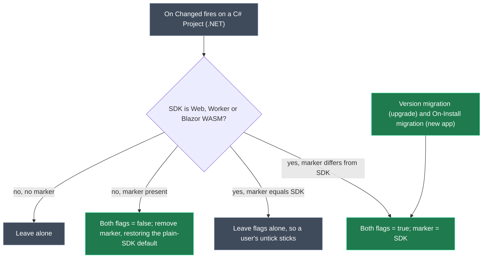
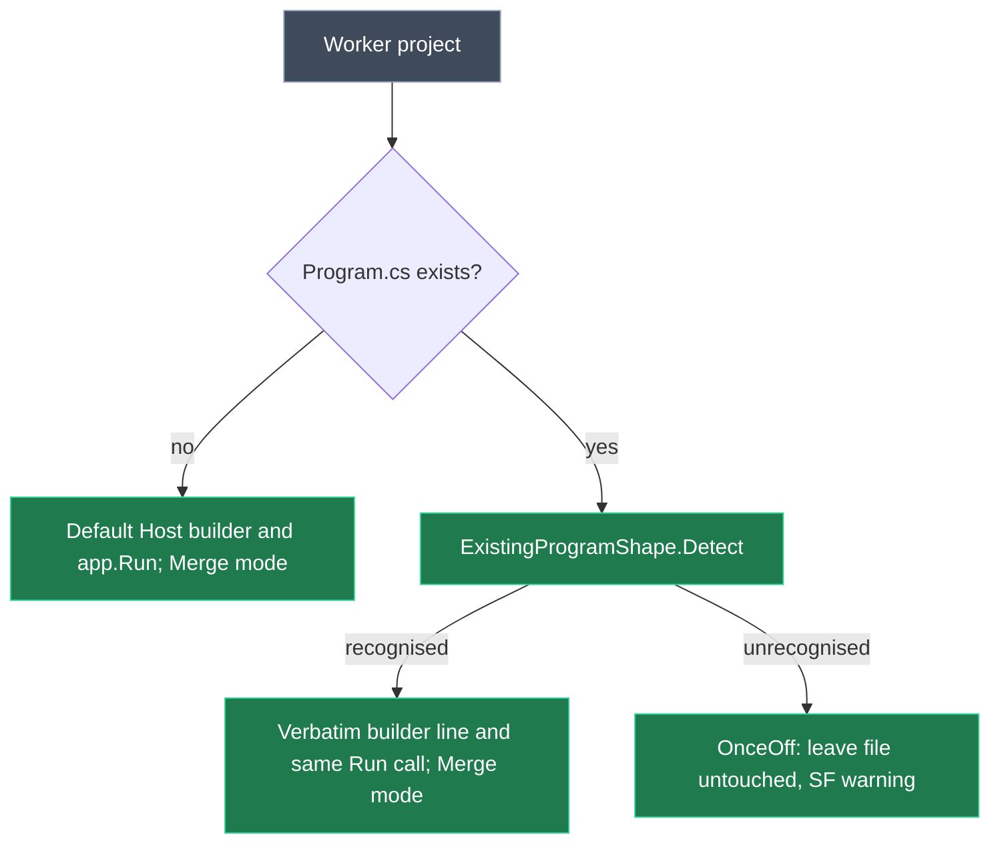

# Make Intent.VisualStudio.Projects safe for brownfield adoption

## Context

Adopting dotnet/eShop (`D:\Dev\MSeShop`, 28 projects, `.slnx`, central package management, `TreatWarningsAsErrors`) surfaced seven defects in `Intent.VisualStudio.Projects`. #7 (launchSettings rewrite) is already fixed in 4.1.11-pre.0. This plan fixes **#1, #2, #3, #4 and #6**. **#5 (Hosting 10.0.9 pin) is out of scope by decision**: the version can be bumped by hand, and the installer's default `IfNewer` behaviour only ever raises an existing central `PackageVersion`.

**Worked example: eShop adoption after this change.** The developer (or the AI doing the brownfield setup) models the existing projects to match the repo:

- `src`/`tests` with Materialize Folder on;
- the MSTest projects as `MSTest.Sdk`;
- the MAUI apps on `net10.0`;
- OrderProcessor with `Use top-level statements` on, because its `Program.cs` uses them;
- `Generate AppSettings File` unticked on the nine host projects.

Then they run the Software Factory:

- `eShop.slnx`, every csproj `Sdk`/`TargetFrameworks` value and all `appsettings.json` files come through **unchanged**.
- OrderProcessor's `Program.cs` keeps every statement, including `WebApplication.CreateBuilder` and `await app.RunAsync()`, and gains only Intent's attribute lines.

Today the same run does none of this:

1. It crashes merging into `eShop.slnx` (#1).
2. It rewrites the MSTest SDKs (#2).
3. It collapses the MAUI target frameworks (#3).
4. It replaces `Program.cs` or fails to merge it (#4).
5. It re-indents every `appsettings.json` (#6).

<Callout id="decisions" tone="decision" title="Decisions settled with the user">

| # | Decision |
| - | -------- |
| 1 | Normalise path comparison in the `.slnx` merger, and stop emitting the leading `./`. No model change. |
| 2 | **Preserve + MSTest option.** Never overwrite an `Sdk` attribute whose SDK name the model can't represent. Add `MSTest.Sdk` as an SDK option with an optional `MSTest SDK Version`. |
| 3 | Preserve-only. Never collapse a `TargetFrameworks` value the model can't express. Modelling platform TFMs is deferred. |
| 4 | **Merge and adapt.** Generate `Program.cs` in Merge mode, re-emitting the existing file's builder line and Run/RunAsync call. Modelled settings, including `Use top-level statements`, are never overridden by the file. Scope the Worker's logging settings to its own `appsettings.json`. |
| 5 | **Out of scope.** Bump by hand; the Software Factory preserves a raised version. |
| 6 | **Honour the setting.** `Generate AppSettings File` / `Generate LaunchSettings File` apply to every SDK, defaulting to true for Web/Worker/Blazor WASM via migrations and a designer script. Turning them off makes Intent hands-off rather than deleting the file. The appsettings template keeps an existing file's formatting and leaves it untouched when nothing changed. |

</Callout>

## Approach

Each defect is the same mistake: a sync step overwrites something on disk that the model either can't represent or didn't change. The fix applies one rule at every one of those steps: **read what is on disk first; write only what the model can represent and has actually changed.**

The model stays the authority for everything it *can* represent. What's on disk only shapes details the model has no setting for, such as the builder line or the indentation; it never overrides a modelled setting.

Only #2 (MSTest option) and #6 (honouring the flags) need designer changes, and both are in this module's own Module Builder package.

**Version:** the module stays at **4.1.11-pre.0**. 4.1.10 is the latest published version, and 4.1.11-pre.0 exists only on the local feed, so this line is still in flight and is not bumped again. The new version migration is registered at `4.1.11-pre.0`.

## Model changes

All changes are in the Module Builder designer of the `VisualStudio.Projects` application, in the `Intent.VisualStudio.Projects` package.

<ModelChanges id="model-changes" caption="Proposed Module Builder changes" changes={[
  { element: ".NET Settings (Stereotype Definition)", designer: "Module Builder", change: "modified", note: "Under the Stereotypes folder; applied to `C# Project (.NET)` with apply mode Always. New properties append to the end of the pane, since there is no ordering API (see CONTEXT.md).",
    fields: [
      { label: "SDK options", before: "7 options, ending Aspire.AppHost.Sdk", after: "+ `MSTest.Sdk`" },
      { label: "MSTest SDK Version", after: "Text box, default empty. Is Active only when SDK is MSTest.Sdk. Hint: leave empty to resolve the version from global.json." },
      { label: "Generate AppSettings File: Is Active Function", before: "Microsoft.NET.Sdk only", after: "Microsoft.NET.Sdk, .Web, .Worker, .BlazorWebAssembly" },
      { label: "Generate LaunchSettings File: Is Active Function", before: "Microsoft.NET.Sdk only", after: "Microsoft.NET.Sdk, .Web, .Worker, .BlazorWebAssembly" },
      { label: "Hints for both flags", after: "Explain the per-SDK default, and that off means Intent leaves an existing file alone" },
      { label: "On Changed Script", after: "SDK defaulting, using a marker in element metadata (see the diagram below)" }
    ] },
  { element: "4.1.11-pre.0", designer: "Module Builder", change: "added", note: "Version Migration under Migrations; generates the Migration_04_01_11_Pre_00 class" }
]} />

The defaulting script writes metadata **only on host-type projects** (Web, Worker, Blazor WASM). Class libraries and other plain projects are never touched.

*The migrations apply the "flags true + marker" step to every existing host-type project.*

<Callout id="defaults-tradeoffs" tone="warning" title="Defaulting tradeoffs">

- **Upgrade churn:** the upgrade migration edits the designer metadata of every app with host-type projects (two property values plus one metadata entry per project). Accepted: there is no other way to tell a hidden default `false` from a real `false`.
- **Brownfield adopters:** installing the module fresh into an existing repo also defaults these flags to true. Brownfield adopters untick them; the README's brownfield guidance says so.
- **SDK changes:** changing a project's SDK between host types (e.g. Web to Worker) re-defaults both flags to true, discarding an earlier untick. Accepted as the SDK-change contract.

</Callout>

## Code changes, per issue

### #1: `.slnx` merge with Materialize Folder

- `SlnxMerger.PathsEqual` compares **normalised** paths:
  - backslashes become forward slashes;
  - empty and `.` segments are dropped;
  - `x/..` collapses, but **leading `..` segments are kept** (projects outside the solution folder);
  - comparison ignores case.
- `ApplyProjectPlacement` already skips the write when `PathsEqual` holds, so an existing `src/Basket.API/Basket.API.csproj` entry is matched and kept exactly as written.
- `VisualStudioSolutionSlnxTemplate.GetProjectRelativePath` normalises its unshifted branch the same way. New entries are then written as `src/X/X.csproj`, as `dotnet sln add` writes them. Update the "byte-for-byte historical format" remark there.
- `CSharpProjectNETModel.GetRelativeLocation()` keeps its `.` seed. That value also feeds the output path through `ProjectConfig`. The classic `.sln` template is unaffected: it emits `.\` deliberately, and its `SlnFile` layer normalises the path and matches existing projects by id or name.
- Defensive: wrap `existingModel.AddProject` / `AddFolder` in `Reconcile` and rethrow the library's `SolutionArgumentException` as a `FriendlyException`. The message names the project and solution folder and says an existing entry with that name has a different path.

<Callout id="slnx-legacy" tone="warning" title="Existing ./-prefixed entries stay as they are">

An `.slnx` already holding `./src/...` entries keeps them. They now match the unprefixed output, so they are no longer rewritten. Only entries added after this change lose the prefix. Rewriting a matching entry would be exactly the churn this fix removes.

</Callout>

### #3: Platform target frameworks

`SyncFrameworks` moves into a testable helper (`TargetFrameworksSync`):

| Situation in the existing csproj | Behaviour |
| --- | --- |
| More than one `TargetFramework`/`TargetFrameworks` element, any `Condition` on the element or its `PropertyGroup`, or a value containing `$(` | Leave untouched |
| Each value reduced to its base moniker (`net10.0-android` becomes `net10.0`) gives the same set as the model | Leave untouched, so order and platform suffixes survive |
| Platform-suffixed values whose base set differs from the model | Leave untouched and log a Software Factory warning naming the project |
| Plain monikers whose set differs from the model | Rewrite as today |
| Model is `(unspecified)` | Leave untouched (unchanged early return) |

<Callout id="tfm-manual" tone="warning" title="Changing the framework of a multi-platform project is manual">

If a MAUI project modelled as `net10.0` is moved to `net11.0` in the model, the csproj is **not** updated. The SF log names the project instead. Rewriting platform lists means guessing per-platform version suffixes (e.g. `windows10.0.19041.0`).

</Callout>

### #2: The Sdk attribute and MSTest.Sdk

- Extract the `Sdk` attribute logic in `ApplySettings` into a testable helper (`SdkAttributeSync`):
  - Split the existing value into a name and an optional `/version`.
  - If the existing name is **not** one of the SDK options (e.g. `Microsoft.Build.NoTargets/3.7.0`, `Uno.Sdk`), leave the attribute alone whatever the model says.
  - Otherwise the model wins and the model's SDK name is written. The version rules are:
    - **Aspire:** behaviour unchanged.
    - **MSTest.Sdk:** write `/version` only when `MSTest SDK Version` is set. When it is blank and the existing name is already `MSTest.Sdk`, keep the existing suffix, if any.
    - **Other SDKs:** no version.
  - Write only on a real change.
- `GetGlobalUsings` (with `ImplicitUsings.cs`) maps `MSTest.Sdk` to the `Microsoft.NET.Sdk` set plus `Microsoft.VisualStudio.TestTools.UnitTesting`. Confirm that list against the MSTest.Sdk documentation while implementing.
- Regenerate the module's own API (`CSharpProjectNETModelStereotypeExtensions.cs`) to get `IsMSTestSdk()` and `MSTestSDKVersion()`.

<Callout id="sdk-model-wins" tone="warning" title="MSTest.Sdk becomes representable, so it must be modelled correctly">

With `MSTest.Sdk` an SDK option, an existing `Sdk="MSTest.Sdk"` on a project left at the default `Microsoft.NET.Sdk` is rewritten, the same as any other representable SDK. Brownfield setup must pick `MSTest.Sdk` when modelling those projects. A value the model can't represent (a typo, a third-party SDK) is never corrected. The defect was destroying values the model can't express.

</Callout>

### #6: `appsettings.json` / `launchSettings.json` opt-out and formatting

**Honour the flags.**

- `AppSettingsTemplateRegistration`: register the Web, Worker and Blazor WASM branches **in one of two modes**, chosen by `GenerateAppSettingsFile()`:
  - **Flag on: managed.** Behaviour as today.
  - **Flag off: hands-off.** The template is still registered for that project, and:
    - `CanRunTemplate` is true only when the file already exists, so the file is never created;
    - an existing file is returned unchanged, so it is neither rewritten nor proposed for deletion;
    - `AppSettingRegistrationRequest` events reaching it are accepted and dropped, with one SF info line per project listing the dropped keys. They must not fall through to the global publish and land in another project's file.
- Plain `Microsoft.NET.Sdk` projects keep today's behaviour (registered only when the flag is on). A hands-off template there would swallow settings that class libraries rely on flowing to their host.
- `LaunchSettingsJsonTemplateRegistration` and `MigrationHelper.HasLaunchSettings` follow the same rule using `GenerateLaunchSettingsFile()`, with an equivalent hands-off mode that keeps an existing file and drops profile and port requests.
- The legacy `ASP.NET Core Web Application` element stays unconditional.

**Migrations.**

- Add `MigrationHelper.ApplyGenerateSettingsDefaults(application)`. For every `C# Project (.NET)` whose SDK is Web/Worker/Blazor WASM, it:
  - sets both flags to `true`, adding each property with `IsActive = true` if missing (look up the property definition ids in the designer);
  - writes the SDK marker into element metadata;
  - **saves the package itself**.
- The new `Migration_04_01_11_Pre_00.Up()` calls it.
- `OnInstallMigration.OnInstall()` calls it **before** `ApplyLaunchSettingsStereotype`, so new apps seeded from architecture templates keep both files.

**Brownfield-safe appsettings.**

- Move `DetectIndentation` / `DetectNewLine` / `Serialize` out of `LaunchSettingsMerger` into a shared internal `JsonFileFormatting` helper.
- `AppSettingsTemplate.RunTemplate()` changes:
  - Parse with `DateParseHandling.None` / `FloatParseHandling.Decimal`.
  - Keep `JsonCommentPreserver`.
  - When the merged tree `DeepEquals` the original, return the original text unchanged.
  - Otherwise serialise with the existing file's own indentation and newline style.
  - `.editorconfig` is consulted only for a brand-new file. Its parser starts honouring sections: `[*]` plus any section whose glob matches `.json`, so `[*.cs] indent_size = 4` no longer reaches JSON.

<Callout id="pre0-apps" tone="warning" title="Apps already on 4.1.11-pre.0 skip the version migration">

eShop and any local app already on `4.1.11-pre.0` won't run the new migration. Their host projects read the flags as `false` and therefore go hands-off: files are left as they are, never deleted. For eShop that is the intended brownfield outcome. Repo test apps already on pre.0 have the flags set explicitly in step 9.

</Callout>

<Callout id="handsoff-verify" tone="risk" title="Open: confirm hands-off really suppresses deletion proposals">

The plan relies on a registered template whose output equals the existing file being treated as generated, so the SF neither diffs nor deletes it. Step 6 verifies this on eShop before going further. If deletion is still proposed, the fallback is `OverwriteBehaviour.OnceOff` on the hands-off template.

</Callout>

### #4: The Worker `Program.cs`

**Statement style** (top-level or `Main`) comes from `Use top-level statements`, exactly as today. Nothing below reads or depends on it; brownfield setup sets it to match the existing file.

**Shape detection.** Add an internal `ExistingProgramShape` detector: a pure function from file text to shape. It strips comments and captures:

- **Builder:** the existing builder declaration **verbatim**, when it is `WebApplication.CreateBuilder(args)` or `Host.CreateApplicationBuilder(args)`, e.g. `var builder = WebApplication.CreateBuilder(args);`.
- **Run call:** `app.Run()` or `await app.RunAsync()`. An `await` makes the generated `Main`, when the setting asks for one, `async Task`.

A file whose builder or Run call matches neither form is **Unrecognised**.

**Reading the file.** The template reads `Program.cs` from `OutputTarget.Location` plus `GetFolderPath()`, using the execution context's file system. `TryGetExistingFileContent` can't be used: it needs `FileMetadata`, which is only configured after the constructor.

**`ServiceWorkerProgramTemplate` changes.**

- Call `CSharpFile.IntentManagedMerge()`.
- When the shape is recognised, re-emit the existing builder declaration verbatim (keeping its `is-builder-statement` metadata) and the detected Run call. Merge mode then adds nothing that duplicates the user's code.
- Add `using Microsoft.AspNetCore.Builder` only for the WebApplication builder. Today the top-level branch always adds it, which a plain Worker project can't resolve.
- For an **Unrecognised** existing file, switch to `OverwriteBehaviour.OnceOff` (settable in the constructor) and log a warning.

**Scoped logging settings.** `AddApplicationLoggingConfig()` stops publishing `AppSettingRegistrationRequest` events.

- Add an internal `AddSetting(key, value)` on `AppSettingsTemplate`. The Worker template finds its own project's base instance with `FindTemplateInstances` (same project, no runtime environment), from the existing `AddClass` callback where every template is registered.
- It skips when the project has no managed instance (flag off).

<Callout id="prg-merge-tradeoffs" tone="warning" title="Merge mode tradeoffs">

- **Not zero-diff:** the first run on an existing `Program.cs` adds Intent's `[assembly: ...]` attributes and their `using` lines. Previously generated Worker files get a one-line change from `Mode.Fully` to `Mode.Merge`.
- **Uninstalling a module:** under Merge, uninstalling a module removes its previously generated *statements* (RoslynWeaver 4.7.0+), but can leave its `using` lines behind. Going back to Fully means a hand edit per app. Accepted with the user's Merge-by-default choice.
- **Serilog:** the Serilog extension wraps the generated statements in a try/catch. In a brownfield file without that structure, the first merge adds it. Merge can't be duplicate-free against a structure another module imposes.

</Callout>

<Callout id="prg-unrecognised" tone="warning" title="Unrecognised Program.cs shapes don't receive module startup code">

An existing file in another shape stays untouched, for example `Host.CreateDefaultBuilder(args).ConfigureServices(...)` or other variable names. Statements registered through the app-startup role (Serilog, WindowsServiceHost, ...) then do not land, and the SF warning says so. Merging into an unknown shape is how duplicate `Run` calls happen.

</Callout>

## Steps

1. **#1 `.slnx` paths.** Change `PathsEqual`, normalise `GetProjectRelativePath`, add the `FriendlyException` wrapper. Tests in `SlnxMergerTests`:
   - existing `src/X/X.csproj` with generated `./src/X/X.csproj`, with and without previous output: byte-identical result;
   - `a/../src` segments;
   - a leading `../` path kept;
   - a duplicate name raises a `FriendlyException`.

   `SlnxFileTests`: a materialized-folder project path has no `./`.
2. **#3 target frameworks.** Extract `TargetFrameworksSync` with the rule table. Tests cover:
   - the eShop ClientApp csproj (multi-target plus a conditional line in the same PropertyGroup): untouched;
   - HybridApp: untouched;
   - a reordered equal set: untouched;
   - a plain `net8.0` to `net10.0` change: rewritten;
   - a changed platform set: untouched, with a warning.
3. **#2 model, then code.** In Module Builder, add the `MSTest.Sdk` option and `MSTest SDK Version`. Run the Software Factory on `VisualStudio.Projects` to regenerate the API. Extract `SdkAttributeSync` and add the implicit-usings mapping. Tests:
   - unknown SDKs preserved under every modelled value;
   - `MSTest.Sdk` kept when modelled as MSTest.Sdk, with and without an existing version;
   - `MSTest.Sdk` rewritten when modelled as `Microsoft.NET.Sdk`;
   - Aspire unchanged.
4. **#6 formatting.** Extract `JsonFileFormatting` from `LaunchSettingsMerger` (its tests must stay green), then rework `AppSettingsTemplate.RunTemplate()` and the `.editorconfig` section parsing. Tests:
   - unchanged input returns the identical string;
   - 2- and 4-space files keep their indent when a key is added;
   - a `[*.cs]`-only `indent_size` is ignored;
   - comments and date-like strings survive.
5. **#6 designer.** Update both Is Active Functions and hints. Add the `.NET Settings` On Changed script; its context exposes the element and `setMetadata`, per `core.context.types.d.ts`. In a scratch app, check by hand:
   - Web defaults both flags on;
   - an untick sticks;
   - switching to Worker re-defaults both;
   - switching to plain clears both and the marker.
6. **#6 registrations (hands-off), then verify on eShop.** Implement the managed and hands-off modes for the AppSettings and LaunchSettings templates, and the `HasLaunchSettings` change. Then run the SF on eShop with the flags off: **no diffs and no deletion proposals** for its nine host projects. If deletions appear, apply the OnceOff fallback before continuing.
7. **#6 migrations.** Add the `4.1.11-pre.0` Version Migration element, regenerate, and implement `ApplyGenerateSettingsDefaults`, `Up()` and the `OnInstall()` ordering.
8. **#4 Worker Program.** Add `ExistingProgramShape` with tests for:
    - the eShop OrderProcessor file (`WebApplication` builder, `await app.RunAsync()`);
    - Intent's own generated output (`Host` builder, `app.Run()`);
    - an unrecognised `CreateDefaultBuilder` file.

    Then change the template:
    - read the file;
    - generate in Merge mode;
    - re-emit the detected builder line and Run call;
    - add the conditional using and the OnceOff fallback;
    - add `AppSettingsTemplate.AddSetting` for the scoped logging settings.
9. **Local apps already on pre.0.** Use `run_solution_query` → `listInstalledModules` to find repo test apps on `4.1.11-pre.0`. For each, set both flags and the marker on its host projects with a designer script, mirroring the migration. eShop is deliberately left alone.
10. **Build and regenerate.** Run `dotnet build --no-incremental` on the module and test projects, plus `dotnet test` on `Intent.Modules.VisualStudio.Projects.Tests`. Re-install 4.1.11-pre.0 one application at a time where it isn't picked up.
11. **Close-out:**
    - **Version:** confirm 4.1.11-pre.0, with no bump.
    - **Dependencies:** run `module-dependency-audit`.
    - **Docs:** release notes under 4.1.11, and README sections on SDK/MSTest, the Generate flags, Worker `Program.cs` behaviour and Materialize Folder. The README also gets brownfield-setup guidance: set `Use top-level statements` to match the existing `Program.cs`, pick `MSTest.Sdk` for MSTest projects, and untick the Generate flags to keep existing files hands-off.
    - **`CONTEXT.md`:** record:
      - the preserve-unrepresentable rule and the TFM preserve rules;
      - Program adaptation (builder line and Run call only; never a modelled setting) and Merge mode;
      - the hands-off semantics;
      - flag defaulting and migration ordering.

## Critical files

<FileTree id="files" title="Files touched (module and tests)" entries={[
  { path: "Modules/Intent.Modules.VisualStudio.Projects/Templates/VisualStudioSolution/Merging/SlnxMerger.cs", change: "modified", note: "#1 normalised PathsEqual; FriendlyException on an AddProject clash" },
  { path: "Modules/Intent.Modules.VisualStudio.Projects/Templates/VisualStudioSolution/VisualStudioSolutionSlnxTemplate.cs", change: "modified", note: "#1 no ./ prefix for new entries" },
  { path: "Modules/Intent.Modules.VisualStudio.Projects/Templates/VisualStudioProjectTemplateBase.cs", change: "modified", note: "#2/#3 delegate to the sync helpers; MSTest implicit usings" },
  { path: "Modules/Intent.Modules.VisualStudio.Projects/Templates/TargetFrameworksSync.cs", change: "added", note: "#3 preserve rules" },
  { path: "Modules/Intent.Modules.VisualStudio.Projects/Templates/SdkAttributeSync.cs", change: "added", note: "#2 preserve rule and version handling" },
  { path: "Modules/Intent.Modules.VisualStudio.Projects/Templates/ImplicitUsings.cs", change: "modified", note: "#2 MSTest.Sdk mapping" },
  { path: "Modules/Intent.Modules.VisualStudio.Projects/Api/Extensions/CSharpProjectNETModelStereotypeExtensions.cs", change: "modified", note: "Regenerated: IsMSTestSdk, MSTestSDKVersion" },
  { path: "Modules/Intent.Modules.VisualStudio.Projects/Templates/JsonFileFormatting.cs", change: "added", note: "#6 shared indent/newline detection and serialisation" },
  { path: "Modules/Intent.Modules.VisualStudio.Projects/Templates/LaunchSettings/LaunchSettingsMerger.cs", change: "modified", note: "Uses JsonFileFormatting" },
  { path: "Modules/Intent.Modules.VisualStudio.Projects/Templates/LaunchSettings/LaunchSettingsJsonTemplate.cs", change: "modified", note: "#6 hands-off mode" },
  { path: "Modules/Intent.Modules.VisualStudio.Projects/Templates/LaunchSettings/LaunchSettingsJsonTemplateRegistration.cs", change: "modified", note: "#6 managed or hands-off by flag" },
  { path: "Modules/Intent.Modules.VisualStudio.Projects/Templates/CoreWeb/AppSettings/AppSettingsModel.cs", change: "modified", note: "#6 hands-off flag on the model" },
  { path: "Modules/Intent.Modules.VisualStudio.Projects/Templates/CoreWeb/AppSettings/AppSettingsTemplatePartial.cs", change: "modified", note: "#6 no-op when unchanged, keep formatting, editorconfig sections, hands-off; #4 internal AddSetting" },
  { path: "Modules/Intent.Modules.VisualStudio.Projects/Templates/CoreWeb/AppSettings/AppSettingsTemplateRegistration.cs", change: "modified", note: "#6 managed or hands-off by flag for host SDKs" },
  { path: "Modules/Intent.Modules.VisualStudio.Projects/Migrations/MigrationHelper.cs", change: "modified", note: "#6 ApplyGenerateSettingsDefaults; HasLaunchSettings honours the flag" },
  { path: "Modules/Intent.Modules.VisualStudio.Projects/Migrations/OnInstallMigration.cs", change: "modified", note: "#6 defaults before launch settings" },
  { path: "Modules/Intent.Modules.VisualStudio.Projects/Migrations/Migration_04_01_11_Pre_00.cs", change: "added", note: "Generated from the Version Migration element; Up() hand-written" },
  { path: "Modules/Intent.Modules.VisualStudio.Projects/Templates/ServiceWorker/ServiceWorkerProgram/ServiceWorkerProgramTemplatePartial.cs", change: "modified", note: "#4 file read, Merge, verbatim builder line and Run call, OnceOff fallback, scoped settings" },
  { path: "Modules/Intent.Modules.VisualStudio.Projects/Templates/ServiceWorker/ServiceWorkerProgram/ExistingProgramShape.cs", change: "added", note: "#4 detector" },
  { path: "Modules/Intent.Modules.VisualStudio.Projects.Tests/Templates/SlnxFile/SlnxMergerTests.cs", change: "modified" },
  { path: "Modules/Intent.Modules.VisualStudio.Projects.Tests/Templates/SlnxFile/SlnxFileTests.cs", change: "modified" },
  { path: "Modules/Intent.Modules.VisualStudio.Projects/release-notes.md", change: "modified" },
  { path: "Modules/Intent.Modules.VisualStudio.Projects/docs/README.md", change: "modified" },
  { path: "Modules/Intent.Modules.VisualStudio.Projects/CONTEXT.md", change: "modified" }
]} />

New test files sit beside the existing ones in `Intent.Modules.VisualStudio.Projects.Tests`, under `Templates/TargetFrameworks`, `Templates/Sdk`, `Templates/AppSettings` and `Templates/ServiceWorker`. They use xUnit, Shouldly and string fixtures, following `LaunchSettingsMergerTests`.

## Verification

<Checklist id="verify" items={[
  { id: "unit", label: "`dotnet test` on Intent.Modules.VisualStudio.Projects.Tests: all new and existing tests pass, including LaunchSettingsMergerTests after the JsonFileFormatting extraction" },
  { id: "build", label: "`dotnet build --no-incremental` on the module exits 0, and the `.imodspec` lists migration `4.1.11-pre.0`" },
  { id: "greenfield", label: "Greenfield regression: run the SF on the `WebAndWorker`, `WindowsServiceHost.Tests` and `BugSnagTest.ServiceHost` test apps", note: "Expected diff: only the Mode.Fully to Mode.Merge line in each Worker Program.cs. No appsettings/launchSettings/csproj/.slnx changes." },
  { id: "toplevel", label: "Greenfield top-level path: a scratch Worker project with Use top-level statements on generates, builds, and has no `Microsoft.AspNetCore.Builder` using" },
  { id: "upgrade", label: "Upgrade path: a scratch app on 4.1.10 with a Web and a Worker project, upgraded to 4.1.11-pre.0", note: "Both flags migrate to true with the marker, and both files keep generating unchanged" },
  { id: "new-app", label: "New app from an architecture template: the API project has both flags true and both files generated" },
  { id: "e1", label: "eShop #1: Materialize Folder on with no Relative Location; the SF reaches staging and eShop.slnx is unchanged" },
  { id: "e2", label: "eShop #2: the 5 MSTest projects modelled as MSTest.Sdk (version blank) keep `Sdk=\"MSTest.Sdk\"`, resolved through global.json" },
  { id: "e3", label: "eShop #3: ClientApp/HybridApp with their real frameworks keep TargetFrameworks, its order and the conditional Windows line" },
  { id: "e4", label: "eShop #4: OrderProcessor modelled with Use top-level statements = true (matching its file)", note: "No merge error. Program.cs keeps every statement, including WebApplication.CreateBuilder and await app.RunAsync(), and gains only Intent attribute/using lines. No other project's appsettings.json changes." },
  { id: "e6", label: "eShop #6: flags off on the host projects: no appsettings/launchSettings diffs and no deletion proposals. Flag on with a raised setting: the file keeps its 2-space indent." }
]} />

## Deliberately deferred

- **#5:** see Context.
- **Modelling platform TFMs:** this plan only preserves them.
- **Whole-file csproj re-indent on any rewrite** (HybridApp went from 4 to 2 spaces): #3 removes this trigger, but any other csproj change still re-indents.
- **`Content Remove`/`Include` items for `appsettings.json` on managed Worker projects:** brownfield Workers can now opt out instead. Changing it for greenfield would churn existing csproj files.
- **The SF proposing deletion of previously recorded but now unmodelled csproj files** (the unmodelled MSTest projects): engine behaviour.
- **A null-safe `TargetFrameworkVersion()` when `.NET Settings` is absent.**

## Open questions resolved

- **Q:** How should the Worker Program template treat an existing `Program.cs` that Intent never generated? **A:** Merge and adapt.
- **Q:** Does adapting to the existing `Program.cs` involve top-level statements? **A:** No. The template adapts only the builder line and Run call. Statement style stays with the `Use top-level statements` setting, unchanged.
- **Q:** How far should the appsettings fix go? **A:** Honour `Generate AppSettings File` and `Generate LaunchSettings File` for every SDK, with migrations and designer defaults, plus brownfield-safe formatting.
- **Q:** How should MSTest.Sdk and unknown SDKs be handled? **A:** Preserve unrepresentable values, and add a `MSTest.Sdk` option with an optional version.
- **Q:** What should change in NuGet handling? **A:** Nothing. The version can be bumped by hand, and the SF preserves the raised version.
