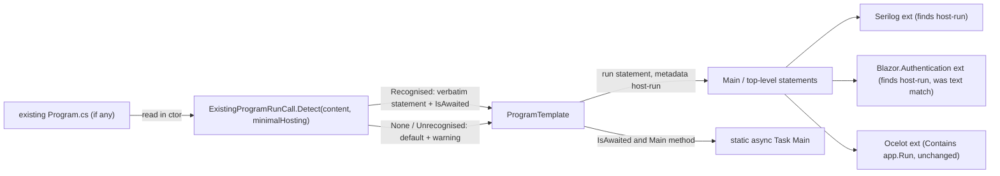

# ASP.NET Core `Program.cs`: keep the developer's run call instead of forcing `app.Run();`

## Context

`Intent.AspNetCore`'s `ProgramTemplate` hard-codes the host start call — `app.Run();` (minimal hosting) or
`CreateHostBuilder(args).Build().Run();` (generic hosting) — and a `void Main`. Now that `Program.cs` is in
Merge mode (6.1.7-pre.0, this branch), a developer who changes it to `await app.RunAsync();` still gets
`app.Run();` re-added on the next Software Factory run, and a class-style `Main` would need to become
`async Task` for the `await` to compile.

The Worker host template (`Intent.VisualStudio.Projects`) already solved this: `ExistingProgramShape`
reads the existing `Program.cs` before generation and re-emits the developer's run call verbatim. Apply
the same idea to ASP.NET Core, covering the common ways a web host is started.

**Worked example.** A developer edits a generated top-level `Program.cs`:

```csharp
app.MapControllers();
app.UseSwashbuckle(builder.Configuration);

await app.RunAsync();          // was: app.Run();
```

Next SF run: the template detects `await app.RunAsync();`, emits exactly that (still tagged `host-run`),
so the diff is empty. With a `Main` method instead of top-level statements, `Main` is generated as
`public static async Task Main(string[] args)`. If they later switch back to `app.Run();`, the template
follows and `Main` returns to `void`.

## Approach



**Hard-to-reverse decisions, settled up front:**

1. **The `host-run` metadata stays the contract.** Whatever statement is emitted keeps
   `.AddMetadata("host-run", true)`, so Serilog (`SerilogStartupConfigurationExtension`, both branches) keeps
   working unchanged. The one consumer matching on *text* — `Intent.Blazor.Authentication`'s
   `ServerAddAuthentication` (`s.Text == "app.Run();"`) — is switched to the metadata, otherwise
   `MapAdditionalIdentityEndpoints()` would silently stop being inserted for `RunAsync` users.
2. **A web-specific detector lives in `Intent.Modules.AspNetCore`, not shared with the Worker.** AspNetCore
   consumes `Intent.Modules.VisualStudio.Projects` as NuGet **3.6.0**, while the Worker's
   `ExistingProgramShape` is `internal` in unpublished 4.1.11-pre.1. Sharing it would mean a public API,
   a package bump and a version floor for one small regex class. Its comment/string-stripping regex and
   `Detect` structure are copied as the starting point.
3. **Scope is the run call (and the `Main` signature it implies) only.** The Worker also detects the
   builder declaration and makes unrecognised files `OnceOff`; that brownfield handling is deferred
   (already recorded as an open item in AspNetCore's `CONTEXT.md`). Turning an Intent-managed web
   `Program.cs` `OnceOff` would stop all other modules' registrations from landing, which is far worse
   than an extra run line.

**Recognised run calls** — one statement, matched after stripping comments, receiver fixed per hosting
model (`app` for minimal, `CreateHostBuilder(args).Build()` for generic), re-emitted verbatim (trimmed):

| Form | Example | `IsAwaited` |
|---|---|---|
| Sync | `app.Run();`, `app.Run("http://localhost:5000");` | no |
| Async, awaited | `await app.RunAsync();`, `await app.RunAsync(url);`, `await app.RunAsync().ConfigureAwait(false);` | yes |
| Async, blocked on | `app.RunAsync().GetAwaiter().GetResult();`, `app.RunAsync().Wait();` | no |
| Generic hosting | each of the above on `CreateHostBuilder(args).Build()` | as above |

**Fallbacks:** no file → default (`app.Run();` / `CreateHostBuilder(args).Build().Run();`, as today).
File exists but zero or several matching statements (e.g. `StartAsync` + `WaitForShutdownAsync`, a run
call per `if` branch, a different receiver name) → default plus a `Logging.Log.Warning` naming the
project and the forms that are recognised, so the extra line in the SF diff is explained. A
commented-out `// app.Run();` never counts.

## Code changes

Module code (templates), not application code — no designer model changes; the Module Builder model
is untouched apart from version handling.

- **New `Modules/Intent.Modules.AspNetCore/Templates/Program/ExistingProgramRunCall.cs`** — `internal sealed record`
  with `Kind` (`None` / `Recognised` / `Unrecognised`), `Statement`, `IsAwaited`, and
  `static Detect(string? content, bool usesMinimalHostingModel)`. Starting point: `CommentsAndStrings`
  regex and BOM trim from
  `Modules/Intent.Modules.VisualStudio.Projects/Templates/ServiceWorker/ServiceWorkerProgram/ExistingProgramShape.cs`.
- **`Modules/Intent.Modules.AspNetCore/Templates/Program/ProgramTemplatePartial.cs`**
  - In the constructor, read the existing file the way the Worker does (`ReadExistingProgramFile()` in
    `ServiceWorkerProgramTemplatePartial.cs`: `Path.Combine(OutputTarget.Location, this.GetFolderPath(), "Program.cs")`
    via `ExecutionContext.FileSystem`, because `FileMetadata` isn't available yet) and call `Detect`
    per instance (multi-host safe — each host reads its own file).
  - Pass the run statement into `ApplyMinimalHostingModelStatements` (currently `static`, hard-codes
    `"app.Run();"`) and `AddGenericModelMainStatements` (hard-codes `CreateHostBuilder(args).Build().Run();`),
    keeping `host-run` metadata and existing separators.
  - For the two `Main`-method shapes: when `IsAwaited`, `method.Async()` with return type `Task`
    (mirror the Worker's `_existingProgramShape.RunsAsync ? "Task" : "void"` + `method.Async()`), and add
    `System.Threading.Tasks` using as the Worker does.
  - Warning on `Unrecognised`.
- **`Modules/Intent.Modules.Blazor.Authentication/FactoryExtensions/ServerAddAuthentication.cs`** (~line 221) —
  replace both `s.Text == "app.Run();"` lookups with `s.HasMetadata("host-run")`.
- **Unit tests** for `Detect`: there is no AspNetCore test project, so add
  `Modules/Intent.Modules.AspNetCore.Tests` modelled on `Intent.Modules.VisualStudio.Projects.Tests`
  (net8.0, xunit + Shouldly, `ProjectReference` to AspNetCore, `InternalsVisibleTo` added to
  `Intent.Modules.AspNetCore.csproj`, added to `Modules/Intent.Modules.NET.sln`). Cases: every row of the
  table above for both hosting models; Serilog-wrapped (`try { ... await app.RunAsync(); }`); BOM;
  commented-out run line ignored; two run calls → `Unrecognised`; `StartAsync`/`WaitForShutdownAsync` →
  `Unrecognised`; wrong receiver → `Unrecognised`; empty → `None`; the current generated output
  (copy from `Tests/AspNetCoreNoAuth/.../Program.cs` and a minimal-hosting test app) → `Recognised`,
  `app.Run();`, not awaited.

## Steps

1. **Version gate** (`module-version-increment`): `Intent.AspNetCore` is already at unpublished
   6.1.7-pre.0 for this line of work — leave it. Run the gate for `Intent.Blazor.Authentication`
   (2.0.3 on disk — expect published → 2.0.4-pre.0, patch). Serilog, Ocelot: no change.
2. **Detector + tests** — add `ExistingProgramRunCall` and the test project; tests green.
3. **Template** — wire detection into `ProgramTemplate` as above; build `Intent.Modules.AspNetCore`
   with `dotnet build --no-incremental`.
4. **Blazor.Authentication** — metadata lookup; build.
5. **Verify generated output** in the Tests solution (see Verification).
6. **Close-out** — dependency audit (no new module dependencies expected); docs: extend the
   6.1.7 release note and the README paragraph added under "Generated Program.cs Structure" to list the
   recognised run calls and the async `Main`; Blazor.Authentication release note; `CONTEXT.md` entry for
   AspNetCore (the `host-run` contract, why the detector isn't shared, the fallback-not-OnceOff decision).

## Critical files

- `Modules/Intent.Modules.AspNetCore/Templates/Program/ProgramTemplatePartial.cs` — template being changed
- `Modules/Intent.Modules.VisualStudio.Projects/Templates/ServiceWorker/ServiceWorkerProgram/ExistingProgramShape.cs` and `ServiceWorkerProgramTemplatePartial.cs` — the pattern to copy (read existing file, detect, async `Main`)
- `Modules/Intent.Modules.AspNetCore.Logging.Serilog/FactoryExtensions/SerilogStartupConfigurationExtension.cs` — `host-run` consumer, must keep working unchanged
- `Modules/Intent.Modules.Blazor.Authentication/FactoryExtensions/ServerAddAuthentication.cs` — text-match consumer to fix
- `Modules/Intent.Modules.ApiGateway.Ocelot/Templates/OcelotConfiguration/OcelotConfigurationTemplatePartial.cs` — `Contains("app.Run")` already matches `RunAsync`; no change

## Verification

- `dotnet test` on the new `Intent.Modules.AspNetCore.Tests`.
- Build both modules (0 errors).
- In the Tests solution, install `Intent.AspNetCore` 6.1.7-pre.0 (and Blazor.Authentication) into:
  - a **minimal hosting + top-level** app with Serilog (e.g. `AdvancedMappingCrud.Cosmos.Tests`), and
  - a **generic hosting + `Main`** app (e.g. `AspNetCoreNoAuth`).
  For each: (1) regenerate unchanged → only the expected Merge-mode header diff, run line untouched;
  (2) hand-edit to `await app.RunAsync();` (or `await CreateHostBuilder(args).Build().RunAsync();`) →
  regenerate → **no diff** on that line, `Main` becomes `async Task` in the `Main` shape, Serilog's
  "Starting web host" log line still sits directly above it inside the `try`; (3) change to something
  unrecognised → warning in SF output, default run line proposed. Build the regenerated app.
- A Blazor Server app with built-in ASP.NET Identity login: with `await app.RunAsync();`,
  `app.MapAdditionalIdentityEndpoints();` is still inserted above it.

## Decisions made without asking (redirect at approval if wrong)

- Detector duplicated into AspNetCore rather than shared from VisualStudio.Projects (reason in decision 2).
- Unrecognised run calls fall back to the default + warning rather than making the file `OnceOff`.
- Brownfield builder-statement detection is deferred.
- A new `Intent.Modules.AspNetCore.Tests` project is created for the detector's unit tests.
