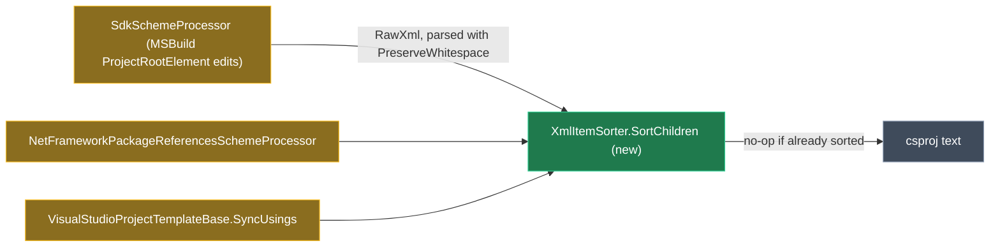

# `.csproj` comments stay with the element they describe

## Context

A developer annotates their project file:

```xml
<ItemGroup>
  <PackageReference Include="Azure.Identity" Version="1.13.0" />
  <!-- Pinned: 9.x breaks our custom converters, see #412 -->
  <PackageReference Include="Newtonsoft.Json" Version="13.0.3" />
  <PackageReference Include="Serilog" Version="4.0.0" /> <!-- keep in step with Serilog.Sinks.* -->
</ItemGroup>
```

On the next Software Factory run, `Intent.VisualStudio.Projects`' NuGet installer rewrites the group, and the "Pinned" comment ends up at the top of the `ItemGroup`, above `Azure.Identity`. That happens even though the list was already sorted and no package changed. After this change, both comments stay on the lines of the packages they describe. A file that is already in order is not touched at all.

**Root cause.** Three places re-sort `.csproj` items by removing them and adding them back, and all three treat comments as if they weren't there:

| Where | What it does to comments |
|---|---|
| <FileRef path="Modules/Intent.Modules.VisualStudio.Projects/FactoryExtensions/NuGet/SchemeProcessors/SdkSchemeProcessor.cs" line={308} endLine={323} label="SdkSchemeProcessor.SortAlphabetically" /> | Runs every time, sorted or not. `RemoveAllChildren` then `AppendChild` moves only the MSBuild `ProjectElement`s. Comments aren't elements, so they stay put while every item is appended after them, which bunches them at the top of the group. **This is the case you hit.** |
| <FileRef path="Modules/Intent.Modules.VisualStudio.Projects/FactoryExtensions/NuGet/SchemeProcessors/NetFrameworkPackageReferencesSchemeProcessor.cs" line={134} endLine={146} label="NetFramework…SortAlphabetically" /> | Same bug using `XElement`: `Elements()` skips comments, and each element is re-added at the end. |
| <FileRef path="Modules/Intent.Modules.VisualStudio.Projects/Templates/VisualStudioProjectTemplateBase.cs" line={268} endLine={298} label="VisualStudioProjectTemplateBase.SyncUsings" /> | Whenever a modelled `<Using>` is added, `usingGroup.RemoveAll()` **deletes** every comment in the group, and every attribute on the `ItemGroup` too, such as `Condition` or `Label`. |

## Approach

One shared, comment-aware sorter replaces all three sort routines. It sorts **units** rather than elements. A unit is the element plus the comments attached to it:

- **Leading comments:** every comment between the previous sortable element and this one.
- **A trailing same-line comment:** a comment after the element with no newline in the whitespace between them.

Indentation between units stays where it is, so the layout of the file doesn't change. A comment after the last element, just before `</ItemGroup>`, stays at the end.

The sorter first checks whether the units are already in order. If they are, it changes nothing and reports no change. That means an already-sorted file stays byte-identical, which fixes the "rewritten every run" half of the problem as well.



*Green: new. Amber: changed to call the shared sorter.*

<Callout id="sdk-xml-level" tone="decision" title="Sort at the XML level, not through the MSBuild API">

MSBuild's `ProjectRootElement` construction model only exposes elements, so there is no way to move a comment through it. `SdkSchemeProcessor.InstallPackages` keeps doing its add, remove and version edits through MSBuild, which is unchanged. Only the final sort moves: take `project.RawXml`, parse it with `LoadOptions.PreserveWhitespace`, sort with the shared helper, then serialise with `SaveOptions.DisableFormatting`. The XML declaration is kept if there was one. The rule for which groups are sorted doesn't change: only `ItemGroup`s that contain nothing but `PackageReference` items.

</Callout>

<Callout id="removed-keeps-comment" tone="decision" title="A removed package keeps its comment (your answer)">

When a module stops requesting a package, its `PackageReference` is removed but a comment above it is left in place, because user-written text is never deleted. Today, when a group ends up with no items, it is removed together with any comments it still holds. Both processors change to remove the `ItemGroup` only if no comments are left in it. This applies to `parent.Count == 0` in the SDK processor and `!Descendants().Any()` in the .NET Framework processor.

</Callout>

<Callout id="same-line-limits" tone="warning" title="Same-line comments only survive where whitespace is preserved">

You asked for trailing same-line comments to stay on their line. The SDK path, which is your case and the default for modern projects, gets this fully, because its XML is handled with whitespace preserved. Two paths parse **without** whitespace and re-indent the whole file whenever they change anything:

- the .NET Framework `PackageReference` processor (`XDocument.Parse(projectContent)`, line 65)
- the `.csproj` template's settings sync, which includes `<Using>` (`RunTemplate`, line 113, then `ToFormattedProjectString`)

On those paths a same-line comment still moves with its element, but lands on its own line beneath it, and only on runs where Intent actually rewrites the file. Fixing that means changing those paths to preserve whitespace, which alters how every rewrite of those files is formatted. It is deferred as a separate change. Leading comments are fully handled on all three paths.

</Callout>

## Model changes

None. This is a fix inside the module's own code. The Module Builder model is untouched apart from the version check below.

## Code changes

<FileTree
  id="files"
  entries={[
    { path: "Modules/Intent.Modules.VisualStudio.Projects/XmlItemSorter.cs", change: "added", note: "Shared comment-aware sorter, `internal static`" },
    { path: "Modules/Intent.Modules.VisualStudio.Projects/FactoryExtensions/NuGet/SchemeProcessors/SdkSchemeProcessor.cs", change: "modified", note: "SortAlphabetically goes through the XML-level sorter; an empty group is kept if it still has comments" },
    { path: "Modules/Intent.Modules.VisualStudio.Projects/FactoryExtensions/NuGet/SchemeProcessors/NetFrameworkPackageReferencesSchemeProcessor.cs", change: "modified", note: "SortAlphabetically delegates to the sorter; the group is removed only if it has no comments" },
    { path: "Modules/Intent.Modules.VisualStudio.Projects/Templates/VisualStudioProjectTemplateBase.cs", change: "modified", note: "SyncUsings uses the sorter instead of RemoveAll, so comments and ItemGroup attributes survive" },
    { path: "Modules/Intent.Modules.VisualStudio.Projects.Tests/XmlItemSorterTests.cs", change: "added", note: "Unit tests for the unit rules" },
    { path: "Modules/Intent.Modules.VisualStudio.Projects.Tests/NuGet/SchemeTests/SdkSchemeTests.cs", change: "modified", note: "Commented csproj cases, end to end through InstallPackages" },
    { path: "Modules/Intent.Modules.VisualStudio.Projects.Tests/NuGet/SchemeTests/NetFrameworkPackageReferenceSchemeTests.cs", change: "modified", note: "Commented csproj case" },
  ]}
/>

The shape of the new helper (signature is indicative):

```csharp
internal static class XmlItemSorter
{
    // Reorders container's child elements matched by isSortable, by key, each moving with
    // its leading comments and same-line trailing comment. Returns false and leaves the
    // container untouched when the units are already in order.
    public static bool SortChildren(XElement container, Func<XElement, bool> isSortable, Func<XElement, string> key);
}
```

The keys stay exactly as they are today:
- SDK: `Include`, ordinal (matches `OrderBy(x => x.Include)`)
- .NET Framework: the `Include` attribute
- Usings: element name, then `Include`

## Steps

1. **Version gate.** `Intent.VisualStudio.Projects` is at 4.1.11-pre.1 on disk, and its 4.1.11 release notes are still being added to, so this is expected to be in flight and left alone. Confirm with a feed search that includes prereleases before changing anything. No other module changes, because this is internal to this module.
2. **Failing tests first.** Add `XmlItemSorterTests` and a commented-csproj case to `SdkSchemeTests`. The SDK test uses your example above: install `TestPackage.One`, then assert the "Pinned" comment still directly precedes `Newtonsoft.Json` and the Serilog comment is still on Serilog's line. Run them against the current code to confirm they reproduce the bunching.
3. **`XmlItemSorter`.** Split the container's children into a leading region, units and a tail. Do the already-sorted check. Rebuild the children in the new order, keeping the whitespace slots between units where they are.
4. **SDK processor.** Run the XML-level sort over `RawXml`, as in the decision above. Keep a group that still holds comments when its last item is removed.
5. **.NET Framework processor.** Delegate to the sorter, and apply the same keep-if-comments rule to the group-removal check.
6. **`SyncUsings`.** Replace `RemoveAll()` and re-add with the sorter, so the `ItemGroup`'s attributes and comments are kept.
7. **Close-out.** Add a 4.1.11 release note ("Fixed: comments in a `.csproj` were moved away from the `PackageReference` or `Using` they described, or deleted, when Intent sorted those items. They now stay with their item, and an already-sorted group is left untouched."). Add a `CONTEXT.md` entry for `Intent.VisualStudio.Projects` covering the unit rule, why the sort is done at the XML level, and the deferred whitespace limitation. The dependency audit should find no change.

## Verification

<Checklist
  id="verify"
  items={[
    { id: "unit", label: "`XmlItemSorterTests` pass", note: "Cases: comment above moves with its element; multi-line and multi-comment blocks; same-line trailing comment; tail comment stays last; already sorted returns false and the text is byte-identical; container attributes kept; mixed sortable and non-sortable children" },
    { id: "sdk", label: "`SdkSchemeTests` commented cases pass", note: "Unsorted with comments ends sorted with every comment beside its package. Sorted with comments plus a new package changes only by the added line. Removing the only package in a group that has a comment keeps the group and the comment" },
    { id: "fw", label: "`NetFrameworkPackageReferenceSchemeTests` commented case passes" },
    { id: "existing", label: "All existing `Intent.Modules.VisualStudio.Projects.Tests` still pass, including the `.verified.txt` snapshots", note: "A snapshot change is only acceptable if it is the sorted-input no-op" },
    { id: "build", label: "`dotnet build --no-incremental` of the module exits 0" },
    { id: "sf", label: "Regenerate a scratch copy of a Tests app (outside the repo, as in the previous task) after adding comments above and beside `PackageReference`s in an API `.csproj`", note: "Expect no `.csproj` diff when nothing changed, and comments in place when a package is added" },
  ]}
/>

## Open questions resolved

- **Q:** When Intent removes a package, what happens to the comment above it? **A:** Keep the comment. User text is never deleted, and an `ItemGroup` that still holds comments is no longer removed.
- **Q:** Scope? **A:** All three sorters: SDK `PackageReference`, .NET Framework `PackageReference`, and `<Using>`, through one shared sorter.
- **Q:** Should same-line trailing comments travel too? **A:** Yes, with the whitespace limitation noted above for the two paths that don't preserve whitespace.
