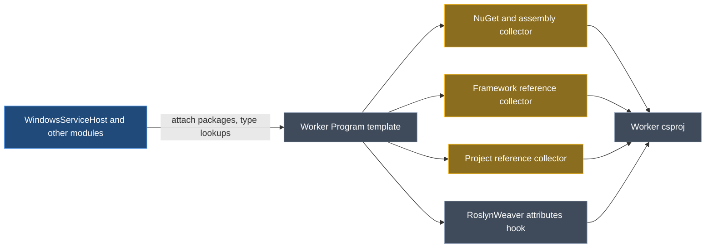

# Hands-off Worker Program.cs adds no dependencies

## Context

*Generate Program File* exists for brownfield Worker projects: the user already owns a `Program.cs` with its own configuration and dependencies, and is mapping the project into Intent. The rule: **when it is off, Intent must not add any dependency on the Program template's account** — not its own, and not what other modules attach to it for startup code that will never be written.

What `4.1.12-pre.2` does today, reproduced in the throwaway `WorkerHandsOffTest` app (Windows Service Host + Quartz + MediatR, setting off):

| Version | Packages Intent adds to the Worker `.csproj` |
| --- | --- |
| pre.1 (published) | RoslynWeaver.Attributes, MediatR, Hosting.WindowsServices, Quartz.Extensions.Hosting |
| pre.2 (current) | the above **plus** Configuration.Binder and DependencyInjection |
| **Target** | RoslynWeaver.Attributes, MediatR, Quartz.Extensions.Hosting |

`Hosting.WindowsServices`, `DependencyInjection`, `Configuration.Abstractions` and `Configuration.Binder` are all attached to the Program template by `Intent.WindowsServiceHost` for `AddWindowsService` and configuration binding in `Program.cs` — code a hands-off project never gets. pre.2 only stopped the template's own `Microsoft.Extensions.Hosting`; that also stopped it masking the other two through NuGet consolidation, which is what your second screenshot shows.

The bare-Worker case (`BareWorkerTest`) is already correct on pre.2 and must stay so.

## Approach

The research found that **none of this module's three dependency collectors checks whether a template will run** — each reads every template on the project:

*Amber: changed in this plan. Grey: unchanged. The RoslynWeaver hook (another repository) is already handled: a hands-off template reports `Basic` code generation.*

So the fix goes **where this module decides which templates contribute**: all three collectors skip a hands-off template. That covers every attacher and every timing at once — packages added in a constructor or `AfterTemplateRegistration`, project references recorded by `GetTypeName` in `OnBuild`, registration requests the startup file processes when `Program.cs` exists — without depending on lifecycle hooks, which only run for templates that can run (the reason the earlier "strip it late" idea was rejected). The template-side `if (!_isHandsOff)` around `Microsoft.Extensions.Hosting` becomes redundant and is removed, leaving one mechanism.

<Callout id="decision-seam" tone="decision" title="Filter in the collectors, not by overriding the template">

Rejected: overriding `GetNugetDependencies()` / `GetTemplateDependencies()` on the template. It works today only because `GetAllNuGetInstalls` reads the virtual method for generic `CSharpTemplateBase<T>` subclasses (a type check in Intent.Modules.Common.CSharp that could be widened at any time), and framework/assembly dependencies are not virtual at all. The collectors are this module's own code, so filtering there is explicit and testable.

</Callout>

<Callout id="tradeoff-other-files" tone="warning" title="Other modules' generated files lose packages they parked on the Program template">

Some modules attach a package to the Program template that their *other* generated file in the same project also benefits from — e.g. `WindowsBackgroundService.cs` uses `BackgroundService`, which reached the project through `Hosting.WindowsServices`. Hands-off, those packages are no longer added. Accepted: hands-off means the brownfield project owns its dependencies, and a Worker whose own `Program.cs` builds a host already references hosting. Packages already in the `.csproj` are never removed by Intent, so existing projects are unaffected.

</Callout>

<Callout id="tradeoff-out-of-scope" tone="warning" title="Found during research, not fixed here">

- A hands-off Program template still *claims* registration requests (e.g. `AddApplication`) and drops them, as designed for the original feature. Unchanged.
- `Intent.Eventing.AzureServiceBus`'s hosted service calls `.Methods.First(x => x.Name == "Main")` on the startup file before it is built; on a hands-off Worker with no `Program.cs` and no top-level statements this could throw. Pre-existing since the setting was added, in another module — I'll report it rather than widen this change.
- `CONTEXT.md` names Serilog as a module that adds startup code to a Worker; Serilog only targets Web SDK projects. The text is corrected in step 4.

</Callout>

## Code changes

<FileTree id="files" entries={[
  { path: "Modules/Intent.Modules.VisualStudio.Projects/Templates/ServiceWorker/ServiceWorkerProgram/ServiceWorkerProgramTemplatePartial.cs", change: "modified", note: "Implements the hands-off marker; drops the Hosting guard; leaves the Program.cs project item untouched when hands-off" },
  { path: "Modules/Intent.Modules.VisualStudio.Projects/FactoryExtensions/NugetDependencyResolutionFactoryExtensions.cs", change: "modified", note: "Skip hands-off templates for NuGet and assembly references" },
  { path: "Modules/Intent.Modules.VisualStudio.Projects/FactoryExtensions/FrameworkDependencyResolutionFactoryExtensions.cs", change: "modified", note: "Skip hands-off templates for framework references" },
  { path: "Modules/Intent.Modules.VisualStudio.Projects/FactoryExtensions/ProjectDependencyResolutionFactoryExtensions.cs", change: "modified", note: "Skip hands-off templates for project references" },
  { path: "Modules/Intent.Modules.VisualStudio.Projects.Tests/Templates/ServiceWorker/ServiceWorkerProgramTemplateTests.cs", change: "modified", note: "Tests for the shared filter" },
  { path: "Modules/Intent.Modules.VisualStudio.Projects/CONTEXT.md", change: "modified" },
  { path: "Modules/Intent.Modules.VisualStudio.Projects/docs/README.md", change: "modified" },
  { path: "Modules/Intent.Modules.VisualStudio.Projects/release-notes.md", change: "modified" },
]} />

No model changes: the setting already exists, and the version stays at the unpublished `4.1.12-pre.2`.

## Steps

1. **One shared filter.** Add a small module-internal interface (a template that can be hands-off, exposing `IsHandsOff`) and one extension that removes hands-off templates from a template sequence. The Worker Program template implements it from its existing `_isHandsOff`. An interface rather than a type check keeps the collectors free of a template dependency and lets the filter be unit-tested with NSubstitute doubles.
2. **Apply it in all three collectors** at the point each reads `outputTarget.TemplateInstances`: NuGet installs and assembly references (`NugetDependencyResolutionFactoryExtensions`), framework references (`FrameworkDependencyResolutionFactoryExtensions`), project references (`ProjectDependencyResolutionFactoryExtensions`, including its null-dependency check).
3. **Template cleanup.** Remove the `if (!_isHandsOff)` around `Microsoft.Extensions.Hosting` (the filter now covers it). When hands-off, set the module's existing `FileAddedData.LeaveProjectItemsUnchangedKey` metadata the way `AppSettingsTemplatePartial` does, so a brownfield `.csproj` item for `Program.cs` is never added or removed. Keep the `Basic` code-generation override for the external RoslynWeaver hook.
4. **Tests.** Unit tests for the filter (hands-off excluded; not hands-off and ordinary templates kept). Existing tests keep passing.
5. **Docs and context**, in the same turn: release-note entry for 4.1.12 reworded to "adds no packages, framework or project references on its account, including what other modules attach for startup code"; README *Generate Program File* section likewise; `CONTEXT.md` — replace the "requests none of its own packages" bullet with the collector-filter decision, the rejected alternatives above, and the Serilog correction.
6. **Rebuild** `--no-incremental` and reinstall `4.1.12-pre.2` into both throwaway apps (confirming the cached assembly matches the build), then run the verification below.

## Verification

<Checklist id="verify" items={[
  { id: "unit", label: "Module builds with 0 errors; all VisualStudio.Projects tests pass" },
  { id: "wsh-off", label: "WorkerHandsOffTest, setting off, package references stripped then SF run", note: "Re-added: only RoslynWeaver.Attributes, MediatR, Quartz.Extensions.Hosting. No WindowsServices, DependencyInjection, Binder or Hosting; no new ProjectReference or FrameworkReference; Program.cs and appsettings.json byte-identical" },
  { id: "wsh-on", label: "WorkerHandsOffTest control, setting on", note: "Same project returns to the pre.1 package set (Hosting absorbed by WindowsServices)" },
  { id: "bare", label: "BareWorkerTest: off without Program.cs, on, off with Program.cs", note: "Off adds nothing and creates no file; on creates Program.cs plus Hosting and RoslynWeaver.Attributes; off with the file leaves it byte-identical and adds nothing" },
  { id: "restore", label: "Restore the stripped package references and build both throwaway apps clean" },
]} />

## Still outstanding (not part of this change)

- CI's pre-build validation needs every `Tests/**/modules.config` moved to `4.1.12-pre.2`, through Intent from the window that has the Tests solution open.
- `WorkerHandsOffTest` and `BareWorkerTest` are registered in `Modules/Intent.Modules.NET.isln`; they stay for you to test with and must be removed before committing.

## Open questions resolved

- **Q:** Should a hands-off Worker still get Hosting? **A:** No — with *Generate Program File* off Intent must not add any dependency it does not require; the brownfield project owns its dependencies.
