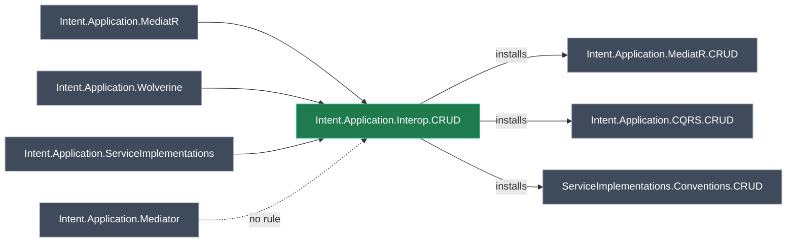

# New module `Intent.Application.Interop.CRUD` — installs the dispatcher's CRUD module

## Context

Today each CRUD implementation is bundled as an optional module inside its dispatcher component on the architecture template: `Intent.Application.MediatR.CRUD` inside *MediatR Dispatch*, `Intent.Application.CQRS.CRUD` inside *Wolverine Dispatch*, and `Intent.Application.ServiceImplementations.Conventions.CRUD` inside *Application Services*. The goal is one dispatcher-neutral **CRUD** choice. The user picks a dispatcher, optionally ticks CRUD, and the matching CRUD module is installed through module interoperability.

The new module carries **no templates, factory extensions, settings or designer metadata**. It exists only to hold `<interoperability>` rules.

**Worked example.** A user creates a Clean Architecture application, picks *Wolverine Dispatch* and ticks *CRUD*. During install, Intent Architect sees `Intent.Application.Wolverine` and, through this module's rule, installs `Intent.Application.CQRS.CRUD`. If they picked *MediatR Dispatch* they get `Intent.Application.MediatR.CRUD`, and with *Application Services* they get `Intent.Application.ServiceImplementations.Conventions.CRUD`. If they picked Mediator, nothing is installed.

## Approach

The module is created as a new Module Builder application in the Dispatchers solution. It is generated once to get its `.csproj` and `.imodspec`, and then gets a hand-written `<interoperability>` block. That block is the module's whole behaviour, and per the repo's `.imodspec` guidance the Software Factory never rewrites it.

*Green: new. Grey: existing modules. The dotted edge is the deliberate Mediator gap.*

### The interoperability rules

| Detected dispatcher module | Installs (minimum version) |
| --- | --- |
| `Intent.Application.MediatR` | `Intent.Application.MediatR.CRUD` 7.2.2 |
| `Intent.Application.Wolverine` | `Intent.Application.CQRS.CRUD` 1.0.0 |
| `Intent.Application.ServiceImplementations` | `Intent.Application.ServiceImplementations.Conventions.CRUD` 5.3.5 |
| `Intent.Application.Mediator` | *no rule* |

The versions are each CRUD module's current version, which is also what the Clean Architecture template pins today. A rule's version is a floor, not a pin.

<Callout id="mediator" tone="decision" title="No rule for Mediator">

`Intent.Application.Mediator`'s `CONTEXT.md` records that under Mediator an AI writes every handler body and `Intent.Application.CQRS.CRUD` is never used. CQRS.CRUD finds handlers by role, sets `Body = Fully` and would overwrite the AI-written bodies, so the CRUD option is a no-op for Mediator. The new module's `CONTEXT.md` records this and points to Mediator's. A Mediator rule can be added once a Mediator-safe CRUD implementation exists.

</Callout>

<Callout id="services-and-mediatr" tone="warning" title="MediatR plus Application Services installs both CRUD modules">

*MediatR Dispatch* and *Application Services* are both included by default on Clean Architecture and can be combined. With both installed, both rules fire and both CRUD modules are installed. That matches today's template defaults, where both CRUD modules come pre-ticked inside their components, so it is accepted.

</Callout>

<Callout id="install-only" tone="warning" title="Interoperability only installs, it never removes">

Uninstalling `Intent.Application.Interop.CRUD` leaves the CRUD module it brought in installed. A developer who wants CRUD gone uninstalls the CRUD module itself, and the interop module too, or the rule may bring the CRUD module back on a later install. Accepted because it is how every interop rule in this repo behaves. It goes in the README.

</Callout>

<Callout id="order" tone="risk" title="Install order is still unproven">

The docs say a rule fires "when a module with a matching detect ID is installed". The architecture template installs the dispatcher and this module in one batch, so verification has to prove the rule fires both when this module goes into an app that already has the dispatcher, and when the dispatcher is installed after this module. If the second case fails, that is an Intent Architect limitation to report to the user, and it is recorded in `CONTEXT.md`.

</Callout>

## Model changes

<ModelChanges id="model-changes" caption="Proposed model changes" changes={[
  { element: "Intent.Application.Interop.CRUD", designer: "Module Builder", change: "added", note: "The new module application's package. Its name is the module id. No templates, factory extensions, settings or designer extensions.",
    fields: [
      { label: "Version", after: "1.0.0-pre.0" },
      { label: "Summary / Description", after: "Installs the CRUD implementation module that matches the installed dispatcher: MediatR, Wolverine or Traditional Services." }
    ] }
]} />

Summary and description are set in the model because the Software Factory owns those `.imodspec` elements.

## Code changes

- `Modules/Intent.Modules.Application.Interop.CRUD/Intent.Application.Interop.CRUD.imodspec`: add the `<interoperability>` block from the table, and set `<tags>` (`crud interop mediatr wolverine csharp dotnet`). The Software Factory never writes either, so they are hand-edited and survive.
- `docs/README.md`, `release-notes.md` and `CONTEXT.md` in the module folder (see steps).
- `Modules/Intent.Modules.NET.Dispatchers.isln`: set the new entry's `solutionFolder="Modules/Support"`, next to `Intent.Modules.Application.CQRS.CRUD`. This is the one `.isln` hand edit the repo allows.

## Steps

1. **Create the module application.** Follow `local-module-application-setup`.
   - Agent: create `Intent.Modules.Application.Interop.CRUD` in `Modules/Intent.Modules.NET.Dispatchers.isln` with the Module Builder architecture and only the *Module Builder - C#* component. No designers are needed.
   - User, in the UI: rename the application to `Application.Interop.CRUD` and decline renaming the files. Then rename the Module Builder package to `Intent.Application.Interop.CRUD` and accept.
   - Agent: add `Root Folder Options` with Relative Location `..`, set the relative output location to `..\Intent.Modules.Application.Interop.CRUD`, verify, then move the `.isln` entry under `Modules/Support`.
2. **Version and metadata.** Set the version to `1.0.0-pre.0` with `module-versioning`, and set the summary and description on the package. The version gate needs nothing else, because the module is new and has no published version.
3. **Generate and build.** Run the Software Factory. Apply only the module's own files, never the harness by-products listed in the setup skill. Then run `dotnet build --no-incremental` and confirm `Intent.Application.Interop.CRUD.1.0.0-pre.0.imod` is produced.
4. **Add the interoperability rules** to the `.imodspec` as tabled, then rebuild. Regenerate once more and confirm the block survived.
5. **Documentation** (`module-docs-chore`):
   - `docs/README.md`: what the module does, the mapping table, the Mediator gap, and that interop only installs.
   - `release-notes.md`: a `1.0.0-pre.0` entry.
   - Related modules are named in plain text. There is no `<projectUrl>`, because no published doc page exists yet.
6. **Context** (`module-context-capture`): write `CONTEXT.md` with:
   - the purpose and the mapping;
   - the Mediator decision, pointing to Mediator's `CONTEXT.md`;
   - that rule versions are floors, to raise when a CRUD module ships a change the dispatcher needs;
   - why this is an interop-only module rather than a template component;
   - the install-order finding from verification.
7. **Dependency audit** (`module-dependency-audit`): the module references nothing, so its `<dependencies>` should be only what Module Builder adds. It must not depend on any dispatcher or CRUD module, because that would install them unconditionally.

## Critical files and elements

- Module Builder designer of the new `Application.Interop.CRUD` application: the package whose name is the module id.
- `Modules/Intent.Modules.Application.Interop.CRUD/Intent.Application.Interop.CRUD.imodspec`: the interoperability rules.
- `Modules/Intent.Modules.Application.Interop.CRUD/CONTEXT.md`, `docs/README.md`, `release-notes.md`.
- `Modules/Intent.Modules.NET.Dispatchers.isln`: the solution folder entry.
- `Modules/Intent.Modules.Application.Mediator/CONTEXT.md` (read only): the source of the Mediator exclusion.

## Verification

Use scratch applications that are not committed. Each should have no CRUD module installed beforehand.

1. **Build.** `dotnet build --no-incremental` exits 0 and the `.imod` is produced.
2. **Install into an app that already has a dispatcher.**
   - MediatR app: `Intent.Application.MediatR.CRUD` gets installed.
   - Wolverine app: `Intent.Application.CQRS.CRUD` gets installed.
   - Application Services app: `Intent.Application.ServiceImplementations.Conventions.CRUD` gets installed.
   - Mediator app such as `TestMediator.NoEventing`: nothing is installed.
3. **Reverse order.** Install this module first and the dispatcher afterwards, and check the CRUD module still arrives. This is the risk above.
4. **Generated output.** In one app per dispatcher, run the Software Factory and confirm the handler or operation bodies get CRUD implementations. That is the existing modules' behaviour, so this only proves the right module arrived.

## Out of scope: the architecture-template change

Done separately, in `D:/Dev/Intent.ArchitectureTemplates`. Expected shape, for whoever picks it up:
- a new *CRUD* component in Clean Architecture's *Application* group that holds `Intent.Application.Interop.CRUD`;
- the three CRUD modules removed from their dispatcher components;
- a `minimumDependencyVersions` entry for each CRUD module. `Intent.Application.CQRS.CRUD` is missing from that list today;
- if a Mediator component is added later, an incompatibility between it and *CRUD*.

## Open questions resolved

- **Q:** Module name? **A:** `Intent.Application.Interop.CRUD`, following the `.Interop.` naming convention.
- **Q:** How should Mediator be handled? **A:** No rule, in line with Mediator's recorded design.
- **Q:** Is the architecture-template change in scope? **A:** No, module only.
