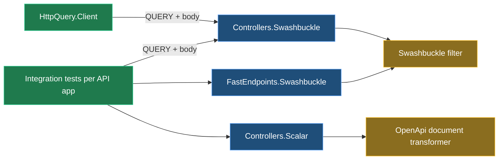

# HTTP QUERY: build working samples before any module work

## Context

Two customers asked for the HTTP `QUERY` method: Gendac (Monday ticket "(Gendac+Yolo) Add support for HTTP QUERY") and Yolo (Slack, 2026-11-02). With `QUERY`, a client sends search criteria in the request body of a safe, idempotent request. That avoids very long query strings and GET-with-body.

**Example.** A client sends `QUERY /api/products/search` with a body like `{"nameContains":"bolt","categories":["Fasteners"],"maxPrice":20}`. The API returns `200` with the matching products. Swagger UI / Scalar list the endpoint, and an Intent-generated `HttpClient` can call it.

The user decided: **build working samples first, then do module work.** This plan covers only the samples. Templates come later and will copy the code these samples prove.

| Area | What .NET 10 and the libraries actually do (checked against source) |
| --- | --- |
| ASP.NET Core 10 | `HttpMethods.Query` and `HttpMethods.IsQuery` exist. There is **no** `[HttpQuery]` attribute and **no** `MapQuery`. |
| Client | `HttpMethod.Query` exists. |
| Swashbuckle 10 | **Throws** `The "QUERY" HTTP method is not supported.` while generating paths, before any document filter runs. Document filters only see descriptions that passed `DocInclusionPredicate`. Its `GenerateOperation` is private. |
| Microsoft.AspNetCore.OpenApi 10 | Skips QUERY descriptions before any operation transformer runs. |
| Microsoft.OpenApi 2.x | Writes every `PathItem.Operations` key as the lower-cased method, with no filtering. Its newer `main` branch writes non-standard methods to `x-oai-additionalOperations` for 3.0/3.1. |
| ASP.NET Core 11 (later) | Emits QUERY itself: `x-oai-additionalOperations` before OpenAPI 3.2, a `query` key in 3.2. |
| FastEndpoints 8.2 (repo version) | Has QUERY already: a `Query(...)` helper, `[HttpQuery]`, and `Http.QUERY`. It drops QUERY from OpenAPI. |
| Swagger UI / Scalar | `additionalOperations` support arrived in Swagger UI 5.34.0 (2026-10-19) and in late-Sep-2026 Scalar releases. The repo's pins (Swashbuckle 10.2.3, Scalar.AspNetCore 2.16.11) are probably older. |
| Intent today | The `HttpVerb` enum and the "body only on POST/PUT/PATCH" rule live in `Intent.Metadata.WebApi` (Intent.Modules repo). |

<Callout id="hand-edits" tone="decision" title="QUERY can't be modelled yet, so the samples model POST and hand-edit the generated code">

The Http Settings stereotype can't hold `QUERY` yet. Each sample therefore models the endpoint as **POST** with a body, then hand-edits the generated endpoint to QUERY. Each edit is protected by `[IntentManaged(Mode.Ignore)]` or `// IntentIgnore`. **Approving this plan is the explicit OK for those edits to generated code in the `Spike/` apps.** That OK covers only these apps.

The samples prove the **generated code shape**. They don't prove the designer experience. Every protection added is listed in `Spike/README.md`, so module verification (Phase 1) can strip them and compare template output instead of the hand-written code itself.

</Callout>

## Approach

Create a new `HttpQuery` Intent solution in a new root folder `Spike/`, with four Clean Architecture .NET 10 apps (the user decided the location and that there are several apps). Every API app gets the same model from **one designer script**.

*Blue: API samples. Green: callers. Amber: the custom OpenAPI code (the user specified custom filters).*

| App (in `Spike/`) | Surface it proves | Hand-written QUERY code |
| --- | --- | --- |
| `HttpQuery.FastEndpoints` | FastEndpoints + Swashbuckle via `AddFastEndpointsApiExplorer` (the user chose Swashbuckle) | `Configure()` edited to FastEndpoints' own `Query(...)` helper; the shared Swashbuckle filter. **Built first, as a gate.** |
| `HttpQuery.Controllers.Swashbuckle` | MVC controllers + Swashbuckle 10 | `HttpQueryAttribute`; actions edited to `[HttpQuery]`; Swashbuckle predicate plus document filter; a seed for the client app to read |
| `HttpQuery.Controllers.Scalar` | MVC controllers + Microsoft.AspNetCore.OpenApi + latest Scalar.AspNetCore | The same attribute and actions; an OpenApi **document** transformer |
| `HttpQuery.Client` | An Integration.HttpClients proxy (from the Service Proxies designer) calling the running Swashbuckle app | The generated client method edited to `HttpMethod.Query` |

<Callout id="fe-swashbuckle" tone="risk" title="FastEndpoints + Swashbuckle will probably fail with today's modules, so it's checked first">

- The FastEndpoints module pins `FastEndpoints.Swagger.Swashbuckle` **2.3.0** (`NugetPackages.cs:93`). That release dates from Feb 2024 and targets Swashbuckle 6 and Microsoft.OpenApi 1.x. The repo is on Swashbuckle 10 and Microsoft.OpenApi 2.x.
- The module's own error text calls Swashbuckle module v6+ incompatible (`StartupConfigurationExtension.cs:37-39`). Its guard (`StartupConfigurationExtension.cs:83-88`) checks the Swashbuckle module under the id `Intent.Swashbuckle.AspNetCore`. Test apps install `Intent.AspNetCore.Swashbuckle` 6.0.5, so that half never fires. Only the `Intent.AspNetCore.Swashbuckle.Security` v5+ half does.

**Step 2 builds and runs this app with no QUERY code. If it fails, stop and ask the user** whether to switch it to Scalar, before building the others. Its result decides whether the Swashbuckle filter is shared. The wrong guard id is a separate, pre-existing issue and gets parked.

</Callout>

**Model in each API app** (one designer script, run once per app):

- Domain: `Product` (Name, Category, Price, Tags collection). EF Core uses SQLite.
  - Integration tests use SQLite in-memory with `EnsureCreated` (`EFContainerFixtureTemplatePartial.cs:198-205`). EF in-memory is not an option: that module throws for any provider except SQL Server, PostgreSQL or SQLite (`:142-147`).
  - The running Swashbuckle app uses the generated `Data Source=<app>.db`. It gets one listed, protected, spike-only edit: `EnsureCreated` plus a few seeded products at startup, so the client app has data to query.
- Services: CQRS queries with MediatR.
  - `SearchProductsQuery` takes a body only, with nullable and collection criteria, and returns a list.
  - `SearchCategoryProductsQuery` takes a route `categoryId` plus a body. This checks that the route parameter is kept out of the body schema.
  - `GetProductByIdQuery` is a GET, kept as the comparison case.
- The QUERY endpoints set **Success Response Code = 200** in Http Settings. The Controllers template honours it (`ControllerResponseMapper`, `Utils.GetReturnStatement`), so 200 isn't a hand edit.
- **API versioning** is only covered if the Clean Architecture architecture installs it by default. If it does, both OpenAPI stacks must keep its document and group match. If not, the plan doesn't add it.

**Swashbuckle approach (preferred, reuses every filter).** QUERY descriptions are kept out of the main pass so Swashbuckle doesn't throw:

1. A `DocInclusionPredicate` returns false for QUERY. Otherwise it keeps the default group and document match.
2. A document filter takes the QUERY descriptions for the current document from `IApiDescriptionGroupCollectionProvider`.
3. It **copies** them with `HttpMethod = "POST"`. Copies, because the provider caches the originals.
4. It runs the copies through a second `SwaggerGenerator`, built with the same options, schema generator and filters. That class is public and not sealed.
5. It moves each resulting operation into the QUERY slot of the main document and merges the component schemas.

This way security, XML comments, `HideRouteParametersFromBodyOperationFilter` and response generation all still apply. Three rules make the second generator safe:

- **Re-entrancy guard.** The second generator shares the options, so its document filters include this filter. An `AsyncLocal` flag makes the filter return straight away when it runs inside the nested generator. Without it the filter recurses until the stack overflows.
- **No dependencies in the constructor.** Options, the description provider and the schema generator are resolved from `IServiceProvider` inside `Apply`. Swashbuckle creates filters while it is still building its options, so asking for them in the constructor would re-enter options setup.
- **Copy everything, merge everything.**
- Copies carry every field, including `Properties`, which holds the Asp.Versioning `ApiVersion`.
- The merge brings **component schemas, tags and security schemes** across (`TryAdd`, because schema ids come from the shared `CustomSchemaIds`). It rebinds tag references to the main document.
- The nested run still applies the *other* document filters, and the main pass applies them again to the merged operations. This is accepted: the only document filter any Intent module ships is OData's `ExcludeODataDocumentFilter`, which is harmless run twice. The README records it.

**Fallback:** if a second generator turns out unworkable, build the operation by hand with `context.SchemaGenerator`, and list every filter that then doesn't run.

<Callout id="yolo-code" tone="decision" title="Start from Yolo's working code if it arrives before step 3">

Yolo says they have QUERY working in their own (non-Intent) projects, using a custom controller attribute plus custom Swagger code, and offered examples. The user asks for them in the Slack thread.

- **If the code arrives before step 3:** the Swashbuckle filter starts from their code. It is checked against the same four criteria and the same tests, and the README records what changed from their version and why.
- **If it doesn't arrive:** step 3 goes ahead with the design above. Nothing else in the plan waits for it.

</Callout>

**Microsoft OpenApi approach (Scalar app).** An operation transformer never sees QUERY, so it's a **document** transformer:

- It takes QUERY descriptions from `context.DescriptionGroups`, filtered to the current document name.
- It builds request and response schemas with `context.GetOrCreateSchemaAsync`, then **registers them in components and references them** itself.
- `GetOrCreateSchemaAsync` returns nested types inline. So the transformer walks the schema recursively (properties, items, allOf/anyOf), the same way ASP.NET Core resolves references internally.
- At **every level**, component ids come from `OpenApiOptions.CreateSchemaReferenceId`, and an existing component (for example `ProductDto` from the GET) is reused rather than added twice.
- It applies the route-parameter-out-of-body rule.

**Which OpenAPI shape the filters write** is decided by the spike. The user specified custom filters, not a shape:

| Shape | How it's written |
| --- | --- |
| A — native `query` key | `pathItem.Operations[HttpMethod.Query] = op` |
| B — `x-oai-additionalOperations` | Exactly what Microsoft.OpenApi `main` writes for 3.0/3.1, so it can be dropped once that ships |

Both are tried with **Swashbuckle.AspNetCore.SwaggerUI and Scalar.AspNetCore raised to their latest versions**, and the README records the minimum versions needed. A shape passes only if all of these hold:

1. Swagger UI shows the operation.
2. Scalar shows the operation.
3. Try-it sends a real `QUERY` in at least one of the two UIs.
4. The document reloads through the `Microsoft.OpenApi` reader with no errors.

**If neither shape meets all four, stop and ask the user** which criterion to give up, with the results in hand. Likely candidates: A fails 4, or B fails 1.

<Callout id="net11" tone="warning" title="Accepted: the filters are a .NET 10 bridge, not a permanent output">

ASP.NET Core 11 emits QUERY itself, and Swashbuckle 11 is expected to. A filter left running on top would duplicate or collide with that output. Accepted because .NET 10 has no other route. The README records how the module must switch the filter off by target framework or package version.

Not covered here: third-party client generators (NSwag, Kiota) reading the document. Intent's own proxies don't use OpenAPI, and neither customer has said they use one.

</Callout>

<Callout id="hack-check" tone="warning" title="Accepted: mapping a copy to POST is a generator trick, kept inside the filter">

Running a POST copy through Swashbuckle's generator borrows its POST path to describe a QUERY operation. It never changes routing, never touches the real descriptions, and a real POST on the same path stays in its own slot. Accepted because the alternative re-implements Swashbuckle's operation generation and silently skips other modules' filters. The README records it, so the module plan can decide whether to keep it or wait for Swashbuckle 11.

</Callout>

## Code changes (hand-written, in `Spike/` only)

- **`HttpQueryAttribute`** — a new file in each controllers app's Api project. It is an `HttpMethodAttribute` subclass using `HttpMethods.Query`.
- **Controller actions** — `[HttpPost]` becomes `[HttpQuery]`, protected.
- **Swashbuckle predicate and document filter** — new files in `Api/Filters/`, registered in the generated `SwashbuckleConfiguration` the same way `Tests/JsonPatchRfc7396.Swashbuckle` registers `JsonMergePatchOperationFilter`, with the line protected. Shared by Controllers.Swashbuckle and, if the gate passes, FastEndpoints.
- **OpenApi document transformer** — a new file in `Api/Filters/`, registered in `OpenApiConfiguration` the same way `Tests/JsonPatchRfc7396.Scalar` registers its transformer.
- **FastEndpoints** — the protected `Configure()` uses `Query("...")`. That matches the template's helper switch (`EndpointTemplatePartial.cs:215-223`).
- **HttpClient proxy and generated integration-test clients** — `HttpMethod.Query`, protected. Both are generated from `Integration.HttpClients.Shared`.
- **Swashbuckle app startup** — `EnsureCreated` plus a seed, protected and spike-only, so the client app has data. Only an environment variable turns it on, set when starting the API for the client check. A flag in `appsettings.Development.json` wouldn't do: `WebApplicationFactory` runs in Development, so the tests would seed too and their exact counts would break.
- **Package bumps** — the latest Swashbuckle.AspNetCore.SwaggerUI and Scalar.AspNetCore, raised by hand in the csproj. The Software Factory never lowers a version.
- **`Spike/Directory.Build.props`** — only if the build needs it, to override the repo root's `LangVersion 12.0` pin, as the Mediator spike did.

## Steps

1. **Set up `Spike/`** — `create_solution` `HttpQuery` in `Spike/`. Start `Spike/PROGRESS.md` (done / next / blocked). Write the one model script (Domain, Services, Http Settings POST + route + Success Response Code 200).
2. **FastEndpoints gate** — create `HttpQuery.FastEndpoints` (Clean Architecture, net10.0, FastEndpoints, Swashbuckle, EF SQLite, MediatR, Integration Testing; confirm the components with `getArchitectureDetails`). Run the script, run the Software Factory, build, and open Swagger UI **with no QUERY code**. If it fails: stop and ask the user. If it passes: commit.
3. **Controllers.Swashbuckle app**:
   - Create it the same way with Controllers, then run the script, the Software Factory, and the build.
   - **Write the tests first and show them failing:**
     - QUERY returns the filtered results.
     - Route + body binds.
     - POST on the QUERY route returns 405.
     - The generated test client sends `QUERY` (checked on the request).
     - The OpenAPI document has the operation at the exact JSON path.
     - DTO schemas are component references with no inline object schema at any depth, each component id maps to one CLR type, and every operation tag is declared.
     - The document reloads through the reader.
   - Then add the attribute, predicate, filter and handler bodies until the tests pass. Compare shapes A and B against the criteria. Green: commit.
4. **Controllers.Scalar app** — the same script, the same tests failing first, then the document transformer and the package bumps. Green: commit.
5. **Finish FastEndpoints** — the same tests failing first, then `Query(...)` and the shared Swashbuckle filter. Green: commit.
6. **Client app** — a Service Proxy to the Swashbuckle app, generated and edited to `HttpMethod.Query`. Add the Swashbuckle app's spike-only seed. Proof is a small check that **asserts** the result count against the running Swashbuckle API. Green: commit.
7. **Write up `Spike/README.md`**:
   - Which OpenAPI shape passed, with screenshots.
   - The minimum Swagger UI and Scalar versions.
   - Every generated-code edit per surface (the module's template change list).
   - Every protection and spike-only edit (to strip before Phase 1).
   - The verb-decision inventory: each place in Modules that branches on the verb (UoW skip, 404, response code, body vs query string, output caching), classified as "treat like GET" or "body like POST". This hands over to the module plan.
   - Commit.

<Callout id="spike-fate" tone="warning" title="Accepted: Spike/ is committed on this branch and removed before merge">

`Spike/` (singular) is not covered by the `.gitignore` entry `Spikes/`, so it gets committed at each green checkpoint. It stays as the reference until module Phase 1 is done, then is removed before the PR merges, as the Mediator spike was (`02f63191a1`). Accepted because the Phase 1 comparison needs these apps in the repo.

</Callout>

## Critical files

- `Tests/JsonPatchRfc7396.Swashbuckle/JsonPatchRfc7396.Swashbuckle.Api/Configuration/SwashbuckleConfiguration.cs` — the existing way custom Swashbuckle filters are registered.
- `Tests/JsonPatchRfc7396.Scalar/JsonPatchRfc7396.Scalar.Api/Configuration/OpenApiConfiguration.cs` — the existing way transformers are registered.
- `Modules/Intent.Modules.FastEndpoints/FactoryExtensions/StartupConfigurationExtension.cs` and `Modules/Intent.Modules.FastEndpoints/NugetPackages.cs` — the FastEndpoints + Swashbuckle wiring, the guard, and the 2.3.0 package pin.
- `Modules/Intent.Modules.AspNetCore.IntegrationTesting/Templates/EFContainerFixture/EFContainerFixtureTemplatePartial.cs` — which database providers the generated tests support.
- `Modules/Intent.Modules.Integration.HttpClients.Shared/Templates/HttpClient/HttpClientTemplateBase.cs` — read only; the generated `HttpRequestMessage` shape.

## Verification

- Every API app: `dotnet test` green, including the 405, request-method, JSON-path, component-reference and reader tests. Each test was shown failing before its QUERY code existed.
- Client app: the asserted check passes against the running, seeded Swashbuckle API.
- `dotnet build` exits 0 for every app, and none has designer validation errors.
- A Software Factory re-run on each app keeps every protected edit and produces no unexpected changes.
- Evidence goes in `C:\Dev\.evidence\Intent.Modules.NET\agent\http-query\YYYY-MM-DD-<what>\` (test output, `swagger.json` / `openapi.json` excerpts, Swagger UI and Scalar screenshots). Each run gets one `INDEX.md` line: `date | what | result | which claim it proves`.

<Callout id="scope" tone="warning" title="Deliberately out of scope">

- Module, template and `.imodspec` changes, and version bumps.
- Traditional service (non-CQRS) dispatch, because its QUERY difference is a generation rule (Unit-of-Work skip), not a code pattern. The README's verb inventory covers it.
- Azure Functions and AWS Lambda (`LambdaHttpMethod` has no QUERY), Ocelot, output caching.
- Blazor HttpClients: QUERY triggers a CORS preflight in the browser.
- FluentValidation, auth, and adding API versioning.

Gendac's stack is still unconfirmed. Yolo's offered code is covered in the Swashbuckle approach above.

</Callout>

## Open questions resolved

- **Where do the samples live?** A new Clean Architecture solution in a root `Spike` folder. The user specified this.
- **Which surfaces?** Controllers + Swashbuckle, an HttpClient caller, Scalar / MS OpenApi, and FastEndpoints, in several apps. The user specified this.
- **How is QUERY documented?** With custom filters. The user specified this. The shape (A or B) is chosen by the criteria above, and the user is asked if neither passes.
- **Which OpenAPI stack does the FastEndpoints app use?** Swashbuckle. The user specified this, subject to the step-2 gate.
