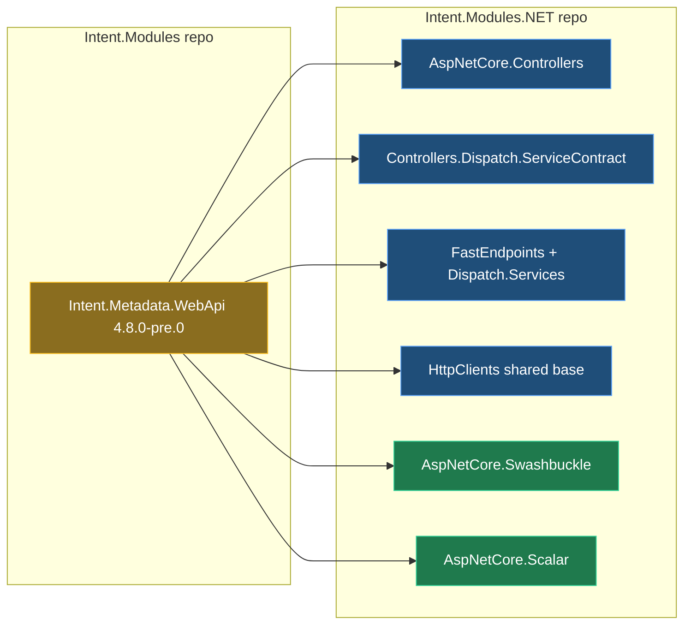

# HTTP QUERY: make the modules generate what the spike proved

## Context

The spike on `agent/http-query` (see `Spike/README.md`) proved HTTP `QUERY` end to end on .NET 10. It covered controllers with Swashbuckle, controllers with Microsoft.AspNetCore.OpenApi, FastEndpoints with Scalar, and an Intent-generated HttpClient proxy. Every QUERY bit there was hand-edited over generated POST code, because the designer cannot model QUERY yet. This plan moves that code into the modules, so modelling an endpoint as QUERY generates it.

**Example.** A developer opens `SearchProductsQuery` in the Services designer and sets Http Settings → Verb to **QUERY**, route `api/products/search`. On the next Software Factory run:

- The controller action gets `[HttpQuery("api/products/search")]` with `[FromBody]` criteria and returns `200 Ok(result)`.
- A FastEndpoints endpoint calls `Query("api/products/search")` instead.
- A service proxy sends `HttpMethod.Query` with a JSON body.
- Swagger UI / Scalar list it as a `query` operation in an OpenAPI 3.2 document.
- An app with no QUERY endpoint regenerates with zero changes.

## Approach

The work runs in two repos, in order. The verb and its binding rules come first; the code generators follow.

*Amber: the verb and its rules. Blue: code generators. Green: OpenAPI bridge code.*

- **Intent.Modules first.** QUERY is added to the Http Settings verb list and to `HttpVerb`. The factory's body rules treat QUERY like POST, so a CQRS query exposed as QUERY gets a body.
- **Then you publish `4.8.0-pre.0`** (your choice). The .NET modules reference that package.
- **Then the generators.** Each verb branch the spike's README listed gets its QUERY case:
  - like GET for the response code, 404 and unit-of-work skipping;
  - like POST for the body;
  - emitting `[HttpQuery]`, `Query(...)` or `HttpMethod.Query`.
- **OpenAPI bridge code is emitted only when the app has at least one QUERY endpoint.** The Swashbuckle filter or MS OpenApi document transformer is the one proven in the spike.

<Callout id="gating" tone="decision" title="Every QUERY-specific file and registration is gated on the model">

These are generated only when at least one endpoint in the application has verb QUERY, following the `BinaryContentAttribute` pattern (`CanRunTemplate()` driven by the model):

- the `HttpQueryAttribute`;
- the Swashbuckle filter, serializer and index page;
- the MS OpenApi transformer and 3.2 document endpoint.

Without that gate, every existing app's OpenAPI document would change label to 3.2 and gain a filter for nothing. With it, existing apps regenerate byte-identical. Proving that is part of verification.

</Callout>

## Part 1 — Intent.Modules repo (Intent.Metadata.WebApi)

Work in a new worktree `~/.worktrees/Intent.Modules/agent/http-query` off `development` (your choice; the other worktrees and `C:\Dev\Intent.Modules` stay untouched).

`Intent.Metadata.WebApi` is at 4.7.22, which is already released, so it moves to **4.8.0-pre.0**. It's a minor bump because the verb is new. The modelling and code it builds on:

| Change | Where (existing) | Delta |
| --- | --- | --- |
| Verb option | Http Settings stereotype, Verb select list (Module Builder designer) | Add `QUERY` via a designer script, then regenerate. The generated `VerbOptionsEnum` / `AsEnum()` / `IsQUERY()` in the three `*ModelStereotypeExtensions.cs` follow from the model. |
| Enum | `Models/HttpVerb.cs` | Add `Query`. `ElementExtensionMethods` already uses `Enum.Parse(ignoreCase)`, so `"QUERY"` parses. |
| Body rules | `HttpEndpointModelFactory.GetHttpInputSource` (Post or Put → FromBody), `verbAllowsBody`; `HttpEndpointModel` guard | Add Query beside Post. This is what makes a CQRS query exposed as QUERY get its synthetic `query` body. |
| Parameter Settings stereotype | display (`[From Body]` for POST/PUT) and the `isFromBody` default | Include QUERY (designer script). |
| Route suggestion | "Bind as HTTP Route Parameter" verb list | Add QUERY. |
| Designer macros | `DesignerMacros/src/.../operation-rest-route-validation.ts` ("Return Type required for HTTP GET") | Also require it for QUERY, then recompile into `resources/*.js` with the repo's existing `tsconfig-save-to-module.json`. |

"Expose as HTTP Endpoint" keeps defaulting queries to GET; QUERY is chosen by hand in this first cut.

Close-out: release notes, `CONTEXT.md`, dependency audit, build and pack. **You publish 4.8.0-pre.0.**

<Callout id="proxies" tone="risk" title="Service Proxies designer scripts may also need QUERY">

`Modelers.ServiceProxies`, `Modelers.Types.ServiceProxies` and `Modelers.UI.ServiceProxies` each carry a `verbAllowsBody = ["PUT","PATCH","POST"]` script (source: `services-proxies-manage-parameters.ts`). The spike's proxy worked with the operation modelled as POST, so it's unproven whether a QUERY-modelled service operation gets its body param in the proxy designer.

Step 9 checks this in the client app. Only if the body is dropped do those three modules gain QUERY, each with its own version bump.

</Callout>

## Part 2 — Intent.Modules.NET repo

At the start of Part 2, every module below goes through the version gate. Each one raises its `Intent.Modules.Metadata.WebApi` package reference and `.imodspec` dependency to 4.8.0-pre.0.

| Module | Builds on | Delta |
| --- | --- | --- |
| `Intent.AspNetCore.Controllers` | `ControllerTemplatePartial.GetHttpVerbAndPath` already emits `[Http{Verb}]`, which yields `[HttpQuery]` | New gated single-file template `HttpQueryAttribute` (an `HttpMethodAttribute` subclass, the spike's file), following `BinaryContentAttribute`; the controller adds its using via `GetTypeName`. Add QUERY as GET-like in `Utils` (return switch, `CanReturnNotFound`) and in the template's XML-response and `ProducesResponseType` switches. |
| `Intent.AspNetCore.Controllers.Dispatch.ServiceContract` | `ServiceContractControllerInstaller` | Skip the unit of work for Query as for Get. The message-bus `StartsWith("[HttpGet")` check also covers `[HttpQuery`. |
| `Intent.FastEndpoints` | `EndpointTemplatePartial` helper switch | Add `HttpVerb.Query => "Query"`. QUERY is GET-like in the `Produces` switch and `Utils`. |
| `Intent.FastEndpoints.Dispatch.Services` | `ServiceContractEndpointExtension` | Skip the unit of work and the message bus for Query. |
| HttpClients shared base (`Integration.HttpClients.Shared`, used by `Integration.HttpClients`, `Blazor.HttpClients`, `Dapr.AspNetCore.ServiceInvocation`, `AspNetCore.IntegrationTesting`) | `HttpClientTemplateBase` emits `HttpMethod.{Verb}` | .NET 10+ gets `HttpMethod.Query`; older targets get `new HttpMethod("QUERY")` (`GetMaxNetAppVersion()`). The body already follows `FromBody`. All four consuming modules get a bump. |
| `Intent.AspNetCore.Swashbuckle` | `SwashbuckleConfiguration` and the factory-extension pattern of `HideRouteParametersFromBodyOperationFilterExtension` | Gated templates: `HttpQueryDocumentFilter` (predicate + nested-generator filter) and `OpenApi32DocumentSerializer`, registered in the `AddSwaggerGen` lambda and options by factory extensions. Swagger UI: see the callout below. |
| `Intent.AspNetCore.Scalar` | `OpenApiConfiguration` and `HideRouteParametersFromBodyOperationTransformerExtension` | Gated template `HttpQueryDocumentTransformer` registered in `AddOpenApi`. The 3.2 document endpoint (`UseHttpQueryOpenApi`) is wired ahead of `MapOpenApi`. Raise `Scalar.AspNetCore` from 2.16.11 to 2.18.7 or the latest. |

<Callout id="swagger-ui" tone="decision" title="Swagger UI: check NuGet first (your choice)">

At step 7, check the newest Swashbuckle.AspNetCore release.

- **If it bundles swagger-ui 5.34 or later:** raise the pin in `NugetPackages.cs`. Only `query` still has to be added to `supportedSubmitMethods`, which the `SubmitMethod` enum lacks.
- **Otherwise:** generate the spike's custom index page (swagger-ui-dist 5.34.1 from a CDN), gated as above.

The README records which applies.

</Callout>

<Callout id="predicate" tone="risk" title="Swashbuckle allows one DocInclusionPredicate">

The filter's predicate replaces Swashbuckle's default group match. If another module (for example API versioning) sets its own predicate, the last one wins.

Step 7 checks the modules for other `DocInclusionPredicate` calls. Any found are composed into one predicate rather than overwritten.

</Callout>

<Callout id="other-hosts" tone="warning" title="Accepted: other hosts are out of scope for now (your choice)">

These keep today's behaviour:

- **AWS Lambda** (`LambdaHttpMethod` has no Query).
- **Azure Functions** and its dispatch modules.
- **Ocelot / Metadata.ApiGateway** (its own `HttpVerb` copy, parsed with `Enum.Parse`).
- **Designer-only modules:** UI `== "GET"`, proxy-interactions CRUD switch.
- **Output caching:** stays GET-only, since QUERY is cacheable only when keyed on the body.

Modelling QUERY on a Lambda or Azure Functions endpoint will fail the Software Factory with a raw `ArgumentOutOfRangeException` from their verb switches. Each gets one line in `PARKED.md`.

</Callout>

<Callout id="net11" tone="warning" title="Accepted: the OpenAPI bridge code is a .NET 10 bridge">

ASP.NET Core 11 and Swashbuckle 11 are expected to emit QUERY themselves. Switching the bridge off by target framework or package version is recorded in both modules' `CONTEXT.md` but not built now, because neither release exists to test against.

The XML-comment gap on MS OpenApi QUERY operations (summaries come from endpoint metadata only) carries over from the spike and goes in the Scalar module's README.

</Callout>

## Steps

0. **Restore the working-sample plan.** My first write of this plan landed on `intent/.plans/2026-11-02-http-query-working-sample.mdx` and replaced it, including its uncommitted edits.
   - Rebuild it from the committed version plus the earlier session's recorded plan writes.
   - Show you the diff against the committed version before committing.
   - Any edit made outside the session (for example in Intent's viewer) can't be recovered this way; you'd need to re-apply it.
1. **Intent.Modules worktree and version gate.** Create the worktree and move `Intent.Metadata.WebApi` to 4.8.0-pre.0.
2. **Verb in the model.**
   - Designer scripts: the Http Settings QUERY option, the Parameter Settings display and default, and the route suggestion.
   - Regenerate and inspect the regenerated stereotype extensions.
3. **Verb in code and macros.**
   - `HttpVerb.Query` and the factory body rules.
   - The route-validation macro, recompiled into `resources`.
   - Build, pack, release notes, `CONTEXT.md`, dependency audit.
   - Commit. **You publish 4.8.0-pre.0.**
4. **Intent.Modules.NET version gate and package references.** Run the gate on every module in the Part 2 table, raise the Metadata.WebApi references and dependencies, and restore cleanly (NU1605 ladder if needed).
5. **Controllers and their dispatch.** The `HttpQueryAttribute` template, the verb switches, and the unit-of-work skip.
6. **FastEndpoints and its dispatch, then the HttpClients shared base.**
7. **Swashbuckle module.** The NuGet check and Swagger UI decision, the predicate-collision check, the filter and serializer templates and their registrations.
8. **Scalar module.** The transformer template, the 3.2 document endpoint, and the Scalar bump.
9. **Prove it on the spike apps (Phase 1).**
   - Install the local modules in the four `Spike/` apps.
   - Strip every protection and hand edit listed in the README's protections table, plus the hand-written QUERY files.
   - Re-model the two search endpoints as QUERY with a designer script.
   - Run the Software Factory and compare the generated files with the spike's proven code.
   - Run the spike suites (7/8/7, client 2/2), the UI check and the OpenAPI validator.
   - Fix the proxy-designer scripts here only if the client shows the dropped-body risk.
10. **Permanent coverage.** The spike is removed before merge, so add one QUERY endpoint plus integration tests to one existing test app per surface. Candidates:
    - Controllers + Swashbuckle: `Standard.AspNetCore.TestApplication`.
    - FastEndpoints: `FastEndpointsTest`.
    - MS OpenApi / Scalar: `Scalar.NET10.Bearer`.
    - Proxies: `CleanArchitecture.Comprehensive.HttpClients`.
11. **Close out.** For every touched module: version confirmation, dependency audit, release notes, README and `CONTEXT.md`. Remove `Spike/` (and the committed `.db-shm`), then commit.

## Critical files / elements

- Intent.Modules:
  - Module Builder designer, stereotypes "Http Settings" and "Parameter Settings" (Intent.Metadata.WebApi).
  - `Modules/Intent.Modules.Metadata.WebApi/Models/HttpVerb.cs`
  - `Modules/Intent.Modules.Metadata.WebApi/Models/HttpEndpointModelFactory.cs`
  - `Modules/Intent.Modules.Metadata.WebApi/Models/HttpEndpointModel.cs`
- <FileRef path="Modules/Intent.Modules.AspNetCore.Controllers/Templates/Controller/ControllerTemplatePartial.cs" /> and <FileRef path="Modules/Intent.Modules.AspNetCore.Controllers/Utils.cs" />
- <FileRef path="Modules/Intent.Modules.AspNetCore.Controllers/Templates/BinaryContentAttribute/BinaryContentAttributeTemplatePartial.cs" /> — the pattern for the gated attribute template.
- <FileRef path="Modules/Intent.Modules.FastEndpoints/Templates/Endpoint/EndpointTemplatePartial.cs" />
- <FileRef path="Modules/Intent.Modules.Integration.HttpClients.Shared/Templates/HttpClient/HttpClientTemplateBase.cs" />
- <FileRef path="Modules/Intent.Modules.AspNetCore.Swashbuckle/FactoryExtensions/HideRouteParametersFromBodyOperationFilterExtension.cs" /> and <FileRef path="Modules/Intent.Modules.AspNetCore.Scalar/FactoryExtensions/HideRouteParametersFromBodyOperationTransformerExtension.cs" /> — the registration patterns.
- `Spike/README.md` — the proven code and the protections to strip.

## Verification

- **Spike apps (step 9):**
  - Modules generate the QUERY code with no protections left.
  - Suites pass: Swashbuckle 7/7, OpenApi 8/8, FastEndpoints 7/7, proxy 2/2.
  - Swagger UI / Scalar show QUERY and Try-it sends it.
  - Microsoft.OpenApi 3.x reads each document as 3.2 with no errors.
- **No-QUERY regression:** a Software Factory run on an existing test app without QUERY endpoints (one per touched surface) proposes zero changes.
- **Test apps (step 10):** the new QUERY integration tests pass and are shown failing first.
- **Builds:** every touched module builds with `--no-incremental`, and every regenerated diff is read before it's applied.
- **Evidence:** saved under `C:\Dev\.evidence\Intent.Modules.NET\agent\http-query\`, one `INDEX.md` line per run.

## Open questions resolved

- **Where does the Intent.Modules work happen?** A new worktree `~/.worktrees/Intent.Modules/agent/http-query`. The user approved this.
- **How do the .NET modules get the new Metadata.WebApi package?** The user publishes 4.8.0-pre.0 to the feed.
- **Swagger UI 5.34?** Check NuGet first; fall back to the custom index page.
- **Lambda, Azure Functions, Ocelot?** Not handled for now (user). Parked.
