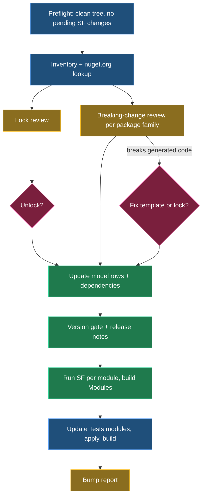

# Replace the NuGet bump tool with an LLM-driven skill and process doc

## Context

Today the NuGet package bump for Intent.Modules.NET runs through the external `Intent.NuGetReferenceUpdater` tool, and the SOP is `Intent.Internal.SOPs/articles/development/module-nuget-packages-bump.md`. The tool does the mechanical part well enough. It reads every Module Builder `NuGet Package` element, asks nuget.org for the latest stable version per target framework, renames the `Package Version` rows, rebuilds their `NuGet Dependency` children, bumps the `.imodspec` to `X.Y.(Z+1)-pre.0`, and writes `- Improvement: Updated NuGet package versions.`

It is blind to everything that needs judgement:

- **Locks are skipped, never questioned.** The lock reason sits in the element's comment, and the tool never reads it. For example, the EF Core net8 rows are locked with "Not all the .net8 providers (Oracle and MySql) have upgraded to support 9.0.0."
- **Nobody reads the release notes.** Breaking changes are left to a manual review that isn't written down anywhere.
- **Every module gets a patch bump**, whatever the impact.
- **The release note is identical every time**, so a consumer can't tell what moved.

It also has known defects. `--resume-id` is ignored, the release-note dedupe only checks one bullet, and it re-bumps a version that is already `-pre`.

**Worked example.** A maintainer types `/module-nuget-bump` in a clean branch off `development`.

1. The agent inventories about 96 modules and finds that `FluentValidation` has moved from `11.11.0` to `12.0.0`.
2. It fetches the v12 upgrade guide and greps `Intent.Modules.Application.FluentValidation`'s templates for the removed APIs. Generated code is unaffected, but consumers' hand-written validators may break.
3. It updates the model rows and bumps the module `3.10.4` → `3.11.0-pre.0` (minor, because consumer code is impacted).
4. It writes the release note below, regenerates, and builds Modules and Tests.
5. It ends with a report that lists every package moved, every lock reviewed, and every breaking-change verdict.

```markdown
### Version 3.11.0

- Improvement: Updated NuGet package versions:
  - `FluentValidation` 11.11.0 → 12.0.0
  - `FluentValidation.DependencyInjectionExtensions` 11.11.0 → 12.0.0

> ⚠️ **BREAKING CHANGES**
>
> This module update may cause compilation breaks if you have written custom code which uses FluentValidation features not supported on v12.
> Any generated code will be compliant.
> For details see the [upgrade guide](https://docs.fluentvalidation.net/en/latest/upgrading-to-12.html).
```

## Approach

There are three deliverables, and no module code changes. The skill is a procedure that **composes the existing module-building skills** rather than restating them. It defers to `module-version-increment` for the version gate, `module-docs-chore` for release-notes mechanics, `scripting-the-model` / `changing-the-model` for designer edits, and `working-with-modules` for updating the Tests apps. This follows `.claude/rules/guidance-precedence.md`, which says to reference a skill rather than paraphrase it.

The model stays the source of truth. Versions are changed with `run_designer_script` on each module's Module Builder designer, and `NugetPackages.cs` and the `.imodspec` are regenerated by the Software Factory. Nothing edits `Intent.Metadata` XML. The one deterministic piece is a helper script that does what an LLM does badly: query nuget.org for hundreds of packages and pick the latest version per target framework using the same rules as the old tool's `NuGetApi.cs`.



*Blue is a deterministic script, amber is LLM judgement, green is model and Software Factory work, and pink is a human checkpoint.*

<Callout id="inventory-source" tone="decision" title="Inventory reads generated NugetPackages.cs, edits go through the model">

The fast first pass parses the generated `Modules/*/NugetPackages.cs` files. They are regular, they list every package, version-per-framework and `locked: true` flag, and they are cheap to scan across about 96 modules. The skill then reads the authoritative values and the lock-reason comments through `run_designer_query` only for modules that actually have candidates, and makes every change through `run_designer_script`.

The preflight check (no outstanding Software Factory changes in `Modules`) guarantees the generated files match the model. The alternative, querying all about 96 Module Builder designers up front, is correct but slow. Reading `Intent.Metadata` directly is forbidden by `model-is-source-of-truth.md`.

</Callout>

<Callout id="no-unlock-without-ask" tone="decision" title="Locks: report, ask, then unlock">

You chose this. For each locked package or row that has a newer version, the agent reads the reason from the element comment, researches whether it still holds, and recommends one of: keep, unlock, or an alternative (for example a different package or a per-TFM split). It then asks once, as a batched `ask_user_question`, before it changes any lock. A lock with no reason is flagged in the report so a reason can be added.

</Callout>

## Deliverables

<FileTree id="files" entries={[
  { path: ".claude/skills/module-nuget-bump/SKILL.md", change: "added", note: "The agent procedure (phases, decision rules, checkpoints)" },
  { path: ".claude/skills/module-nuget-bump/scripts/Get-NuGetBumpCandidates.ps1", change: "added", note: "Inventory + nuget.org latest-per-TFM lookup, emits JSON + markdown table" },
  { path: ".claude/skills/module-nuget-bump/resources/release-notes-format.md", change: "added", note: "Exact entry format + breaking-change block template" },
  { path: "docs/nuget-package-bump.md", change: "added", note: "Human-facing process doc for the repo" },
  { path: ".gitignore", change: "modified", note: "Ignore the .nuget-bump/ working folder" }
]} />

The SOP in the separate `Intent.Internal.SOPs` repo is cut down to a pointer, in `D:/Dev/Intent.Internal.SOPs/articles/development/module-nuget-packages-bump.md`.

## The skill — `module-nuget-bump`

Frontmatter follows the hand-written repo skills such as `address-pr-review`: `name`, a `description` with USE WHEN / DO NOT USE wording, and `argument-hint` (optional: a module-id filter, or `--resume`). It lives only in `.claude/skills/`, as you chose.

**Phases in `SKILL.md`:**

1. **Preflight.** The tree is clean and on a branch off `development`. Run `PipelineScripts/ensure-no-outstanding-sf-changes.ps1` against `Modules/Intent.Modules.NET.isln`, or phase 2 of `run-pre-commit-checks.ps1`. If it fails, stop, because the inventory would be stale.
2. **Inventory and discover.** Run `Get-NuGetBumpCandidates.ps1`. It writes `.nuget-bump/candidates.json` and `.nuget-bump/report.md`, a state file that replaces the old `--resume-id`. Each package is reported once across modules, with its modules, current and latest version per TFM, the delta class (patch, minor or major), and its lock state.
3. **Lock review.** Done only for locked items that have a newer version, as described in the callout above.
4. **Breaking-change review.** Patch deltas on packages at 1.0 or above get no review. For minor and major deltas, and for 0.x packages, find the release notes from the package's `projectUrl` / repository on nuget.org: GitHub releases via `gh api`, `CHANGELOG.md`, or the official migration guide. Review package families together, for example `Microsoft.EntityFrameworkCore.*`, `AWSSDK.*` and `Azure.*`, so each changelog is read once. Fan out with sub-agents per family. For each breaking item, grep the owning module's templates (and its `CONTEXT.md`) for the affected APIs, and classify it using the matrix below.
5. **Update the model.** For each module with changes, load `scripting-the-model` and `changing-the-model`, call `get_designer_rules`, then use `run_designer_script` on the Module Builder designer. This step does what the old tool did, minus its bugs:
   - rename unlocked `Package Version` rows to the latest version (never downgrade);
   - recreate their `NuGet Dependency` children from that TFM's dependency group;
   - add rows for newly supported TFMs;
   - delete unlocked rows whose TFM is no longer produced.
   
   Shared packages, such as `Microsoft.Extensions.*`, must end at the same version in every module.
6. **Version.** Load `module-version-increment` and run its gate. If the module is already on an unpublished `-pre`, leave it, and only raise the component if the impact is larger. Choose the component from the matrix. This step also covers the `.csproj` `Version` that 34 modules carry.
7. **Release notes.** Load `module-docs-chore` and use the format in `resources/release-notes-format.md`. Add one nested row per package (old → new, with TFMs only when they differ) and the ⚠️ block when consumer code is impacted.
8. **Regenerate and build.** Run `run_software_factory` per changed module app, and review the `NugetPackages.cs` diff against the plan. Build the modules. If you hit NU1605, follow `known-build-gotchas.instructions.md`.
9. **Tests.** Update the Tests apps' modules to the new local versions (`working-with-modules`, one module per call), run `apply-template-testing.ps1`, then run `run-pre-commit-checks.ps1`. That script also validates that `modules.config` matches the `.imodspec` and that the release-notes heading exists. If a build breaks, either fix the template (ask first) or lock the package with a reason and roll back.
10. **Report.** Finalise `.nuget-bump/report.md` with the packages moved, locks kept or changed and why, breaking-change verdicts with links, the module versions chosen, and anything deferred. Use it as the PR description.

### Versioning matrix (in the skill and the doc)

| Package delta | Release notes say | Impact found | Module bump |
| --- | --- | --- | --- |
| patch | not reviewed | none | patch |
| minor or major | no breaking changes | builds and tests pass | patch |
| any | breaking, but not on APIs generated code or typical consumer code uses | none | patch, verdict recorded in report |
| any | breaking on APIs consumers commonly use | generated code fine | **minor** + ⚠️ block |
| any | breaking on APIs the templates emit | generated code breaks | stop and ask: fix the template (minor) or lock with reason |

<Callout id="template-break-checkpoint" tone="decision" title="Template breaks: the agent always asks, never chooses">

A breaking change can surface as a template that would emit code that no longer compiles. The agent finds this in phase 4 by grepping the templates, and in phase 9 when the Tests build fails. Either way it stops for that package and asks, with its evidence: the breaking item, the template lines affected, and the release-note link. Unaffected packages carry on. The two options:

- **Fix the module.** The template change runs through the normal module-building workflow: read `CONTEXT.md`, capture output before the change, implement, and regenerate. The module gets a **minor** bump, and the release note describes both the package move and the template change.
- **Lock it.** The agent reverts that package's rows to the current version, sets `Locked`, and writes the reason in the element comment, including the breaking change, a link, and the date. The lock then shows up in the next run's lock review. The package is not mentioned in that module's release note.

</Callout>

<Callout id="no-sdk-scope" tone="warning" title="Scope: consumer-facing NuGet Package elements only">

The skill only bumps packages modelled as Module Builder `NuGet Package` elements, which are the packages a module installs into consumer apps. It does not touch the modules' own `.csproj` SDK references (`Intent.Modules.Common*`, `Intent.SoftwareFactory.SDK`). Raising those changes the minimum Intent Architect version, which is a separate decision. This matches what the old tool did.

</Callout>

## The script — `Get-NuGetBumpCandidates.ps1`

The script ports the lookup rules from `Intent.NuGetReferenceUpdater/NuGetApi.cs`, so results don't change silently:

- latest stable version only, with prerelease used only when no stable version exists; unlisted versions are ignored;
- frameworks from `.NETStandard 2.0` and `2.1` up to `net10.0`, choosing the highest version whose dependency group targets that TFM exactly, with an `Any` fallback;
- prune any later TFM that would resolve to a lower version than an earlier one.

It reads the nuget.org v3 registration API with `Invoke-RestMethod`, caches results per package, and runs read-only against the repo. It doesn't edit any files. It parses package names, the TFM switch arms and `locked: true` from the generated `NugetPackages.cs`. Hand-written `IntentIgnore` branches, such as AutoMapper's `UsePreCommercialVersion`, are reported as "manual" and never auto-updated.

## The doc — `docs/nuget-package-bump.md`

The doc is for a human reader. It covers:

- why the process exists;
- prerequisites: a clean branch, Intent Architect running with the MCP connected, `gh` authenticated, and `INTENT_PACKAGER_*` env vars set for `apply-template-testing.ps1`;
- how to start it (`/module-nuget-bump`);
- what each phase does, and the two human checkpoints (lock changes, and template-breaking changes);
- the versioning matrix, the release-notes format, and how to review the resulting report and diff before committing;
- troubleshooting: NU1605, a stale inventory, resuming from `.nuget-bump/`, and the EF Core per-TFM row locks that used to be "manual".

It links to the skill, not the reverse. The skill only names the doc for humans.

## Steps

1. **Write the helper script.** Port the lookup rules from `NuGetApi.cs`, and test it read-only against the repo (it must list the EF Core 9/8 locked rows and AutoMapper's manual branch).
2. **Write `SKILL.md` and `resources/release-notes-format.md`**, referencing the existing skills by name and not copying their rules.
3. **Write `docs/nuget-package-bump.md`.**
4. **Add `.nuget-bump/` to `.gitignore`.**
5. **Replace the SOP body with a pointer**: a short summary plus a link to the repo doc on GitHub (`development` branch). This is a separate commit in `Intent.Internal.SOPs`.

## Verification

- Run `Get-NuGetBumpCandidates.ps1` against the worktree. Its output must agree with nuget.org for a spot-check of packages (EF Core, FluentValidation, MediatR), show the locked rows with lock flags, and finish without writing outside `.nuget-bump/`.
- Dry-run the skill up to the end of phase 4 (inventory, lock review, breaking-change review) and check that the report is sensible. The full end-to-end run is the next real bump, not part of this change.
- Confirm that the SKILL.md frontmatter loads (it appears in the skill list) and that every skill it names exists.

## Open questions resolved

- **Q:** What happens to a stale lock? **A:** The agent reports it, asks you, and only then unlocks.
- **Q:** What format do the release notes use? **A:** One bullet, plus a nested `old → new` row per package, plus the ⚠️ block when consumer code is impacted.
- **Q:** Where does the skill live? **A:** In `.claude/skills` only.
- **Q:** What happens to the existing SOP? **A:** It is replaced with a pointer to the repo doc.
