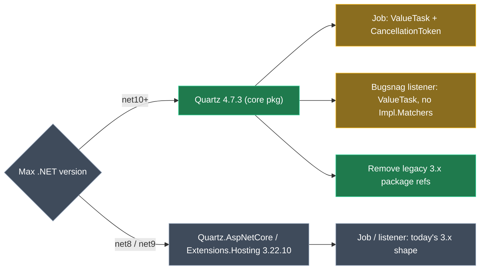

# Upgrade Quartz.NET to 4.x in the QuartzScheduler and Bugsnag modules

## Context

`Quartz.AspNetCore` and `Quartz.Extensions.Hosting` are locked at **3.22.10** on the `net10.0` row of the `Intent.QuartzScheduler` Module Builder model. The lock comment says Quartz 4 changes `IJob.Execute` and the listener callbacks, and that the ScheduledJob template and the Bugsnag job listener emit the 3.x shape. You asked what our modules need to change to move to the latest version, and what that means for consumers.

**What nuget.org has today (checked 2026-11-13):** Quartz **4.7.3** (2026-11-09) is the latest. **3.22.10** was released on the same day, so the 3.x line is still maintained.

**The fact that shapes everything else:** *"Quartz.NET 4.x targets `net10.0` only. There is no `netstandard2.0` build."* (migration guide, Target Framework). The `net8.0` and `net9.0` rows cannot move to 4.x at all. The upgrade only applies to `net10.0` projects, and the templates have to emit **two shapes**, chosen by target framework.

### A worked example

A consumer has a `net10.0` worker and a Scheduled Job called `NightlyCleanup` in the Services designer. After the upgrade, the Software Factory:

1. Replaces `Quartz.Extensions.Hosting 3.22.10` with `Quartz 4.7.3` in the `.csproj`.
2. Rewrites the job's signature from `public async Task Execute(IJobExecutionContext context)` to `public async ValueTask Execute(IJobExecutionContext context, CancellationToken cancellationToken = default)`. The developer's hand-written body is kept.
3. Leaves `QuartzConfiguration.ConfigureQuartz` unchanged. `AddQuartz`, `ScheduleJob`, `WithCronSchedule`, `WithIdentity`, `AddQuartzHostedService` and `WaitForJobsToComplete` all still exist on 4.x.

A `net8.0` consumer sees no change.

## What breaks on 4.x, mapped to what we generate

| Generated today | On Quartz 4.x | Effect if left as is | Source |
|---|---|---|---|
| Job `public async Task Execute(IJobExecutionContext context)` | `ValueTask Execute(IJobExecutionContext, CancellationToken = default)` | **Compile error.** The job no longer implements `IJob` | ScheduledJob template |
| Dispatch job: `await _mediator.Send(command);` | The token is now a parameter | CA2016 warning (not forwarding the token) | ScheduledJob template |
| Bugsnag listener: three `Task` callbacks | `ValueTask`. Every `IJobListener` member now has a default implementation | **Compiles, then throws at startup.** A `SchedulerConfigException` from `q.AddJobListener` says the method "does not implement IJobListener" | BugSnagQuartzJobListener template |
| `using Quartz.Impl.Matchers;` added to `QuartzConfiguration` | The matchers moved to `Quartz` | **Compile error.** CS0234: the namespace no longer exists | BugSnagQuartzJobListenerExtension |
| `Quartz.Extensions.Hosting` / `Quartz.AspNetCore` 3.x package references | Merged into the core `Quartz` package. The old ids are published as empty packages | **CS0433 duplicate types** if a 3.x reference is left next to Quartz 4 | NugetPackages / QuartzConfiguration |
| `AddQuartz`, `ScheduleJob<T>(trigger => ...)`, `WithCronSchedule(string)`, `WithIdentity(string)`, `AddQuartzHostedService(o => o.WaitForJobsToComplete = true)`, `AddJobListener<T>(GroupMatcher<JobKey>.AnyGroup())` | Unchanged call shapes | None | — |
| `[DisallowConcurrentExecution]` | Unchanged | None | — |

*Sources: the Quartz 4.x [migration guide](https://www.quartz-scheduler.net/documentation/quartz-4.x/migration-guide.html) (Package Changes, Tasks Changed to ValueTask, Jobs take a CancellationToken, Listener API Changes, Matchers moved to Quartz, The hosted service starts every scheduler) and the [IJobListener 4.x API](https://www.quartz-scheduler.net/apidoc/4.x/api/Quartz.IJobListener.html).*

## Approach

Branch on `OutputTarget.GetMaxNetAppVersion().Major >= 10`. Several templates already branch this way, for example `HttpQueryAttributeTemplatePartial.cs:34`. `net10.0` and later get the 4.x shape and the core `Quartz` package. Earlier frameworks keep exactly what they generate today, so their output does not change.

*Green: new. Amber: changed for net10+ only. Grey: unchanged.*

<Callout id="pkg-decision" tone="decision" title="Package strategy on net10: core Quartz, and remove the legacy ids">

On `net10.0`, the configuration template requests **`Quartz`** for both web and worker projects. It also publishes `RemoveNugetPackageEvent` for `Quartz.Extensions.Hosting`, `Quartz.AspNetCore` and `Quartz.Extensions.DependencyInjection`. `ApiVersioningConfigurationTemplatePartial.cs:59` uses the same pattern.

Removing the packages is necessary, not cosmetic. Intent does not drop a package reference just because no template asks for it any more. An existing consumer's 3.22.10 reference would stay next to Quartz 4, and the build would fail with CS0433.

The alternative was to keep requesting the old ids at 4.7.3, since the 4.x versions are empty forwarding packages. That leaves `.csproj` files with packages Quartz itself says to delete, and `Quartz.AspNetCore` 4.x pulls in the HTTP API assembly. Neither generated configuration needs that.

</Callout>

<Callout id="aspnetcore-removal" tone="warning" title="A hand-added Quartz.AspNetCore is removed too">

The removal event does not check whether our module added the package. A `net10.0` consumer who referenced `Quartz.AspNetCore` on purpose, for the 4.x HTTP API or dashboard, loses it and has to re-add it. We accept this: on 3.x the module was the only reason the package was there, and the dashboard did not exist on 3.x.

</Callout>

<Callout id="job-merge-risk" tone="risk" title="Open: are hand-written Execute bodies kept when the signature changes?">

A hand-written job's `Execute` is generated as `[IntentManaged(Mode.Fully, Body = Mode.Merge)]`. The return type and parameters both change. If RoslynWeaver identifies the method by its parameter list, it may see the old method as a different member, remove it as previously generated, and add an empty one, which would **lose the developer's code**.

Neither the docs nor the existing test apps settle this. No `net10.0` test app has a hand-written job, so Step 2 sets one up **before** the templates change. If the body is dropped, stop and decide on a mitigation before release, for example a version migration or a release-notes instruction to add `[IntentIgnoreBody]` first.

</Callout>

## Model changes

<ModelChanges id="mb-nuget" caption="Module Builder — Intent.QuartzScheduler / NuGet Packages" changes={[
  { element: "Quartz", designer: "Module Builder", change: "added", note: "New NuGet Package. Requested only for net10.0 and later",
    fields: [{ label: "Package Version (>= net10.0)", after: "4.7.3, not locked; dependencies as listed on nuget.org" }] },
  { element: "Quartz.AspNetCore", designer: "Module Builder", change: "modified", note: "No longer requested on net10. The row stays so the net9 row is never applied to net10",
    fields: [
      { label: "net10.0 row", before: "3.22.10 [locked]", after: "4.7.3, unlocked; dependency Quartz 4.7.3" },
      { label: "net10.0 row comment", before: "Quartz 4 changes IJob.Execute…", after: "Not requested on net10.0: Quartz 4 folded it into Quartz. Kept so the 3.x net9 row is never resolved for net10." } ] },
  { element: "Quartz.Extensions.Hosting", designer: "Module Builder", change: "modified", note: "Same treatment as Quartz.AspNetCore",
    fields: [
      { label: "net10.0 row", before: "3.22.10 [locked]", after: "4.7.3, unlocked; dependency Quartz 4.7.3" },
      { label: "net10.0 row comment", before: "Quartz 4 changes IJob.Execute…", after: "Same note as Quartz.AspNetCore" } ] },
]} />

The `net8.0`, `net9.0` and `netstandard2.0` rows stay at 3.22.10. They are not locked: 4.x has no build for those frameworks, so a NuGet bump cannot pick it for them.

<Callout id="tfm-validation" tone="info" title="Existing designer error on the net10 rows">

Both existing `>= .NETCoreApp,Version=v10.0` rows already show a validation error: *"Minimum Target Framework: Value [.NETCoreApp,Version=v10.0] could not be found."* The new `Quartz` row will show the same error. This change did not cause it, and generation already emits the `>= 10` arms in `NugetPackages.cs`. Report it rather than work around it.

</Callout>

## Code changes

**`Intent.Modules.QuartzScheduler`**

- `Templates/ScheduledJob/ScheduledJobTemplatePartial.cs`: when `net10+`, emit return type `ValueTask` and add `CancellationToken cancellationToken = default` (with `using System.Threading`). In the `OnBuild` dispatch path, emit `await _mediator.Send(command, cancellationToken);`. Both `MediatR.ISender` and `Mediator.ISender` take a token. Otherwise, emit exactly what is generated today.
- `Templates/QuartzConfiguration/QuartzConfigurationTemplatePartial.cs`: when `net10+`, add `NugetPackages.Quartz(OutputTarget)` instead of the web/hosting pair, and publish the three `RemoveNugetPackageEvent`s in `BeforeTemplateExecution`. The emitted configuration code is unchanged.
- `NugetPackages.cs`: regenerated from the model change above.

**`Intent.Modules.Bugsnag`**

- `Templates/BugSnagQuartzJobListener/BugSnagQuartzJobListenerTemplatePartial.cs`: when `net10+`, emit `ValueTask JobWasExecuted(...)` and drop the two no-op callbacks, which now have default implementations. Otherwise, keep today's three `Task` callbacks.
- `FactoryExtensions/BugSnagQuartzJobListenerExtension.cs`: add `using Quartz.Impl.Matchers` only below `net10`. `GroupMatcher` is in `Quartz` on 4.x. The `AddJobListener<T>(GroupMatcher<JobKey>.AnyGroup())` statement is unchanged.

<Diff
  id="job-diff"
  filename="Jobs/NightlyCleanup.cs (generated, net10)"
  before={`[IntentManaged(Mode.Fully, Body = Mode.Merge)]
public async Task Execute(IJobExecutionContext context)
{
    // hand-written body
}`}
  after={`[IntentManaged(Mode.Fully, Body = Mode.Merge)]
public async ValueTask Execute(IJobExecutionContext context, CancellationToken cancellationToken = default)
{
    // hand-written body (must be preserved - see risk callout)
}`}
/>

<Diff
  id="listener-diff"
  filename="Jobs/BugSnagQuartzJobListener.cs (generated, net10)"
  before={`public Task JobToBeExecuted(IJobExecutionContext context, CancellationToken cancellationToken = default)
{
    return Task.CompletedTask;
}

public Task JobExecutionVetoed(IJobExecutionContext context, CancellationToken cancellationToken = default)
{
    return Task.CompletedTask;
}

public async Task JobWasExecuted(IJobExecutionContext context, JobExecutionException? jobException, CancellationToken cancellationToken = default)`}
  after={`public async ValueTask JobWasExecuted(IJobExecutionContext context, JobExecutionException? jobException, CancellationToken cancellationToken = default)`}
/>

**Module wiring:** if Bugsnag and QuartzScheduler are on different versions in a `net10.0` app, the build fails either way: a `Task` listener against Quartz 4, or a `ValueTask` listener against Quartz 3. Add an `<interoperability>` `detect` to each `.imodspec` that installs the new minimum version of the other module.

## Implications

**For our modules**

- Both shapes have to be maintained until `net8.0` and `net9.0` support is dropped. Each template branch is small, but every future change to a job or listener has to be made twice.
- `Intent.QuartzScheduler` is at `1.0.17-pre.1` and still in flight. Run the version gate. Raising the minor version (`1.1.0-pre.0`) is justified, because consumer job signatures change. `Intent.Bugsnag` is at `1.0.9`, which is probably published, so it needs an increment.
- The `Intent.Application.Mediator` `.imodspec` detects `Intent.QuartzScheduler` at `1.0.17-pre.0`. That still works and does not need to move.

**For net10.0 consumers, on their next Software Factory run**

- Every Scheduled Job's `Execute` signature changes, and the `.csproj` swaps the package. Dispatch jobs are fully regenerated. Hand-written bodies must survive (see the risk callout). Bodies that `await` without forwarding `cancellationToken` get CA2016 warnings, which become errors only under `TreatWarningsAsErrors`.
- `ScheduleJob<T>` now registers the job as **scoped** and validates it when the container is built (`ValidateOnBuild`, on in Development). A job whose dependencies cannot be resolved now fails at startup instead of at fire time.
- **Changes Quartz 4 makes, and we don't generate. Call these out in the release notes:** hand-written `IJobListener` / `ITriggerListener` / `ISchedulerListener` implementations with the 3.x signatures throw at startup. A persistent ADO.NET job store needs the mandatory 3.x to 4.0 database schema migration, and a 4.x node refuses to start against an unmigrated schema. `quartz.config` is no longer read. `MassTransit.Quartz` does not run on 4.x. The cron parser rejects expressions 3.x accepted silently (`1-5W`, `MON,FRI#3`, `*/0` and others), and from 4.1 `MON/2` means "Mon/Wed/Fri" instead of "fortnightly". The template reads cron strings from the model and from `Quartz:Jobs:*:CronSchedule` in configuration, so existing values should be audited.

<Callout id="cron-lowercase" tone="warning" title="The modelled cron string is lower-cased">

`QuartzConfigurationTemplatePartial.cs:70` emits `CronSchedule().ToString().ToLower()`. Quartz parses day and month names case-insensitively on 3.x, and nothing in the 4.x guide says that changed, so this is left alone. If Step 7 shows a parse failure, this is the first place to look.

</Callout>

## Steps

1. **Version gate.** Run `module-version-increment` for `Intent.QuartzScheduler` (minor raise) and `Intent.Bugsnag`. Read both modules' `CONTEXT.md` first.
2. **Baseline, before any template change.** In `Tests/WebAndWorker`, add a Scheduled Job with no published command to the Services model. Generate it with the current module and give it a hand-written body. In the `Tests/BugSnagTest.ServiceHost` Visual Studio model, retarget the project from `net8.0` to `net10.0`, so a `net10` app covers the Bugsnag listener. `BugSnagTest.AspNetCore.Api` stays on `net9.0` to cover the 3.x branch. Record the current generated output of every Quartz test app.
3. **Module Builder model.** Apply the NuGet package changes above in `Intent.QuartzScheduler`. Regenerate the module so `NugetPackages.cs` gains `Quartz(...)`.
4. **QuartzScheduler templates.** Add the `net10` branch to ScheduledJob and QuartzConfiguration, including the removal events.
5. **Bugsnag.** Add the `net10` branch to the listener template and the factory extension.
6. **`.imodspec` wiring.** Add the interoperability detects in both directions.
7. **Build, install, regenerate.** Run `dotnet build --no-incremental` on both modules. Re-install them into the test apps one at a time, then regenerate:
   - `net10` apps (`WebAndWorker.QuartzWorker`, `TestMediator.Quartz.Api`, retargeted `BugSnagTest.ServiceHost`): 4.x shape, `Quartz 4.7.3` reference only, and the hand-written body from Step 2 preserved.
   - `net8` / `net9` apps (`WindowsServiceHost.Tests`, `AdvancedMappingCrud.Cosmos.Tests.Api`, `BugSnagTest.AspNetCore.Api`): **no diff**.
8. **Prove it runs.** Build the affected Tests solutions. Start `BugSnagTest.ServiceHost` and `WebAndWorker.QuartzWorker` until the scheduler is up. Quartz 4 rejects a mismatched listener only at startup, so a green build does not cover it.
9. **Close-out.** Run `module-dependency-audit` and `module-docs-chore`: release notes for both modules, the consumer implications above, and the QuartzScheduler `docs/README.md`. Update `CONTEXT.md` in both modules (the framework split, the removal events, the Bugsnag pairing). Tick the two Quartz rows in the Modules.NET work item.

## Critical files and elements

- Module Builder `Intent.QuartzScheduler`: NuGet Packages `Quartz.AspNetCore`, `Quartz.Extensions.Hosting`, and the new `Quartz`
- <FileRef path="Modules/Intent.Modules.QuartzScheduler/Templates/ScheduledJob/ScheduledJobTemplatePartial.cs" line={43} />: `Execute` method and dispatch statement
- <FileRef path="Modules/Intent.Modules.QuartzScheduler/Templates/QuartzConfiguration/QuartzConfigurationTemplatePartial.cs" line={42} />: package selection and `BeforeTemplateExecution`
- <FileRef path="Modules/Intent.Modules.Bugsnag/Templates/BugSnagQuartzJobListener/BugSnagQuartzJobListenerTemplatePartial.cs" line={42} />: listener callbacks
- <FileRef path="Modules/Intent.Modules.Bugsnag/FactoryExtensions/BugSnagQuartzJobListenerExtension.cs" line={49} />: `Quartz.Impl.Matchers` using
- <FileRef path="Modules/Intent.Modules.AspNetCore.Versioning/Templates/ApiVersioningConfiguration/ApiVersioningConfigurationTemplatePartial.cs" line={59} />: precedent for `RemoveNugetPackageEvent`
- `Modules/Intent.Modules.QuartzScheduler/Intent.QuartzScheduler.imodspec`, `Modules/Intent.Modules.Bugsnag/Intent.Bugsnag.imodspec`: versions and interoperability

## Verification

<Checklist id="verify" items={[
  { id: "v1", label: "Both modules build with `--no-incremental`, and the module packages are re-installed in the test apps" },
  { id: "v2", label: "net10 test apps: jobs emit `ValueTask Execute(..., CancellationToken cancellationToken = default)`; dispatch jobs forward the token" },
  { id: "v3", label: "net10 `.csproj` files reference `Quartz` 4.7.3, with no `Quartz.AspNetCore` / `Quartz.Extensions.Hosting` left" },
  { id: "v4", label: "The hand-written job body from Step 2 survives regeneration", note: "If not: stop, the risk callout applies" },
  { id: "v5", label: "Retargeted BugSnagTest.ServiceHost: `ValueTask` listener, no `Quartz.Impl.Matchers`, and it starts without a SchedulerConfigException" },
  { id: "v6", label: "net8/net9 test apps regenerate with zero diff" },
  { id: "v7", label: "Affected Tests solutions build; WebAndWorker.QuartzWorker starts and its scheduler runs" },
  { id: "v8", label: "Version gate, dependency audit, release notes, README and CONTEXT.md done for both modules" },
]} />

## Open questions resolved

- **Q:** Can the `net8.0` / `net9.0` rows move to 4.x too? **A:** No. Quartz 4 targets `net10.0` only, so those rows stay on the still-maintained 3.22.10.
- **Q:** Does `QuartzConfiguration`'s generated code change? **A:** No. Every call it emits keeps its shape on 4.x. Only the package it requests changes.
