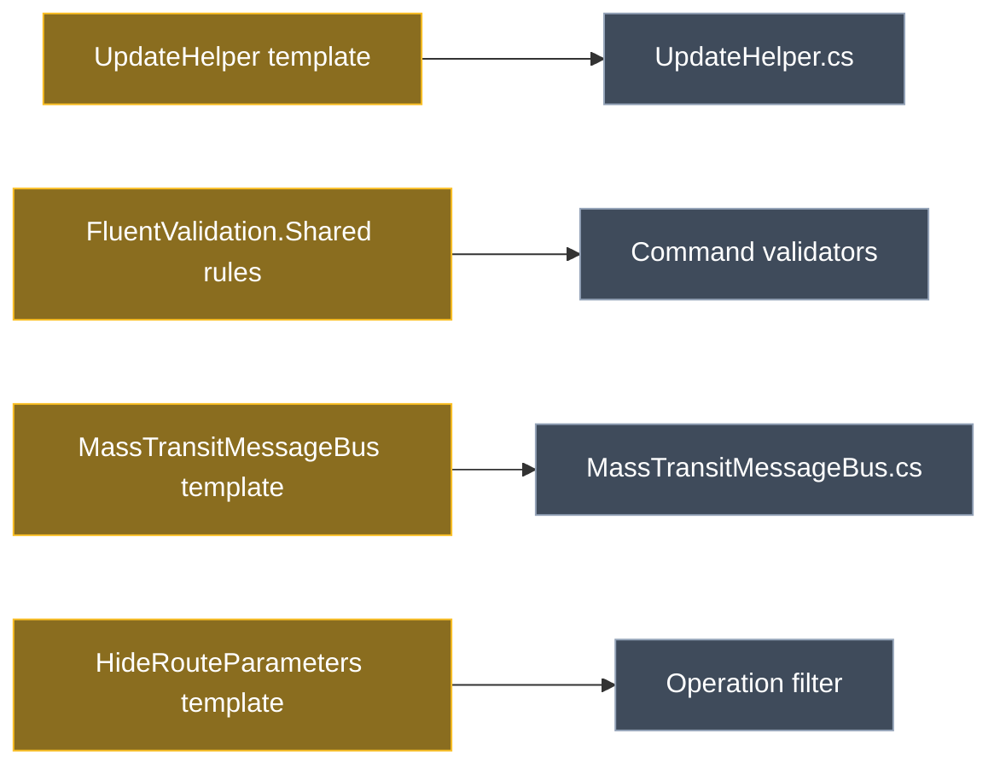

# Remove redundant `!` that trips SonarAnalyzer S8969 in generated code

## Context

`Tests/TrainingModel.Tests` builds with `TreatWarningsAsErrors`. The SonarAnalyzer.CSharp bump to **10.35.0.4138** added rule **S8969 "Null-forgiving operators should not be redundant"**. Commit `b49018b92a` added `dotnet_diagnostic.S8969.severity = none` to <FileRef path="Tests/TrainingModel.Tests/.editorconfig" /> so the build stops failing. The goal is to fix the templates that emit the redundant `!`, so that suppression can be removed.

The rule's two messages, read from the analyzer DLL:

1. *"Remove this null-forgiving operator; the compiler already knows this expression is not null here."* The expression's nullable **flow state** is already NotNull. Examples: a `new` expression, a call to a method whose return type is not nullable, or a value that was just null-checked.
2. *"Remove this null-forgiving operator; nullable warnings are disabled here."* Any `!` in a project or region where nullable is turned off.

All four TrainingModel projects have `Nullable` enabled and contain no `#nullable disable`, so only case 1 applies there.

**Example.** <FileRef path="Tests/TrainingModel.Tests/TrainingModel.Tests.Domain/Common/UpdateHelper.cs" line={41} /> contains `baseCollection ??= new List<TOriginal>()!;`. A `new` expression can never be null, so S8969 flags the trailing `!`. With warnings treated as errors, that fails the build.

<Callout id="method" tone="warning" title="Identified by analysis, not by a build">

I checked every `!` in the generated TrainingModel code against the compiler's flow analysis. I did not build, because the planning phase is read-only. The Verification step confirms the list: remove the suppression and build. Any site this plan misses will appear there as an error with a file and line number.

</Callout>

## Findings: what S8969 reports in TrainingModel.Tests

| Generated code | Why the `!` is redundant | Emitting template |
| --- | --- | --- |
| `UpdateHelper.cs:41` `new List<TOriginal>()!` | A `new` expression is never null | <FileRef path="Modules/Intent.Modules.Entities/Templates/UpdateHelper/UpdateHelperTemplatePartial.cs" line={68} /> |
| `x.SetValidator(provider.GetValidator<XDto>()!)` in the CreateCustomer, UpdateCustomer and CreateOrder command validators | `IValidatorProvider.GetValidator<T>()` returns a non-nullable `IValidator<T>` | <FileRef path="Modules/Intent.Modules.FluentValidation.Shared/ValidationRulesExtensions.cs" line={454} endLine={455} /> |
| `ConsumeContext!.PublishBatch`, `.Send` and `.GetSendEndpoint` in `MassTransitMessageBus.cs` (lines 64, 86, 90) | Generated inside `if (ConsumeContext is not null)` | <FileRef path="Modules/Intent.Modules.Eventing.MassTransit/Templates/MassTransitMessageBus/MassTransitMessageBusTemplatePartial.cs" line={90} /> (also lines 114 and 117) |
| `operation.Parameters!` and `operation.RequestBody!` in `HideRouteParametersFromBodyOperationFilter.cs` (lines 25-26) | They come directly after an early-return guard that already rules out null for both | <FileRef path="Modules/Intent.Modules.AspNetCore.Swashbuckle/Templates/HideRouteParametersFromBodyOperationFilter/HideRouteParametersFromBodyOperationFilterTemplatePartial.cs" line={78} endLine={79} /> |

**When each one is generated:**

- **UpdateHelper**: always, whenever `Intent.Entities` generates the `UpdateHelper` (used by CRUD and domain-interaction update mappings).
- **Validator `GetValidator<…>()!`**: any command, query or DTO validator with a property typed as another DTO that has its own validator. Self-references are excluded and use `SetValidator(this)` instead. A single-valued property gets `SetValidator(...)`; a collection gets `ForEach(x => x.SetValidator(...))`. Every module that compiles in `FluentValidation.Shared` is affected: Application.FluentValidation.Dtos, Application.MediatR.FluentValidation, Application.Mediator.FluentValidation and Application.Wolverine.FluentValidation.
- **MassTransitMessageBus**: always, with Eventing.MassTransit.
- **HideRouteParametersFromBodyOperationFilter**: only the `isMicrosoftOpenApi_2_4_1` branch, that is Swashbuckle 10.x with Microsoft.OpenApi 2.4.1 or later.

These `!` usages stay, because they are needed:

- `null!` initialisers.
- `GetService<T>()!`, which returns `T?`.
- `GetElementType()!`, which returns `Type?`.
- `claimsPrinciple!` in `CurrentUserService`. It is a fresh `ClaimsPrincipal?` method result, not the null-checked one.
- `p.Name!` inside the `Select` lambda. Flow state does not carry across lambdas, and `Name` is `string?`.

## The same pattern outside TrainingModel (fix in the same pass)

- <FileRef path="Modules/Intent.Modules.Eventing.MassTransit.Scheduling/FactoryExtensions/MassTransitMessageBusExtension.cs" line={60} /> has `ConsumeContext!.SchedulePublish(...)` inside `if (ConsumeContext is not null)`.
- <FileRef path="Modules/Intent.Modules.Blazor.FluentValidation/Templates/SimpleValidationRulesExtensions.cs" line={241} endLine={242} /> is a copy of the `GetValidator<…>()!` emission.
- <FileRef path="Modules/Intent.Modules.AspNetCore.Controllers/Templates/BinaryContentFilter/BinaryContentFilterTemplatePartial.cs" line={105} /> (also line 119) has `operation.RequestBody!.Content!.Add(...)`, right after `operation.RequestBody` is assigned a new `OpenApiRequestBody` that initialises `Content`.

<Callout id="binary-content" tone="warning" title="BinaryContentFilter: Content! is uncertain">

`RequestBody!` is certainly redundant, because the property was just assigned a `new` value. `Content!` is less certain. `RequestBody` is typed as an interface in OpenApi 2.x, so the compiler may not carry the object initialiser's state through to `Content`. Remove `RequestBody!` now, and remove `Content!` only if a build with SonarAnalyzer 10.35 reports it.

</Callout>

## Approach

Every fix removes a `!` from a string literal emitted through `AddStatement` or `AddChainStatement`. This is hand-written template logic, so the Module Builder model doesn't change. The generated code differs only by the removed characters.

*Orange = template to change, grey = TrainingModel output that currently trips S8969.*

## Code changes

1. **UpdateHelper**: emit ``$"baseCollection ??= new List<{TOriginal}>();"`` with no `!`.
2. **FluentValidation.Shared `ValidationRulesExtensions`**: emit `provider.GetValidator<…>()` with no `!`, in both the `ForEach` and the single-property forms. Make the same change in Blazor.FluentValidation's `SimpleValidationRulesExtensions`.
3. **MassTransitMessageBus**: change the three `ConsumeContext!.` statements to `ConsumeContext.`. Make the same change in the Scheduling factory extension's `SchedulePublish` statement.
4. **HideRouteParametersFromBodyOperationFilter**, 2.4.1 branch: emit `var parameters = operation.Parameters;` and `var requestBody = operation.RequestBody;`. Leave the `requestBody?.Content == null` re-check that follows as it is; it is outside S8969's scope.
5. **BinaryContentFilter**: drop `RequestBody!`. Drop `Content!` only if the build confirms it is flagged.
6. **Suppression**: delete the S8969 line and its comment from `Tests/TrainingModel.Tests/.editorconfig`.

## Versioning: target the version after the upcoming release

**The user specified** that this branch merges into `development` *after* the next round of module publishing. By then every module currently on `-pre.#` on `development` will have been released without the suffix: `3.13.5-pre.0` becomes `3.13.5`, and so on. Each version below is therefore set above that coming release, not above the current pre-release. This branch currently sits on the same commit as `development`, so the versions in the table are `development`'s.

The impact is a **patch** for every module. The change only removes a redundant `!` from generated code: nothing new is generated and nothing breaks, it just stops a Sonar warning.

| Module | Current (`development`) | Released by merge time | Target |
| --- | --- | --- | --- |
| Intent.Entities | `5.3.5` | `5.3.5` (already released) | `5.3.6-pre.0` |
| Intent.Application.FluentValidation.Dtos | `3.13.5-pre.0` | `3.13.5` | `3.13.6-pre.0` |
| Intent.Application.MediatR.FluentValidation | `4.12.4-pre.0` | `4.12.4` | `4.12.5-pre.0` |
| Intent.Application.Mediator.FluentValidation | `1.0.0` | `1.0.0` (already released) | `1.0.1-pre.0` |
| Intent.Application.Wolverine.FluentValidation | `1.0.4-pre.0` | `1.0.4` | `1.0.5-pre.0` |
| Intent.Blazor.FluentValidation | `1.4.1-pre.0` | `1.4.1` | `1.4.2-pre.0` |
| Intent.Eventing.MassTransit | `7.2.5-pre.0` | `7.2.5` | `7.2.6-pre.0` |
| Intent.Eventing.MassTransit.Scheduling | `1.1.1` | `1.1.1` (already released) | `1.1.2-pre.0` |
| Intent.AspNetCore.Swashbuckle | `6.1.0-pre.1` | `6.1.0` | `6.1.1-pre.0` |
| Intent.AspNetCore.Controllers | `7.2.0-pre.0` | `7.2.0` | `7.2.1-pre.0` |

*I checked the "Current" column against the online feed with prereleases included. Every current version, `-pre` ones too, is already published on intentarchitect.com, so each module has to move regardless.*

<Callout id="skill-override" tone="decision" title="This overrides the skill's rule for modules already on a pre-release">

`module-version-increment` says a module already on a pre-release should move only its pre-release number, for example `3.13.5-pre.0` to `3.13.5-pre.1`. That would put this fix *below* the `3.13.5` release that comes out before the merge, so the fix would never reach consumers. The user's instruction takes precedence, so each module moves to the next patch number instead.

</Callout>

<Callout id="merge-conflicts" tone="warning" title="Expect version conflicts when merging in development">

The publishing round changes the same lines this branch changes: `<version>` in each `.imodspec` (and the version in the Module Builder model), plus the top of each `release-notes.md`. When the published `development` is merged in:

- Keep this branch's higher target version.
- In `release-notes.md`, keep **both** sections: this fix in its own new section, above the newly released version's section. Don't fold the fix into a version that shipped without it.

</Callout>

<Callout id="regate" tone="risk" title="Re-run the gate before merging">

If the publishing round releases a different number than the table expects (for example it releases `6.1.0-pre.2` instead of `6.1.0`, or includes an extra patch), re-run the version gate before merging and move the target above whatever was actually published.

</Callout>

None of these modules needs a minimum-version floor on another module, because each fix is self-contained.

## Steps

1. **Read `CONTEXT.md`** for each module in scope:
   - Entities
   - FluentValidation consumers: Application.FluentValidation.Dtos, MediatR.FluentValidation, Mediator.FluentValidation, Wolverine.FluentValidation
   - Blazor.FluentValidation
   - Eventing.MassTransit
   - Eventing.MassTransit.Scheduling
   - AspNetCore.Swashbuckle
   - AspNetCore.Controllers
2. **Set versions**: set each module to its **Target** from the versioning table. Set it in the Module Builder model's version, and check that the `.imodspec` `<version>` follows after regeneration. Use `module-versioning` to make the change, and add a new top section with that version to each `release-notes.md`.
3. **Template edits**: make code changes 1-5.
4. **Build modules**: run `dotnet build --no-incremental` on each changed module.
5. **Regenerate TrainingModel.Tests**: reinstall or update the modules, run the Software Factory, and check that the diff contains only the removed `!` characters.
6. **Remove the suppression**: make code change 6.
7. **Close out**: dependency audit, a release-note fix line per module (for example "Removed redundant null-forgiving operator flagged by SonarAnalyzer S8969"), and `CONTEXT.md` notes where they are useful.

## Verification

<Checklist
  id="verify"
  items={[
    { id: "mods", label: "Each changed module builds with `--no-incremental`" },
    { id: "diff", label: "TrainingModel.Tests regeneration diff shows only removed `!` at the listed sites" },
    { id: "build", label: "`TrainingModel.Tests.sln` builds with warnings as errors and **no** S8969 suppression", note: "Any remaining S8969 error names the file and line. Trace it to its template and fix it the same way." },
    { id: "siblings", label: "Optional: a test app using MassTransit Scheduling, Blazor FluentValidation or BinaryContentFilter builds clean with SonarAnalyzer 10.35" },
  ]}
/>

<Callout id="nullable-off" tone="warning" title="Out of scope: consumer apps with nullable disabled">

S8969 also reports **every** `!`, including `null!`, in a project or region where nullable is disabled. A consumer app with nullable off and SonarAnalyzer installed hits it on any template that emits `!` without checking whether nullable is enabled. That doesn't affect TrainingModel, so it is left out of this fix; it is worth checking separately.

</Callout>
