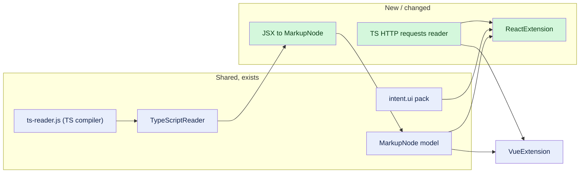

# Drift engine: what React support would take

## Context

The drift engine's `intent.ui` pack is already framework-neutral. It claims `component.kind`, `page.route`, `page.title`, members, `intent.uses` / `navigates` / `opens` / `invokes` and `proxy.verb` / `proxy.route` on the User Interface designer's elements, and readers answer through bindings, never through element types. Two stacks read it today: `intent.blazor` and `intent.vue`. React has no reader, so on a React codebase every UI claim comes back `noRule`. `CONTEXT.md` lists this as a known gap ("Angular and React have no reader").

**Worked example.** A Page `ProductDetails` has the route `/products/{id}`, and a Navigation association runs to it from `Catalog`. Here is how the React reader would verify it:

- `page.route`: a react-router record `{ path: "products/:id", element: <ProductDetails /> }`, or `<Route path="/products/:id" element={...} />`, mounts the component, and `:id` reads as `{id}`.
- `intent.navigates`: `Catalog.tsx` renders ``<Link to={`/products/${p.id}`}>`` or calls `navigate(...)` from `useNavigate()`, and the link matches the target's route.
- `intent.invokes`: the component, or a hook it calls, reaches `catalogApi.getProduct(id)`.
- `proxy.route`: inside the proxy, ``axios.get(`/api/products/${id}`)`` reads as `GET api/products/{id}`.

None of this changes the pack, the vocabulary or any designer. The work is all inside the engine's Stacks project.

## Approach

The parser layer is mostly in place already. `ts-reader.js` runs TypeScript's own compiler, accepts `tsx` / `jsx` script kinds, and already writes JSX nodes into the JSON tree. Nothing reads them, though. So the work falls into three layers:

1. **Language: make JSX visible in the code graph.** `TypeScriptReader` turns JSX into the shared `MarkupNode` model that Razor and Vue already use, and recognises function components as `component` types.
2. **Shared TypeScript HTTP reader.** The `Requests` reader (fetch, axios, ky, `HttpClient`) is not Vue-specific, but it currently sits in `VueExtension.cs`. It moves into a framework-neutral `intent.typescript.http` extension (or a shared `TypeScriptHttp` helper), so React and a future Angular reader get proxy verbs and routes for free.
3. **`ReactExtension` (`intent.react`).** Its claim readers mirror Vue's: `Components`, `Members`, `Links` and `Modules`. They reuse `VueCode`'s neutral helpers, which get promoted to a shared `UiCode` / `TypeScriptUi` class: `Bound`, `Words`, `Folders`, `EndsWith`, `CodeOf`, `Units`, `Reached`, route `Matches`, and the module/file location logic.

## What changes, layer by layer

### 1. Language (`Stacks/TypeScript`)

| Change | Why |
|---|---|
| `TypeScriptLanguage` and `TypeScriptReader` read `.js` / `.jsx` too, with the `js` / `jsx` script kind | Many React codebases are plain JavaScript. Today only `.ts`, `.tsx`, `.mts`, `.cts` and `.vue` are read, and `.tsx` gets the `tsx` kind only by its extension. Open question 1 covers whether `.js` is read always or only when a `jsconfig` / `package.json` says the project is React. |
| JSX to `MarkupNode`: `JsxElement`, `JsxSelfClosingElement`, `JsxFragment`, attributes, `{expr}` children, and `.map(x => <X/>)` / `cond && <X/>` children walked through | Uses, composition, links and layout (`<Outlet/>`) are all read from markup. A capitalised or dotted tag gets a `Component` ref, resolved through the file's imports, as Razor and Vue tags are. |
| **Markup is owned by a component, not by a file** | `FileNode.Markup` assumes one component per file (Razor, Vue SFC). A React file can declare several components. Two options: add `Markup` to `TypeNode` / `MemberNode` (a Core addition, overload-only per the invariant), or keep the file-level list and let `ReactExtension` filter by span. The span filter is recommended for the first cut, since it needs no Core change. |
| A function component becomes a `component` `TypeNode`: an exported or top-level `function X` or `const X = (...) =>` that returns JSX, plus `memo(...)` / `forwardRef(...)` wrappers | Vue gets this from the file. React needs a "returns JSX" test. Its props are the first parameter's type members or its destructured names, and its body is the component's unit, so `Units` / `Reached` walk it. |
| Hooks as members: `useState` pairs become state `property` members, and local functions become `operation` members | These are what Property and Operation claims, and `property.bindable`, read. |

### 2. Shared HTTP reader

- Move `Requests` (`VueExtension.cs`, about lines 822-970) and its `Client` regex into a neutral extension that answers for any TypeScript proxy code. Vue's behaviour must stay identical: the existing `vue-standard-http-request` and `vue-standard-backend-call` cases are the guard.
- Add React-ecosystem clients only where they're plain calls: `axios.create()` instances (already matched by the `instance` / `client` names), and RTK Query / react-query are **deferred**, since their endpoints are declared as configuration, not as calls.

### 3. `ReactExtension` claim readers

| Reader | Kinds | React reading |
|---|---|---|
| `Components` | `component.kind`, `page.route`, `page.title`, `security` | Page: mounted by a react-router route, whether an object record (`createBrowserRouter`, `useRoutes`, `children` joined) or JSX `Route path element/component`. Layout: renders `<Outlet/>`. Dialog: `noRule`, as in Vue. Title: `document.title =`, React 19 `<title>`, `Helmet`. Security: `None` from silence, Secured `noRule`. |
| `Members` | `member.exists`, `property.query`, `property.route`, `property.bindable` | Property: a prop or `useState`. Event Emitter: an `on*` callback prop. Operation: a function. Route params: `useParams().id` or a destructure. Query: `useSearchParams().get('x')`. Bindable: a `value` + `onChange` pair, or `x` + `onXChange`. |
| `Links` | `intent.uses`, `navigates`, `opens`, `invokes`, `target` | Uses / composition: a JSX tag rendering the target, else a value import of its file. Navigates: `Link` / `NavLink` `to`, `navigate(...)` from `useNavigate()`, `<Navigate to>`, `redirect(...)`, all matched with the same route `Matches`. Invokes: the BFS from the component through its own functions **and custom hooks** to the proxy call. |
| `Modules` | `type.exists` for Store / Module / Proxy | The Implementation Path or a name-and-folder file match (shared with Vue). Store: a Redux `createSlice({ name })`, Zustand `create(...)` exported as `use{Name}Store`, or React context `createContext` + Provider. Open question 3 covers how many of these to support. |

<Callout id="nextjs-deferred" tone="warning" title="Next.js file-system routing is a separate piece">

In Next.js (`app/products/[id]/page.tsx`, `pages/`) and Remix / React Router v7 file routes, the route comes from the file path, not from code. Reading it needs a path-to-route convention reader, not markup or call analysis. It belongs after react-router, and only if a real codebase needs it.

</Callout>

<Callout id="angular-next" tone="decision" title="Angular is the next TypeScript stack">

Angular is planned for later, so the shared layer must not assume any one framework. Step 1 factors out only what has no framework in it: locating modules, matching routes, walking calls to a proxy, and reading HTTP requests. The shared HTTP reader already reads Angular's `HttpClient`. An Angular component is a class with an `@Component` decorator whose template is inline or in a separate `.html` file, so it can't be mistaken for a `.vue` file or a JSX function. Angular will be its own plan: template syntax, `@Input` / `@Output` and signals, and the router's `Routes` arrays.

</Callout>

<Callout id="extension-ordering" tone="warning" title="Two TypeScript UI readers, one claim">

Vue and React both answer for TypeScript code. Each reader must return `null` unless the code is its own. Vue checks for a `.vue` component; React checks for a `component` type whose code holds JSX or that is a `.tsx` / `.jsx` file. A shared TS module (a store or proxy file) could be answered by either reader. That is harmless only if both read it identically, which is the reason the shared `Modules` and HTTP logic gets factored out rather than duplicated.

</Callout>

## Steps

1. **Factor the shared code.** Move `VueCode`'s neutral helpers, and the `Requests` reader, out of `Stacks/Vue` into a shared TypeScript UI/HTTP place. All Vue cases must still pass unchanged.
2. **Read `.js` / `.jsx`, and turn JSX into markup.** In `TypeScriptReader`, build `MarkupNode`s from JSX nodes, ranged per component, and add unit tests in `Stacks/TypeScriptFactsTests.cs` alongside the Vue ones.
3. **Recognise function components.** Read props, `useState` members and hook-local functions, again with unit tests.
4. **Add `ReactExtension` (`Stacks/React`).** Build `Components` and `Links` (routes, layout, navigation, uses, invokes) first, then `Members`, then `Modules` / stores. Register it in `StockExtensions.With()` after Vue.
5. **Acceptance cases.** Add `react-standard-*` cases next to each `vue-standard-*` case in `Tests/Acceptance/cases/ui/*.cases.md` and `services/intent.invokes.cases.md`, using `tsx file` blocks. Then add `EngineAdapter` registration for `intent.react` when a case lists `intent.ui`.
6. **Cover the open set of React idioms in the cases, not one app's idioms.** Each kind gets cases for every form the readers claim to read. That means:
    - TS and JS components;
    - `function`, arrow, `memo` and `forwardRef` components;
    - several components in one file;
    - object-record routes and JSX routes, including nested `children`, lazy `lazy(() => import(...))` elements and index routes;
    - `Link`, `NavLink`, `navigate`, `Navigate` and `redirect`;
    - proxy calls through custom hooks;
    - Redux Toolkit and Zustand stores.

    Each kind also gets a contradicted case, and a `noRule` / `CantVerify` case for a form it can't read, such as a computed route or a Next.js `app/` route. No real-codebase run is planned (see the callout below).
7. **Close out.** Update `CONTEXT.md` (decisions, and remove React from Known gaps), `docs/spec/code-reader.md` (JSX markup, `.jsx` / `.js`), `release-notes.md`, and the version gate for the DriftEngine modules.

## Critical files

- <FileRef path="Modules/Intent.Modules.Common.DriftEngine.Stacks/TypeScript/TypeScriptReader.cs" />: read `.jsx` / `.js`, JSX markup, function components
- <FileRef path="Modules/Intent.Modules.Common.DriftEngine.Stacks/TypeScript/TypeScriptLanguage.cs" />: the extension list
- <FileRef path="Modules/Intent.Modules.Common.DriftEngine.Stacks/TypeScript/Worker/ts-reader.js" />: already emits JSX nodes, so no change is expected
- <FileRef path="Modules/Intent.Modules.Common.DriftEngine.Stacks/Vue/VueExtension.cs" />: the template for the readers, and the source of the shared helpers and `Requests`
- <FileRef path="Modules/Intent.Modules.Common.DriftEngine.Stacks/StockExtensions.cs" />: register `intent.react`
- <FileRef path="Modules/Intent.Modules.Common.DriftEngine.Core/Code/CodeGraph.cs" />: `MarkupNode`, and an optional per-type markup overload
- <FileRef path="Modules/Intent.Modules.Common.DriftEngine.Core/Packs/intent.ui.pack.json" />: unchanged, apart from adding `javascript` to `languages` if `.js` gets its own language id
- <FileRef path="Modules/Intent.Modules.Common.DriftEngine.Tests/Harness/EngineAdapter.cs" />: case registration

## Verification

- Every existing Vue and Blazor acceptance case passes unchanged after step 1, which proves the refactor is behaviour-neutral.
- The new `react-standard-*` cases pass, each kind with a verified case and a contradicted case.
- Every reader's case set includes a form it must decline: a Vue file, a Blazor file, and a plain TS module that isn't a component. Those cases prove `intent.react` returns `null` and never claims another stack's code.

<Callout id="no-reference-app" tone="warning" title="No real React app in the proof">

The engine has to work for any React app, so the acceptance cases are the specification: each idiom the readers read is a case. A real codebase would only catch idioms nobody thought to write a case for. When one becomes available, add it to `codebases.json` and run it then. This is accepted because each missed idiom gives a `CantVerify` or `noRule` (visible, never a false clean), and fixing one means adding a case and a reader branch, not redesigning anything.

</Callout>
- `git status` is unchanged in the codebase after a run, per the engine's own invariant.

## Open questions resolved

- **Q:** Read JavaScript? **A:** Yes. `.js` and `.jsx` are read with the TS parser. Typed comparisons such as `member.type` can't be verified in JS.
- **Q:** Which routing for the first cut? **A:** react-router, in both its object-record and JSX forms. Next.js and file-based routing are deferred, and their routes are `noRule`.
- **Q:** Which state stores? **A:** Redux Toolkit `createSlice` and Zustand. React Context is deferred.
- **Q:** Which reference codebase? **A:** None. The user specified that the readers must work for any React app, not a particular one, so the acceptance cases cover the idioms themselves (step 6).
