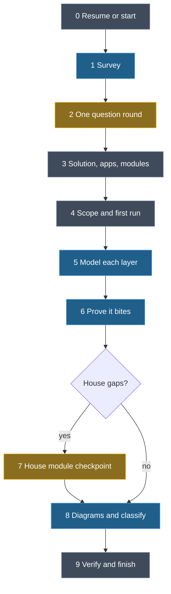
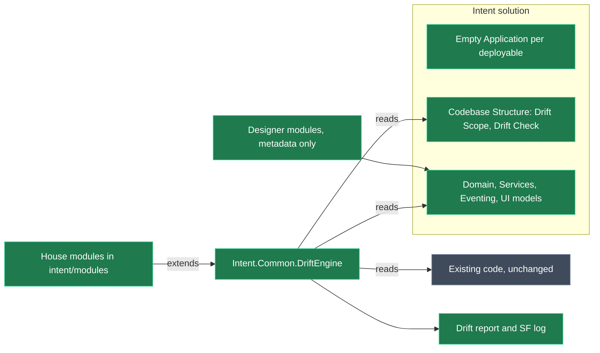

# initialize-brown-field2: bring a brownfield codebase into Intent on the drift engine

## Context

Two skills bring existing code into Intent Architect today, and each was built for a different engine:

- `D:\WIP\ibrefactor\initialize-brown-field`: C#. It drives the Guardrails Contracts modules' `reverse-engineer-domain` / `reverse-engineer-services` skills and checks drift with Common.Drift recipes.
- `D:\WIP\skills\adopt-brownfield-progressively` (with its older sibling `brownfield-model-and-guardrails`): any language. Each concern gets its own house module with a hand-written drift engine. This is how the Java eShop and eShopCustom were adopted.

`Intent.Common.DriftEngine` now replaces both engines. The skill is phase 5 of its plan, "Adoption flow", in <FileRef path="Modules/Intent.Modules.Common.DriftEngine/docs/plan.md" />: AI skills that set scope, build a curated intent model, choose packs and verify. It is done when a real codebase is adopted in two hours or less with no code changes. The engine ships no skills, and the old skills assume templates and recipes the engine has dropped. So a new skill is needed: `initialize-brown-field2`.

**What a run looks like (C# eShop example).** A developer opens the eShop repository (no `intent` folder) in Intent Architect and runs `/initialize-brown-field2`.

1. Read-only sub-agents survey the code: the deployables (Basket, Catalog, Ordering, WebApp...), C# with Razor, EF Core, Minimal APIs, MediatR, gRPC and Blazor. Every one of those has a stock engine extension.
2. One question round confirms the solution name, one application per deployable, and the layers to model.
3. The skill creates the solution and Empty Applications pointed at the code. It installs only designer modules plus `Intent.Common.DriftEngine`, and sets each application's **Drift Scope**. For example, `src/Ordering.Domain/**` is In, and `Migrations/**` is Out with the reason "generated by EF Core".
4. Sub-agents then model Domain, Services, messaging and UI one phase at a time. Each phase ends with a Software Factory (SF) run whose drift report must be empty, and a log that shows claims verified.
5. The skill plants one wrong attribute type in the Ordering domain and sees exactly one finding. It reverts the change from git, and the next run is clean.
6. The baseline found that Ordering wraps commands in its own `IdentifiedCommand` type, which no stock reader understands. The skill stops once and offers a house extension for it. The developer accepts, and the skill builds it as a module under `intent/modules`.
7. The run ends with area diagrams, a `PROGRESS.md` and a few lines of status. Not one code file has changed.

## What each existing skill does well and badly

| Aspect | Old skill (`ibrefactor`) | Java / eShopCustom skill | `initialize-brown-field2` takes |
| --- | --- | --- | --- |
| Languages | C# only | Any | Any: stock readers for C#, Java, TypeScript/Vue and Protobuf; a house extension for the rest |
| Code adoption | Guardrails templates merge into every file: headers, formatting, NuGet churn; uninstalling deletes files | Code described only, never written | Never written (engine principle 4, requirement R17) |
| Drift check | Common.Drift recipe JSON per designer | A hand-written engine and parser per house module | Stock engine extensions, plus house extensions in C# only where needed |
| Scope | None: all or nothing | An adoption-scope stereotype grown chunk by chunk | The engine's own `Drift Scope`, set once up front |
| Pace | One question, then autonomous | A pilot per layer and your OK per phase; many stops | One question round plus one house-module checkpoint |
| Context cost | One sub-agent per phase; capped read-only reports (a 340-file run hit 727K tokens without them) | Foreground; context keeps growing | One sub-agent per phase (kept) |
| Modelling guidance | Deep C# rules in the reverse-engineer skills | Thinner, stack-agnostic phase guides | The C# depth ported and generalised, without the template, File Config and recipe parts |
| Proof | A zero-change SF run | A planted break is caught ("prove it bites") | A clean baseline plus one planted break per designer |
| House rules | None | House modules, layers, AI rules, Validate Functions, `GUARDRAILS.mdx` | House extensions at a checkpoint; architecture layers as an optional house module |
| Readability | Area diagrams, a layout script, classification | None | Diagrams and classification kept, as options |
| Resume | Memory notes | `PROGRESS.md` on disk | `PROGRESS.md` on disk |

_Table 1 — what each skill does, and what the new one keeps._

## Approach

The new skill keeps the old skill's **shape**: a conductor in the main conversation, one question round, a sub-agent per heavy phase with a fixed hand-off and a capped report, and focused diagrams.

From the Java skill it takes the **method**:

- any language;
- a pattern harvest mapped to designers;
- scope in the model;
- planted-drift proof;
- house modules;
- progress kept on disk.

Everything both skills built for themselves is replaced by the engine: recipes, per-module parsers, templates that adopt files in place, and the adoption-scope stereotype.



_Grey: the conductor does it. Blue: run in sub-agents. Amber: stops for the user._

The diagram below shows what the skill leaves behind in the target repository. The only new files are under the Intent solution folder, plus house modules when they are built.



<Callout id="no-vs-mirroring" tone="decision" title="Folder Structure, not the Visual Studio component">

The old skill mirrored every `.sln` and `.csproj` in Codebase Structure and installed `Intent.VisualStudio.Projects`. The SF then rewrote project files: package versions, properties and startup files. The engine never writes code (R17) and needs no project mirror, because `Drift Scope` sits on the Root Folder and Folders, not on Projects. So each application gets the Empty Application architecture's **Folder Structure** component, and the NuGet-alignment, startup-file and adoption-diff sections of the old skill are dropped.

</Callout>

<Callout id="no-guardrails" tone="decision" title="The Guardrails Contracts modules are never installed">

Their reverse-engineer skills hold the best C# modelling rules, but installing the modules to get those skills would merge templates into every file. Uninstalling them later stages the deletion of every file they own (128 on eShop10, 347 on ClientB's CRM application). Their stereotypes, such as File Config, belong to the old system (user, 2026-11-16, recorded in the engine's `CONTEXT.md`). So the modelling rules are **ported** into the new skill's references, minus templates, Template Outputs, File Config, Registration Filters and recipes. If the folder already runs on the old system, the skill stops and says so: migration is the engine plan's phase 6.

</Callout>

<Callout id="baseline-triage" tone="decision" title="A baseline finding is a bug, never drift, and never quietly excepted">

The model was drawn from unchanged code, so every finding on the baseline is a defect, and the sub-agent classifies each one:

- **The model was drawn wrong:** fix the model.
- **A house pattern no stock reader understands** (a custom `[Authorization]` attribute, a helper that wraps `Send`): record it as a house-extension candidate with the claim, the file and an example. It stays failing until the checkpoint.
- **A stock extension misreads a framework it supports:** that is an engine bug. The skill names it as one in the final message, so it can be fixed in `Intent.Common.DriftEngine`, and the checkpoint offers a house extension or an exception the user approves in the meantime.

The skill never adds a `Drift Check` exception on its own: the Java skill's rule ("never loosen a check to make a failure go away") is kept.

</Callout>

<Callout id="unread-stacks" tone="warning" title="Code in a language or store no reader handles">

The stock readers cover C#, Java, TypeScript/Vue and Protobuf, and a fixed set of frameworks. Brownfield code can be anything: Python, Go, MongoDB, a framework nobody reads yet. A modelled claim is always checked, even out of scope, so modelling such code would only produce can't-verify errors. The survey lists it, and the checkpoint offers a house extension for it (a `Languages` or `ClaimReaders` extension). Until one exists, that code is scoped Out with the reason "no reader for X" and not modelled, and the final message says so. Accepted because a model the engine can't check would break the plan's principle 2, that every claim on the visual is checked.

</Callout>

## The skill's files

Location: `D:\WIP\initialize-brown-field2\`, beside the two existing skills (an assumption; see the questions at the end).

```text
initialize-brown-field2/
  SKILL.md                      conductor: phases 0-9, sub-agent hand-off, user decisions
  references/
    survey.md                   survey, stack-to-extension map, scope proposal, app split
    drift-engine.md             Drift Scope, Drift Check, reading report and log, baseline triage, prove it bites
    modelling-domain.md         Domain designer rules, any language
    modelling-services.md       DTOs, commands/queries, services, HTTP, security, interactions
    modelling-messaging.md      domain events, integration events, commands, service proxies
    modelling-ui.md             User Interface designer 2.0.0 (and 1.x for Blazor)
    house-modules.md            building a DriftEngine extension module
    progress.md                 PROGRESS.md format and resume protocol
    diagrams.md                 copied from the old skill
    gotchas.md                  merged from both skills, deduplicated
  scripts/
    services-area-layout.js     copied from the old skill
```

| New file | Built from | What changes on the way |
| --- | --- | --- |
| `SKILL.md` | `ibrefactor` SKILL.md (conductor, sub-agent hand-off, read-only sub-agent rules, user decisions); Java skill's hard rules | Phases rewritten for the engine; VS mirroring, NuGet, adoption diffs and Guardrails dropped |
| `survey.md` | Java skill's `survey-and-pattern-harvest.md` and `designer-and-module-catalogue.md`; `ibrefactor` step 1 | Adds a map from code signals to the engine's stock extensions and to designer modules; proposes scope rows and the application split |
| `drift-engine.md` | Engine <FileRef path="Modules/Intent.Modules.Common.DriftEngine/docs/README.md" /> and `docs/spec/scope.md`; Java skill's `drift-engine.md` (proof, two-way thinking) | The engine's own stereotypes, rule ids and log replace the hand-built engine |
| `modelling-*.md` | Section 1 and sections 3 to 5 of the three `ReverseEngineer*SkillTemplatePartial.cs` templates; Java skill's `phase-*.md` and `other-patterns.md` | Stack-agnostic; states values only where the code states them; follows the README's "What it checks" |
| `house-modules.md` | Java skill's `module-anatomy.md`; eShopCustom's and the Java spike's extensions | Rewritten for `DriftEngineExtensionBase`: which override fixes which gap |
| `progress.md` | Java skill's `progress-and-resume.md` | Chunk ladder simplified to phases; lives under the Intent solution folder |
| `diagrams.md`, `services-area-layout.js` | `ibrefactor` (its newer copy, with Integration Command) | Unchanged |
| `gotchas.md` | Both skills' gotchas | Drops the template, recipe and NuGet entries; keeps the tool, designer and module-build entries |

_Table 2 — where each file comes from._

## What `SKILL.md` prescribes, phase by phase

**0. Resume or start.**
- With `PROGRESS.md` present, read it and carry on from the last phase it records.
- With an `.isln` but no `PROGRESS.md`, rebuild the progress file from evidence (installed modules, the last report, model size against code size) and say what was inferred.
- With an `.isln` on Common.Drift or Guardrails Contracts, stop.

**1. Survey** (read-only sub-agents, Sonnet, each report capped at about 2,000 words, names verbatim). Find:
- each deployable;
- languages, by file extension;
- frameworks, mapped to the stock extensions that read them;
- layers, with file and type counts per folder;
- junk to scope out: tests, generated code, migrations, vendored code, `wwwroot/lib`;
- composition roots, to read as Context;
- house-pattern candidates: custom attributes, base classes, helpers wrapping a bus or `HttpClient`, an architecture convention;
- stacks no reader handles;
- whether git is clean and Node.js 18 or later is on the path.

**2. One question round.** One `ask_user_question` covering:
- the solution name;
- the application split, proposed as one per deployable with shared projects as Context;
- the layers to model;
- the extras: diagrams, classification, architecture layers.

Each question carries the context and one example from this codebase. **User decision:** no questions after this point except the house-module checkpoint.

**3. Solution, applications, modules.**
- Create the solution and each Empty Application (Folder Structure), with output at the folder that contains the deployable's code.
- Turn the `.gitignore` setting off by id, and discard what the creation run produces.
- Install the designer modules the survey called for, metadata only: Domain, Services, CQRS, Eventing, Domain and Event Interactions, Service Proxies, RDBMS or DocumentDB metadata, and User Interface.
- Install `Intent.Common.DriftEngine`, prerelease included.
- Never install a code-generating module. The Java skill's catalogue list is kept.
- Set the naming conventions to manual before creating any element, so names stay verbatim.

**4. Scope and first run.**
- Model `Drift Scope` on each application's Root Folder: In for the deployable's source, Out with a reason for the junk, Context for composition roots and shared projects.
- Leave the opt-in rules off, so unmodelled code is never drift (plan principle 1). This is why scope no longer has to grow chunk by chunk.
- Run the SF. Expect no findings, no `scope/stale` warnings, and a log listing the files read.

**5. Model each layer** (one sub-agent per application and layer, in order). Layer by layer across every application, so cross-application links have targets: Domain everywhere, then Services, then messaging (integration events and commands across applications), then UI and proxies. Each sub-agent:
- loads its `modelling-*.md` and the scripting skills;
- models the layer;
- saves and runs the SF;
- applies the baseline triage until the report is empty and the log shows claims verified for that designer;
- reports in at most 15 lines, with any house candidates.

The user decisions carried over from the old skill:
- names verbatim;
- intent drawn for a reviewer, leaving out plumbing such as logging and configuration lookups;
- no mappings on interaction associations.

**6. Prove it bites** (once per designer).
- On a file git shows as clean, plant one wrong fact with the Edit tool, for example an attribute's type.
- Expect exactly one finding, naming the element, file and line.
- Revert with git, compare the checksum, and rerun clean. Skip a designer whose files are all dirty.

**7. House-module checkpoint.** Runs only if there are candidates.
- One question lists each candidate: what it would check, an example from the code, and which engine override it needs (`Refiners`, `ClaimReaders`, `Rules`, `OptInRules`, `Languages`, `Kinds` or `ClaimSources`).
- For each one chosen, a sub-agent builds `<Product>.Modules.<Concern>` under `intent/modules`. It follows the existing module-building skills and the workflow rules, and packs into `intent/Intent.Modules` through a local `Directory.Build.props` and `intent.repositories.config`. Tests come first: fixture tests with the exact finding text, plus a real-code-is-clean test.
- The sub-agent then installs it, reruns the SF clean and proves the extension bites.
- Architecture layers, if chosen, follow `eShopCustom.Modules.Architecture`.

**8. Diagrams and classification** (sub-agents; optional).
- Diagrams: `diagrams.md` as in the old skill, with no all-in-one diagrams and service-to-service lines on the right.
- Classification: `classify-codebase` as in the old skill's step 7.

**9. Verify and finish.**
- Every designer validates clean.
- The final SF run's report has no Areas.
- The log shows claims verified, and no can't-verify, per designer.
- `git status` shows nothing outside the Intent solution folder and `intent/modules`.
- Update `PROGRESS.md`.
- Send a few lines: status, what was scoped out and why, the diagrams to read, and ordered next steps.

<Callout id="planted-drift-writes" tone="warning" title="Proving it bites edits a code file for a moment">

The engine principle is that adopting never writes code. Phase 6 makes one temporary edit per designer, only to a file git shows as clean. It restores the file from git and compares the checksum before going on. Accepted because it is the only proof that a clean report means "checked" rather than "read nothing". A designer whose files are all dirty is skipped and named in the final message.

</Callout>

<Callout id="apps-sequential" tone="warning" title="Several applications run one after another">

The eShop has around nine deployables, so phase 5 dispatches up to nine sub-agents per layer, in sequence, because two agents must never mutate designers or run the SF at once. That puts the two-hour target at risk on large estates. Accepted for v1. Running applications in parallel is deferred until your runs show where the time goes.

</Callout>

<Callout id="skill-name" tone="info" title="Name">

You asked for `initialize_brown_field2`. Skill names allow only lowercase letters, digits and hyphens, so the folder and command are `initialize-brown-field2`, matching `initialize-brown-field`.

</Callout>

## Steps

1. **Scaffold the skill.** Create `D:\WIP\initialize-brown-field2\` with the `SKILL.md` frontmatter:
   - a description that triggers on initialising, onboarding or adopting a brownfield codebase, or setting up drift checking, in any language;
   - `requiredTools` from the old skill, keeping `create_sub_agent`.
2. **Write `SKILL.md`.** Cover phases 0 to 9 as above, the sub-agent dispatch block and its hand-off contents, the read-only sub-agent rules, and the **User decision** paragraphs carried over from both skills.
3. **Port the references.**
   - `survey.md`, `drift-engine.md` and `progress.md`, from the sources in Table 2.
   - The four `modelling-*.md` files, taking the modelling rules out of the three Guardrails `ReverseEngineer*SkillTemplatePartial.cs` templates. Cut every template, Template Output, File Config, recipe and adoption step, and check each rule against the engine README's "What it checks". One example: a Table name is modelled only when the code has a `ToTable`.
4. **Write `house-modules.md`.**
   - Where a house module lives and how it packs: a local `Directory.Build.props` and `intent.repositories.config`, so it never lands in a shared module folder.
   - The `DriftEngineExtensionBase` overrides, each with a worked example from eShopCustom's Domain, Services and Architecture extensions and the Java spike's `ServicesDriftExtension`.
   - Tests, the version gate, install, and proof.
   - It points to `module-building-strategies`, `configuring-designers`, `add-designer-extension` and `intent-metadata-consumer` rather than repeating them.
5. **Copy and merge.** Copy `diagrams.md` and `services-area-layout.js` from `ibrefactor`. Merge and deduplicate both skills' gotchas into `gotchas.md`.
6. **Read-through review.** Check that every skill, tool, stereotype and rule id the skill names exists, against the engine README and the skill list. Check that no step installs a code-generating module or writes outside the Intent folders. This is the last step: I don't run the skill.

## Critical files

- <FileRef path="Modules/Intent.Modules.Common.DriftEngine/docs/README.md" />: the consumer view of scope, opt-in rules, what is checked, and extending. The modelling references must agree with it.
- <FileRef path="Modules/Intent.Modules.Common.DriftEngine/docs/plan.md" />: principles, and the phase 5 done-when.
- <FileRef path="Modules/Intent.Modules.Common.DriftEngine/Api/DriftEngineExtensionBase.cs" />: the house module entry point.
- `Modules/Intent.Modules.{Domain,Services,UI}.Guardrails.Contracts/Templates/ReverseEngineer*Skill/*TemplatePartial.cs`: the modelling rules to port. Read only; nothing in them changes.
- `D:\WIP\ibrefactor\initialize-brown-field\`: the conductor pattern, `diagrams.md` and `services-area-layout.js`.
- `D:\WIP\skills\adopt-brownfield-progressively\`: survey, catalogue, progress, house-module anatomy, architecture and gotchas.
- `D:\Dev\Temp\eShopCustom\intent\modules\`: the house extensions and the module-packing setup to copy.

## Verification

I verify the skill by reading it, never by running it. You run it on a codebase of your choosing and tell me what went wrong; fixes to the skill come from those reports.

<Checklist
id="verify"
items={[
    { id: "names", label: "Every skill, tool, stereotype, rule id and engine override the skill names exists", note: "Checked against the skill list, the engine README and DriftEngineExtensionBase" },
    { id: "nowrite", label: "No step installs a code-generating module or writes outside the Intent solution folder and intent/modules", note: "Apart from phase 6's temporary planted break, which is restored from git" },
    { id: "decisions", label: "No step contradicts a recorded decision", note: "Engine principles, the engine's CONTEXT.md, and the User decision paragraphs carried over from both skills" },
    { id: "handoff", label: "Every sub-agent dispatch names the skills to load, the reference files to read and the report it must end with" },
]}
/>

## Deferred

- **A day-two skill for the new engine.** Common.Drift shipped `sync-model` and an always-on model-sync rule; the engine ships nothing that helps an agent resolve findings after adoption.
- **Shipping this skill in the product.** It has to run before any module is installed, so it can't come from the engine module, but day-two skills could.
- **Choosing packs on `Drift Check`.** Not built in the engine; the skill doesn't need it yet.
- **Running applications in parallel in phase 5.**
- **Migrating solutions on Common.Drift or Guardrails Contracts.** That is the engine plan's phase 6.

## Open questions

These were asked in chat but not answered. The plan above assumes the recommended option for each.

<QuestionForm
  id="open-questions"
  questions={[
    {
      id: "pace", title: "How should the skill pace the modelling of each layer?", mode: "single",
      options: [
        { id: "auto", label: "One question round, then autonomous", recommended: true, detail: "Whole layers, one sub-agent per phase, no stops except the house-module checkpoint. Fits the two-hour target." },
        { id: "pilot", label: "A pilot slice per layer, then your OK", detail: "One aggregate (or one controller) modelled, proven and shown to you before the rest of the layer. Slower; you shape conventions early." },
      ],
    },
    {
      id: "house", title: "What should the skill do when the stock engine can't read a house pattern?", mode: "single",
      options: [
        { id: "propose", label: "Propose after the baseline, I pick", recommended: true, detail: "One stop listing each candidate extension, with an example and the effort; builds only the ones chosen." },
        { id: "build", label: "Build them without asking", detail: "Authorised in the first question round." },
        { id: "defer", label: "Not in this skill yet", detail: "Scope that code Out with a reason and list it; house modules become a later skill." },
      ],
    },
    {
      id: "extras", title: "Which extras should v1 include?", mode: "multi",
      options: [
        { id: "diagrams", label: "Focused area diagrams", recommended: true, detail: "The old skill's diagrams reference and layout script, unchanged." },
        { id: "arch", label: "Architecture layer rules", detail: "A house module modelled on eShopCustom.Modules.Architecture; there is no stock one." },
        { id: "classify", label: "Change Review classification", detail: "classify-codebase at the end; needs git and Node.js 18 or later." },
        { id: "optin", label: "Offer the opt-in must-be-modelled rules", detail: "unmodelled.type, .member, .endpoint and the rest, offered at the end; off by default." },
      ],
    },
    {
    id: "where", title: "Where should the skill live?", mode: "single",
    options: [
        { id: "wip", label: "D:\\WIP\\initialize-brown-field2", recommended: true, detail: "Beside the two existing skills, while you try it out." },
        { id: "repo", label: "This repository's .claude/skills", detail: "Next to the product's initialize-brown-field." },
      ],
    },
  ]}
/>
