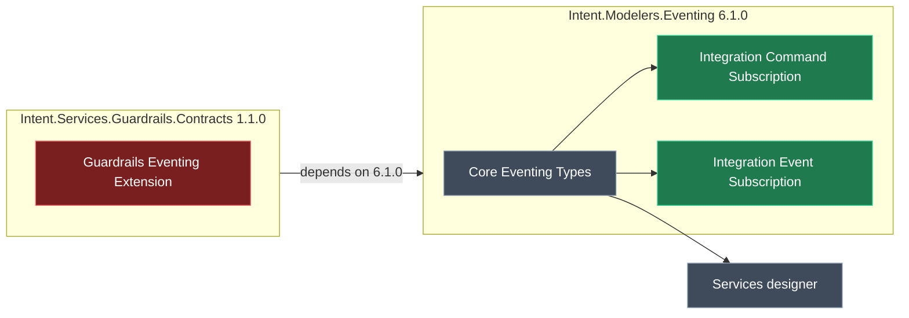

# Move the subscription associations into Intent.Modelers.Eventing, keeping their IDs

## Context

The **Integration Command Subscription** and **Integration Event Subscription** association types are defined in `Intent.Services.Guardrails.Contracts`. They sit in its Module Builder Designer Settings, `Guardrails Eventing Extension`. Guardrails 1.0.0 is published and the module is now at 1.1.0-pre.0.

| Association | Ends | Context menu |
| --- | --- | --- |
| Integration Command Subscription | Integration Command → Integration Command | Link To Sent Integration Command |
| Integration Event Subscription | Message → Message | Link To Published Integration Event |

This work is on the `guardrail-extract` branch, and `Modelers.Eventing`, which lives in the Intent.Modules repo, has just been added to both `Intent.Modules.NET*.isln` files. The goal is to move these associations into **Intent.Modelers.Eventing**, the module that owns `Message` and `Integration Command`.

**Worked example.** A consumer reverse-engineered a receiver with Guardrails 1.0.0. Its own `CreateInvoice` Integration Command is linked to the sender's `CreateInvoice` by an Integration Command Subscription, and the link is stored under association type `9073c828-…`. After the move, the consumer updates both modules. The same link still reads `[subscribes to] CreateInvoice`, and right-clicking a command still offers **Link To Sent Integration Command**. Neither depends on which module now defines the type.

<Callout id="ids-fixed" tone="decision" title="These six IDs must be identical after the move">

Consumer Services designers store these associations by type ID, so re-IDing them orphans every link that already exists.

| Association | Association ID | Source end | Target end |
| --- | --- | --- | --- |
| Integration Command Subscription | `9073c828-0127-448e-be24-f2ebfc4d3238` | `ed77d7e5-6000-4653-a278-992c7627a459` | `855b4897-bf70-4b03-87f4-ada35969c410` |
| Integration Event Subscription | `75e953ed-9a87-47d5-9d45-cdca4232be54` | `0d828a77-f460-4d03-a6fd-63d69ede80b1` | `cb3c248d-989c-4bc1-9f89-a772ee5f4746` |

The context-menu options refer to the target ends by these same IDs, so keeping the element IDs keeps everything a consumer sees.

</Callout>

## Approach

*Green: moved, with the same IDs. Red: removed. Grey: existing.*

- **New owner.** The two associations move onto Eventing's existing **Core Eventing Types** Designer Settings, with their ends, display functions, type-reference settings, visual settings and AI rules. `Generalization` is already defined there. That Designer Settings already has `Integration Command` and `Message` element settings, so the two Link To options go straight onto them and no element extensions are needed.
- **Guardrails stops defining them.** Delete its `Guardrails Eventing Extension` Designer Settings, which is empty once the associations have moved, and drop the matching `install` line from its `.imodspec`. Its `Intent.Modelers.Eventing` dependency stays, raised to the new Eventing version, because its skill, README and drift guidance name these menus.
- **API models follow.** `IntegrationCommandSubscriptionModel`, `IntegrationEventSubscriptionModel` and their `…AssociationExtensions` are regenerated under `Intent.Modelers.Eventing.Api` and disappear from `Intent.Services.Guardrails.Contracts.Api`. No Guardrails template reads them, because only the generated Api files reference them, so nothing has to be rewired. That also retires the hand-added `using Intent.Modelers.Eventing.Api;` workaround recorded in the Guardrails `CONTEXT.md`.

## How the IDs are preserved

The elements have to be **moved, not recreated**. The order matters:

1. **Find the mechanism.** In the implementing session, load `scripting-the-model` and check whether creating a Module Builder element accepts an explicit `id`.
   - **If it does:** script the six elements into Modelers.Eventing's Module Builder with the IDs above. Delete the Guardrails originals first in the same pass if the IDs are still held in the solution.
   - **If it does not:** the user moves them with **cut and paste** in the Module Builder designer, from `Guardrails Eventing Extension` to `Core Eventing Types`. Both applications are in this solution now, which is why the `.isln` change exists.
2. **Gate on the IDs.** Query the Eventing Module Builder for the six association and end elements and compare their IDs with the table above. Then check the regenerated `Core Eventing Types.designer.settings` emits the same `typeId`s. Stop if any of them differs.
3. **Re-point the targets.** Point the moved ends' target types at Eventing's own local `Integration Command` and `Message` element types instead of the external package reference. Their type IDs, `7f01ca8e-…` and `cbe970af-…`, do not change.

<Callout id="copy-not-cut" tone="warning" title="Copy and paste gives new IDs">

A copy, or a paste while the originals still exist, gives the pasted elements fresh IDs, and every link already made in a consumer then stops resolving. Accepted constraint: use cut, or delete before creating, and treat step 2 as a hard gate rather than a spot check.

</Callout>

## Model changes

<ModelChanges id="model-changes" caption="Proposed Module Builder changes" changes={[
  { element: "Core Eventing Types", designer: "Module Builder (Modelers.Eventing)", change: "modified", note: "Gains both association types with their original IDs",
    fields: [
      { label: "Integration Command Subscription", after: "association setting, ends, visual settings, AI rules" },
      { label: "Integration Event Subscription", after: "association setting, ends, visual settings, AI rules" },
    ] },
  { element: "Integration Command", designer: "Module Builder (Modelers.Eventing)", change: "modified",
    fields: [{ label: "Context menu", after: "Link To Sent Integration Command (Allow Multiple off)" }] },
  { element: "Message", designer: "Module Builder (Modelers.Eventing)", change: "modified",
    fields: [{ label: "Context menu", after: "Link To Published Integration Event (Allow Multiple off)" }] },
  { element: "Guardrails Eventing Extension", designer: "Module Builder (Services.Guardrails.Contracts)", change: "removed", note: "Empty once the associations have moved" },
]} />

The Guardrails package reference to `Intent.Modelers.Eventing` is removed only if nothing else in that package uses it. Check this; don't assume it.

## AI rules wording

The rules currently say "a brownfield receiver guarded by Intent.Services.Guardrails.Contracts" and "the one exception to the Eventing rule". Once they live in Eventing, reword them as Eventing's own guidance: use the association only when the code keeps its own copy of another application's message.

Keep everything else unchanged:
- the direction: the link runs from the copy to the published or sent message
- one link per copy
- same kind only
- add the missing package reference before linking
- a copy whose original is modelled nowhere stays unlinked and is reported

Also adjust Eventing's existing `Message` and `Integration Command` ownership rules ("subscribers add a Package Reference, never a copy") to name this as the exception, so the two rule sets don't contradict each other.

## Versions and dependencies

- **Intent.Modelers.Eventing:** 6.0.6 is published, so this goes to **6.1.0**, a minor bump for new association types and menus.
- **Intent.Services.Guardrails.Contracts:** 1.1.0-pre.0 is in flight and stays at that version. Its `Intent.Modelers.Eventing` dependency goes to 6.1.0.
- Run `module-dependency-audit` on both modules. The client range only changes if that audit requires it.

<Callout id="mixed-versions" tone="risk" title="Eventing 6.1.0 with Guardrails 1.0.0">

A consumer that updates Eventing but not Guardrails would have two Designer Settings defining the same association type IDs. It isn't known yet whether Intent Architect tolerates that. Verification step 4 tests it. If it fails, Eventing's release notes must tell users to update Guardrails to 1.1.0 at the same time.

</Callout>

## Documentation and context

- **Eventing:**
  - add a 6.1.0 `release-notes.md` entry
  - add a `docs/README.md` section on linking a copy
  - add a `CONTEXT.md` decision record covering why the associations moved here, why the IDs were kept for published consumers, and the reworded rules
- **Guardrails:**
  - add a 1.1.0 `release-notes.md` entry: "the subscription associations now come from Intent.Modelers.Eventing 6.1.0; existing links are unaffected"
  - in the `CONTEXT.md` "Subscriber copies of messages" bullets, rewrite "Where it is modelled", the dependency rationale and the hand-added using
  - leave `docs/README.md` and the reverse-engineer skill as they are, because the menu names don't change

## Critical files

<FileTree id="files" entries={[
  { path: "Modules/Intent.Modules.Services.Guardrails.Contracts/Intent.Services.Guardrails.Contracts.imodspec", change: "modified", note: "Drop the Guardrails Eventing Extension install line; Eventing dependency to 6.1.0" },
  { path: "Modules/Intent.Modules.Services.Guardrails.Contracts/modelers/Guardrails Eventing Extension.designer.settings", change: "removed", note: "Regeneration removes it" },
  { path: "Modules/Intent.Modules.Services.Guardrails.Contracts/Api/IntegrationCommandSubscriptionModel.cs", change: "removed" },
  { path: "Modules/Intent.Modules.Services.Guardrails.Contracts/Api/IntegrationEventSubscriptionModel.cs", change: "removed", note: "With both …AssociationExtensions files" },
  { path: "Modules/Intent.Modules.Services.Guardrails.Contracts/CONTEXT.md", change: "modified" },
  { path: "Modules/Intent.Modules.Services.Guardrails.Contracts/release-notes.md", change: "modified" },
  { path: "D:/.worktrees/Intent.Modules/workitem/guardrail-extract/Modules/Intent.Modules.Modelers.Eventing/modelers/Core Eventing Types.designer.settings", change: "modified", note: "Must emit the six original typeIds" },
  { path: "D:/.worktrees/Intent.Modules/workitem/guardrail-extract/Modules/Intent.Modules.Modelers.Eventing/Api/IntegrationCommandSubscriptionModel.cs", change: "added" },
  { path: "D:/.worktrees/Intent.Modules/workitem/guardrail-extract/Modules/Intent.Modules.Modelers.Eventing/Api/IntegrationEventSubscriptionModel.cs", change: "added" },
  { path: "D:/.worktrees/Intent.Modules/workitem/guardrail-extract/Modules/Intent.Modules.Modelers.Eventing/Intent.Modelers.Eventing.imodspec", change: "modified", note: "Version 6.1.0" },
  { path: "D:/.worktrees/Intent.Modules/workitem/guardrail-extract/Modules/Intent.Modules.Modelers.Eventing/CONTEXT.md", change: "modified" },
  { path: "D:/.worktrees/Intent.Modules/workitem/guardrail-extract/Modules/Intent.Modules.Modelers.Eventing/release-notes.md", change: "modified" },
]} />

## Verification

<Checklist id="verify" items={[
  { id: "ids", label: "The six IDs appear unchanged in `Core Eventing Types.designer.settings`, and nowhere in Guardrails output" },
  { id: "sf", label: "Software Factory run on both module applications, diffs inspected", note: "Eventing gains the Api models; Guardrails loses the Api models, the designer settings file and its install line" },
  { id: "build", label: "`dotnet build --no-incremental` on both modules, and `Intent.Modules.Guardrails.Contracts.Tests` passes" },
  { id: "consumer", label: "A consumer with a link made under Guardrails 1.0.0, updated to Eventing 6.1.0 + Guardrails 1.1.0", note: "Link still shows `[subscribes to] …` with no validation errors, and both Link To menus appear" },
  { id: "mixed", label: "Eventing 6.1.0 with Guardrails 1.0.0 checked for duplicate type IDs" },
]} />

## Open questions

These couldn't be asked earlier, so the plan above assumes the recommended answers.

<QuestionForm id="open-questions" questions={[
  { id: "scope", title: "Which associations move to Eventing?", mode: "single", options: [
    { id: "both", label: "Both Integration Command Subscription and Integration Event Subscription", recommended: true, detail: "They are one feature; splitting leaves Guardrails depending on Eventing for half of it" },
    { id: "command", label: "Only Integration Command Subscription" },
  ] },
  { id: "rules", title: "Where do the AI rules go?", mode: "single", options: [
    { id: "reword", label: "Move with the associations, reworded as Eventing guidance", recommended: true },
    { id: "verbatim", label: "Move verbatim, still naming Guardrails" },
  ] },
  { id: "dep", title: "Guardrails' dependency on Intent.Modelers.Eventing?", mode: "single", options: [
    { id: "keep", label: "Keep it, raised to 6.1.0", recommended: true, detail: "Its skill and README name the Link To menus Eventing now provides" },
    { id: "drop", label: "Drop it" },
  ] },
]} />
