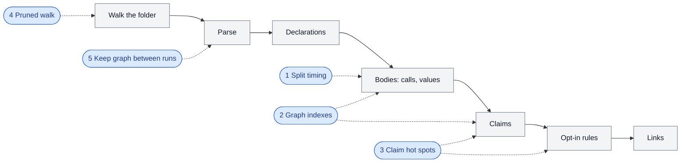

# Drift engine: cut the time a Software Factory run spends in it

## Context

On a clean copy of ClientB's codebase the drift engine is about 95% of every Software Factory run: 30–89 s a pass, most of it in `code csharp` (reading 920 C# files). Your figures check out against the SF logs. Three more facts from the logs and the code change what to do first:

- **The cost per file grows with the codebase.** ClientA read 298 files at about 14 ms a file (CONTEXT.md, run timings decision). ClientB reads 920 files at 32 ms a file on a quiet machine (29.8 s at 13:28, with 0 claims). Parsing doesn't grow like that; name lookups that scan the whole graph do.
- **Every name lookup scans the whole graph.** `CodeGraph.Resolve` (`CodeGraph.cs:1098`) scans every type (`:1101`) and every file (`:1102`), then for each of the type's files `ImportsOf` (`:867`) scans every file again for its project's global usings. `TypeNamed` (`:1096`) scans every type again. There is no index by name, qualified name, path or project. The C# body pass calls `Resolve` for every call and value it types (`CSharpBody` → `Targets` / `TypeFor`), so this is most likely where the 30 s goes. The same scans are the claims' cost: repository.implementation runs `Bases()` of every type, for each repository (`DriftEngine.Repositories.cs:69`), and `Bases` calls `Resolve` for every base reference, with nothing memoised.
- **Two of the seven passes repeated the one before, unchanged.** 13:47 repeated 13:46 (84 s), and 14:22 repeated 14:20 (62 s): same claim counts, same outcomes. A save restarted the run after it had staged, and no code had changed.

So I'd change your order in one place: **index the graph first.** It shrinks the read and the claims on every run, the first one included. Then the cache between runs makes the unchanged reruns close to free.

Cancellation (step 6) applies to every stage.

## Approach

This is engine code only: `Intent.Modules.Common.DriftEngine.Core` and `.Stacks`, plus the module's spec and docs. No designer changes. Every step keeps results identical, so the acceptance suite is the correctness proof after each one. Step 1 is a gate: if parsing turns out to be the cost and not the body pass, I stop and tell you before step 2.

`Intent.Common.DriftEngine` is at 1.0.0-pre.0, in flight and unpublished, so the version stays, and so do the public API changes below (`CodeGraph.Types` and `Files`, `ILanguage.Read`).

## Steps

1. **Split the read's timing (gate).**
   - The timing line gets `code files` (the walk and the scope decisions) and, for C#, `parse`, `declarations`, `bodies`, `top-level` and `nullability`.
   - Readers live in Stacks and can't call the engine's `Timed`, so `CodeGraph` gets a timing sink that the engine appends to its line (`DriftEngine.cs:186`, `DriftEngineReport.cs:117`).
   - Measure locally with `RealStructureRunTests`, over the test solution's code in place, with an empty model: the read doesn't depend on the model. Nothing about the client's code is committed.

2. **Index the code graph** (`Code/CodeGraph.cs`).
   - Indexes: types by name, types by qualified name, files by path, and each project's global imports. Each is built on its first lookup and dropped when `Types` or `Files` change.
   - `Types` and `Files` become a list type that records changes (based on `Collection`, with `AddRange` for the Protobuf reader). No caller uses a `List`-only method; I checked.
   - `Resolve`, `TypeNamed`, `ImportsOf` and `MarkupOf` use the indexes. The candidate order stays the same, so ties resolve as they do now.
   - Memoise `Bases` and `Supertypes` per type, dropped with the indexes.
   - Add `ImplementationsOf(type)`, built once from `Bases`. Use it in repository.implementation (`Repositories.cs:69`) and in `Counterparts` (`DriftEngine.cs:1158`), and in place of the Messaging extension's own copy (`Stacks/Messaging/MessagingExtension.cs:808-820`).

3. **Fix the claims' and opt-in rules' hot spots** (Core).
   - **repository.implementation:**
     - the contract is looked up by name, with its `I` name worked out once per language, not by a regex per type (`Repositories.cs:60-62`);
     - the run-time scan compares a type argument's name with the contract's before it resolves it (`:99-102`).
   - **type.exists:** each language's name is worked out once per claim and used, not recomputed per type (`DriftEngine.cs:1174`, `:1182`, `:1203-1205`).
   - **`LanguageOf`:** memoised by path (`DriftEngine.cs:375`). It is called per type and per file almost everywhere.
   - **Opt-in:** a reverse index from type to claim replaces `ElementOf`'s scan (`DriftEngine.OptIn.cs:96-97`).
   - **Links:** `DriftEngine.Links.cs:92`'s `whole.Where(!links.Any(...))` becomes a set lookup.

4. **Skip excluded folders while walking** (`DriftEngine.cs:303`, `Scope/ScopeModel.cs`).
   - Replace `Directory.EnumerateFiles(..., AllDirectories)` with a walk that never enters an excluded folder, as the old Drift module's `CodeFiles.AllFiles` did (`Intent.Modules.Common.Drift/Engine/CodeIndex.cs:157-197`). Excluded folders are the built-in ones, hidden folders, and Intent's own (a folder holding an `.isln`, an `.application.config` or `Intent.Metadata`).
   - Add NuGet's packages folder to the built-ins, recognised by what it holds: a child folder with a `.nupkg` in it, which is the `packages/Id.Version/Id.Version.nupkg` layout.
   - The coverage listing counts built-in exclusions in folders, not files, since their files are no longer listed. That changes R15, `scope.md`, the run-result schema's `builtin` description and the scope coverage cases.
   - Docs: `docs/README.md:21`, `scope.md:42` and R22 gain the packages folder.

5. **Keep the code graph between runs, in the SF process.**
   - **The process outlives a run.** Process 22240 loaded the module assemblies once, at 13:22, and ran every pass until 14:33 through hot restarts. `TypeScriptWorker.cs` already relies on this.
   - **What's kept:** after a complete read, everything the read produced: the graph, the file decisions, the excluded types, reader failures and what the extension readers stored. It is held in a static keyed by the output folder, one entry per folder, and replaced on each read.
   - **When it's reused:** when nothing it depends on has changed. That means every walked file's path, size and last-write time; the scope rows; and the languages and extensions, with their assembly versions. Otherwise the code is read afresh. The timing line says `code cached` on a reuse.
   - **Audit before reuse:** claim evaluation must never write model-derived state onto the graph. The Stacks caches kept with `code.Set` (`ImplementationsOf`, `HandlerIndexes`, `MemberTypes`, `RouteRecords`, Wolverine's `Handlers`) must each depend on code only, or be cleared per run.

6. **Cancellation checkpoints.**
   - `DriftInput` carries a `CancellationToken`. The engine checks it per file in each language's read loops (`ILanguage.Read` takes the token), per claim, per opt-in rule and before links. A cancelled read is never kept for the next run.
   - Until Intent Architect hands extensions the run's token, `DriftEngineReport` passes `CancellationToken.None`. The SDK change is left for another time (user decision).

<Callout id="graph-reuse-not-per-file" tone="warning" title="The cache is the whole graph, not per file">

A per-file cache keyed by hash looks cheaper, but one file's read depends on the others. The body pass resolves names across files, so a change to one file can change another file's calls. The graph's nodes also hold lazy closures over Roslyn syntax, so it can't be written to disk without first being made plain data. So the reuse is all or nothing, in memory: any change on disk means a fresh read, which step 2 makes faster. A cache on disk, one that would survive a module reinstall, is deferred.

</Callout>

<Callout id="graph-memory" tone="warning" title="Memory held between runs">

Between runs the SF process keeps one graph per application, Roslyn trees included. That's the memory a run already peaks at, kept instead of freed. I'll measure the process's working set on the test solution with and without the cache, and report it.

</Callout>

<Callout id="nuget-folder-by-content" tone="warning" title="packages is skipped by what it holds, not by name">

`packages/` is also where JavaScript and TypeScript monorepos keep their source, and the TypeScript, Vue and React readers read it there. Excluding the name would silently drop that code. So only a folder whose child folders hold a `.nupkg` is skipped.

</Callout>

<Callout id="cancellation-evidence" tone="warning" title="Cancellation needs an SDK change, and cost nothing in this session">

- **No token reaches the engine.** The SF host cancels its run's token, but checks it only between factory extensions (`FactoryExtensionHelper.cs:17`, in the Intent repo). `TaskTracker`, which carries it, is internal to `Intent.SoftwareFactory`, and the SDK gives extensions no token. So a save during a pass waits for the pass to end, and the engine-side checkpoints only take effect once the SDK exposes the token, for example on `ISoftwareFactoryExecutionContext`.
- **It cost nothing in this session.** All 13 restarts came while the run was idle in Staging Changes, and each cancelled in 3–1,851 ms. None landed during a pass.

That's why this step comes last: steps 2 to 5 shrink the window it covers.

</Callout>

**Deferred:**
- parsing in parallel, only if step 1 shows parsing matters;
- a cache on disk;
- unmodelled.value's second evaluation of every unset probe (`DriftEngine.OptIn.cs:123-196`), unless opt-in is still seconds after step 3.

## Critical files

- `Modules/Intent.Modules.Common.DriftEngine.Core/Code/CodeGraph.cs`: indexes, memos, `ImplementationsOf`, change tracking on `Types` and `Files`
- `Modules/Intent.Modules.Common.DriftEngine.Core/DriftEngine.cs`: walk, `LanguageOf` memo, type.exists names, timings, graph reuse, checkpoints
- `Modules/Intent.Modules.Common.DriftEngine.Core/DriftEngine.Repositories.cs`, `DriftEngine.OptIn.cs`, `DriftEngine.Links.cs`: hot spots
- `Modules/Intent.Modules.Common.DriftEngine.Core/Scope/ScopeModel.cs`: built-ins, the NuGet folder, folder counts
- `Modules/Intent.Modules.Common.DriftEngine.Core/Extensions/IDriftExtension.cs`: `ILanguage.Read` takes the token
- `Modules/Intent.Modules.Common.DriftEngine.Stacks/CSharp/CSharpReader.cs`: phase timings, checkpoints; Java, TypeScript and Protobuf readers take the token
- `Modules/Intent.Modules.Common.DriftEngine.Stacks/Messaging/MessagingExtension.cs`: uses the graph's `ImplementationsOf`
- `Modules/Intent.Modules.Common.DriftEngine/Reporting/DriftEngineReport.cs`: the timing line
- Docs: `docs/spec/requirements.md` (R15, R22), `docs/spec/scope.md`, `docs/spec/schemas/run-result.schema.json`, `docs/README.md`, and `CONTEXT.md`. CONTEXT.md gets four decisions: the indexes and when they're dropped; the graph cache's key and its memory cost; the NuGet folder recognised by content, with the rejected by-name alternative; and cancellation's dependency on the SDK. There's no release-notes line for speed, since 1.0.0 hasn't shipped.

## Verification

- **Acceptance suite (1,295 passing, 22 skipped today):** green after each step. Identical results are the proof that the indexes resolve exactly what the scans did.
- **New cases:**
  - Scope coverage counts built-in folders.
  - A NuGet packages folder is skipped, while a `packages/` folder of TypeScript source is read.
  - Two runs over unchanged code give identical results, the second one cached.
  - A touched file or a changed scope row means a fresh read.
  - A cancelled token stops the read, and nothing is kept.
- **Timings, before and after:**
  - The local harness over the test solution's code, after steps 1, 2 and 3.
  - Your next SF run on the ClientB copy: its timing line shows the read, repository.implementation and opt-in, and the second run over unchanged code shows `code cached`.
- **Every module build or test reinstalls the `.imod` into the open solutions and reruns their SF.** I'll tell you each time I do one.

## Open questions resolved

- **Q:** Should NuGet's `packages` folder be added by name? **A (user):** No: by what it holds.
- **Q:** Should the SDK change that exposes the run's token be made here? **A (user):** No. Add the engine's cancellation-token support now, and leave the Intent Architect SDK alone; that's done another time.
