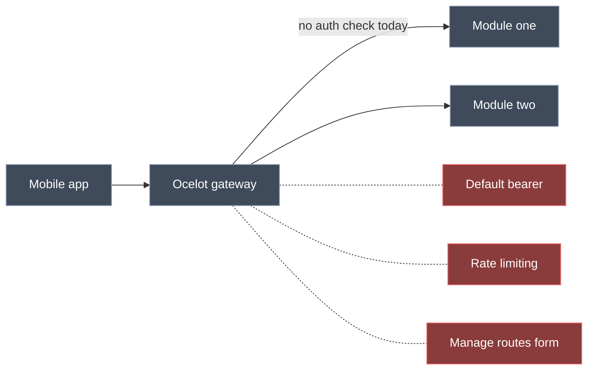

# Ocelot gateway: prove the patterns before the SDD change

Ticket: [Mukon API Gateway module enhancements](https://intent-architect.monday.com/boards/2883919780/pulses/13037817699). Source: the 2026-10-05 Ocelot security call with the client, and the ticket notes (validation on CQRS without an HTTP stereotype, a management interface, bulk expose/secure/rate limit).

This plan does **not** change any module. It proves each code and modelling pattern the module work will need, in hand-written reference code and against the existing `OcelotTest` app. The SDD change is written once every pattern has passed or been dropped.

## Goals (agreed 2026-11-18)

| # | Goal | Status |
| - | ---- | ------ |
| G1 | **Manage gateway routes in Intent.** One "Manage gateway routes" form listing the HTTP endpoints of the referenced services: tick to add a route, untick to remove one, and optionally sync routes whose endpoint's verb or route changed. Security and rate limits are not on it. | In scope (P5). Mock: [[2026-11-18-ocelot-bulk-expose-mockups]] |
| G2 | **Only HTTP-exposed endpoints can be route targets.** This is a bug in the modeler module `Intent.Metadata.ApiGateway`. | In scope, fix in `C:\Dev\Intent.Modules` (P4) |
| G3 | **Secure by default.** Generated routes carry bearer authentication; a developer can change it in `ocelot.json` when needed. | In scope (P1, P2) |
| G4 | **Hand edits to `ocelot.json` survive regeneration.** | Stretch: find out what is possible (P6) |
| G5 | **Per-route rate limiting.** | In scope (P3) |
| G6 | Audit dashboard | Dropped |
| G7 | Reload picks up new downstream endpoints | Not reproduced (see below) |
| G8 | Aggregates | Deferred until the client needs one |

<Callout id="g7" tone="info" title="G7: the reload did not reproduce">

In the running Intent on this branch I added an HTTP operation to `Standard.AspNetCore.TestApplication`'s Services designer and saved it. `OcelotTest`'s Services designer saw it straight away through its package reference: 32 HTTP endpoints before, 33 after, with no reload needed. I then removed the operation, and `git status` is clean. So the client's case is probably different, for example the downstream app in another solution, the designer not reopened, or an expectation that routes appear by themselves. Next step: ask the client for exact steps. No fix until it reproduces.

</Callout>

## Where things stand today

- <FileRef path="Modules/Intent.Modules.ApiGateway.Ocelot/Templates/OcelotJson/OcelotJsonTemplatePartial.cs" /> writes `Routes` with the upstream and downstream path, the verb, and a `{Package}` host placeholder. Nothing else: no `AuthenticationOptions`, no `RateLimitOptions`, no `GlobalConfiguration`. The file is fully regenerated.
- `Intent.Security.JWT` registers the JWT bearer scheme on the gateway host, but no route references it, so every route proxies **unauthenticated** today.
- The route model (Api Gateway Route, Route Association) is in `Intent.Metadata.ApiGateway` 1.0.0-beta.6. The Route Association accepts any Command, Query or operation, HTTP-exposed or not (G2).
- The Ocelot module has no `CONTEXT.md`.

*Grey: exists today. Red: missing.*

## Repos and branches

| Repo | Branch / worktree | Holds |
| ---- | ----------------- | ----- |
| `Intent.Modules.NET` | `agent/ocelot-improvements` (this worktree) | `Intent.ApiGateway.Ocelot`, `OcelotTest`, the reference solution |
| `Intent.Modules` | `agent/ocelot-improvements`, worktree `~/.worktrees/Intent.Modules/agent/ocelot-improvements`, created from `development` | `Intent.Metadata.ApiGateway`: the G2 bug fix and any route metadata or bulk-expose menu G1 needs |

## The patterns to prove

### Runtime patterns (hand-written reference solution)

A small hand-written .NET solution, not generated by Intent, containing:

- an Ocelot gateway on the version the module installs (25.0.2);
- two minimal-API downstream services;
- an xUnit project that starts all three in-process and drives them with real JWTs signed by a test key.

Every check below is an automated test.

| # | Pattern | Pass when | Decides |
| - | ------- | --------- | ------- |
| P1 | Route with `AuthenticationOptions.AuthenticationProviderKeys` set to the host's bearer scheme | **No token:** 401 at the gateway, downstream not called. **Valid token:** 200, and the downstream receives the same `Authorization` header. **Expired or wrong-audience token:** 401. | The exact JSON the template emits, and that the key matches the scheme name `Intent.Security.JWT` registers |
| P2 | Default-secure, editable per route | Removing a route's `AuthenticationOptions` by hand makes that route anonymous (200 without a token); every other route stays protected. Also check whether Ocelot 25 has a global authentication default with a per-route opt-out. | Emit auth on every route (visible and editable in the file) or rely on a global default. Recommendation going in: on every route, because that is what G3 means by "can be altered in the json". |
| P3 | Per-route `RateLimitOptions`, plus `GlobalConfiguration.RateLimitOptions` for the response | Request N+1 inside the period returns 429 with the configured message. Other routes are unaffected, and a whitelisted client is not limited. Record which options Ocelot 25 honours globally and which per route. | The rate-limit metadata shape (period, limit, wait, whitelist) and what goes global |

<Callout id="ocelot-version" tone="warning" title="Ocelot's options changed across versions">

Ocelot reshaped its authentication and rate-limit options between versions 23 and 25, and the client described the fields from memory. The reference pins the version the module installs and records the field names that actually work. Nothing in the module is shaped from docs or memory alone.

</Callout>

### Intent patterns (against `OcelotTest`, no module changes)

| # | Pattern | How it is proven | Pass when | Decides |
| - | ------- | ---------------- | --------- | ------- |
| P4 | G2: only HTTP-exposed endpoints can be route targets | Reproduce first: link a route in `OcelotTest` to a command with no HTTP Settings and show that it is accepted and what the Ocelot output does with it. Then prototype the fix as an association or validation rule. | A non-HTTP target is refused, or flagged with a clear validation error | The fix in `Intent.Metadata.ApiGateway` (association target filter, a validation, or both) |
| P5 | G1: the "Manage gateway routes" form | Run the form as a designer script against `OcelotTest`. Prove that a script-created Route Association fires the modeler's on-changed macro (name, verb, route, body filled in as when drawn by hand), that Find can filter the `tree-view` while it is open, and that a 200+ node tree stays usable. | Apply adds, removes and syncs exactly the ticked changes, and the new routes match hand-drawn ones; Find works or the fallback (Find on a first page) is chosen | The context-menu script the modeler ships |
| P6 | G4 (stretch): hand edits to `ocelot.json` survive | In `OcelotTest`, hand-add a key on a route, a `GlobalConfiguration` section and a hand-written route; remove one route's auth. Rerun the Software Factory and read the diff. | We know exactly what survives today, and whether a mechanism exists (JSON merge ownership, or a managed/unmanaged split) that keeps hand edits | Whether G4 ships now, later, or needs Intent changes outside these repos |

## Proposed metadata (to be confirmed by P2, P3 and P5)

<ModelChanges id="proposed" caption="Draft only; the proof decides the final shape" changes={[
  { element: "Api Gateway Route", designer: "Services", change: "modified", note: "Gains security and rate-limit settings",
    fields: [
      { label: "Secured / Unsecured", after: "reuse Intent.Metadata.Security stereotypes, as controllers do" },
      { label: "Rate Limit", after: "Period, Limit, Wait, Client Whitelist" } ] },
  { element: "Ocelot module settings", designer: "Settings", change: "added",
    fields: [
      { label: "Default route security", after: "Secured by default, mirrors Default API Security" },
      { label: "Authentication provider key", after: "defaults to the registered bearer scheme" } ] },
  { element: "Route Association", designer: "Services", change: "modified", note: "G2 fix",
    fields: [ { label: "Targets", before: "any Command, Query or Operation", after: "only ones with Http Settings" } ] },
]} />

Reusing `Secured` / `Unsecured` and a default-security setting mirrors how ASP.NET Core Controllers already work.

<Callout id="rate-limit-home" tone="decision" title="Where the rate-limit settings live">

Ocelot-specific options, rate limits in particular, could sit in the Ocelot module instead of `Intent.Metadata.ApiGateway`, so that a future YARP module is not forced into Ocelot's shape. P3 and P5 settle this. Security stays in the modeler because it is gateway-neutral.

</Callout>

## Order of work

1. P4: reproduce the G2 bug in `OcelotTest` (show it failing before any fix).
2. Build the reference solution and prove P1, P2 and P3 (all tests green).
3. P5: the manage-routes script against `OcelotTest`.
4. P6 stretch: the edit-survival check.
5. Write up the results here (pass, fail or decision per pattern). You review them before the SDD change.
6. `/sdd-run` the change from the proven patterns, across both repos.

Evidence for each run goes in `C:\Dev\.evidence\Intent.Modules.NET\agent\ocelot-improvements\`.

<Callout id="out" tone="warning" title="Out of scope">

The audit dashboard (dropped), aggregates (deferred), claims or role checks at the gateway (`RouteClaimsRequirement`), header transformation, token exchange and CORS. Beyond these drops and deferrals, none of the excluded items came up as a need; the client only passes a bearer token through.

</Callout>

<QuestionForm
  id="open-questions-2"
  questions={[
    {
      id: "ref-location", title: "Where should the hand-written reference solution live?", mode: "single",
      options: [
        { id: "tests", label: "Tests/OcelotReference in this branch", recommended: true, detail: "Reviewable in the PR, can be deleted before merge" },
        { id: "scratch", label: "Outside the repo (C:\\Dev\\scratch)", detail: "Keeps the branch clean, but nobody else can review it" },
      ],
    },
    {
      id: "checkpoints", title: "Stop for your review after each pattern, or run P1 to P6 and report once?", mode: "single",
      options: [
        { id: "once", label: "Run all, report once", recommended: true },
        { id: "each", label: "Stop after each pattern" },
      ],
    },
  ]}
/>
