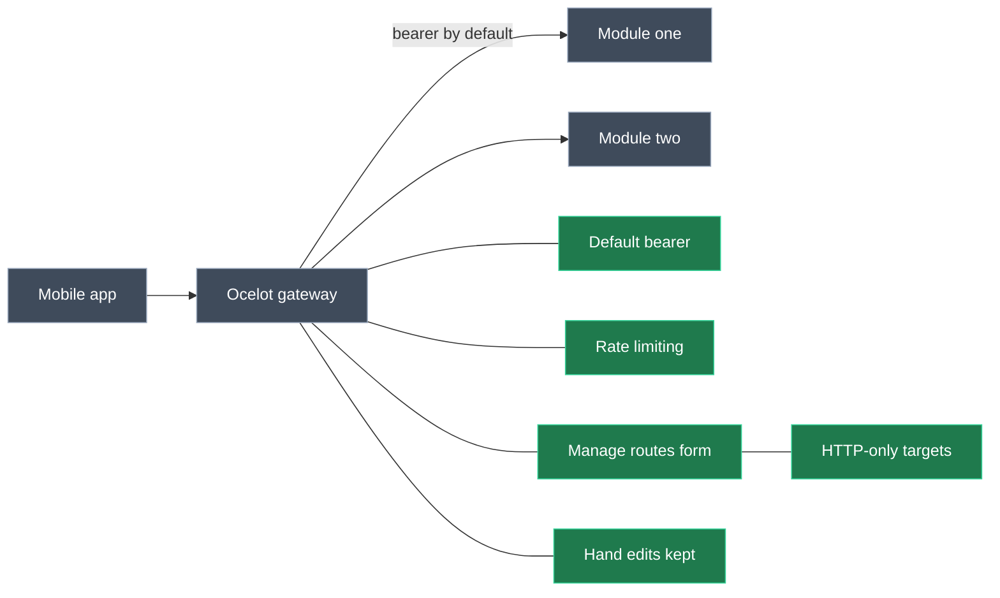
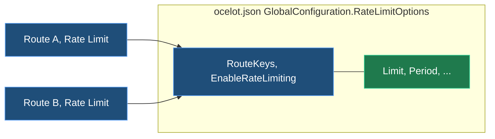

# Ocelot gateway: prove the patterns, then build them

Ticket: [Mukon API Gateway module enhancements](https://intent-architect.monday.com/boards/2883919780/pulses/13037817699). Source: the 2026-10-05 Ocelot security call with the client, and the ticket notes (validation on CQRS without an HTTP stereotype, a management interface, bulk expose/secure/rate limit).

This plan started as proof only: prove each code and modelling pattern before any module changed. The patterns have since been proven (by a spike host and probes, see Order of work), and the work is built into the modules on this branch. This document now records what shipped, what was decided, and what is still open. Updated 2026-11-24.

## Goals (agreed 2026-11-18)

| # | Goal | Status |
| - | ---- | ------ |
| G1 | **Manage gateway routes in Intent.** One "Manage gateway routes" form listing the HTTP endpoints of the referenced services: tick to add a route, untick to remove one, and optionally sync routes whose endpoint's verb or route changed. Security and rate limits are not on it. | **Done:** `Intent.Metadata.ApiGateway` 1.0.0-pre.0, **Manage Gateway Routes...** on the Services package. Mock: [[2026-11-18-ocelot-bulk-expose-mockups]] |
| G2 | **Only HTTP-exposed endpoints can be route targets.** This is a bug in the modeler module `Intent.Metadata.ApiGateway`. | **Done:** `Intent.Metadata.ApiGateway` 1.0.0-pre.0 flags a non-HTTP target with a validation error on the Route Association; Ocelot 1.2.0-pre.0 fails with an error on the route instead of crashing. See G2 result. |
| G3 | **Secure by default.** Generated routes carry bearer authentication; exclusions are made in the model. | **Done:** Ocelot 1.2.0-pre.0 with `Intent.Metadata.Security` 1.1.7-pre.0. Runtime-verified. |
| G4 | **Hand edits to `ocelot.json` survive regeneration.** | **Done:** Ocelot 1.2.0-pre.0. The template merges `ocelot.json` itself (no JSON weaver), matching routes on upstream path and verb. |
| G5 | **Per-route rate limiting.** | **Done:** Ocelot 1.2.0-pre.0, `Rate Limit` stereotype. Runtime-verified. |
| G6 | Audit dashboard | Dropped |
| G7 | Reload picks up new downstream endpoints | Not reproduced; needs the client's steps |
| G8 | Aggregates | Deferred until the client needs one. Each route now has a `Key`, so `RouteKeys` can reference it. |

<Callout id="g7" tone="info" title="G7: the reload did not reproduce">

In the running Intent on this branch I added an HTTP operation to `Standard.AspNetCore.TestApplication`'s Services designer and saved it. `OcelotTest`'s Services designer saw it straight away through its package reference: 32 HTTP endpoints before, 33 after, with no reload needed. I then removed the operation, and `git status` is clean. So the client's case is probably different, for example the downstream app in another solution, the designer not reopened, or an expectation that routes appear by themselves. Next step: ask the client for exact steps. No fix until it reproduces.

</Callout>

## Where things stand now

- <FileRef path="Modules/Intent.Modules.ApiGateway.Ocelot/Templates/OcelotJson/OcelotJsonTemplatePartial.cs" /> writes each route's paths, verb, host placeholder and `Key`, plus `AuthenticationOptions` and `Priority` from the model. It always writes `GlobalConfiguration`, and writes the shared `RateLimitOptions` rule there while any route is marked: `RouteKeys` from the model, and starting values only where missing.
- <FileRef path="Modules/Intent.Modules.ApiGateway.Ocelot/Templates/OcelotJson/OcelotJsonMerger.cs" /> merges that output into the `ocelot.json` on disk, so hand-added keys, routes marked `// IntentIgnore` and comments survive. No JSON weaver module is needed; the rules are in `CONTEXT.md`.
- Every route is secured by one global `Bearer` setting. `Unsecured` on a route writes `"AllowAnonymous": true` on it; `Unsecured` on the package drops authentication entirely.
- The route model (Api Gateway Route, Route Association) is in `Intent.Metadata.ApiGateway`, which now ships the Manage Gateway Routes form. A Route Association to an endpoint without Http Settings is flagged with a validation error (G2).
- The Ocelot module has a <FileRef path="Modules/Intent.Modules.ApiGateway.Ocelot/CONTEXT.md" label="CONTEXT.md" /> recording these decisions.

*Green: built and verified.*

## Repos, branches and module versions

| Repo | Branch / worktree | Holds |
| ---- | ----------------- | ----- |
| `Intent.Modules.NET` | `agent/ocelot-improvements`, worktree `D:\Worktrees\Intent.Modules.NET\agent\ocelot-improvements` | `Intent.ApiGateway.Ocelot`, `OcelotTest` |
| `Intent.Modules` | `agent/ocelot-improvements`, worktree `D:\Worktrees\Intent.Modules\agent\ocelot-improvements`, created from `development` | `Intent.Metadata.ApiGateway` (G1, G2), `Intent.Metadata.Security` (route-level `Secured` / `Unsecured`) |

| Module | Last published | On this branch | Why |
| ------ | -------------- | -------------- | --- |
| `Intent.ApiGateway.Ocelot` | 1.1.0 | 1.2.0-pre.0 (see pending decisions) | G3, G4, G5 |
| `Intent.Metadata.ApiGateway` | | 1.0.0-pre.0 | G1 |
| `Intent.Metadata.Security` | 1.1.6 | 1.1.7-pre.0 | `Secured` / `Unsecured` target Api Gateway Route. Ocelot's `.imodspec` now requires it. |

The demo used for runtime checks is outside the repos: `D:\Workspace\OcelotGatewayDemo` (Gateway, Customers and Orders apps) and the probe host in `D:\Workspace\gateway-security`.

## Pending decisions and open items

<Callout id="version" tone="decision" title="Ocelot version: 1.2.0">

Decided 2026-11-24 (your call): Ocelot stays at **1.2.0-pre.0**, not 2.0.0. Secured by default does change what an existing gateway does on upgrade (with no `Bearer` scheme it stops starting; with one, every previously open route needs a token), so the release notes say so plainly.

</Callout>

| # | Open item | Who |
| - | --------- | --- |
| O1 | Done 2026-11-24: Ocelot stays 1.2.0-pre.0. | — |
| O2 | `Intent.Metadata.Security`'s Software Factory stages `Api/ApiGatewayRouteModelStereotypeExtensions.cs` on every run. It must not be applied (Security has no NuGet reference to the ApiGateway API). Mark it ignored in the Software Factory window, as `Intent.Metadata.WebApi` has it. There is no agent tool to ignore a file. | You |
| O3 | Done 2026-11-24: G2 (see G2 result). | — |
| O4 | G7: get the client's exact reload steps. | You, with the client |
| O5 | Done 2026-11-24: the `Rate Limit` icon shows beside the route in the designer, and the route's label shows the rate limit and `[AllowAnonymous]`. Since the marker redesign the label reads "Rate Limited". | — |
| O6 | Commits in both worktrees, then PRs. Not merged until you say so. | Me, when asked |

## The patterns that were proven

### Runtime patterns

The plan called for a hand-written xUnit reference solution. The proof was done with a spike instead: an Ocelot 25.0.2 probe host with a `Bearer` scheme and a test token (`D:\Workspace\gateway-security\probe`), in front of the generated Customers API, driven by curl call matrices. Both work the same way at runtime; the spike was faster and lives outside the repos, so nothing needs deleting before merge.

| # | Pattern | Result |
| - | ------- | ------ |
| P1 | Route authentication with a bearer scheme | **Pass.** No token or a bad token: 401. Valid token: reaches the downstream. |
| P2 | Default-secure, editable per route | **Pass, with a changed shape.** One global `AuthenticationProviderKeys` plus `"AllowAnonymous": true` per excluded route (D3), because it fails closed. Hand-removing auth in the file is reverted on regeneration, so exclusions are made in the model. |
| P3 | Per-route `RateLimitOptions` | **Pass.** 429 over the limit, a counter per `Oc-Client`, whitelisted client never limited, other routes unaffected. |

<Callout id="ocelot-version" tone="warning" title="Ocelot's options changed across versions">

Ocelot reshaped its authentication and rate-limit options between versions 23 and 25, and the client described the fields from memory. Every field the module writes was run on 25.0.2, the version the module installs, not taken from docs.

</Callout>

### Intent patterns

| # | Pattern | Result |
| - | ------- | ------ |
| P4 | G2: only HTTP-exposed endpoints can be route targets | **Reproduced, then fixed.** See G2 result. |
| P5 | G1: the "Manage gateway routes" form | **Pass, shipped** in `Intent.Metadata.ApiGateway` 1.0.0-pre.0. |
| P6 | G4: hand edits to `ocelot.json` survive | **Pass, shipped** in Ocelot 1.2.0-pre.0: first through the JSON weaver, then through the template's own merge (your call, 2026-11-24), with routes matched on `UpstreamPathTemplate` + `DownstreamHttpMethod`. |

## Shipped model changes

<ModelChanges id="shipped" caption="What the modules now model" changes={[
  { element: "Secured / Unsecured", designer: "Services", change: "modified", note: "Intent.Metadata.Security 1.1.7-pre.0",
    fields: [ { label: "Targets", before: "Service, Operation, Command, Query, Services Package", after: "also Api Gateway Route" } ] },
  { element: "Rate Limit", designer: "Services", change: "added", note: "Marker stereotype in Intent.ApiGateway.Ocelot, Api Gateway Route only. No properties: the values live in ocelot.json's shared rule",
    fields: [ { label: "Properties", before: "Limit, Period, Wait, Client Whitelist (first cut)", after: "none" },
              { label: "Label", after: "Rate Limited" } ] },
  { element: "Manage Gateway Routes...", designer: "Services", change: "added", note: "Intent.Metadata.ApiGateway 1.0.0-pre.0, on the Services package" },
  { element: "Route Association", designer: "Services", change: "modified", note: "G2 fix, Intent.Metadata.ApiGateway 1.0.0-pre.0",
    fields: [ { label: "Targets", before: "any Command, Query or Operation, accepted silently", after: "a target without Http Settings is a validation error" } ] },
]} />

No Ocelot module settings were added: the draft "Default route security" and "Authentication provider key" settings were replaced by D1 and D4 below.

<Callout id="rate-limit-home" tone="decision" title="Where the rate-limit settings live">

Decided 2026-11-24: the stereotype is in the Ocelot module, not `Intent.Metadata.ApiGateway`, because the shared rule and the client header are Ocelot concepts that a future YARP module should not inherit. Security stays in `Intent.Metadata.Security` because it is gateway-neutral.

Revised the same day, on your call: the stereotype only marks the route, and the numbers live in one shared rule in `ocelot.json`, which the template merges itself, with no JSON weaver (see G5 below).

</Callout>

## G3 decisions (2026-11-24)

They follow the convention agreed with the client on the 2026-10-05 call: bearer on every exposed route, with an exclusion list for the few routes that must be anonymous, such as a heartbeat. The client said "I'd much rather have it reapply security than remove it".

| # | Decision | Why |
| - | -------- | --- |
| D1 | Every gateway route is **secured by default**, whatever the gateway app's Default API Security setting says. | The downstream ports are closed, so the gateway is the only protection. Default API Security defaults to unsecured and would leave a new gateway open. |
| D2 | `Unsecured` on an Api Gateway Route excludes that route. `Secured` / `Unsecured` on the gateway's Services package sets the default for all of its routes. | Reuses the Intent.Metadata.Security stereotypes, as controllers do. |
| D3 | `ocelot.json` gets one `GlobalConfiguration.AuthenticationOptions` with `AuthenticationProviderKeys: ["Bearer"]`, and `"AllowAnonymous": true` on each excluded route. | Proven on Ocelot 25.0.2. It fails closed: a route written by hand, or one missing its settings, is secured. |
| D4 | The auth settings are written whether or not Intent.Security.JWT is installed. The scheme name is fixed at `Bearer`. No settings yet. | The client registers bearer through their own authorization module, which Intent cannot see, so skipping auth when JWT is missing would leave their gateway open. Add a setting only when someone asks for different behaviour. |
| D5 | `Intent.Metadata.Security` targets Api Gateway Route through a package reference **by path** to the ApiGateway modeler (your call, 2026-11-24). | The same mechanism `Intent.Metadata.WebApi` uses for Http Settings. A module reference was tried first and pulled `Intent.Modelers.Services` 4.0.0 into the Security module. The path reference adds no `.imodspec` dependency. |

<Callout id="g3-tradeoffs" tone="warning" title="Accepted trade-offs">

- **A gateway with no `Bearer` scheme will not start.** Ocelot 25 refuses to start when a route names a scheme the host has not registered (verified 2026-11-24). Accepted: failing loudly beats running open. The module docs say a bearer scheme is required, or mark the package `Unsecured`.
- **Generated security is reasserted unless the developer opts out.** Regeneration reasserts what the template writes (first through the JSON weaver, now through the template's own merge, with the same rules): a deleted key comes back and a changed value is reverted. Exclusions are normally made in the model; the client accepted this ("reapply security rather than remove it"). A developer who needs a hand value puts `// IntentIgnore` above the key, and it is then kept as written and no longer follows the model (verified 2026-11-24, evidence `2026-11-24-ocelot-json-manual-override`). That meets the original G3 wording, "can be altered in the json", without making hand edits the default.
- **Service-to-service calls through the gateway need a token.** A generated HTTP client attaches one only when the downstream endpoint is secured, so a call through the gateway to an open endpoint gets 401. Verified 2026-11-25 (evidence `2026-11-25-service-to-service`, s21): in the demo, creating an order makes Orders call Customers' get-by-id through the gateway; with the generated `ocelot.json` the gateway answered that call 401 and the order failed with 500. With `AllowAnonymous` on that one route the order was created (201). The fix is in the model, either `Unsecured` on the route or a secured downstream endpoint (so the client sends a token); the README says so. Changing how the client sends tokens belongs to Intent.Integration.HttpClients, not Ocelot.
- **Route-level security needs `Intent.Metadata.Security` 1.1.7.** Ocelot's `.imodspec` now depends on it, so Ocelot cannot be published before Security 1.1.7 is.

</Callout>

### G3 result (2026-11-24)

All four decisions are built and verified. Evidence `2026-11-24-g3-g5-runtime`: the generated `ocelot.json`, served by an Ocelot 25 host with a `Bearer` scheme in front of the real Customers API, gave 401 with no token or a bad token, and 200/201 with a valid one. The generated Gateway app, which has no `Bearer` scheme, refuses to start, as accepted. With `Unsecured` on the package, the auth settings are removed and that gateway serves anonymously.

Evidence `2026-11-24-g3-route-unsecured`: with the package secured and `Unsecured` on the customers list route only, the list answered 200 without a token (and still 429 over its rate limit, 503 without `Oc-Client`), while get-by-id and create answered 401 without a token and reached the API with one. In `OcelotTest` the same change adds `"AllowAnonymous": true` to that one route, and a re-run is stable.

<Callout id="g3-weaver-global" tone="warning" title="Fixed during verification: hand keys in GlobalConfiguration">

When a gateway flipped to `Unsecured`, the weaver deleted the whole `GlobalConfiguration` object, including a hand-added `BaseUrl`. The template now always writes `GlobalConfiguration`, varying only what is inside it, and the same flip now keeps `BaseUrl` (re-verified with the template's own merge, M6). Cost: a fully unsecured gateway gets an empty `"GlobalConfiguration": {}`.

</Callout>

## G5 decisions (2026-11-24)

Rate limiting is modelled as a **marker stereotype on the Api Gateway Route** (your call, 2026-11-24, revised the same day). A route without the stereotype is not rate limited. The stereotype has no properties: the marked routes point at one shared, hand-configured rule.

Ocelot 25.0.2 has exactly one shared rule, `GlobalConfiguration.RateLimitOptions`, with no named rules. A route "points at" it by being listed in that rule's `RouteKeys` (evidence `2026-11-24-rate-limit-global`, s6–s15). The whole rule lives in `ocelot.json`. The template merges the file itself, with no JSON weaver (your direction, 2026-11-24: "without needing the json weaver", then "make the ocelot.json template more clever so that it does some form of weaving"), so it owns the rule's two model fields and seeds the values only when they are missing:

*Blue follows the model; green is the developer's, seeded when missing and then kept.*

| Shared rule field | Owner | Written as |
| --- | --- | --- |
| `EnableRateLimiting` | Model | `true` |
| `RouteKeys` | Model | The `Key` of every marked route |
| `Limit`, `Period` | Developer | `100`, `"1m"`, only when missing |
| `ClientIdHeader` | Developer | `"Oc-Client"`, only when missing |
| `ClientWhitelist` | Developer | `[]`, only when missing |
| `Wait` and any other field | Developer | Not written; added by hand |

The rule is written only while a route is marked: with no `RouteKeys` it would limit every route (s11).

- **Rejected: the values marked `// IntentIgnore` under the JSON weaver** (built and verified first, s15/s16). It depended on the weaver, and removing the last marker deleted the hand values with the rule.
- **Rejected after building it: a separate `ocelot.rate-limiting.json`**, written once and loaded after `ocelot.json` while a route was marked (spike `2026-11-24-rate-limit-layered`, L1–L4; verified s17/s18). It kept the values when the last route was unmarked, but you preferred one file once the template could merge `ocelot.json` itself.

- **Home: the Ocelot module.** Rejected: `Intent.Metadata.ApiGateway`, which would make the modeler Ocelot-shaped.
- **Route only, no package default.** Rejected: a package-level default like D2, which would make every route limited by accident.
- **Rejected: a bare marker on the route.** A route `RateLimitOptions` holding only `EnableRateLimiting: true` stops Ocelot starting ("Period is empty"), so the route itself gets nothing.
- **Rejected: properties on the stereotype** (the first cut: Limit, Period, Wait, Client Whitelist). Limits are tuned per environment, so they belong in the file.
- **A route needing its own limit** gets a hand-written `RateLimitOptions` on the route, which overrides the shared rule and survives regeneration.

<Callout id="g5-shared-rule-tradeoffs" tone="warning" title="Accepted trade-offs of the shared rule">

- **Unmarking the last route removes the whole rule, values included**, and re-marking seeds the starting values again (verified, M3/M4). Accepted, and documented in the README: every way of keeping the values without a marked route is worse. A rule with no `RouteKeys` limits every route (s11), a disabled one switches off hand route limits (s12), and a placeholder key is a hack.
- **One limit for all marked routes.** Ocelot 25 has one shared rule. Routes needing a different limit use a route-level rule by hand.

</Callout>

<Callout id="g5-gotchas" tone="warning" title="Known behaviour to design around">

- **A rate-limited route answers 503 to any request without the client header** ("Rate limiting client could not be identified"). Accepted: the docs tell callers to send it. The header is `Oc-Client` unless the developer changes `ClientIdHeader` in the shared rule.
- **A trailing placeholder matches the bare path.** With `/x/{id}` listed before `/x`, `GET /x` is served by the `/x/{id}` route and loses `/x`'s rate limit and its `AllowAnonymous`. The template therefore writes `"Priority": 2` on `/x` whenever a route with the same verb has `/x/{...}`. Proven: with the priority set, `/x` is limited and `/x/7` is not.

</Callout>

### G5 result (2026-11-24)

Built into Ocelot 1.2.0-pre.0 as the `Rate Limit` stereotype (Limit, Period, Wait, Client Whitelist), with a gauge icon beside the route, and verified through both the probe host and the generated Gateway app: 200, 200, then 429 for one client; a separate counter per client; the whitelisted client never limited; 503 without `Oc-Client`; `/api/customers/{id}` not limited, thanks to the generated `Priority`; the client served again once Wait has passed. Removing the stereotype removes `RateLimitOptions` from the route.

Reworked the same day into the marker plus a shared rule. In `OcelotTest` the shared rule is generated with its `// IntentIgnore` comments, and hand values (Limit 2, Period 10s, a hand-added Wait, whitelist `vip`, `ops`) survive regeneration. Marking a second route adds only its key; unmarking it removes only that key; a re-run is stable. That generated file, run on Ocelot 25.0.2 (s15), gave 200, 200, 429 per client on the marked route, a separate counter per client, `vip` never limited, 503 without `Oc-Client`, 401 without a token, and no limit on unmarked routes. In the demo Gateway app (s16), regeneration moved the first-cut route settings into the shared rule. The hand-edited values (Limit 2, Period 10s, Wait 5s, whitelist `vip`) survived a further run. In front of the real Customers API, the list route gave 200, 200, 429 per client, `vip` was never limited, calls without `Oc-Client` got 503, and the client was served again after Wait. The unmarked get-by-id route was never limited.

Reworked again the same day so the values need no JSON weaver: they moved to `ocelot.rate-limiting.json` (evidence `2026-11-24-rate-limit-separate-file`). In `OcelotTest`, regeneration creates the file with the starting values and adds the load after `ocelot.json`. Hand values in it survive regeneration. Unmarking the last route removes the rule and the load line but keeps the file untouched, and re-marking brings both back without overwriting it. That pair of files on Ocelot 25.0.2 (s17), and the demo gateway's pair in front of the real Customers API (s18), gave the same results as s15 and s16: 200, 200, 429 per client, `vip` never limited, 503 without `Oc-Client`, unmarked routes not limited, 401 without a token on a secured route.

Reworked a last time the same day, on your call, so the template merges `ocelot.json` itself and the values move back into it (evidence `2026-11-24-ocelot-json-self-merge`). `ocelot.rate-limiting.json`, its template and the second load line are gone, and so is the `Intent.Code.Weaving.Json` dependency. In `OcelotTest`, with the weaver uninstalled:

| # | Scenario | Result |
| - | -------- | ------ |
| M0 | Upgrade from the weaver-era file | Same file, plus the seeded values; the second load line removed. |
| M1 | Hand edits, then regenerate | A tampered path reverted. Route options, `//` and `/* */` comments, an `// IntentIgnore` value, `AllowedScopes`, an ignored hand route, `BaseUrl`, a top-level `Aggregates` and the hand rate-limit values kept. A tampered `EnableRateLimiting` and a bogus `RouteKeys` entry reverted; an unignored hand route removed. |
| M2 | Regenerate again | No change. |
| M3 | Route moved to the end; last route unmarked | Back in model order with its edits; the rule removed with its values, `BaseUrl` kept. |
| M4 | Route re-marked | Starting values seeded again. |
| M5 | Invalid JSON | The Software Factory stops with an error on the Services package giving the line; the file is untouched. |
| M6 | Package `Unsecured`, then back | Auth settings removed, `AllowedScopes`, `BaseUrl` and the rate-limit values kept; reverting restores them. |

The merged `OcelotTest` file on Ocelot 25.0.2 (s19), and the demo gateway's file, with its values moved by hand from the old separate file, in front of the real Customers API (s20), gave the same results as s17 and s18. Both gateway projects build.

## G2 result (2026-11-24)

Reproduced in `OcelotTest` by pointing a route at a Command with no Http Settings. Three faults showed up together. The association was accepted. Its On Changed script threw partway through, leaving the route with no verb or route; an existing route retargeted that way kept its old ones. The Software Factory then failed with a `NullReferenceException` that named no element.

Fixed in two modules:

- **`Intent.Metadata.ApiGateway` 1.0.0-pre.0.** The Route Association's Downstream End now has a validation error naming the endpoint. The shared `getMethodAndRoute` returns `NotHttp` instead of throwing, so On Changed clears the route's Http Settings and Body, and the route's display text reads "[Not an HTTP endpoint]".
- **Ocelot 1.2.0-pre.0.** The Software Factory fails with an `ElementException` on the route that names the route and the endpoint.

Pointing the route back at an HTTP endpoint restores its verb, route and body.

<Callout id="g2-flag" tone="warning" title="Flagged, not prevented">

A Route Association can still be drawn to a non-HTTP endpoint. It is flagged as an error rather than refused, for two reasons. Target Traits match element types, not applied stereotypes, so the designer cannot filter targets on Http Settings. And an endpoint can lose its Http Settings after the route already exists, which only validation catches. This is why the Ocelot template guards against it as well.

</Callout>

## Order of work

| # | Step | Status |
| - | ---- | ------ |
| 1 | P4: reproduce the G2 bug in `OcelotTest` | Done, then fixed |
| 2 | Prove P1, P2 and P3 | Done, by spike and probes rather than an xUnit reference solution |
| 3 | P5: the manage-routes form | Done, shipped |
| 4 | P6: the edit-survival check | Done, shipped |
| 5 | Write up the results here | Done (this update) |
| 6 | Build the change | Done for G1 to G5 directly on this branch, without a separate SDD change. |

The two earlier open questions were settled in practice: the reference code lives outside the repos (the spike in `D:\Workspace`), and the work ran through without a review stop after each pattern, as you asked.

Evidence for each run is in `D:\.evidence\Intent.Modules.NET\agent\ocelot-improvements\`.

<Callout id="out" tone="warning" title="Out of scope">

The audit dashboard (dropped), aggregates (deferred), claims or role checks at the gateway (`RouteClaimsRequirement`), header transformation, token exchange and CORS. Beyond these drops and deferrals, none of the excluded items came up as a need; the client only passes a bearer token through.

</Callout>
