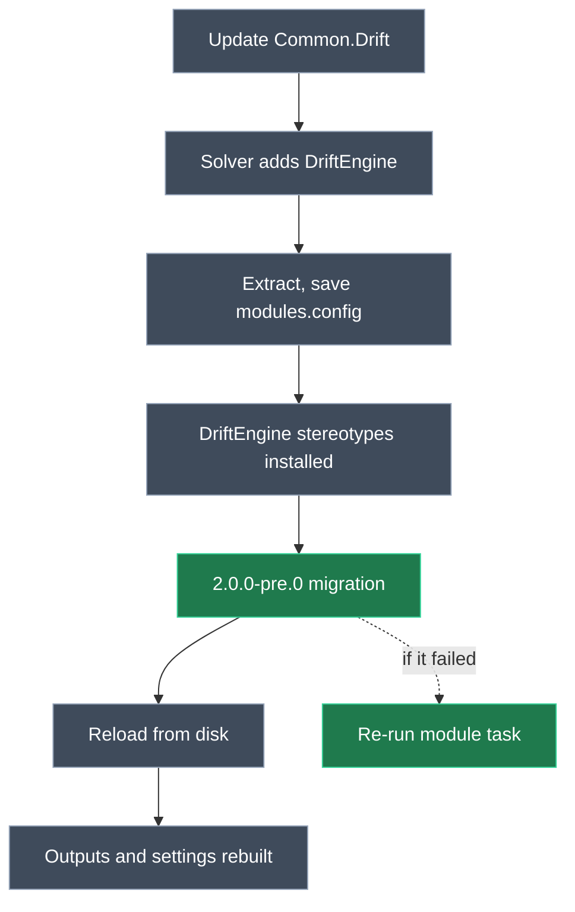

# Update Intent.Common.Drift to move an application onto the drift engine

## Context

An application set up with the v1 drift system has Intent.Common.Drift and up to three Guardrails Contracts modules (Domain, Services, UI). Those modules:

- merge generated contract code into hand-written files;
- define stereotypes that only steer that code generation;
- check drift through committed recipe files, `guardrails/<designer>.drift.json`.

Intent.Common.DriftEngine replaces all of that. Its scope and opt-in rules are modelled on the Codebase Structure Root Folder, and it generates no code. Moving an application across is currently a manual procedure, the one used on the New Engine copies: uninstall the Guardrails modules, strip their stereotypes, then back up and restore every contract file.

You want that move to be one action: **update Intent.Common.Drift, and its migration does the rest.**

### An example

This is one application, to illustrate. The change itself applies to any v1 application.

1. An application on Common.Drift 1.0.0, with Domain and Services Guardrails and a recipe file for each designer. The developer opens the Module Manager and updates Intent.Common.Drift to `2.0.0-pre.0`.
2. Intent installs Intent.Common.DriftEngine, the new dependency, then runs Common.Drift's migration. The migration:
   - strips the Intent attributes from the contract files and makes Intent forget it generated them;
   - writes the recipes' scope, conventions and exceptions as `Drift Scope` and `Drift Check` rows on the Root Folder;
   - removes the Guardrails modules, their stereotypes and their subscription links;
   - deletes the recipe files and the old baselines.
3. The developer runs the Software Factory:
   - No contract file is proposed for deletion.
   - The old AI files are proposed for deletion: sync-model, configure-drift-check, validate-drift-recipes, the reverse-engineer skills and the recipe guides.
   - Findings appear in the drift report under the engine's Areas (`Domain (DriftEngine)`, …).

### Where the modules stand

| Module                               | Published online | This branch | This plan                                |
| ------------------------------------ | ---------------- | ----------- | ---------------------------------------- |
| Intent.Common.Drift                  | 1.0.0            | 1.0.0-pre.2 | **2.0.0-pre.0**                          |
| Intent.Common.DriftEngine            | not published    | 1.0.0-pre.0 | version unchanged (in flight), docs only |
| Intent.Domain.Guardrails.Contracts   | 1.1.0            | 1.0.1-pre.1 | untouched                                |
| Intent.Services.Guardrails.Contracts | 1.1.1-pre.0      | 1.0.1-pre.1 | untouched                                |
| Intent.UI.Guardrails.Contracts       | 1.0.0            | 1.0.0-pre.1 | untouched                                |

<Callout id="version-major" tone="decision" title="Common.Drift goes to 2.0.0-pre.0, a major increment">

It is a major increment because it changes how people use the drift check: recipes and code generation are replaced by the engine. The version check passed, since nothing at or above 2.0.0-pre.0 is published. This branch's versions are behind the published ones, which were released from another branch; 2.0.0-pre.0 is above all of them.

Releasing it needs Intent.Common.DriftEngine 1.0.0-pre.0 published first, because Common.Drift 2.0.0-pre.0 depends on that exact version.

</Callout>

## Approach

Updating a module adds its new dependencies and runs its migrations; Intent's own code confirms both. Common.Drift's migration runs after DriftEngine's metadata is installed, which is what defines the `Drift Scope` and `Drift Check` stereotypes. After the migration, Intent reloads the application from disk and rebuilds module settings from the installed modules.

_Green is new in Common.Drift 2.0.0-pre.0; grey is what Intent already does on an update._

### What the migration does, in order

It edits only packages this application owns. `GetPackages()` also returns packages owned by other applications, such as shared Eventing packages, and another application there may still be on v1. Every step checks before it acts, so running it again changes nothing.

1. **Detect v1.** Carry on only if a Guardrails module is installed or a recipe file exists. Otherwise the migration only removes old baselines.
2. **Read the recipe files** for every designer that has one.
3. **Release the contract files** (below):
   - strip their Intent attributes;
   - remove their entries from all three of Intent's file records.
4. **Model edits, saved together:**
   - Write the converted rows. Skip this if any Codebase Structure package or folder of this application already has a `Drift Scope` or `Drift Check`. Otherwise the rows go on the first Codebase Structure package the application owns.
   - Delete the subscription links.
   - Remove the Guardrails stereotypes.
   - Remove the Guardrails modules.
5. **Delete** `guardrails/*.drift.json` and `.cache/guardrails/<application>/`.
6. **Log every file it rewrote and every row it wrote** to the install's output. The migration changes source files outside Change Review, so the log and `git diff` are how a developer reviews it.

<Callout id="files-before-model" tone="decision" title="Files are released before the model is changed, and a failed migration can be re-run">

If the model save fails after the files are released, the Guardrails modules are still installed. Their next run merges the attributes back and logs the files again, so nothing is deleted. In the opposite order, the modules would be gone with the log unpruned, and the next run would propose deleting every contract file.

Intent doesn't re-run a failed migration: `modules.config` is already saved at 2.0, and updating to the same version runs no migrations. So the same code is also a module task, **Migrate to Drift Engine**, as the recovery path. `Down()` changes nothing and logs a warning: going back to 1.x means reinstalling the Guardrails modules.

</Callout>

<Callout id="keep-v1-code" tone="decision" title="Common.Drift 2.0 keeps its v1 engine code">

- **Published Guardrails modules still install beside it.** Their dependency on Common.Drift is satisfied by 2.0, and they compile against its `DesignerDriftReporter`, `IDriftStructureSource`, `FactKind`, `Modellable` and `RecipeValidationTask`.
- **A migration that fails leaves v1 working** until the module task succeeds.
- **The migration reuses v1's own recipe reading**: `RecipeEngine`'s JSON options, `Glob` and `LooksLikeGlob`.

Start-up is not the reason. Intent's loader skips an assembly whose types fail to load and logs it, so removing the types wouldn't stop the migration host. A later major version removes the dead code.

</Callout>

<Callout id="uninstall-ourselves" tone="decision" title="The migration does the uninstall itself">

A migration cannot call Intent's uninstall: the module installer isn't available to it. It does what an uninstall does instead:

- removes the module entries;
- removes the installed designer packages and the `Guardrails Eventing Extension` designer settings reference;
- removes their Template Output elements.

Template Outputs are removed from every package of each designer that provides output targets. The platform's `RemoveTemplateOutputs` cleans only the first package and throws on a designer without them.

Intent's reload after migrations then drops the Guardrails settings groups. The subscription links are deleted before the module, because without its association types the Eventing packages fail to load and the Services designer can't save. That is the failure eShop10 hit.

</Callout>

<Callout id="no-uninstall-event" tone="warning" title="No ModuleUninstalledEvent is published">

A real uninstall publishes it, and it invalidates caches. The migration can't publish it. Intent's final save after migrations publishes a changed event and the designers reload, which we expect to cover it. The end-to-end checks confirm that every designer loads and saves afterwards.

</Callout>

### Recipes become model rows

| Recipe construct                                                                      | Becomes                                                                                                                           |
| ------------------------------------------------------------------------------------- | --------------------------------------------------------------------------------------------------------------------------------- |
| The code v1 checked (your decision during implementation; top-level `files` don't bound it) | One `Drift Scope` `In` row for `**` whose Reason names the recipe files. Both systems resolve globs from the output folder.   |
| A file-pattern exception (the patterns v1's `LooksLikeGlob` accepts)                  | A `Drift Scope` `Out` row, with the exception's reason                                                                            |
| An `own` entry                                                                        | An Opt-in Rules row: `optin/unmodelled.type`, its `files` (else the recipe's) as the Glob, and its `kind` as the Description       |
| Nothing in the recipe: v1 always reported unmodelled public members of modelled types | One `optin/unmodelled.member` row over `**/*.cs`, where there is a Domain or Services recipe                                      |
| A type exception                                                                      | An Exceptions row for `optin/unmodelled.type`, one row per reason                                                                 |
| A `Type.Member` exception                                                             | An Exceptions row for `optin/unmodelled.member`, one row per reason                                                               |
| An exception naming an `own` entry                                                    | That entry gets no opt-in row                                                                                                     |
| `facts`                                                                               | Nothing. The stock readers read those kinds by name                                                                               |
| `note` and comments                                                                   | Dropped. They stay in git history                                                                                                 |

<Callout id="spec-conflict" tone="decision" title="This changes the engine's spec (R55 and R56)">

R56 and `conversion.md` say the converter only proposes rows and never changes the model. You asked for the update to do the migration, so the migration applies the rows. R55 and R56 and `conversion.md` are reworded to match. `conversion.md` also still maps `own` entries to find paths; that predates the Glob-only opt-in decision of 2026-11-16, and is corrected at the same time.

</Callout>

<Callout id="conventions-widen" tone="warning" title="Converted conventions report more than v1 did">

The engine's opt-in rows take a Glob only, so an `own` entry's regular expression is dropped. `unmodelled.type` then reports every unmodelled type in that glob, not only those the regex matched, so a static helper beside the DTOs is now reported. On top of that, `conversion.md` lists 13 changes in what the engine reports for the same model and code.

Accepted: the engine decided conventions are Globs only, and the developer adds an Exceptions row for each helper on the first run.

</Callout>

<Callout id="first-run-errors" tone="warning" title="The first run after migrating may fail on drift">

If the engine finds drift, the run's errors untick every staged change, including the proposed deletion of the old AI files. The developer then either resolves the findings or applies those deletions by hand. This happens whenever a stricter check is switched on, and it is accepted.

</Callout>

<Callout id="no-recipes" tone="warning" title="Guardrails installed but no recipe files">

v1's check was off until a recipe file existed, so there is nothing to convert. The migration writes no scope rows, and the engine warns that no Drift Scope is set until someone sets one up. This matches v1's off state.

</Callout>

<Callout id="globs" tone="warning" title="Globs the engine's matcher can't take">

The engine's matcher is File Classification's: it doesn't support braces such as `{a,b}` or a leading `/`. Where v1 accepted a brace pattern, the migration expands it into one line per alternative. Anything else is written as it is, so the first run reports it as `config/glob` instead of the migration silently changing its meaning.

</Callout>

### The model cleanup

| What                                                                                                                                                                                                           | Where                                                                                                             | Identified by                                                                                                                        |
| -------------------------------------------------------------------------------------------------------------------------------------------------------------------------------------------------------------- | ----------------------------------------------------------------------------------------------------------------- | ------------------------------------------------------------------------------------------------------------------------------------ |
| Guardrails stereotypes: File Config; Type, Property, Constructor, Enum, Async, Operation, Handler Type and Service Proxy Configuration; Collection Type; Parameter Modifier; Primary Constructor; Default Value | Packages, elements, associations and association ends in this application's Domain and Services packages, Eventing included | The stereotype's definition package is one of the Guardrails modules. This holds across published versions; a test also checks the known definition ids |
| Integration Event Subscription and Integration Command Subscription links                                                                                                                                      | This application's Eventing packages in the Services designer                                                     | Their association type ids                                                                                                           |
| Module entries, installed designer packages, the designer settings reference, Template Output elements                                                                                                         | The application                                                                                                   | The three Guardrails module ids                                                                                                      |

<Callout id="links-lost" tone="warning" title="Deleting the subscription links loses which message copy maps to which">

These links tied a subscriber's copy of a message to the published one. The engine never needs them: it already counts a subscriber's copy of another application's message as that message, by name. Accepted, because no designer still installed can hold these links.

</Callout>

<Callout id="anchors-stay" tone="warning" title="Output Anchors with Guardrails.Contracts roles are left in place">

The developer or the reverse-engineer skill created these, not the module. Once the templates are gone nothing targets them, so they are harmless. Accepted: a migration shouldn't delete elements the user made.

</Callout>

### Releasing the contract files

Intent decides which files to delete from three records, and the migration edits all of them, matching the 18 contract templates (7 Domain, 11 Services) by the template id before `#` in the correlation id:

| Record                                         | Where it lives   | What the migration does                                                                                        |
| ---------------------------------------------- | ---------------- | -------------------------------------------------------------------------------------------------------------- |
| `.intent/output-log.xml`                       | Each machine     | Removes the contract entries                                                                                   |
| `<application>.application.output.log`, the legacy log | Committed  | Removes the contract entries. The Software Factory rewrites this file whenever it exists                       |
| `<application>.output.config.xml`              | Committed        | Removes any entry for a contract path. It has no correlation ids, so the migration matches by path              |

`<application>.managed-files.xml` only feeds deviation hashes, so it's left alone. The contract files drop out of it on the next run.

- **Finding the files.** The migration parses the two logs itself and skips entries that have no correlation id. `GeneratedFilesProvider` isn't used: it reads only `.intent/output-log.xml`, and it throws on such entries.
- **Stripping them.** Roslyn removes:
  - `[assembly: DefaultIntentManaged(...)]` and `[assembly: IntentTemplate(...)]`;
  - every `Intent.RoslynWeaver.Attributes` attribute on types and members (`IntentManaged`, `IntentIgnore`, `IntentIgnoreBody`, `IntentMerge`, `IntentFully`, …);
  - the `using Intent.RoslynWeaver.Attributes;` directive.

  Formatting, encoding and line endings are kept, and a file is written only if it changed. A file the log lists that is no longer on disk is skipped.

<Callout id="log-scope" tone="decision" title="Only the contract templates' entries are removed (your choice)">

Every other entry stays, so the next run proposes deleting the old skills, rule and recipe guides. Those files would otherwise stay on disk and keep pointing agents at recipe files the engine never reads.

</Callout>

### Other developers' machines

The stripped files and the two committed records reach teammates through git. Their own `.intent/output-log.xml` still lists the contract templates, and Intent reads it before any module code runs, so **a teammate's first run always proposes deleting the contract files**. The deletes are marked destructive and left unticked, and git has every file. CI and fresh clones don't have that log.

What happens after that first run depends on the open question at the bottom. The baseline is your earlier choice, pruning on each machine, and its limit has been corrected since:

<Callout id="teammates" tone="risk" title="Pruning on each machine: an agent's apply writes the entries back">

The Software Factory rewrites the log from the copy it loaded, before After Template Execution. So the extension prunes at **After Template Execution** and again at **After Commit Changes**.

- **Applied from the Changes pane, or not applied:** the next run is clean.
- **Applied through an agent** (`apply_staged_file_changes`): the agent saves the log from memory and no hook runs afterwards. The entries come back, so a teammate who works through an agent sees the deletes on every run.

The alternative is a platform hook that lets an extension forget a generated file before deletes are worked out. That would fix every case, including the first run.

</Callout>

<Callout id="on-install" tone="decision" title="An On-Install migration covers Guardrails 1.0.0 applications">

Published Guardrails 1.0.0 carried its own copy of the engine and doesn't depend on Common.Drift, so those applications have nothing to update. Installing Common.Drift 2.0.0-pre.0 runs the same migration through an On-Install migration. In an application without v1 it changes nothing, apart from DriftEngine being installed. On-Install migrations don't run on updates, so it never runs twice.

</Callout>

<Callout id="stays-installed" tone="decision" title="Common.Drift stays installed after the migration">

It carries the recovery task and the per-machine handling teammates need. Removing itself in the middle of its own update would also risk Intent's install step that runs after migrations. Once every machine has run the Software Factory, the developer can uninstall it; the release notes say so.

</Callout>

### Deliberately deferred

- Removing v1's code from Common.Drift, in a later major version.
- Retiring the published Guardrails modules. They still install and work beside Common.Drift 2.0, because its v1 code stays.
- AI guidance for the engine. No skill work happens until we've discussed it.
- R57's side-by-side comparison of the two engines. It is still done on Common.Drift 1.x before migrating.

## Model changes

<ModelChanges id="module-builder-changes" caption="Module Builder designer of the Intent.Modules.Common.Drift application (Guardrails solution)" changes={[
  { element: "Intent.Common.Drift", designer: "Module Builder", change: "modified", note: "Intent Module package",
    fields: [{ label: "Version", before: "1.0.0-pre.2", after: "2.0.0-pre.0" }] },
  { element: "Migrations", designer: "Module Builder", change: "added", note: "Module Migrations container" },
  { element: "2.0.0-pre.0", designer: "Module Builder", change: "added", note: "Version Migration, runs on an update from 1.x" },
  { element: "OnInstall", designer: "Module Builder", change: "added", note: "On-Install Migration, the same migration for Guardrails 1.0.0 applications" },
  { element: "MigrateToDriftEngine", designer: "Module Builder", change: "added", note: "Module Task, re-runs the migration if the update's run failed" },
  { element: "GuardrailsOutputLogPruner", designer: "Module Builder", change: "added", note: "Factory Extension for teammates' machines; its hooks depend on the open question" },
]} />

The `.imodspec` dependencies are added by hand, as the existing ones are:
- add `Intent.Common.DriftEngine` 1.0.0-pre.0;
- set `supportedClientVersions` to `[5.4.2-a,6.0.0)`, DriftEngine's minimum, or higher if the persistence package or the platform hook needs it.

## Code changes

<FileTree id="files" title="Files" entries={[
  { path: "Modules/Intent.Modules.Common.Drift/Migrations/Migration_02_00_00_Pre_00.cs", change: "added", note: "Scaffolded; Up() calls EngineMigration, Down() warns" },
  { path: "Modules/Intent.Modules.Common.Drift/Migrations/OnInstallMigration.cs", change: "added", note: "Scaffolded; OnInstall() calls EngineMigration" },
  { path: "Modules/Intent.Modules.Common.Drift/Tasks/MigrateToDriftEngine.cs", change: "added", note: "Scaffolded Module Task; calls EngineMigration" },
  { path: "Modules/Intent.Modules.Common.Drift/EngineMigration/EngineMigration.cs", change: "added", note: "Runs the steps in order and logs each change" },
  { path: "Modules/Intent.Modules.Common.Drift/EngineMigration/RecipeConversion.cs", change: "added", note: "Turns recipe JSON into rows; pure and tested" },
  { path: "Modules/Intent.Modules.Common.Drift/EngineMigration/GuardrailsModelCleanup.cs", change: "added", note: "Stereotypes, links, module removal, conversion rows; this application's packages only" },
  { path: "Modules/Intent.Modules.Common.Drift/EngineMigration/ContractRelease.cs", change: "added", note: "Strips Intent attributes with Roslyn" },
  { path: "Modules/Intent.Modules.Common.Drift/EngineMigration/OutputLogPruning.cs", change: "added", note: "The three file records; shared with the factory extension" },
  { path: "Modules/Intent.Modules.Common.Drift/EngineMigration/V1Footprint.cs", change: "added", note: "Module ids, contract template ids, stereotype packages, association types, DriftEngine stereotype ids" },
  { path: "Modules/Intent.Modules.Common.Drift/FactoryExtensions/GuardrailsOutputLogPruner/GuardrailsOutputLogPruner.cs", change: "added", note: "Scaffolded; body depends on the open question" },
  { path: "Modules/Intent.Modules.Common.Drift/Intent.Common.Drift.imodspec", change: "modified", note: "DriftEngine dependency, client range; version, migrations and task are generated" },
  { path: "Modules/Intent.Modules.Common.Drift/Intent.Modules.Common.Drift.csproj", change: "modified", note: "Intent.Persistence.SDK 1.0.3 and Intent.Architect.Persistence 3.7.4" },
  { path: "Modules/Intent.Modules.Guardrails.Contracts.Tests/EngineMigration/RecipeConversionTests.cs", change: "added" },
  { path: "Modules/Intent.Modules.Guardrails.Contracts.Tests/EngineMigration/ContractReleaseTests.cs", change: "added" },
  { path: "Modules/Intent.Modules.Guardrails.Contracts.Tests/EngineMigration/OutputLogPruningTests.cs", change: "added" },
  { path: "Modules/Intent.Modules.Guardrails.Contracts.Tests/EngineMigration/V1FootprintTests.cs", change: "added" },
]} />

Exact file names of the scaffolded classes come from the Software Factory. The hand-written code is the bodies of the migration, task and extension methods, plus the `EngineMigration` folder; nothing structural is hand-written.

What it reuses:
- **v1's own reading.** Recipe JSON with `//` comments is read with the options `RecipeEngine` uses, and file-pattern exceptions are classified with `Glob` and `LooksLikeGlob` (<FileRef path="Modules/Intent.Modules.Common.Drift/Engine/CodeIndex.cs" />), exactly as v1 told them apart.
- **`IApplicationConfigurationProvider`:**
  - `GetApplicationConfig().DirectoryPath` for the recipe files and file records;
  - `GetSolutionConfig().SolutionRootLocation` for the baselines.
- **Persistence patterns** from <FileRef path="Modules/Intent.Modules.VisualStudio.Projects/Migrations/Migration_04_00_00_Pre_00.cs" />: adding and removing stereotypes, and removing modules and designer settings references. From <FileRef path="Modules/Intent.Modules.Application.MediatR/Migrations/Migration_04_03_00_Pre_00.cs" />: a stereotype loop over every designer with the V1 persistence model.
- **The persistence package.** V1's `ApplicationPersistable` is used because the V2 SDK can't write item-list rows or reach links stored inside elements. `ItemList` first appears in `Intent.Architect.Persistence` 3.7.4. At run time the client's own persistence assembly is loaded, so the client minimum is what matters.
- **Roslyn at run time.** Intent.OutputManager.RoslynWeaver, already a Common.Drift dependency, supplies it, as it does for v1's engine.
- **The ids, copied as constants:**
  - the contract template ids from the Guardrails modules' `TemplateId` constants;
  - the stereotype and row definition ids from DriftEngine's generated `Api/RootFolderModelStereotypeExtensions.cs`.

  Common.Drift can't reference those assemblies, so `V1FootprintTests` checks the copies against this branch and against `origin/master`, which is the published 1.0.0 source.

## Steps

1. **Prove the persistence API before building, with a throwaway console app and no commit.** On a copy of a v1 application, with `Intent.Architect.Persistence` 3.7.4, confirm that it can:
   - write `Drift Scope` `Entries` rows;
   - remove association links stored inside elements;
   - remove a module, its installed packages and its designer settings reference;
   - remove Template Outputs from every package.

   Find which Intent Architect version ships that persistence, and set the client minimum from it. If any of these can't be done, stop and report it before step 2.
2. **Version and model.**
   - Set Common.Drift's version to 2.0.0-pre.0.
   - Add the Module Migrations container, the `2.0.0-pre.0` Version Migration, the On-Install Migration, the Module Task and the Factory Extension.
   - Run the Software Factory on the Guardrails solution to scaffold them, and fix any `NU1605` package downgrades.
   - Add the DriftEngine dependency and the client range to the `.imodspec`.
3. **`V1Footprint` and its test.** The test pins every constant to the Guardrails modules and DriftEngine, on this branch and on `origin/master`.
4. **`RecipeConversion` and its tests.**
   - Every construct in the table above, plus brace globs, a missing `files`, an exception naming an `own` entry, and a recipe file with only `//` comments.
   - Each local codebase's real recipe files, read in place and never copied into the repository: ClientA, ClientB, eShop10, 13 and 14. Each gives the rows expected.
5. **`ContractRelease` and its tests.**
   - Each contract template's real rendered output, stripped, compared with expected text.
   - Running it again changes nothing.
   - CRLF line endings and a BOM are kept.
   - A file with no Intent attributes is not rewritten.
6. **`OutputLogPruning` and its tests.**
   - All three records, in the formats of the platform's `OutputLogPersistable`, `LegacyOutputLogPersistable` and `OutputConfigPersistable` in `D:\Dev\Intent`.
   - Only contract entries are removed, entries without a correlation id are kept, and a missing record is fine.
7. **`GuardrailsModelCleanup` and `EngineMigration`.**
   - Use the order in **What the migration does, in order**, on this application's packages only, logging every change.
   - The constructors take only injected services, because a migration constructor that throws stops every migration in the application.
   - `Down()` changes nothing and logs a warning.
8. **The Module Task.** It calls `EngineMigration`, and is the recovery path for a failed update.
9. **Teammates' machines**, as the open question decides:
   - per-machine pruning at After Template Execution and After Commit Changes, when no Guardrails module is installed, which also deletes `.cache/guardrails/<application>/`; or
   - the platform hook: an SDK call in `D:\Dev\Intent`, which Common.Drift's extension calls at Start, raising the client minimum to that Intent release.
10. **Build and test.** Run `dotnet build --no-incremental`, then the full test project. Building reinstalls the module into any open solution that has it, so tell the user.
11. **End-to-end on copies** (Verification below).
12. **Close-out:**
    - version confirmed;
    - dependency audit against the `.imodspec`;
    - Common.Drift's release notes for 2.0.0: about three feature-level lines;
    - Common.Drift's README: a "Moving to the drift engine" section, covering what the update does, what the first run shows, what teammates see, the recovery task, and that Common.Drift can be uninstalled afterwards;
    - both modules' CONTEXT.md files: the decisions above;
    - DriftEngine's docs:
      - README: "replaces Intent.Common.Drift; update it to migrate";
      - `docs/plan.md`: phase 6;
      - `docs/spec/conversion.md`: the migration applies the rows, and conventions are Globs;
      - `docs/spec/requirements.md`: R55 and R56.

## Critical files and elements

- Module Builder designer, `Intent.Common.Drift` package: version, migrations, module task and factory extension.
- <FileRef path="Modules/Intent.Modules.Common.Drift/Intent.Common.Drift.imodspec" />: dependencies and client range.
- <FileRef path="Modules/Intent.Modules.Common.Drift/DesignerDriftReporter.cs" />: v1's public types, which stay.
- <FileRef path="Modules/Intent.Modules.Common.Drift/CONTEXT.md" /> and <FileRef path="Modules/Intent.Modules.Common.DriftEngine/CONTEXT.md" />: decisions.
- <FileRef path="Modules/Intent.Modules.Common.DriftEngine/docs/spec/conversion.md" /> and <FileRef path="Modules/Intent.Modules.Common.DriftEngine/docs/spec/requirements.md" />: the spec change.

## Verification

Every end-to-end check runs on fresh copies under a scratch folder, never on the originals. Client code stays local. Each copy is committed before the update so `git diff` shows exactly what the migration changed. Drift reports are never applied.

<Checklist id="verify" items={[
  { id: "unit", label: "Unit tests green", note: "V1Footprint, RecipeConversion, ContractRelease and OutputLogPruning, plus the existing Guardrails and DriftEngine suites" },
  { id: "copy-a", label: "Copy A, updated from Common.Drift 1.x with Domain and Services Guardrails", note: "A copy of ClientB's document management application. Installed modules: DriftEngine and Common.Drift 2.0, no Guardrails. Scope and check rows match the conversion. No Guardrails stereotypes. Every designer loads, and a no-op Services script saves. The recipe files are gone. The install output lists every rewritten file." },
  { id: "copy-a-sf", label: "Copy A: Software Factory run with autoApply false", note: "No contract file deleted. The old AI files are proposed for deletion. Findings under the DriftEngine Areas. In git diff, the contract files differ only by the removed Intent attributes and usings." },
  { id: "copy-b", label: "Copy B: UI Guardrails, subscription links and a legacy committed log", note: "A copy of the eShop10 original, or any copy that has a legacy log. As Copy A; every Services and Eventing package loads, and the legacy log no longer lists contract entries." },
  { id: "copy-c", label: "Copy C: Guardrails 1.0.0-pre.3 without Common.Drift, by installing", note: "A copy of ClientA's codebase. Installing Common.Drift 2.0.0-pre.0 does the same through the On-Install migration." },
  { id: "recover", label: "Recovery", note: "Force the update's migration to fail, for example with a contract file made read-only. v1 still works, the next run deletes nothing, and the Migrate to Drift Engine task then completes the migration." },
  { id: "teammate", label: "Teammate simulation", note: "Clone Copy A before the update, so it keeps its own log, then pull the update commit. Run 1 proposes the contract deletes; don't apply them. Then run again after a Changes-pane apply, and again after an apply_staged_file_changes apply, and record what each shows." },
  { id: "no-v1", label: "An application without v1", note: "Installing Common.Drift 2.0.0-pre.0 adds DriftEngine and changes nothing else." },
]} />

## Open questions resolved

- **Q:** How should the old templates' generated files be handled? **A (yours):** Remove the templates and make the Software Factory forget the files, so it doesn't delete them, and have the migration strip the Intent attributes from them. Deletions are decided by `.intent/output-log.xml`, the committed legacy log and `output.config.xml`, not by `managed-files.xml`.
- **Q:** How much of the log should go? **A:** Only the contract templates' entries.
- **Q:** What should the migration write from the recipe files? **A:** Everything that maps: scope rows, opt-in rows, the `unmodelled.member` row and the exceptions.
- **Q:** What happens to the recipe files afterwards? **A:** Delete them.
- **Q:** What about teammates' machines? **A (yours, during implementation):** Prune per machine. No platform change; a teammate who applies through an agent sees the deletes on every run (accepted).
- **Q (raised during implementation):** Only two of the five codebases have top-level `files`, so In rows from `files` would leave most of the code v1 checked out of scope. What should the scope rows be? **A (yours):** Everything: one `**` In row, with file-pattern exceptions as Out rows. This replaces the first row of **Recipes become model rows**. The `unmodelled.member` row then covers `**/*.cs` rather than the In globs, because over `**` it reported UI components' members, which v1 never did.

## What implementation found

- **The recovery task needs the solution reopened.** After migrations Intent reloads the application from disk; after a module task it doesn't. On the eShop10 copy, the Software Factory kept loading the removed Guardrails modules until the application was reloaded. The task's result now tells the developer to close and reopen the solution, and the README says so.
- **Contract files are also found by their headers.** ClientA's output log lacked its contract entries, so the migration also releases every `.cs` file whose `[assembly: IntentTemplate]` names a contract template, unless another application shares the output folder.
- **The Changes-pane apply wasn't tested**, since it needs the UI. The legacy committed log is covered by unit tests only: none of the local codebases has one.
- **Teammates no longer see the deletes (your idea, 2026-11-24).** A hand-written template registration registers a stand-in for each contract file a teammate's log still lists, under the entry's correlation id, with overwrite disabled, so the Software Factory counts the file as generated and writes nothing. The pruner now also prunes `managed-files.xml`, because the stand-ins are outputs. Once-off stand-ins were tried first, and they created a committed `output.config.xml`. On the ClientB copy, a teammate's first run proposed no contract delete and changed no committed file. An agent apply still writes the entries back, and lists the contract files in `managed-files.xml` until the next run, which again proposed no contract delete and removed both. This replaces the **Pruning on each machine** callout's first-run and agent-apply limits.
