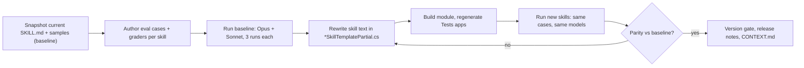

# Shrink the Blazor agent skills, proven by before/after evals

## Context

The Blazor agent skills were written and tuned against an older, weaker model. Today they come to about 225 KB of generated `SKILL.md` and sample files per app. `blazor-app-menu` alone is 38 KB and 348 lines, and repeats its "Region source-of-truth" rules four times.

The goal is to cut the size and simplify the wording **with no drop in the output agents produce**. That needs an eval suite that gives a baseline before anything changes, and the same suite has to show the reduced skills match it.

Here is a worked example. An agent gets the task "implement the Add Customer page" in a MudBlazor app with a skeleton `.razor.cs`.

- Today it loads the 9 KB `blazor-page-adding-entity` skill, reads two samples, and produces a page.
- The eval runs that task 3 times on Opus and 3 times on Sonnet, then grades the result. Example checks: hero header plus main card, `MudDatePicker` with `Placeholder="Select date"`, Save disabled while invalid or loading, no `@code`, enums verified, and `dotnet build` passes.
- After the reduction the same task runs against a skill of about 4 KB. It must score the same.

**Your answers:**
- Scope: every Blazor skill, in both modules.
- Runner: the skill-creator eval and benchmark harness.
- Models: Opus and Sonnet.
- Location: the evals are committed inside the modules.

## Approach

**No designer or model changes are needed.** Each skill's markdown is a raw string inside its template constructor, and that constructor is marked `[IntentManaged(Mode.Fully, Body = Mode.Ignore)]`. The content is therefore hand-owned and can be edited in place. Sample files are static content under each module's `content/` folder.

### Skills in scope

| Skill folder | `Intent.Blazor` (Bootstrap) | `Intent.Blazor.Components.MudBlazor` |
|---|---|---|
| `blazor-page-adding-entity`, `-editing-`, `-search-`, `-view-` | yes | yes |
| `blazor-dialog-adding-entity`, `-editing-` | yes | yes |
| `blazor-app-menu` | yes | yes |
| `blazor-ux-theme-sync` / `mudblazor-ux-theme-sync` | yes | yes |
| `updating-styling` | yes (always emitted) | n/a |

There are no Blazor.Authentication skills. The instruction files (`blazor-general`, `blazor-mudblazor-general`, `ui-modeling-blazor`) are not skills, so they are out of this cut.

### Eval design (skill-creator harness)

Each module gets an `evals/` folder at its root, beside `content/`, so it is not packaged into the `.imod`. Layout:

- `evals/<skill>/evals.json` holds the cases. Each case has a prompt, the fixture app, setup files and its assertions.
- `evals/baseline/<skill>/` holds the frozen current `SKILL.md` and samples. This is the "old skill" arm of the benchmark.
- `evals/fixtures/` holds skeleton and "already implemented" `.razor` and `.razor.cs` overlays. Setup copies them over the target page.
- `evals/graders/` holds the deterministic checks, which are regex or structural assertions.
- `evals/README.md` explains how to re-run the suite the next time the skills change.

**Fixtures.**
- **MudBlazor cases** run on a temporary copy of an existing test app:
  - `Tests/Blazor.InteractiveServer.Jwt` for Auth cases.
  - `Tests/Blazor.InteractiveAuto.*` for the hosted WASM `.Client` cases.
  - `Tests/Blazor.Standalone` for NoAuth cases.
- **Bootstrap cases.** No test app produces the Bootstrap variants; every Blazor test app has MudBlazor installed. They get a minimal Bootstrap fixture under `evals/fixtures/bootstrap/`, made from a stripped copy of a test app. Their baseline is taken from the template raw strings at HEAD.

**Grading.** Every case is graded in three layers:
1. Deterministic assertions taken from each skill's Definition of Done and Forbidden list.
2. A `dotnet build` of the fixture copy.
3. An LLM-judge rubric for qualitative items, such as matching the sample's visual structure and preserving existing logic.

Each skill gets the cases below (representative rather than exhaustive):

| Skill | Cases | Key assertions |
|---|---|---|
| page add / edit | skeleton code-behind; implemented code-behind; enum + date + child collection + nullable object | hero + card layout; `Placeholder="Select date"`; Save disabled when invalid or loading; collection buttons only when `AddX`/`RemoveX` exist; `var index = i`; no `@code`; implemented methods byte-identical; no invented services or enum members |
| search / view | skeleton; implemented | table or detail layout matches sample; no editable controls on view; existing load and navigation untouched |
| dialog add / edit | skeleton; implemented | dialog chrome from sample; cancel and submit flow; no service calls in `.razor` |
| app-menu | Auth: Sider + Header + Profile items with roles, policy, login-only; NoAuth gated item; hosted WASM `.Client` sync; unknown region; footer described; theming disabled; re-run idempotence | `Roles="A,B"`, `Policy="X"`, bare `AuthorizeView`, no `NotAuthorized` on gated items; NoAuth reports and adds no auth registration; fallback to Sider plus a note; Footer file created with chrome from the sample; no `ThemeToggle` when theming is disabled; `MainLayout` never gets a Profile reference; no duplicate hrefs on a second run |
| theme-sync | design.md palette change; dark mode tokens | tokens updated in `ux-tokens.css` only; MudTheme mapping consistent; no hardcoded hex in components |
| updating-styling | restyle a component | uses `var(--token)`; shared stylesheets not modified; component css minimal |

**Parity criterion.** Each configuration (skill, case and model) runs 3 times, on both Opus and Sonnet.
- The new arm passes if no assertion's pass rate drops by more than 1 run out of 3 against baseline.
- The build pass rate must be unchanged.
- The judge score must stay within the run-to-run spread seen in the baseline.

Token use and wall time are recorded as the secondary win.

<Callout tone="warning">
Running both arms 3 times on two models costs a lot. That is roughly 25 cases x 2 arms x 2 models x 3 runs, about 300 agent runs, before any iterations. To keep the cost down, each failing skill is iterated on Sonnet alone, and the full matrix runs once at the end. Sonnet goes first because it is the model most likely to have relied on the verbose wording.
</Callout>

### Reduction rules, applied to every skill

- **One Definition of Done.** The checklist keeps only the verifiable items. Prose that restates a checklist item is deleted.
- **State each rule once.** App-menu's four copies of the region source-of-truth become one table. Rules shared across the CRUD skills (mandatory reading, utility-class grep, styling tokens, the `.razor.cs` skeleton vs implemented assessment) become one tight block per skill, with the same wording in every skill.
- **Let the samples carry the layout.** Markup the sample already shows is not described in prose. The skill says "copy the chrome verbatim from the sample" and lists only what must not change.
- **Remove narration.** That means history, motivational language ("STOP — you MUST"), and rationale a capable model doesn't need. Short reasons stay where they prevent a known mistake.
- **Fix contradictions.** App-menu says both "do not add Login/Register/Manage/Logout by default" and that the Profile menu's fixed Login/Register/Logout come from the sample. It will say this instead: the fixed account actions come from the sample, and user-described items are added beside them.
- **Keep the frontmatter `description` and `paths` behaviour-equivalent.** These drive skill triggering, so they change only by trimming.

Size targets are guides rather than gates; parity is the gate.

| Skill | Now | Target |
|---|---|---|
| `blazor-app-menu` | 38.7 KB | 12–15 KB |
| CRUD skills (each) | 7.6–9.8 KB | 3.5–5 KB |
| `mudblazor-ux-theme-sync` | 13.2 KB | 6–7 KB |
| `updating-styling` | 9.3 KB | 4–5 KB |

Sample files are unchanged in this cut. They are the behaviour reference the shortened text leans on, and `SkillSampleOverwritePolicy` already ties sample overwrites to the `SKILL.md` hash.

## Model changes

None. The skill text sits in constructor bodies marked `Body = Mode.Ignore`, so no Module Builder elements, TemplateIds or registrations change.

## Code changes

- `Modules/Intent.Modules.Blazor.Components.MudBlazor/Templates/MudBlazor*Skill/*TemplatePartial.cs` (8 skills): rewrite the `FromMarkdown` raw string.
- `Modules/Intent.Modules.Blazor/Templates/Templates/AI/Blazor*Skill/*TemplatePartial.cs` (9 skills): apply the same reduction to each Bootstrap twin, keeping the Bootstrap-specific control mapping.
- `Modules/Intent.Modules.Blazor{,.Components.MudBlazor}/evals/**`: new. Cases, fixtures, graders, baseline and README.
- Release notes, `CONTEXT.md` and `docs/README.md` in both modules.

## Steps

1. **Phase 1 and 2 gates.**
   - Read `CONTEXT.md` for both modules.
   - Run `module-version-increment` for `Intent.Blazor` and `Intent.Blazor.Components.MudBlazor`, both at 2.1.0. Bump only if 2.1.0 is already published.
   - Confirm that `evals/` is excluded from the `.imodspec` packaging.
2. **Freeze the baseline.**
   - Copy each current MudBlazor `SKILL.md` and its samples from `Tests/Blazor.InteractiveServer.Jwt/.agents/skills/` into `evals/baseline/`.
   - For Bootstrap, extract the raw strings from the templates at HEAD.
3. **Author fixtures and cases.**
   - Skeleton and implemented overlays for one entity that has an enum, a date, a lookup and a child collection, taken from the test apps' existing services and DTOs.
   - App-menu cases across the Auth, NoAuth and hosted WASM apps.
   - The Bootstrap fixture.
4. **Author graders.**
   - Deterministic assertions per skill.
   - A build check.
   - A judge rubric drawn from each skill's Definition of Done.
5. **Run the baseline** on Opus and Sonnet, 3 runs each, and save the benchmark output as `evals/results/baseline.json`. Inspect any case that is flaky in the baseline itself, and fix the case before going on.
6. **Rewrite the MudBlazor skills** following the reduction rules, starting with `blazor-app-menu`. Then build with `dotnet build --no-incremental`.
7. **Regenerate the MudBlazor test apps** and inspect the `SKILL.md` diffs. Only the content and `contentHash` should change; the samples should be untouched.
8. **Run the new arm, then compare.**
   - Run Sonnet first, and iterate on any skill that regresses.
   - Then run the full matrix and record `evals/results/after.json` along with a short comparison summary.
9. **Port the reductions to the Bootstrap twins** and run the Bootstrap cases on both arms.
10. **Close out** in this order: confirm the version, then the dependency audit (no change expected), then the release notes (the skills are shorter, the app-menu Login/Register wording is clarified, and an eval suite is added), then the docs, then `CONTEXT.md`. `CONTEXT.md` gets the eval suite's location and parity rule, and the invariant that a skill text change must be re-benchmarked.

## Critical files / elements

- `Modules/Intent.Modules.Blazor.Components.MudBlazor/Templates/MudBlazorAppMenuSkill/MudBlazorAppMenuSkillTemplatePartial.cs`: the largest skill (45 KB of source).
- `Modules/Intent.Modules.Blazor/Templates/Templates/AI/BlazorAppMenuSkill/BlazorAppMenuSkillTemplatePartial.cs`: its Bootstrap twin.
- `Modules/Intent.Modules.Blazor/Templates/Templates/AI/StaticContentTemplateRegistrations/SkillSampleOverwritePolicy.cs`: the hash-gated sample overwrite. Read it, don't change it.
- `Modules/*/content/ComponentSkillSamples/**`, `content/GeneralSkillSamples/blazor-app-menu/**`: the samples, unchanged.
- `Tests/Blazor.InteractiveServer.Jwt`, `Tests/Blazor.InteractiveAuto.Jwt`, `Tests/Blazor.Standalone`: the eval fixture sources and regeneration targets.

## Verification

- Benchmark parity on Opus and Sonnet as defined above, with the comparison summary committed under `evals/results/`.
- `dotnet build --no-incremental` passes for both modules.
- The Tests apps regenerate with `SKILL.md`-only diffs, and those diffs are read before they are accepted.
- Size report: bytes and lines per skill, before and after.

## Open questions resolved

- **Q:** Which skills? **A:** Every Blazor skill, in both modules.
- **Q:** Eval runner? **A:** The skill-creator harness.
- **Q:** Models? **A:** Opus and Sonnet.
- **Q:** Where do the evals live? **A:** Committed inside the modules.

## Deferred

- Trimming the sample files. The same suite can measure that later as a second cut.
- Shrinking the general instruction files (`blazor-mudblazor-general.instructions` is 21.8 KB).
